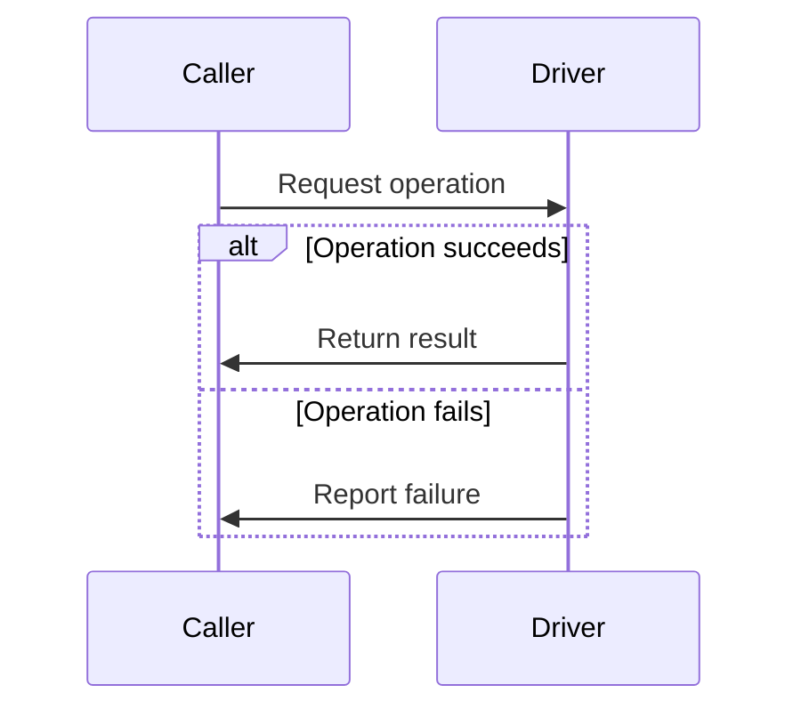

# [Driver name] contract

## Overview

[Name the caller, the capability this Driver owns, and the result it produces.
State which configurations support it and which responsibilities belong to an adjacent Driver.]

## Interface

[Link the exported interface and its callers. In each table, list required
members first, then optional members. Use only `Required` or `Optional` in the Requirement
column, as declared by the exported type. For optional members, describe the
default, fallback, or unavailable feature in the value or behavior column.]

### Properties

| Property              | Requirement | Value and meaning                           |
| --------------------- | ----------- | ------------------------------------------- |
| `<required property>` | Required    | [Value and what it identifies or declares.] |
| `<optional property>` | Optional    | [Meaning and default when omitted.]         |

### Methods

| Method              | Requirement | Caller and behavior                                     |
| ------------------- | ----------- | ------------------------------------------------------- |
| `<required method>` | Required    | [Caller, inputs, result, and effect.]                   |
| `<optional method>` | Optional    | [When the caller needs it and what happens if omitted.] |

[Omit empty groups. Add Interface subsections for facets, input types, or
operations that need more detail.]

## IAM

[Identify the acting identity, who authorizes the operation, the exact resource
scope, and the result of a denial. Explain which credentials or references cross
the Driver boundary.]

## Lifecycle

[Use a Mermaid sequence diagram. Replace the sample participants and messages
with the actual callers and operations. Show the trigger, handoffs, and terminal
result. Include readiness checks, failure, retry, or cleanup when they apply.]

[Briefly explain any retry or cleanup rules the diagram needs. Distinguish the
Driver instance from the resources it manages.]

## Configuration

[Identify the configuration scope and when changes take effect. List required
settings before optional settings, using only `Required` or `Optional` in the
Requirement column. Include defaults, constraints, and omission behavior in the
last column. Use separate tables for Installation and per-resource settings.]

| Setting              | Type     | Requirement | Value, default, and constraints                    |
| -------------------- | -------- | ----------- | -------------------------------------------------- |
| `<required setting>` | `<type>` | Required    | [Meaning and accepted values; no default.]         |
| `<optional setting>` | `<type>` | Optional    | [Meaning, constraints, and behavior when omitted.] |

[Link the shared selection and configuration contract. Keep implementation-specific
fields and examples in the implementation references. If there are no shared
settings, say so and omit the empty table.]

## Limits

[State supported combinations, enforced limits, and behavior outside those limits.]

## Troubleshooting

| Symptom              | Check                                      | Recovery and expected result      |
| -------------------- | ------------------------------------------ | --------------------------------- |
| [Observable failure] | [First check that distinguishes the cause] | [Action and evidence of recovery] |

## Implementations

- [Link each supported implementation and state its selection or support limits.]

## Related

- [Link the owning feature, adjacent contracts, runtime flow, or verification guide.]
