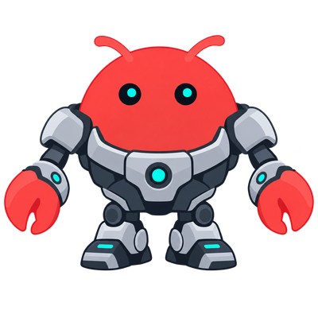

# OpenClaw Enterprise

OpenClaw Enterprise (OCE) is the open source, vendor neutral platform for managing agents. Think of it as Kubernetes for agents.



OCE includes the [OpenClaw Control Plane (OCC)](docs/guides/concepts.md#control-plane)
for deploying and managing [Agents](docs/guides/concepts.md#agents-and-revisions).
Start with [Getting Started](docs/README.md) to use the platform, [Deploy & Operate](docs/guides/operate/README.md) to administer it, or [Contribute](docs/contributing/README.md) to change its source.

## Getting started

Choose one OpenShell installation path: [local k3d](docs/guides/deploy/local-setup.md), [Kubernetes](docs/guides/deploy/kubernetes-setup.md), or [Amazon EKS](docs/guides/deploy/eks-openshell-setup.md). Then [deploy your first Agent](docs/guides/deploy/deploy-first-agent.md) and use its saved operator session for [Add Git](docs/guides/repository-credentials/openshell-git-push.md), [Add Plugin](docs/guides/integrations/codex-plugins.md), and [Delete Agent](docs/guides/deploy/quickstart-delete-agent.md). For the [local quickstart without OpenShell](docs/guides/quickstart.md), run from the repository root:

```bash
go build -trimpath -o bin/occ ./cmd/occ
export OCC_DEVELOPMENT_COMPUTE_DRIVER=kubernetes
export OCC_DEVELOPMENT_CONTROL_PLANE=kubernetes
export OCC_DEVELOPMENT_SANDBOX_DRIVER=none
./bin/occ dev up
```

This selects the Kubernetes-only profile for Agent deployment. With no profile
selection, `occ dev up` starts a Compose control-plane preview that cannot deploy
Agents.

You need Docker Engine or Podman, k3d, kubectl, Helm, Bash, Python 3, Go (the version in [`go.mod`](go.mod)), Node.js 24.22.1 or newer, and the pnpm version in [`package.json`](package.json). The quickstart covers installation checks, the local API credentials, and cleanup.

For a dedicated OpenShell Codex Agent, complete [local k3d setup](docs/guides/deploy/local-setup.md), then [deploy and onboard your Agent](docs/guides/deploy/deploy-first-agent.md). For an existing installation, [deploy and verify an Agent](docs/guides/deploy/production-agents.md).

Reuse settings with [Agent Presets](docs/guides/topics/agent-presets.md), then fill variables and review the copied draft in the console.

## Develop

Follow [Make your first platform change](docs/contributing/first-change.md) for
setup, a small source edit, and focused verification. You need Node.js 24.22.1 or
newer, the pnpm version pinned in [`package.json`](package.json), and the Go
version selected by [`go.mod`](go.mod).

Use the [local checks](docs/testing/local.md) for the current formatting, lint,
type, CLI, and API commands; follow the [contribution policy](CONTRIBUTING.md)
before opening a PR. [Testing](docs/testing/README.md) explains additional
PostgreSQL, Docker/Podman, and Kubernetes setup; [CI coverage](docs/testing/ci.md#github-actions)
distinguishes PR-safe checks from protected integrations.

## Code layout

| Path                                          | Responsibility                                                                                  |
| --------------------------------------------- | ----------------------------------------------------------------------------------------------- |
| `apps/controller/`                            | HTTP API, browser console, worker, and [Drivers](docs/guides/concepts.md#drivers-and-backends). |
| `packages/contracts/`                         | Resource models, Driver interfaces, and API schemas.                                            |
| `packages/occ/`                               | Resource lifecycle, persistence, and work queue.                                                |
| `packages/iam/`                               | Identities, roles, and resource authorization.                                                  |
| `packages/audit/`                             | Audit events and sensitive-value sanitization.                                                  |
| `cmd/occ/`                                    | Go entry point for the OCC domain CLI.                                                          |
| `internal/occcli/`                            | OCC resource commands and human or structured output.                                           |
| `internal/occclient/`                         | Internal Go client that owns OCC transport and authentication.                                  |
| [`packages/utils/`](packages/utils/README.md) | Shared validation, hashing, and object helpers.                                                 |
| `tests/`                                      | Conformance and integration tests.                                                              |

## Documentation

Run `npm run docs:install` once, then `npm run docs:dev` to preview the docs at <http://127.0.0.1:4173>.
Use `npm run docs:build` for the full static build. See the
[local preview instructions](docs/local-preview.md) for setup and checks.

- [Getting Started](docs/README.md) and [Concepts](docs/guides/concepts.md): setup, the first Agent, and the product model.
- [Topics](docs/guides/topics/README.md) and [Integrations](docs/guides/integrations/README.md): feature behavior and named implementations.
- [Deploy & Operate](docs/guides/operate/README.md) and [Reference](docs/reference/README.md): platform operations, the CLI, and the HTTP API.
- [Contribute](docs/contributing/README.md): development, design, and documentation.

## Contributors

Thanks to everyone contributing code, documentation, reviews, and ideas.
See the [full contributor graph](https://github.com/openclaw/openclaw-enterprise/graphs/contributors)
and [how to update recognition](CONTRIBUTING.md#recognize-contributors).

<!-- contributors:start -->

<a href="https://github.com/aitrawog"></a> <a href="https://github.com/anmol0b"></a> <a href="https://github.com/derekwaynecarr"></a> <a href="https://github.com/drew"></a> <a href="https://github.com/ericcaiwx-star"></a> <a href="https://github.com/ericcurtin"></a> <a href="https://github.com/freeqaz"></a> <a href="https://github.com/gauravprasadgp"></a> <a href="https://github.com/goutamadwant"></a> <a href="https://github.com/ilaigold"></a>
<a href="https://github.com/IsaiahStapleton"></a> <a href="https://github.com/jacobtomlinson"></a> <a href="https://github.com/jalehman"></a> <a href="https://github.com/jhjaggars"></a> <a href="https://github.com/joshavant"></a> <a href="https://github.com/jwboyer"></a> <a href="https://github.com/kevinslin"></a> <a href="https://github.com/Kimiyu-186"></a> <a href="https://github.com/miguelbranco80"></a> <a href="https://github.com/mrunalp"></a>
<a href="https://github.com/natedemoss"></a> <a href="https://github.com/PalmPalm7"></a> <a href="https://github.com/Patrick-Erichsen"></a> <a href="https://github.com/prakash-oai"></a> <a href="https://github.com/RaymondMcCreesh"></a> <a href="https://github.com/rclarke0"></a> <a href="https://github.com/RomneyDa"></a> <a href="https://github.com/russellb"></a> <a href="https://github.com/sallyom"></a> <a href="https://github.com/SebTardif"></a>
<a href="https://github.com/sjenning"></a> <a href="https://github.com/steipete"></a> <a href="https://github.com/stevenlee-oai"></a> <a href="https://github.com/sunnymodi"></a> <a href="https://github.com/sunnymodi21"></a> <a href="https://github.com/vincentkoc"></a> <a href="https://github.com/virusimmortal00"></a>

<!-- contributors:end -->

## License

[MIT](LICENSE). Third-party components retain their own licenses.
