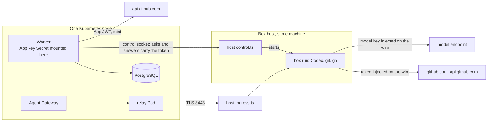

# Runbook: a real end-to-end Strands Box test against GitHub

From an empty host to the result in [What was proven](README.md#what-was-proven):
an Agent inside OCE and Box opens a draft pull request on github.com with a
token the Worker minted from the GitHub App key. Failures and fixes:
[RUNBOOK-TROUBLESHOOTING.md](RUNBOOK-TROUBLESHOOTING.md).

## 1. What counts as a valid test

It passes only when all of these hold for one turn:

- [ ] A new draft pull request in your test repository, author the App's bot
      (`author.is_bot` true).
- [ ] The Agent ran stock `git push` and `gh pr create --draft` inside Box.
- [ ] OCE has a prepared attempt with issuer
      `https://api.github.com#default-https-trust` and use rows for it.
- [ ] The host journal shows `POST credential-asks` and `POST credential-answers`
      during the turn.
- [ ] `GITHUB_TOKEN` and `OPENAI_API_KEY` inside Box are placeholders, and a
      search finds no token, model key or App key in the workload, Box's
      runtime directory or the logs.

| Part    | Must be real                                                                                  | Stand-ins in this tree that do not count                                                                             |
| ------- | --------------------------------------------------------------------------------------------- | -------------------------------------------------------------------------------------------------------------------- |
| Box     | the [fork build](README.md#which-box-build), started by `host/control.ts`                     | the `box run` stand-in in `tests/conformance/strands-box-protected*.test.ts`; released Box                           |
| GitHub  | `github.com` and `api.github.com` by public DNS                                               | the tests' controlled GitHub origin; any local origin pinned in `/etc/hosts` or CoreDNS                              |
| Token   | an installation token the Worker mints from the App key per request; Box injects it at egress | a personal token, `gh auth login`, any token in the workload's environment, files or prompt                          |
| Clients | stock `/usr/bin/git` and a released `gh`                                                      | credential helpers, custom remotes, draft-pull helpers                                                               |
| Agent   | a dedicated Codex Agent deployed through OCE, with one repository binding                     | the native check, the [ordinary-chat](ordinary-chat/README.md) fixture, the workspace verifier                       |
| Model   | a real model at an HTTPS `POST <base>/v1/responses`, key stored in OCE and injected by Box    | `ordinary-chat/serve-installed-model.ts` (marker); `git/controlled-git-model.ts` (scripted, stand-in rehearsal only) |

What the existing checks prove and do not:

- **`verify-native.ts`**: Box starts Codex and fences the workspace. No OCE,
  model or GitHub.
- **[Ordinary chat](ordinary-chat/README.md)** and
  **[installed ordinary chat](ordinary-chat/installed.md)**: OCE drives Box and
  the file node for one turn. Synthetic model, no credentials, no GitHub.
- **`strands-box-protected.test.ts`, `-protected-gh.test.ts`**: Driver, host
  and OCE decisions with stock `git` and `gh`. Stand-in Box and GitHub.
- **`strands-box-source-native.test.ts`, `-model-native.test.ts`**: a real Box
  asks a request-time source and injects a model key. No installed OCE, no
  github.com.

## 2. Inputs

- **GitHub App**: Contents and Pull requests read and write, Metadata read;
  installed on **only** the test repository; one private key (`.pem`). The
  lookups below are standard GitHub reads (not verified with this runbook).
  - App ID: `gh api apps/<app-slug> --jq .id`
  - repository ID and default branch:
    `gh api repos/<owner>/<repo> --jq '.id, .default_branch'`
  - installation ID: the number ending the installation's settings URL,
    `.../settings/installations/<installation-id>`
- **Test repository** you own, its default branch protected.
- **Model endpoint**: HTTPS `POST <base>/v1/responses` (no WebSocket), bearer
  key, answering for the `<model-id>` the Configuration sends (step 8). A
  name (here `model.example.test`) with one private IPv4 the host reaches. A
  privately signed certificate needs its CA in Box's upstream bundle (step 9).
- **Host**: Ubuntu 24.04 x86-64. The proven runs used one 16 vCPU, 32 GiB,
  80 GB virtual machine for K3s, PostgreSQL, OCE and the Box host.
- **OCE**: this branch, and Docker Buildx for `linux/amd64` images.

## 3. The picture



The App key lives only in a Secret mounted into the Worker. The installation
token exists only in the Worker, one answer through the host, and Box's
outgoing request.

## 4. Steps

Run as the nonroot operator (here UID 1000) unless marked `sudo`. Private
files `0600`, private directories `0700`.

### Step 1. Prepare the host

```bash
sudo apt-get install -y git jq curl ca-certificates bubblewrap uidmap openssl python3
sudo mount -o remount,exec /run        # Box's runtime directory is under /run; until reboot
sudo install -o root -g root -m 0755 <node-24.22.1>/bin/node /usr/local/bin/node
sudo install -d -o "$USER" -g "$USER" -m 0700 /home/node
```

Install Node 24.22.1 (checksum-verified) and pnpm through `corepack`; run
`pnpm install --frozen-lockfile` in the OCE checkout on the host. For user
namespaces see the [known gap](KNOWN-GAPS.md#ubuntu-2404-restricts-unprivileged-user-namespaces);
the runs loaded AppArmor profiles with `userns,` and `flags=(unconfined)` for
`/usr/bin/bwrap` and the Box programs' directory.

**Check:** `bwrap --unshare-all --die-with-parent --ro-bind / / true` exits 0;
`findmnt -no OPTIONS /run` lacks `noexec`; `realpath /usr/local/bin/node` is
itself.

### Step 2. Build Box and the host programs

Build and install the three Box programs side by side as in
[Which Box build](README.md#which-box-build), in a directory the AppArmor
profile covers. Build the [workspace verifier](workspace-verifier/README.md)
with `GOARCH=amd64`. From the OCE checkout:

```bash
pnpm exec tsc -p deploy/examples/strands-box/host/tsconfig.agent.json --outDir <out>
sudo cp -a <out>/. /opt/oce-box/compiled-agent/ && sudo chown -R root:root /opt/oce-box
sudo install -D -m 0755 oce-workspace-verifier /opt/demo/verifier/oce-workspace-verifier
```

Install a released `gh` (the runs used 2.103.2) at `/usr/local/bin/gh`.

**Check:** `EXPERIMENTAL_X86_SUPPORT=TRUE <box-dir>/strands-box --version`
prints a version (not verified; the runs proved Box by the native check).

### Step 3. Build the images

- **Runtime**: [Build a local runtime image](../../runtime/README.md#build-a-local-runtime-image),
  `--platform linux/amd64`.
- **Controller with the Driver**: `node deploy/examples/strands-box/driver/build.ts`
  and `pnpm --dir deploy/examples/strands-box/driver pack`, then a Controller
  image with that package as a direct `apps/controller` dependency at `0.1.6`
  ([package identity](../../../docs/reference/drivers/selection.md#package-identity-and-factory-exports)).
  The runs added one stage over the stock `runtime` target that copied the
  unpacked package into
  `/app/apps/controller/node_modules/@openclaw-enterprise/example-strands-box-driver/`
  and added it to `/app/apps/controller/package.json`, without updating
  `pnpm-lock.yaml` (not the documented procedure).
- **Relay**: `docker buildx build --platform linux/amd64 -f deploy/examples/strands-box/ingress/relay.Dockerfile --build-arg NODE_IMAGE=<node:24.22.1-bookworm-slim@sha256:...> deploy/examples/strands-box/ingress`.

Use each by digest. On the host, copy the runtime image's `/app`,
`/opt/oce/runtime` and `/usr/bin/tini` to the same paths, root-owned. Unpack
the same image to `/srv/oce-file-node/runtime` (operator-owned, `0700`) as the
file node's root, with an empty `etc/hosts`. Point Codex at the native binary:

```bash
CODEX=$(realpath -e /app/node_modules/openclaw/node_modules/.pnpm/@openai+codex@*-linux-x64/node_modules/@openai/codex/vendor/x86_64-unknown-linux-musl/bin/codex)
sudo ln -sfn "$CODEX" /app/node_modules/.bin/codex
```

**Check:** `"$CODEX" --version` runs; in the Controller image, from
`/app/apps/controller`,
`node --input-type=module -e 'await import("@openclaw-enterprise/example-strands-box-driver")'`
exits 0 (both not verified; the runs relied on the Worker loading the Driver).

### Step 4. Install K3s, PostgreSQL and OCE

Follow the [production installation](../../../docs/guides/deploy/production-installation.md)
and [Prepare each Namespace](../../../docs/guides/deploy/production-agents.md#prepare-each-namespace), with:

- K3s on this host, so the Worker, Gateway and Box host share the node: set
  `controlPlane.nodeSelector` and Compute's node selectors to it.
- `worker.replicaCount: 0` until step 7.
- A Gateway listener above port 1023 (the runs: a ClusterIP Service on
  Envoy's `10443`, its DNS name as `gatewayRouting.hostname`,
  `gatewayRouting.endpointPort: 10443`).
- The `request` and `turn` helpers from
  [operator-session.sh](../../../docs/snippets/openshell-quickstart/operator-session.sh),
  with `base=/namespaces/<namespace-id>`.

**Check:** `request GET "$base"` shows `"status":"ready"`.

### Step 5. Cluster objects for Box

In the Agent's Kubernetes namespace `<agent-ns>` (release namespace here
`oce-system`):

1. The relay [Service](ingress/service.yaml) and the ReplicaSet read Role from
   [Build and select](driver/README.md#build-and-select). Note the ClusterIP.
2. [model-gateway-rbac.yaml](model-gateway-rbac.yaml) for your release namespace.
3. A NetworkPolicy in `oce-system` letting Worker Pods
   (`app.kubernetes.io/component: worker`) reach Pods labelled
   `box.openclaw.dev/component: harness-relay` in `<agent-ns>` on TCP 8443.
   The chart's Worker egress is default-deny.
4. The control directory, local PV and PVC from
   [the control claim checks](driver/worker-control.md); the runs used
   `runtimeDir` `/run/oce-box/revision`.
5. From one dedicated CA, a TLS leaf for
   `box-harness.<agent-ns>.svc.cluster.local` and, if the model is privately
   signed, one for `model.example.test`.

**Check:** the control claim checks 1 to 3 pass.

### Step 6. Register the GitHub App

The registry ConfigMap is immutable: publish each change under a **new** name.

```bash
jq -n --arg ns <namespace-id> '{version:1, backendId:"repository-backend",
  providerInstanceId:"github-com", appId:"<app-id>", githubInstallationId:"<installation-id>",
  maximumDurationSeconds:<seconds>, allowStandingApprovals:true,
  repositories:[{repositoryRef:"<ref>", repositoryId:"<repo-id>", repository:"<owner>/<repo>",
    namespaces:[{namespaceId:$ns, profiles:["github-repository"], allowStandingApproval:true,
      permissions:{metadata:"read", contents:"write", pull_requests:"write"}}]}]}' > registry.json
kubectl -n oce-system create configmap repository-registry-1 --from-file=registry.json \
  --dry-run=client -o json | jq '.immutable = true' | kubectl create -f -
kubectl -n oce-system create secret generic repository-app --from-file=private-key.pem=/dev/stdin \
  --dry-run=client -o yaml < <app-key>.pem | kubectl create -f -
head -c 32 /dev/urandom | kubectl -n oce-system create secret generic repository-custody \
  --from-file=custody.key=/dev/stdin --dry-run=client -o yaml | kubectl create -f -
curl -fsS https://api.github.com/meta | jq -c '[.api[], .git[]] | map(select(test(":") | not)) | unique'
```

Never `kubectl apply` the key (it keeps a copy in the
`last-applied-configuration` annotation). Helm values:

```yaml
repositoryCredentials:
  enabled: false
  delivery: credential-proxy
  authority: prepared-git
  backendId: repository-backend
  registryConfigMapName: repository-registry-1
  appKeySecretName: repository-app
  preparedCustodySecretName: repository-custody
  upstreamCidrs: [<the IPv4 list printed above>]
  upstreamPort: 443
worker:
  replicaCount: 1
  strandsBoxControlClaimName: <control PVC>
```

Leave `preparedProviderCaConfigMapName` and `issuerCaPath` unset: an issuer CA
replaces public trust, and real `api.github.com` is refused. The Worker
resolves through CoreDNS, Box through the host's `/etc/hosts`: neither may pin
`github.com`.

**Check:** the key Secret has no `kubectl.kubernetes.io/last-applied-configuration`
annotation; after step 7, only the Worker Pod mounts it.

### Step 7. Select the Driver and upgrade

Merge into the Installation, keeping your other Compute settings
([Driver fields](driver/README.md)):

```yaml
drivers:
  sandbox:
    id: strands-box
    package: "@openclaw-enterprise/example-strands-box-driver"
    configuration:
      namespace: <agent-ns>
      controlSocket: /run/strands-box/control.sock
      nativeEndpoint: wss://box-harness.<agent-ns>.svc.cluster.local:8443/
      nativeCaBundle: <ingress CA PEM>
      workspaceRoot: /home/node/workspace
      workspaceNodeMode: file-only-v1
      relay:
        image: <relay@sha256>
        hostAddress: <host-ip>
        installation: <label>
        workerPeer:
          namespace: oce-system
          podLabels:
            app.kubernetes.io/name: openclaw-enterprise
            app.kubernetes.io/component: worker
      controlledInference:
        modelBaseUrl: https://model.example.test:<port>/v1
        address: <model-ip>
        caSha256: <bundle sha256>
      protectedRepository: { provider: github }
      modelGateway: { secretNamespace: oce-strands-model }
  credential_proxy: { id: strands-box, configuration: {} }
  credential_gateway: { id: strands-box, configuration: {} }
  compute:
    configuration:
      images: { gateway: <runtime@sha256>, agent: <runtime@sha256>, requireImmutableDigest: true }
      network:
        providerHarness:
          namespace: <agent-ns>
          address: <relay ClusterIP>
          port: 8443
          podLabels:
            box.openclaw.dev/component: harness-relay
            box.openclaw.dev/installation: <label>
      runtime:
        modelProvider:
          protocol: openai-responses
          baseUrl: https://model.example.test:<port>/v1
      servicePrincipalCredentials: { mode: disabled }
backend:
  - id: repository-backend
    type: github
    configuration: { registryPath: /etc/openclaw/repository-registry/registry.json }
    drivers: { repo: repository-credentials }
repository:
  id: repository-credentials
  configuration: { sessionDurationSeconds: <seconds> } # both one hour in the runs
  preparedGitHub:
    privateKeyPath: /etc/openclaw/prepared-repository/private-key.pem
    custodyKeyPath: /etc/openclaw/prepared-repository/custody.key
```

Upgrade, mount the control claim in the single Worker, and run its
[live mount check](driver/worker-control.md#mount-the-empty-control-directory).

**Check:** the Worker is Ready with no Driver load error.

### Step 8. Create the Agent and give it the model

Follow [Configure the Agent runtime](../../../docs/guides/deploy/production-agents.md#configure-the-agent-runtime) with what ran:

- Configuration: `agents.defaults.model: codex/<model-id>`; provider `codex`
  with `api: openai-responses` and model `<model-id>`; plugin `codex` with
  `appServer: { mode: guardian, approvalPolicy: on-request, sandbox: workspace-write, transport: websocket }`;
  `tools.loopDetection.enabled: true`.
- Agent: `executionMode: dedicated`, `gatewayManagedMode: true`, saved
  stopped; `harnessAuth` an `api_key` from a Secret holding the public marker
  `openclaw-strands-controlled-inference-v1`, with an `operate` grant on it;
  then `POST $base/agents/<agent>/runtime-credentials`.
- The two local PVs from [Prepare the original volume](ordinary-chat/installed.md#prepare-the-original-volume).

Then store the model key (from a file, never a command line), register the
source, and bind:

```bash
jq -Rsc '{name:"test model key", value: rtrimstr("\n")}' < <model-key-file> | request POST "$base/secrets" --data-binary @-
jq -n --arg s <secret-id> --arg ns <namespace-id> '{name:"test model", type:"openai",
  config:{authorized_base_url:"https://model.example.test:<port>/v1"},
  secrets:{api_key:{kind:"secret", namespaceId:$ns, id:$s}}}' | request POST "$base/credential-sources" --data-binary @-
request GET "$base/agents/<agent>" | jq --arg s <source-id> '.data | {configurationId,
  repositoryBindings: [{repositoryRef:"<ref>", profile:"github-repository"}],
  credentialSources: [{sourceId:$s}], harnessAuth: {method:"credential_source", sourceId:$s}}' |
  request PATCH "$base/agents/<agent>" --data-binary @-
```

The runs sent the binding and the source in two PATCHes of this shape; one
combined PATCH is not verified. **Check:** the reply shows the binding and
`credential_source`.

### Step 9. Start the host and deploy

1. Write the host configuration from [installed.example.json](host/installed.example.json):
   `owner.implementation` `@openclaw-enterprise/example-strands-box-driver@0.1.6`,
   `codexBin` `$CODEX`, `image` the runtime digest, and
   `upstreamCa: { file, sha256 }` (one bundle: the model CA if private, plus
   the Gateway root CA). Every route must name that bundle's SHA-256:
   `controlledInference.caSha256`, `protectedRepository: { provider: github, caSha256 }`,
   `nativeHookRelay: { caSha256 }`. Add `protectedModel: { revocationDir: <0700 dir> }`
   and `separateWorkspaceNode.caSha256` (the Gateway root CA). Pin
   `model.example.test` and the Gateway route's name in the host's `/etc/hosts`.
2. As in [Start the held host and approve](ordinary-chat/installed.md#start-the-held-host-and-approve):
   `request POST "$base/agents/<agent>/deploy"`; bind the four volume subpaths
   once the claims are `Bound`; start
   `node deploy/examples/strands-box/host/control.ts <host.json>` (the Worker
   waits about 3 minutes); run the live mount check; approve the exact revision
   and digest.
3. On `ready.json`, start [host ingress](ingress/README.md).

**Check:** `request GET "$base/agents/<agent>" | jq .data.activeRevisionId`
names the new revision; the journal shows `stage=native-hook reason=observed`.

### Step 10. The turn

Save the prompt to a file and run `turn <file>`:

```text
Use your shell tool to run the commands below, one at a time, in this order. Run each command exactly as written. Only git and gh are available as programs; do not run any other program.
1. cd /home/node/workspace && git clone https://github.com/<owner>/<repo>.git <dir>
2. cd /home/node/workspace/<dir> && git switch -c review/<branch>
3. cd /home/node/workspace/<dir> && git config user.name <name> && git config user.email <email>
4. cd /home/node/workspace/<dir> && printf 'draft PR test\n' > <file>.txt && git add <file>.txt
5. cd /home/node/workspace/<dir> && git commit -m "test: draft PR from a Strands Box Agent"
6. cd /home/node/workspace/<dir> && git push -u origin review/<branch>
7. cd /home/node/workspace/<dir> && gh pr create --draft --base <default-branch> --title "test: draft PR from a Strands Box Agent" --body "Opened inside the sandbox with stock git and gh. Test only."
Rules: work only with https://github.com/<owner>/<repo> and the branch review/<branch>. Never push to another branch, never force push, never change remotes or other git configuration. Do not read, print or search for credentials, tokens or environment variables. If a command fails, stop and reply with its error text. After step 7 prints the pull request URL, reply with it and stop.
```

The identity is repository-local: no global Git identity exists inside Box.
The model may try Codex Code Mode first and fall back to its shell
([known gap](KNOWN-GAPS.md#codex-code-mode-cannot-run-in-box)).

### Step 11. Verify

```bash
gh pr view <url> --json isDraft,author,headRefName
sudo -u postgres psql -d <database> -c "SELECT state, custody, admission->>'issuerAuthority'
  FROM occ.prepared_github_attempts ORDER BY started_at DESC LIMIT 1"
sudo -u postgres psql -d <database> -c "SELECT operation FROM occ.prepared_repository_git_uses
  ORDER BY authorization_reply_by DESC LIMIT 10"
```

The proven runs had eight uses: `advertise-upload-pack`, two `upload-pack`,
`advertise-receive-pack`, `receive-pack`, three `github-graphql`. Then, as
root, search Box's process environments (`/proc/<pid>/environ`), `/home/node`,
the runtime directory, the host journal and the Worker, API and Agent
namespace logs for `gh[pousr]_` token shapes, PEM private-key blocks and the
model key (compare digests; never print a match). Expect zero, and
`GITHUB_TOKEN` and `OPENAI_API_KEY` starting `strands_box_`. Never run `git`
as root in the workspace.

### Step 12. Optional refusals

In the same chat, `git ls-remote https://github.com/<owner>/<other-repo>.git`
and `gh api repos/<owner>/<other-repo>` fail with `403` and
`credential refused by its source: request_not_allowed`, with no use row. A
PATCH to `repositoryBindings: []` while running makes the next `git ls-remote`
of your repository fail while chat still answers.

### Step 13. Clean up, in this order

1. From your own machine: `gh pr close <url>`, delete the branch, check the
   default branch is unchanged.
2. Stop the Agent (`request POST "$base/agents/<agent>/stop"`) while GitHub is
   still wired. The newest prepared attempt must read `custody` `revoked`;
   `unknown` delays the next revision up to 72 minutes.
3. PATCH the Agent back to the marker `harnessAuth` with
   `credentialSources: []` (not verified: the runs attached another source),
   then `DELETE` the source and its Secret. A referenced source returns `409`.
   For a revoke receipt, withdraw before step 2
   ([known gap](KNOWN-GAPS.md#withdrawing-a-model-source-needs-an-active-revision)).
4. Revoke the model key at its issuer.
5. When done with the App, delete the key and custody Secrets. K3s keeps old
   Secret revisions until it compacts its datastore (every 5 minutes); search
   again after that.
