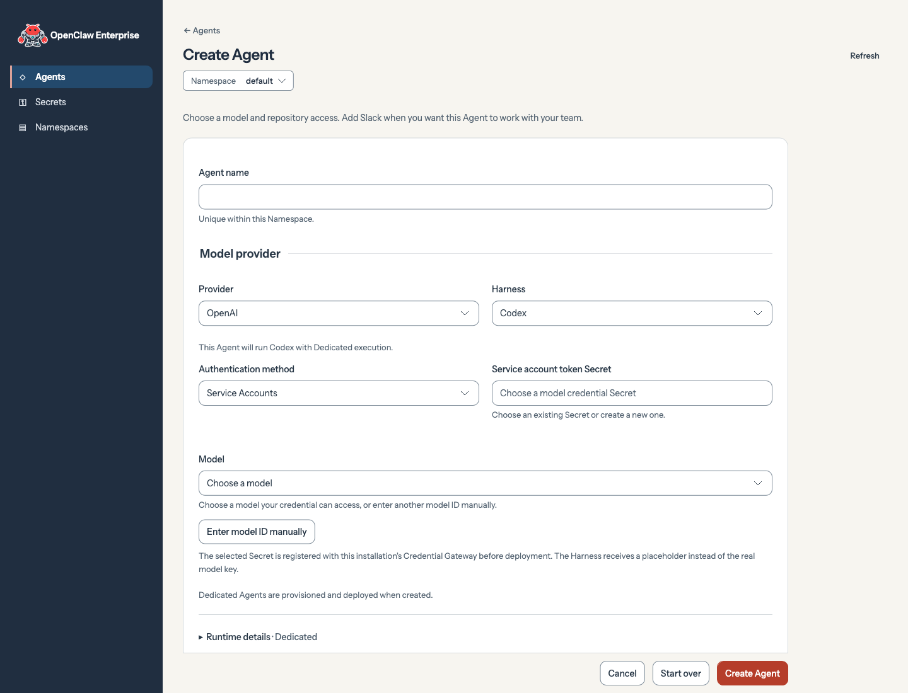
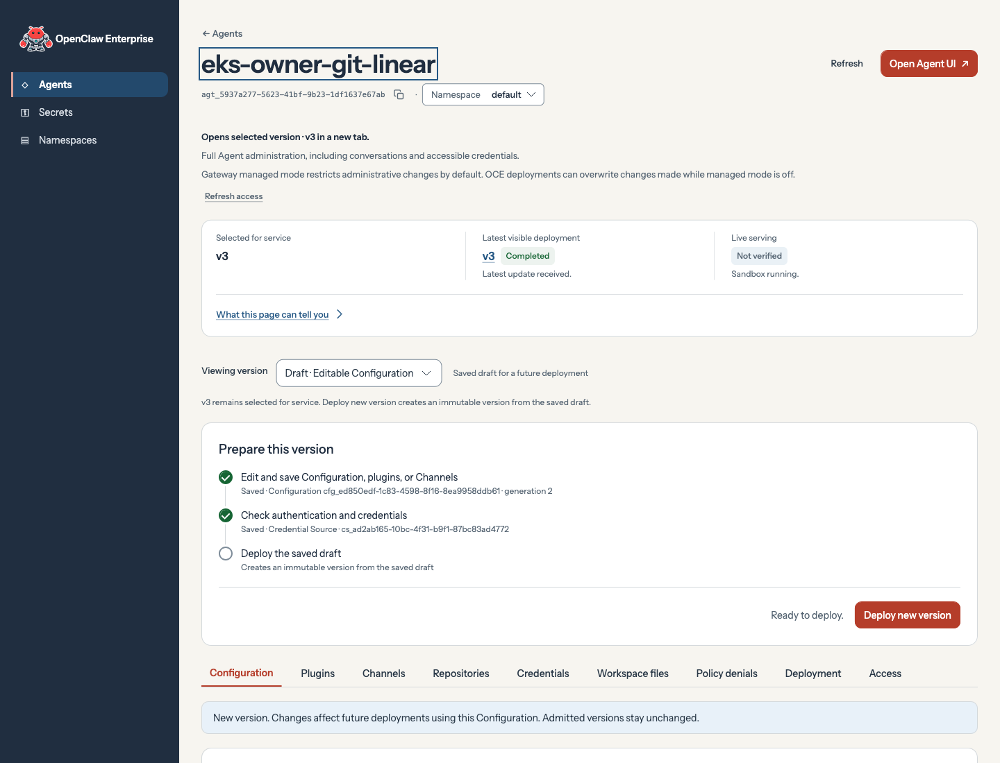

**Create a new Agent.** From **Agents**, select **Create Agent** (`/console/agents/new`), then **Start without Preset**. Enter a unique Agent name. Select **OpenAI**, **Codex**, and **Service Accounts**, then choose the prepared service-account token Secret and its authorized model. Codex uses **Dedicated** execution. With these prerequisites in place, **Create Agent** provisions and deploys the new Agent.

**Deploy an existing Agent’s saved draft.** Open the Agent from **Agents** (`/console/agents/{agentId}`). Under **Viewing version**, select **Draft · Editable Configuration**. In **Prepare this version**, check the saved configuration and credentials, then select **Deploy new version**. Wait for the new version to be selected for service.

**Open a running Agent.** From **Agents**, select the Agent. Under **Viewing version**, select the active version, then select **Open Agent UI** in the page header. Its Control UI opens in a new tab.
