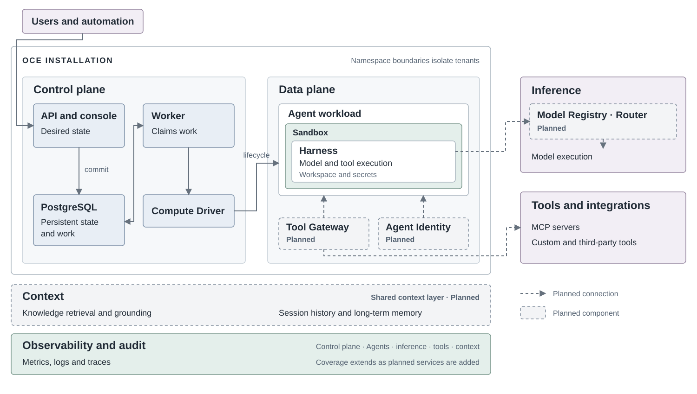

# OpenClaw Enterprise architecture

## Overview

OpenClaw Enterprise (OCE) provides a multi-tenant control plane for configuring,
deploying, and operating Agents. OpenClaw Control Plane (OCC) owns desired state,
authorization, and resource lifecycles. Installation-selected Drivers turn that
state into infrastructure and runtime operations.

See [OpenClaw Enterprise concepts](guides/concepts.md) for detailed explanations
of Installations, Namespaces, Agents, Harnesses, configuration, and identity.

The diagram shows the target architecture. **Tool Gateway, Agent Identity,
Model Registry, Router, and the shared context layer are planned additions.**
Dashed boxes labeled “Planned” and dashed arrows identify these additions and
their pending connections. Solid arrows show implemented relationships, subject
to the [implementation status](#implementation-status) and Driver limits below.

The planned Tool Gateway and Agent Identity components are distinct from the
per-Agent OpenClaw gateways, ServicePrincipals, and Kubernetes identities that
exist today. The Sandbox boundary depends on the selected Compute and Sandbox
Drivers. The shared context layer will cover knowledge retrieval and grounding,
session history, and long-term memory. Metrics, logs, and audit evidence cover
implemented paths today; application tracing remains planned. See
[observability](guides/observability.md) for current signal coverage. Coverage of
planned services will depend on their implementation.

## Details

Each deployment owns exactly one server-selected Installation containing isolated
Namespaces. A Namespace is a logical tenant boundary; it can span more than one
physical Kubernetes namespace. Each deployed Agent owns its gateway and version
history. OCC manages multiple single-Agent runtimes rather than making one
OpenClaw gateway multi-tenant.

The platform supports global Namespace settings. Resource references follow the
scope and authorization rules of each resource type.

OCC owns platform resources. At deployment, it records the selected configuration
and execution settings in an Agent revision. Later edits leave that revision unchanged.
External systems retain ownership of infrastructure, provider accounts, credentials, and model
sources. Drivers operate those systems through interfaces with defined responsibilities; they cannot
grant themselves authorization or change platform-resource ownership.

An Agent inheriting its creator's identity is not yet supported. Gateways and
workloads are runtime components, not an extra execution resource between an
Agent and its deployment. Detailed APIs, storage schemas, and integration
protocols belong to their feature references.

### Implementation status

This is the authoritative architecture overview. It describes the implemented
system and identifies [remaining design work](#remaining-design-work) separately.
The [design chapters](#design-chapters) retain approved requirements; each chapter
states where those requirements exceed current support. Feature references own
supported behavior and limits. Source implementation is not proof that a
particular deployment enforces its networking, storage, or placement requirements.

The API, console, durable worker, PostgreSQL persistence, and Kubernetes packaging
are implemented. Single-cluster Kubernetes execution places Gateway and Harness in one tenant
namespace with separate Pods, identities and storage. External access-gateway admission, workload
token authentication to OCC, and general credential-free model inference remain
planned. The two-cluster profile is experimental.

### Remaining design work

These approved requirements are not established by the implemented architecture:

| Area                         | Current boundary and remaining work                                                                                                                                                                                                                                                                                                                    |
| ---------------------------- | ------------------------------------------------------------------------------------------------------------------------------------------------------------------------------------------------------------------------------------------------------------------------------------------------------------------------------------------------------ |
| Tool Gateway                 | The Tool Gateway component and its tool connections in the target diagram are planned additions. Existing per-Agent OpenClaw gateways remain part of the supported runtime.                                                                                                                                                                            |
| Shared context               | The shared layer for knowledge retrieval, grounding, session history, and long-term memory is planned.                                                                                                                                                                                                                                                 |
| External admission           | Sessions and service keys authenticate to OCC. The separate OpenClaw Access Gateway (OAG) and trusted-ingress admission protocol remain planned. See [access design](design/access.md).                                                                                                                                                                |
| Agent Identity               | The Agent Identity component is planned. Agents own ServicePrincipals and may receive projected Kubernetes tokens. OCC token verification, identity exchange, and workload API authentication remain deferred. See [authorization](reference/authorization.md#principals).                                                                             |
| Model mediation              | Model Registry and Router are planned additions. Harnesses receive scoped model credentials. General `InferenceDriver` mediation, restricted model egress, and credential-free execution remain planned; OpenShell credential substitution is not a supported deployment substitute. See [runtime isolation](reference/security/runtime-isolation.md). |
| Runtime trust                | Separate placement is implemented; general mutually authenticated, workload-bound transport and complete two-cluster runtime acceptance remain pending. See [Kubernetes Compute](reference/drivers/kubernetes-compute.md).                                                                                                                             |
| Resource and policy coverage | Agent-owned SandboxPolicy network additions are implemented. General shared containment policies, the published Harness and Channel resource model, and Restrictions across every integration remain beyond the current contracts. See [resource requirements](design/resources.md) and [Sandbox contract](reference/drivers/sandbox.md).              |

Agent and Plugin Directories, plugin invocation approval workflows, broader audit
export and retention, Budgets, and Routers remain future work. Existing logging
and metrics integrations have their own [operational contracts](guides/observability.md).

## Control Plane

The API serves the console and authorized resource operations. An independent
worker claims operations from the queue and calls the selected Drivers. PostgreSQL stores
platform state, IAM policy, controller work, and audit evidence.

The API authenticates human sessions and non-Agent service keys, resolves an
explicitly provisioned identity, and authorizes exact resource operations.
The console at `/console/` uses these same APIs. GitHub and Google sign-in require
administrator-enrolled identities; neither sign-in nor Namespace membership
grants permissions. See [authentication](reference/authentication.md) and
[authorization](reference/authorization.md).

Resource mutations, queued work, and audit records commit together. The worker
reauthorizes the original actor and protected references before infrastructure
effects, and commits results under its live work claim.
[Platform repositories](reference/platform-repositories.md) defines transaction
ownership and read-only views; the [worker flow](flows/controller-worker.md)
traces dispatch and persistence.

Compose and Helm initialize the Installation after database migration and before
starting the API and worker. Only the initializer mounts bootstrap credential
output. See [startup](flows/platform-startup.md) and
[bootstrap recovery](guides/deploy/service-keys.md#recover-an-incomplete-bootstrap).

| Component            | Responsibility                                                |
| -------------------- | ------------------------------------------------------------- |
| `apps/controller`    | API, console, admission, composition, and worker entrypoints. |
| `packages/contracts` | Resource models, Driver interfaces, and API schemas.          |
| `packages/occ`       | Resource ownership, lifecycle, persistence, and work queue.   |
| `packages/iam`       | Identity lookup and authorization.                            |
| `packages/audit`     | Audit events and sensitive-value sanitization.                |

[Repository layout](layout.md) owns directory placement and package boundaries.

## Data Plane

The data plane runs Agent conversations and tool execution. Each deployed
Agent owns a gateway that receives messages and manages client connections.
Its Harness executes model turns and tools against the Agent's workspace and
selected credentials.

Embedded OpenClaw runs its gateway and Harness together in the data plane.
Dedicated Kubernetes execution uses separate Gateway and Harness Pods, identities
and storage within one tenant namespace in a single cluster. The Gateway uses scoped remote file operations rather than
mounting the Harness workspace. Only the model-executing consumer receives its
model credential; a dedicated Gateway does not.

See [Harness execution](reference/harness-execution.md) for runtime behavior and
limits, and [Agent deployment](design/workloads.md#current-provisioning-sequence)
for the provisioning sequence.

## Drivers

Installation configuration selects compute, configuration, IAM, and Secret
implementations, plus channel and optional service-account, plugin, repository, Sandbox, and
Credential Gateway integrations. [Driver development](contributing/driver-development.md)
links to contracts; [selection](reference/drivers/selection.md) defines trusted
package loading. [Backends](reference/backends.md) supply authenticated clients
to related Drivers within their documented experimental scope. Driver-owned
configuration definitions share schemas and validation across startup and Agent
settings. A contribution registry binds them to existing resource owners, which
retain authorization, persistence, and save/apply lifecycle; see
[configuration discovery](reference/drivers/selection.md#configuration-definitions-and-discovery).

Compute owns Namespace infrastructure and each Agent's gateway and workload
lifecycle: preparation, readiness, activation, stop, retirement, and deletion.
An optional SandboxDriver participates through Compute and can provision a
dedicated Harness. Its cleanup for each Agent revision and Namespace must complete before
Compute releases the corresponding infrastructure.

A CredentialGatewayDriver holds registered model credentials and supplies
attachments for each Agent revision to its paired Sandbox; activation waits for applied
attachments. The OpenShell development profile implements a plugin-free
dedicated Codex path through experimental provider files and bearer passthrough.
Real activation remains conditional on the documented identity, storage,
admission, and gateway-authentication preconditions. See
[Sandbox](reference/drivers/sandbox.md) and
[OpenShell limits](reference/drivers/openshell-sandbox.md).
Other Drivers participate through
[Compute lifecycle hooks](flows/compute-driver-lifecycle-hooks.md) with defined
startup and cleanup operations.

## Security Boundaries

IAM checks exact resources and protected references. Agent-scoped identities,
Namespace isolation, and explicit Secret bindings constrain access. Secret
values stay out of OCC resource responses, Agent revisions, and audit records.
Required authorization or audit failures block mutations.

Operators must configure disjoint trusted Gateway and untrusted Harness node
pools. Sharing a namespace trusts its workload managers with both roles; credential
mounts and NetworkPolicies do not restrict a namespace administrator.

Kubernetes uses restricted Pod security, scoped ServiceAccounts, and
NetworkPolicies. Controller credentials remain trusted within their granted
tenant namespaces: workload-write authority can expose Secrets indirectly.
Model credentials currently reach the executing Harness, and same-cluster
Codex transport uses capability-token `ws://`, not mutually authenticated TLS.
[Security](reference/security.md) and
[runtime isolation](reference/security/runtime-isolation.md) own these limits.

Kubernetes Compute supports [protected execution](reference/credential-sources/protected-inference.md)
with the selected Credential Proxy and a matching OpenShell Sandbox. Compute verifies
the current installation before it signs the workload release. Other Compute Drivers
and readers that cannot interpret the admission refuse it. The bundled OpenShell
release cannot enforce this path; qualify the exact pair before rollout.

### Native admin pilot exception

Trusted human operators with exact-Agent `administer` permission can enter the
[stock OpenClaw admin UI](reference/agent-native-admin.md) through an opt-in pilot.
OCC checks admission and session retention, but does not authorize or audit each
native command. Operators share the selected gateway's exposed conversations
and credentials; this grants no access to another Agent or platform IAM.

Operators can provide a separate [human access path](reference/drivers/kubernetes-compute/gateway-authentication.md)
to the shared Agent. This path does not grant OCC access.

Configuration and AgentRevision records remain authoritative for
managed deployments. Native edits may diverge; OCC neither imports them nor
promises to reset persistent gateway state on redeployment.

## Deployment

The default placement uses one Kubernetes cluster; a second execution cluster is an
[experimental profile](testing/kubernetes.md#two-cluster-validation), with incomplete runtime
acceptance. See [Harness execution](reference/harness-execution.md) and
[Kubernetes Compute](reference/drivers/kubernetes-compute.md).

- **Local Kubernetes:** API, worker, PostgreSQL, and Agent workloads run in an
  owned k3d cluster hosted by Docker or Podman. Start with [Local Setup](guides/quickstart.md).
- **Production Kubernetes:** separate API and worker services manage tenant
  infrastructure and runtimes. Follow [Deploy](guides/deploy.md) for internal
  service exposure, authenticated ingress, and operator prerequisites.
- **Docker or Podman preview:** Compose runs the control plane on loopback.
  [Docker Compute](reference/drivers/docker-compute.md) cannot provide the Harness
  authentication required to deploy Agents through OCC.
- **SSH execution:** embedded OpenClaw runs on preprovisioned Linux hosts.
  Host networking and runtime credentials remain the operator's responsibility;
  see [SSH Compute](reference/drivers/ssh-compute.md).

## Design Chapters

These chapters preserve the approved ownership and security requirements, with
explicit implementation limits. They do not turn planned contracts into
supported capabilities:

- [Resources and tenant boundaries](design/resources.md)
- [Access and authorization](design/access.md)
- [Agent gateways and deployment](design/workloads.md)
- [Drivers and Backends](design/drivers.md)
- [Platform safeguards](design/safeguards.md)
- [Credential Proxy](design/credential-proxy.md)

## Related Documentation

- [Documentation map](README.md)
- [Feature topics](guides/topics/README.md)
- [Runtime flows](contributing/runtime-flows.md)
- [Testing](testing/README.md)
