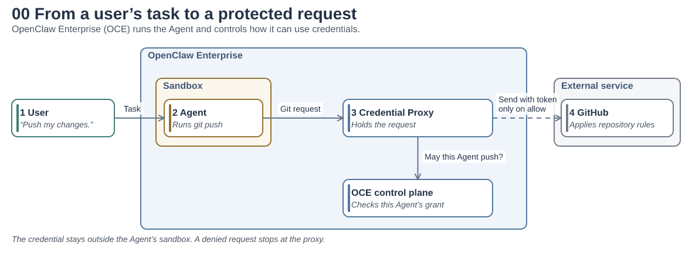
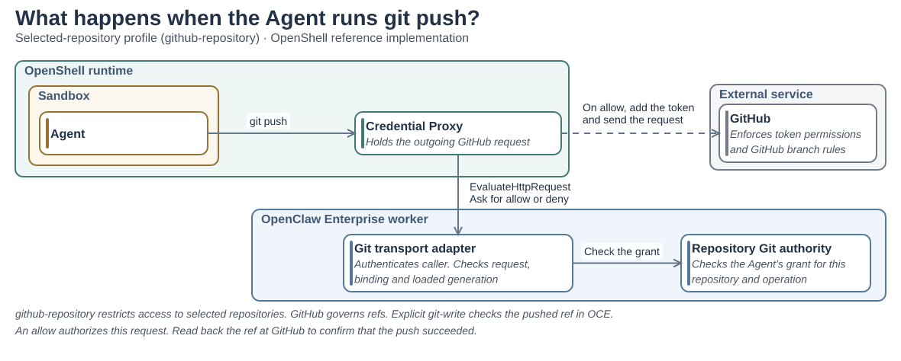
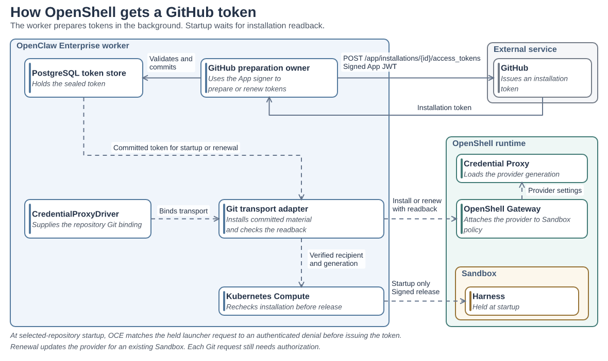
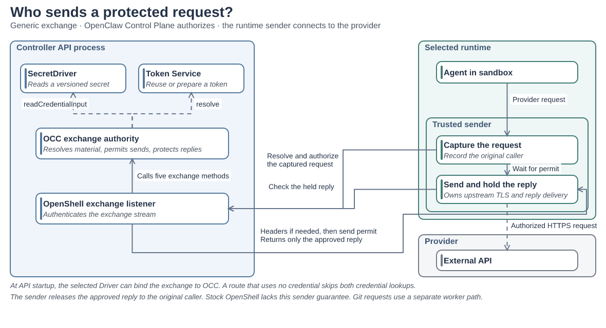
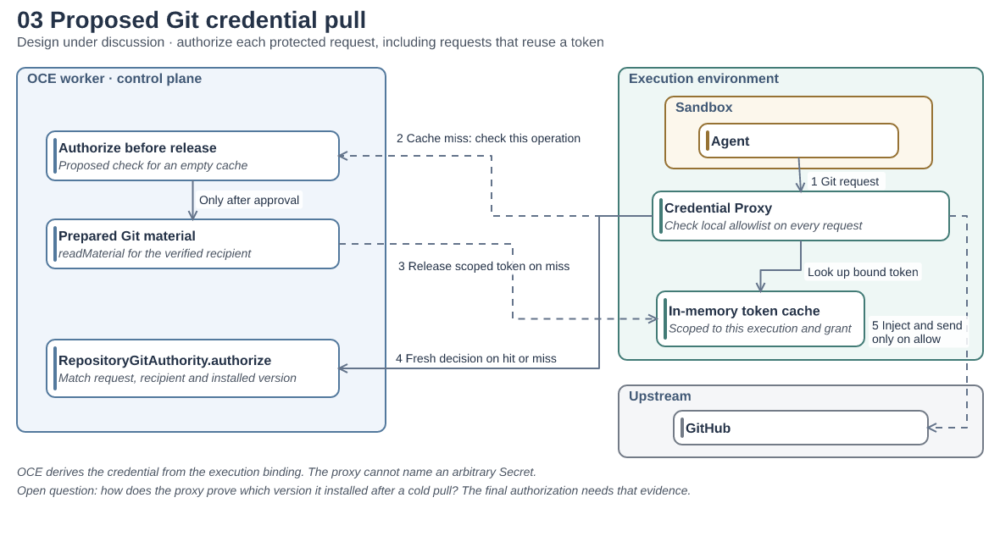
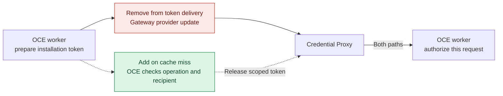

# Credential Proxy architecture

A user asks an Agent, “Implement a feature and push a branch.” OpenClaw Enterprise (OCE) runs the Agent in a sandbox. The Agent runs ordinary Git commands. OCE keeps the GitHub App signing key and the installation token outside that sandbox.

## From the user to GitHub

The task tells the Agent what to do. An operator’s grant determines whether it may do it. The Credential Proxy checks the request against that grant through the control plane. If OCE denies the push, the proxy stops it. If OCE allows it, the proxy adds the credential and GitHub applies its own repository rules.

## How does the Credential Proxy authorize a Git request?

In the OpenShell implementation shown here, the supervisor acts as the Credential Proxy. Its `EvaluateHttpRequest` hook sends the attempted request to the OCE worker. The worker checks who called, which credential version the proxy loaded, and whether the grant covers this operation.

For selected repositories, the grant names repositories on one GitHub App installation. GitHub enforces the token's permissions and branch rules. An exact-ref write grant and the opt-in installation-wide preview have different scopes. The hook's allow reply authorizes the observed request. To find out whether a push succeeded, read back the ref from GitHub. See [OpenShell repository access](../reference/repository-credentials/protected-openshell-git.md).

## How does the token get there?

One OpenShell Backend supplies both `SandboxDriver` and `CredentialProxyDriver`. The worker binds its `ProtectedRepositoryGitAuthority` through `bindRepositoryGit`. See the [Driver contract](../reference/drivers/credential-proxy.md).

GitHub issues the installation token after the worker signs an App JWT. Preparation and refresh run separately from Git requests. On the selected-repository path, OCE checks the held launcher's request against an authenticated middleware denial before issuing credentials. Credential installation and signed release precede Agent startup. See [OpenShell enrollment](../guides/repository-credentials/openshell-enrollment.md) and [token renewal](../guides/repository-credentials/openshell-git-renewal.md).

## Who controls a generic API request and its reply?

The generic `CredentialProxyExchange` also governs what comes back. A qualified sender can ask OCC to resolve a credential, recheck permission just before sending, and protect the complete response before releasing it to the caller. The OpenShell Git hook above authorizes a different protocol. Its allow reply establishes neither exact dispatch nor response filtering. [Walk through a GitHub metadata request](credential-proxy.md#read-one-repositorys-identity).

## Proposed Git credential pull

Today the worker installs the credential through the OpenShell management API. In this proposal the proxy first checks a local allowlist. An unlisted destination stops there. For a listed destination, a cache miss triggers a request for the credential bound to this execution. A hit skips that transfer. Both paths still require a fresh operation decision before the proxy sends.

### What changes for Git?

Red marks the provider update that pull would replace for Git. Green and dashed arrows mark the proposed release check. Sandbox provisioning and other Gateway uses have their own lifecycle.

The open contract question is the first request. Today's `authorize` takes the version already installed at the recipient. Checking the operation **before releasing any token bytes** needs an earlier decision, followed by evidence that the same recipient installed that version. The proposal grants the proxy no general Secret lookup. See the [repository Git authority](../../packages/contracts/src/protected-repository-git.ts).
