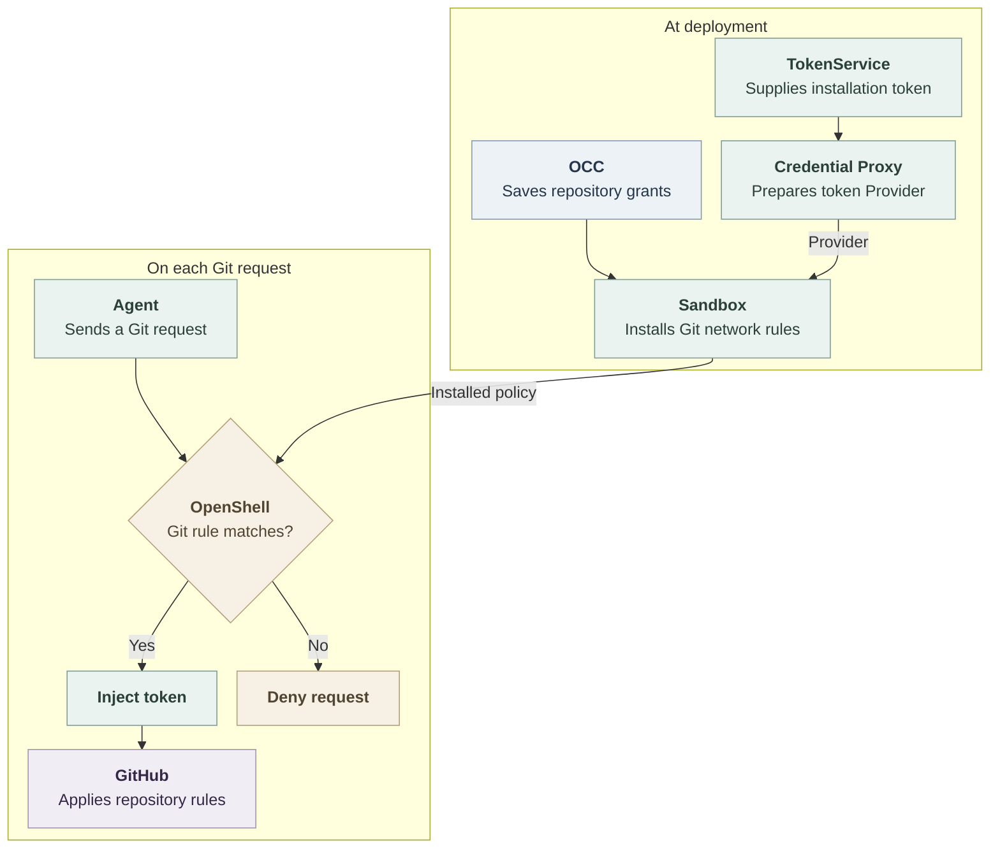

# Credential Proxy architecture

OCC decides which credentials an Agent revision can use. TokenService maintains
the credentials. Sandbox enforces network access and Credential Proxy configures
injection for approved requests. In native OpenShell delivery, the Sandbox
supervisor applies both policies when the Agent sends a request. Network policy
can allow a request on its own. Injection also requires a match against the
credential binding's policy.

## Deploy an Agent with credentials

1. The operator selects the Sources the Agent needs for its model and Plugin
   slots. For native Git, the operator selects approved repositories and a
   GitHub App Client.
2. OCC checks the caller's and Agent's authority and saves one binding list with
   the Agent revision. The network policy limits the requests the Agent can
   send. Each credential injection policy limits the requests that can carry
   its credential.
3. Compute prepares an idle Sandbox. Credential Proxy configures injection. For
   OCC custody, it resolves the Source through TokenService and attaches a
   delivery Provider. For native custody, it attaches the Source's Provider.
   OpenShell loads the policies. The Worker rechecks authorization and releases
   the Agent after Compute confirms policy and delivery are ready. The Harness
   receives placeholders.

See [Credential Sources](../reference/credential-sources.md#implementation-status)
for the supported model, Git, and Plugin paths.

## Authorize a native OpenShell Git request

For Source-backed Git, the operator chooses repositories and Read or Read/write access. OCC saves those grants with the Agent
revision. Agents in the Namespace can share a GitHub installation token while
keeping their own grants. Sandbox compiles the saved grants into OpenShell Git
network rules. Credential Proxy prepares the token's delivery Provider, which
Sandbox binds to the matching rules.

OpenShell decides locally from the installed policy. It matches the executable,
destination, HTTP method, repository path, and Git service query where
applicable. A push needs the write rules for
`git-receive-pack`. OpenShell injects the installation token only on a match.
GitHub applies the token's permissions. See the
[native Git flow](../flows/agent-repository-credentials.md#tokenservice-git).

## Renew or withdraw delivery

TokenService commits a credential update. With OCC custody, it notifies
Credential Proxy to update the delivery copy. After a delivery failure, retry
with the committed value. With native custody, the Source's Provider holds the
updated value. Git renewal keeps the Agent's saved repository grants. OCC marks a
withdrawal revoked after it confirms policy reduction and detachment, or confirms
the Sandbox is gone.
When OpenShell reduces policy in place, independent, non-overlapping grants remain.
See [renewal](../reference/credential-sources.md#request-renewal) and
[withdrawal](../reference/credential-sources/withdrawal.md).

## Credential-free requests and retired exchanges

A credential-free request needs only admitted Sandbox network access. For
example, grant the requesting executable access to `api.github.com:443`;
`GET /repos/acme/widgets` then returns GitHub's full response. Current editable
[network additions](../reference/sandbox-policies.md#authority-and-admission)
cannot restrict the method or path. The Git-only Repository grant does not allow
that REST endpoint. No Source, credential injection, or request-time OCC check
participates.

Credential 1.0 retires the protected metadata and repository exchanges,
including response filtering, per-send OCC authorization, OCE branch allowlists,
exact-ref checks, and bounded pull request operations. The legacy Driver has been removed.
Branch protection is outside Credential Design 1.0. The independent
[prepared Git broker](../reference/repository-credentials/prepared-native-git.md)
is a separate execution path outside this 1.0 model.

See [Credential Design 1.0](../../specs/rfcs/20261124-credential-design-1-0/index.md)
for the design decisions, including the deferred
[request-time credential pull](../../specs/rfcs/0023-egress-proxy-credential-lifecycle/git-credential-pull.md).
