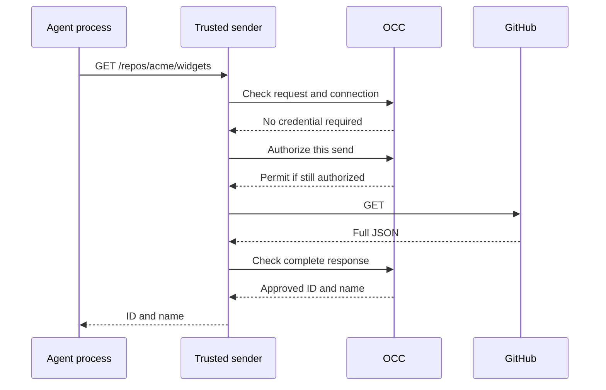

# Why an Agent needs a Credential Proxy

An Agent sends a placeholder instead of the upstream credential. TokenService
owns the credential. At deployment, OCC authorizes the Source and records
separate network and injection policies. Sandbox enforces network access.
Credential Proxy injects the credential only into matching requests. Start with
[Credential Sources](../reference/credential-sources.md#implementation-status)
for supported model, Git, and Plugin paths.

The separate protected egress path can restrict what a caller receives from
an upstream service. This example explains the trusted sender on that path.

An Agent needs to confirm that a repository is the one its operator approved.
A trusted sender controls the connection to GitHub. The OpenClaw Control Plane
(OCC) checks whether the sender can make the exact request. A GitHub adapter
decides which fields the Agent receives. The credential-free metadata grant
below works for repository identities GitHub serves without authentication.

The [architecture diagrams](credential-proxy-architecture.md) show where the worker prepares Git credentials, where OpenShell asks for authorization, and how the generic exchange handles replies.

## Read one repository's identity

Suppose an operator binds a GitHub metadata source to a dedicated Agent. The
grant names the Agent, origin and expected identity of
`acme/widgets` (ID `12345`). This example requires an installed sender and Sandbox
that force the execution's GitHub requests through the protected exchange.
Stock OpenShell does not provide this path.

A process in the execution asks GitHub for the repository with a bodyless HTTPS request.

```http
GET /repos/acme/widgets HTTP/1.1
Host: api.github.com
```

The sender asks OCC to select the approved operation, then asks for permission
to send. A loss of access between those steps stops the request.



If GitHub returns a valid `200` JSON response with the matching ID and name,
the caller receives this body.

```json
{ "id": 12345, "full_name": "acme/widgets" }
```

The adapter discards other repository fields. If the ID differs, the sender
withholds the response. If the same process tries `POST /repos/acme/widgets/pulls`
on the same host, the adapter refuses the request before it reaches GitHub.

## Which checks does OpenShell provide?

| Delivery path               | What happens to a request                                                                                                                                                                                                         |
| --------------------------- | --------------------------------------------------------------------------------------------------------------------------------------------------------------------------------------------------------------------------------- |
| Native Credential Proxy     | OpenShell applies the revision's network and injection rules. It substitutes the credential on a matching request. Managed MCP can also restrict RPC methods and tools. The native Proxy does not filter upstream replies.        |
| Protected repository sender | Before issuing credentials, OCE matches the held launcher request to an authenticated middleware denial. The worker checks subsequent GitHub requests against the grant. GitHub enforces token permissions and branch rules.      |
| Online GitHub preview       | On stock OpenShell 0.1.5, a one-use probe must receive the expected denial before the Agent starts. This observes the hook at startup. The opt-in profile grants installation-wide GitHub access.                                 |
| Protected exchange above    | A qualified sender must capture the request, obtain permission to send it and release only the approved response to the original caller. Stock OpenShell lacks the protected exchange’s exact-send and filtered-reply guarantees. |

<a id="read-further"></a>

## Follow the credential through the system

1. [Register the metadata source](../reference/credential-sources/protected-repository-metadata.md#register-a-source) and [bind it to the Agent](../reference/credential-sources/protected-repository-metadata.md#bind-a-source-to-an-agent).
2. [Follow the GET and its reply](../flows/credential-source-egress.md#follow-the-metadata-get). See [what a child process can do](../reference/security/credential-proxy.md#what-can-a-process-inside-the-execution-do) with the same grant.
3. [Trace GitHub token issuance and renewal](../flows/credential-source-lifecycle.md#issue-and-renew-a-github-installation-token). The [repository credential reference](../reference/repository-credentials.md#token-service-lifecycle) distinguishes metadata access from Git access.
4. [Follow native Proxy delivery](../flows/credential-source-lifecycle.md#3-prepare-credential-delivery) or inspect the [installation-wide GitHub preview](../reference/repository-credentials/protected-openshell-git.md#grant-access-to-a-github-app-installation).

For setup, use the [operator guide](../guides/credential-proxy.md). For a new
sender, start with the [Driver contract](../reference/drivers/credential-proxy.md).
