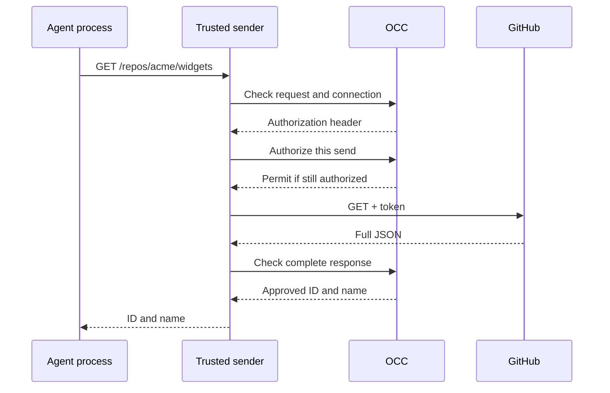

# Why an Agent needs a Credential Proxy

An Agent needs to confirm that a private GitHub repository is the one its
operator approved. Giving the Agent an installation token would also give
any script it runs a credential it could copy and use elsewhere. A proxy that
attaches the token to any GitHub request still lets the script exercise the
token's GitHub permissions.

The Credential Proxy lets the Agent use one approved operation without receiving
the token. A trusted sender controls the connection to GitHub. The OpenClaw
Control Plane (OCC) checks which credential the sender can use and whether it
can send this particular request. A GitHub adapter decides which fields the Agent receives.

## Read one repository's identity

Suppose an operator binds a GitHub metadata source to a dedicated Agent. The
grant names the GitHub App, its installation, the Agent and the expected identity of
`acme/widgets` (ID `12345`). This example requires an installed sender and Sandbox
that force the execution's GitHub requests through the protected exchange.
Stock OpenShell does not provide this path.

A process in the execution asks GitHub for the repository with a bodyless HTTPS request.

```http
GET /repos/acme/widgets HTTP/1.1
Host: api.github.com
```

The worker prepares a short-lived installation token with the App signing key.
The sender asks OCC for the credential header, then asks again for permission
to send. If the Agent loses access between those steps, the request stops there.



If GitHub returns a valid `200` JSON response with the matching ID and name,
the caller receives this body.

```json
{ "id": 12345, "full_name": "acme/widgets" }
```

The adapter discards other repository fields. If the ID differs, the sender
withholds the response. If the same process tries `POST /repos/acme/widgets/pulls`
on the same host, the adapter refuses the request before OCC selects a token.

## Which checks does OpenShell provide?

| Delivery path               | What happens to a request                                                                                                                                                                                                                |
| --------------------------- | ---------------------------------------------------------------------------------------------------------------------------------------------------------------------------------------------------------------------------------------- |
| Ordinary Credential Gateway | A matching process can use a placeholder at an allowed endpoint. The supervisor substitutes the credential. The profile does not check each request body or filter the reply.                                                            |
| Online GitHub preview       | On stock OpenShell 0.1.5, a one-use probe must receive the expected denial before the Agent starts. This observes the hook at startup. The opt-in profile grants installation-wide GitHub access.                                        |
| Protected exchange above    | A qualified sender must capture the request, obtain permission to send it and release only the approved response to the original caller. Stock OpenShell lacks this guarantee. Its bundled Driver refuses repository-scoped `git-write`. |

<a id="read-further"></a>

## Follow the credential through the system

1. [Register the metadata source](../reference/credential-sources.md#register-a-source) and [bind it to the Agent](../reference/credential-sources.md#bind-a-source-to-an-agent).
2. [Follow the GET and its reply](../flows/credential-source-egress.md#follow-the-metadata-get). See [what a child process can do](../reference/security/credential-proxy.md#what-can-a-process-inside-the-execution-do) with the same grant.
3. [Trace GitHub token issuance and renewal](../flows/credential-source-refresh.md#6-issue-and-renew-a-github-installation-token). The [repository credential reference](../reference/repository-credentials.md#token-service-lifecycle) distinguishes metadata access from Git access.
4. [Follow a placeholder through the ordinary Gateway](../reference/drivers/openshell-credential-gateway.md#follow-a-codex-request-through-openshell) or inspect the [installation-wide GitHub preview](../reference/repository-credentials/protected-openshell-git.md#grant-access-to-a-github-app-installation).

For setup, use the [operator guide](../guides/credential-proxy.md). For a new
sender, start with the [Driver contract](../reference/drivers/credential-proxy.md).
