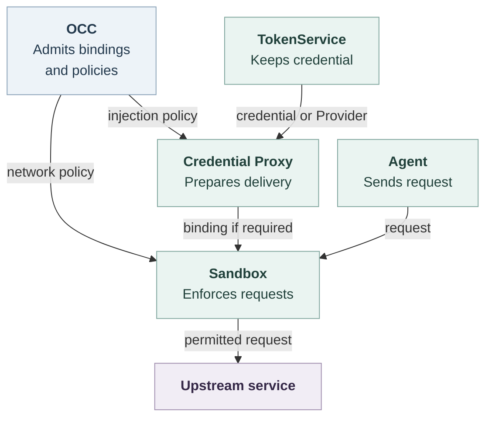

# How Agent credentials work

An operator selects the model credential, Plugin connections, or repositories an
Agent may use. For managed CredentialSource delivery, the OpenClaw Control Plane
(OCC) checks the selection and saves the approved bindings and policies in an
Agent revision. The Harness uses a placeholder instead of the upstream credential.
[Direct authentication](../reference/harness-execution.md#harness-authentication)
is a separate path that gives the credential to the executing Harness.

## Enroll and deploy

A [CredentialSource](../reference/credential-sources.md) identifies an enrolled
credential in a Namespace. The selected [TokenService](../reference/drivers/selection.md#supported-selections)
maintains the credential and renews eligible tokens. A
[Connection Template](../reference/connection-templates.md) can define consent
or approved destinations. OAuth also uses an eligible client registration.

The operator selects a Source for the [model](../reference/agents.md) or a
[Plugin connection](../reference/agent-plugins.md). For
[Git](../reference/repository-credentials.md), the operator selects a GitHub App
client and approved repositories; OCC creates or reuses the shared Source. OCC
checks Source and Repository authority and derives two distinct policies: which
requests the Agent may send, and which requests may receive each credential.
[Compute](../reference/drivers/compute.md) prepares an idle
[Sandbox](../reference/drivers/sandbox.md). Sandbox installs network policy;
[Credential Proxy](../reference/drivers/credential-proxy.md) prepares credential
delivery and injection rules. The Worker checks authorization again and releases
the Agent only after preparation succeeds.

## Send, renew, and withdraw

For native OpenShell delivery, the supervisor checks both installed policies
locally and substitutes the credential on a matching request. Native Git makes
no request-time call to OCC. Git grants repository Read or Read/write access;
Branch protection and pull request operations are outside this Git-only path.
The upstream service enforces the credential's permissions. See the
[request architecture](credential-proxy-architecture.md).

TokenService commits replacements before delivery is updated. Withdrawal removes
one Agent's authority and detaches its binding; Stop removes the deployment but
keeps the Source. See [Source lifecycle](../flows/credential-source-lifecycle.md)
and [withdrawal](../reference/credential-sources/withdrawal.md).

## Which path checks the request?

Native OpenShell checks the deployed policies locally. Credential 1.0 retires the
legacy protected metadata and repository exchanges instead of migrating their
extra checks. The legacy Driver has been removed.

## Read one repository's identity

For public repository metadata, admit network access to `api.github.com:443` for
the requesting executable. A request such as
`GET https://api.github.com/repos/acme/widgets` returns GitHub's full response
without a CredentialSource, token, or OCC callback. Current editable
[Sandbox additions](../reference/sandbox-policies.md#authority-and-admission)
grant executable, host, and port access; they do not restrict HTTP method or
path. A Git Repository grant does not authorize REST access. Private repository
metadata requires a separately authorized credentialed API path.

## Follow the credential through the system

Start with [current support and limits](../reference/credential-sources.md#implementation-status),
then use the [operator setup guide](../guides/credential-proxy.md). The
[Credential Design 1.0 RFC](../../specs/rfcs/20261124-credential-design-1-0/index.md)
links the detailed decisions and historical amendments.
