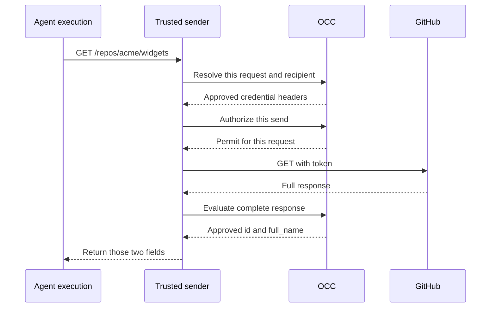

# Why an Agent needs a Credential Proxy

An Agent needs the identity of a private GitHub repository. If its process
receives a provider key, a downloaded script can copy the key and use it
elsewhere. A trusted sender can keep the key outside the process. It must also
limit which requests it sends. If the key permits writes, a script could
otherwise ask the sender to create a pull request.

The Credential Proxy lets an operator grant a specific operation to one Agent
execution. The OpenClaw Control Plane (OCC) checks who may use the source. A
provider adapter recognizes the operation and decides what response is safe to
return. The trusted sender holds the connection to the provider and uses the
credential outside the Agent.

## Read one repository's identity

Suppose the grant names `acme/widgets` and its numeric repository ID. On a
qualified protected path, the Agent or a child process can make the same
bodyless `GET /repos/acme/widgets`. The diagram shows the protected exchange
for a prepared GitHub installation token.

Under this grant, `POST /repos/acme/widgets/pulls` and
`GET /repos/acme/tools` both fail before credential access. Even an allowed
GET can produce an unsafe reply. If the returned ID differs from the admitted
ID, the sender withholds the provider response. The
[request flow](../flows/credential-source-egress.md) traces both permission checks.

**Deployment boundary.** The exchange requires an installed sender that enforces
the route and controls the response. No stock OpenShell deployment is qualified
for it in this release. Stock OpenShell 0.1.5 offers a separate,
opt-in installation-wide GitHub preview with a request hook observed at startup.
The bundled Driver refuses repository-scoped `git-write`. Each profile needs
its own [installed qualification](../testing/protected-repository-custody.md).
[Protected Git profiles](../reference/repository-credentials/protected-openshell-git.md)

## Read further

- [Threat model](../reference/security/credential-proxy.md) — which processes can use the grant and which components have to be trusted.
- [Credential sources](../reference/credential-sources.md) — who approves access and who holds the credential.
- [OpenShell Credential Gateway](../reference/drivers/openshell-credential-gateway.md#how-sources-map-to-openshell) — how ordinary placeholder substitution works. [Protected inference](../reference/credential-sources/protected-inference.md) has additional request and response checks.
- [Token Service lifecycle](../reference/repository-credentials.md#token-service-lifecycle) — how approval, execution sessions and GitHub token renewal fit together. The [refresh flow](../flows/credential-source-refresh.md#6-oce-prepared-github-core) traces issuance and retirement.

For setup, use the [operator guide](../guides/credential-proxy.md). For a new
sender, start with the [Driver contract](../reference/drivers/credential-proxy.md).
