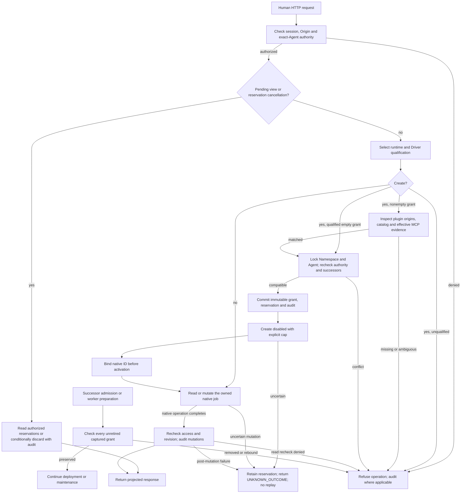

# Agent automation broker flow

## Overview

OpenClaw Control Plane (OCC) authorizes a human, obtains the selected Compute
Driver's qualified static Model Context Protocol (MCP) operations, and saves an immutable grant before native creation. OpenClaw owns
scheduling, execution and history. The same grant constrains successor deployment
and worker preparation. This flow describes the implementation; runtime
qualification remains a separate gate.

## Entry Points

- Trigger: one of the six automation collection, item or history HTTP operations.
- Source: `packages/contracts/src/api/routes.ts:occApiRoutes`
- Source: `apps/controller/src/http/agent-automations.ts:createAgentAutomationHandlers`
- Assumptions: native operations require a selected running revision with native
  access and supported provenance. The pending view and reservation cancellation
  require OCC state but no native transport. Trusted native writers remain outside
  the guarantee.

## Flow

## Execution Trace

### 1. Authorize management without delegating a personal identity

`apps/controller/src/index.ts:admit` refuses service keys for these operations.
`apps/controller/src/http/agent-automations.ts:createAgentAutomationHandlers`
retains closed schemas, mutation Origin/CSRF checks and the refusal of caller-native
authority headers. Creation requires exact-Agent `operate`; management uses creator
`operate` or exact-Agent `administer`.

For `view=pending`, the handler reads unbound OCC rows, then reauthenticates and
checks exact-Agent access before disclosure. If administration was lost, it
filters to the creator before calculating the page, total and snapshot. DELETE with the returned
`reservation:<id>` revision checks the same authority and conditionally discards
the unbound row with audit. Both paths return before native selection or transport.

`packages/occ/src/agent-automations.ts:createAgentAutomations` checks creator
ownership before native access. Foreign and absent records remain indistinguishable.
The final authority mode filters list rows before pagination and snapshot hashing;
a lost administrative grant cannot disclose a previously loaded all-creator view.
Route UUID validation precedes persistence lookup.

The creator owns management access. The execution grant uses the Agent's existing
shared authority, without capturing personal credentials, requester grants or
interactive approvals.

### 2. Qualify the selected runtime and effective MCP operations

`apps/controller/src/http/agent-automations.ts:createAgentAutomationHandlers`
evaluates the selected Compute policy before opening transport for POST and PATCH
other than disable-only. Missing qualification returns `503 AUTOMATIONS_UNQUALIFIED`;
evaluator or dependency failures return `503 DEPENDENCY_UNAVAILABLE`. Disable-only
PATCH, DELETE and history retain recovery under existing authorization,
native-shape and transport checks.

`apps/controller/src/composition/agent-automations.ts:createAgentAutomationsAccess`
checks Compute identity and observed main-container provenance before returning
the result of `ComputeDriver.evaluateAgentAutomationPolicy` and a transport from
`ComputeDriver.openAgentAutomationTransport`. Undefined qualification permits
conservative recovery operations only, without relaxing transport provenance.

`apps/controller/src/drivers/compute/kubernetes/index.ts:KubernetesComputeDriver.openAgentAutomationTransport`
selects the revision-specific Service/operator HTTPRoute through existing Envoy
filters. `verifyAutomationRouteInstance` checks the exact selector, route and
EndpointSlice targets against the sole live revision Pod. Observations bind Pod
UID, container/image identity and pinned source; `assertCurrent` repeats them.
For nonempty grants, `verifyAutomationEndpointAssets` checks the expected
role-specific Gateway ServiceAccount, embedded ServicePrincipal label and configured
projected identity, or dedicated Agent identity through the same helper. During
preparation, the controller reads the revision-owned immutable ConfigMap back and
records its UID in Gateway Pod annotation
`openclaw.dev/automation-configuration-uid`. Qualification fetches the owned map, compares that UID with the Pod annotation, verifies the
expected name, immutable state, exact renderer data and read-only mounted
`openclaw.json`, and refuses mismatches even without an optional CA. Endpoint rules and configured CA assets receive separate
checks. The deployed wrapper, read-only root filesystem and no mounts replacing
`/app` remain required.
`reconcileGatewayRoute` creates these resources; revision cleanup removes them.
The route renders the default backend `weight: 1` explicitly so API defaulting
does not change the spec used for strict readback.

Automation verification uses the [control chart's](../../deploy/helm/openclaw-enterprise/templates/rbac.yaml)
separate, deliberately unbound `${RELEASE}-openclaw-tenant-automation-observer`
ClusterRole. An [operator-created tenant-local binding](../guides/deploy/production-agents.md#grant-automation-observation)
limits its reads to the Gateway namespace; the shared `tenant-api` role
does not receive them. Existing `tenant-configuration` bindings provide ConfigMap
`get`. The worker does not write RBAC, and supported automations need no
execution-plane binding.

The native adapter checks bounded, nonempty handshake boot ID and same-socket
`system.info` process-instance ID plus positive PID. Only the hostname is compared
with the expected Pod name; boot/process IDs have no prior expected value.
Mutations require the captured identity and the same handshake boot ID.
It rechecks the transport before requests. Connection closure stops the client; no reconnect or replay
selects another Gateway. The Agent-wide route is excluded.

`apps/controller/src/drivers/compute/agent-automations-policy.ts:nativeAutomationPolicy`
qualifies the static provisioning and policy. The Kubernetes implementation owns
the exact anonymous HTTPS endpoint attestation, translated host CIDRs and optional
public CA bundle. For nonempty grants, `nativeAutomationPolicy` prevalidates every enabled server as
attested `streamable-http` and binds the full canonical server/transport/attestation
map into each selected tool binding. Policy refuses more than 64 enabled routes;
endpoint configuration rejects equivalent duplicate IPv6 host CIDRs, and Compute
refuses nonempty qualification when Gateway port 47730/47731 conflicts with the
reserved listener. Model-only capability remains unaffected. Adding or changing an enabled sibling or its
URL/CIDR/CA invalidates that grant even if the sibling has no selected tool. Native
catalog setup may initialize/list siblings before scheduled cap filtering; this
does not permit forbidden tool calls. Compute renders one revision-selected Gateway
endpoint policy. A separate Gateway-only `automation-trust` volume mounts exact
fingerprint-named CA files read-only. Verification checks immutable CA data,
key/path items, mount, annotation hash and absence after revocation; it rejects
automation-derived `NODE_EXTRA_CA_CERTS` while preserving unrelated provider trust.
Preparation removes owned stale Agent automation policy/CA assets; verification
rejects Agent automation-specific policy, CA map, Pod volume/mount, environment or
annotation. Independent Agent model/workload routes and Codex trust remain separate.
Stdio is ineligible. Literal raw operations map to canonical
aliases; unsupported credentials, approval controls, transports or ambiguous names
refuse qualification. For dedicated execution, only ordinary Kubernetes
deployment-backed Codex can qualify; provider-owned Sandbox, protected-egress and credential variants
fail closed. OCC revision admission inserts the sole main entry
`identity.name`; the policy validates and binds its exact public value. Embedded
OpenClaw admits an identity-only main entry. Dedicated Codex also requires the
exact main tool allow list and intersects each alias with the literal
MCP filter, Gateway allow list and canonical `agents.entries.main.tools.allow`. It
requires server approval and the qualified Standard guardian WebSocket configuration.
`qualifiedCodexPluginConfig` preserves reviewer `user`, on-request approval,
workspace-write sandbox and the limited workspace proxy. It rejects unsafe proxy
flags, noncanonical domains, sockets and unknown keys. The canonical grant binds
the full reviewer, sorted domain decisions, proxy flags and native filesystem
permissions alongside workspace, transport/authentication provenance, exclusions
and immutable images; it stores no raw app-server token or URL. Proxy domains do
not authorize the independent Gateway MCP callback. Unsupported qualification refuses without fallback; qualified model-only paths
remain available. Genuine HTTPS execution proof is a separate qualification gate.
Code Mode and tool search must already be disabled. This does not modify ordinary chat.

`apps/controller/src/drivers/compute/kubernetes/index.ts:projectEmbeddedAutomationMarker`
projects server-owned `meta.lastTouchedVersion: "2026.11.5"` only for the embedded
candidate selected by `hasEmbeddedAutomationMarker`: endpoint support, immutable
Gateway image, nonempty plugin allowlist and an MCP server not explicitly disabled.
Caller `meta` refuses preparation. Candidate detection does not qualify malformed
servers. `requireAutomationRenderedEquivalence` verifies and reverses only exact
server-owned projections before rechecking original qualification. Compute derives
opaque paths from revision, server, original HTTPS target, capability hash and
endpoint descriptor, then projects native URLs to
`http://127.0.0.1:47731/mcp/<64hex>`; public source stays unchanged. The origin
guard checks the exact mapping before every spawn.
`apps/controller/src/drivers/compute/kubernetes/automation-mcp-proxy.ts:AUTOMATION_MCP_PROXY_SOURCE` accepts only
exact loopback routes, GET/POST/DELETE and protocol headers. Its HTTPS lookup
filters DNS results to admitted addresses used by the actual socket; each request
supplies automation CA only per route and rejects all 3xx without Location or replay. It limits
active exchanges to 32, requests to 4 MiB, responses to 32 MiB, idle time to 60
seconds and total time to 300 seconds. `gatewayRuntimeEntrypoint` checks projection
before configuration, starts the proxy before Doctor, and requires it listening
for readiness and every native spawn; failure holds the Gateway unready. The final
dedicated workspace must match the Harness workspace. A mismatch refuses
preparation; this does not qualify app tools or authenticated connectors.

`apps/controller/src/gateway/agent-automations-client.ts:createNativeAgentAutomationsAccess`
checks native administrative scope, the six cron methods and sole native Agent.
For a nonempty grant, `captureToolGrant` checks `plugins.inspect` for admitted
bundled origins and `tools.catalog` for core/plugin collisions without session
overrides. Native server include filtering precedes alias allocation. Dedicated
checks the complete resulting source namespace for collisions, suffix ambiguity
and the reserved `mcp__` prefix before Gateway, Agent or caller subsets. Both Harnesses reject enabled filters
containing raw `resources_list`, `resources_read`, `prompts_list` or `prompts_get`
case-insensitively; tool-only authority cannot approve synthesized utilities. The
policy also rejects raw include entries beginning with their own normalized safe
server prefix plus `__`, ignoring case, before policy subsets. Native interprets
them as alias selectors; unrelated raw `foo__bar` remains valid. No probe or
fallback occurs. Embedded uses `sessions.list` and
`tools.effective` to match MCP source, server, raw operation and alias. The
existing session must prove ordinary same-Agent scope; cron, subagent, system,
dock, foreign, unknown and session-denied entries are refused. Dedicated uses the
standing immutable Agent grant and performs no `sessions.list`, `tools.effective`,
`sessions.get` or history read. It does not inherit chat-session-specific denials.
Real ordinary and scheduled identity, source and cap parity is a packaged-runtime
qualification gate, not an admission-time discovery step.

`apps/controller/src/drivers/compute/agent-automation-program.ts:verifyAgentAutomationProgram`
matches the complete deployed wrapper against the rendered program and grant.
`apps/controller/src/drivers/compute/agent-automation-guard.ts:AGENT_AUTOMATION_PRE_DOCTOR_GUARD`
checks the reviewed packaged source/version and read-only persisted plugin
discovery/index before configuration or Doctor; refusal holds `gateway-config`
unavailable. Existing `compat` is never repaired or adopted. Doctor and
missing-plugin repair still run, while configured-plugin release bookkeeping/restamp
is suppressed. `AGENT_AUTOMATION_ORIGIN_GUARD` repeats the check before each spawn and
compares canonical entries and MCP against the immutable mounted source for
embedded OpenClaw, or the immutable rendered ConfigMap for dedicated Codex. It
checks writable discovery roots, installed-plugin state and bundled manifests. It
also rechecks disabled Code Mode/tool search, node plugin/skill controls and
canonical `agents.entries` and model overrides; legacy `agents.list` is refused.
`apps/controller/src/drivers/compute/kubernetes/runtime-entrypoints.ts:gatewayRuntimeEntrypoint`
runs this guard before every native Gateway spawn, including respawns and container
startup. This local origin check is separate from OCC grant compatibility checks.

### 3. Freeze the grant under the admission locks

`packages/occ/src/agent-automations.ts:createAgentAutomations` reserves under the
Namespace lock followed by the Agent lock. It rechecks the human's authority after
waiting, selected running revision and Driver evaluation. Later revisions that
could still launch must preserve the proposed grant; a failed candidate is not
safe to ignore until its retirement is confirmed.

The transaction stores the public UUID, creator, exact target, `toolGrant` and
admission audit. The grant contains exact names and opaque binding fingerprints;
credential values are not stored there.
`packages/occ/src/state/postgres-agent-automations.ts` and
`migrations/0090_agent_automations.sql` enforce immutable ownership/grant fields and
one-time native identity binding.

### 4. Create disabled, bind, then activate with native CAS

`apps/controller/src/http/agent-automations.ts:createAgentAutomationHandlers`
creates disabled with `occ-automation:<OCC UUID>`, persists the returned native ID,
then enables only if requested.
`apps/controller/src/gateway/agent-automations-client.ts:createNativeAgentAutomationsAccess`
writes the saved explicit cap, including `[]`, on add and update. Eligibility and
the expected native revision come from one read. Native CAS protects the write;
it cannot establish that an alias still has the same authority. Updates and
explicit re-enablement require current qualified bindings. A disable-only PATCH
keeps the existing authorization and native-shape checks without requiring renewed
policy qualification; DELETE and retained history remain available too.

Inventory recovers a missing native ID only from the reserved declaration key,
then binds it once with audit. Recovery neither replays create nor activates a job.
Only registered, authorized records enter public pagination and history. Native
history can outlive a one-shot job; it is not evidence of grant retirement.

### 5. Fence successors and startup preparation

`packages/occ/src/agent-deployment-admission.ts:admitAgentDeployment` evaluates a
candidate under the Namespace/Agent decision locks. Every unretired grant must be
a subset of its qualified operations with unchanged binding fingerprints.
Unrelated operation additions do not expand an existing job. Removing a captured
operation or changing its authority blocks the candidate.

`apps/controller/src/worker.ts:ControllerWorker.automationAuthorityCurrent` repeats
that check under the live claim's Namespace/Agent locks before Compute binding or
preparation. It covers deployment and selected-revision re-observation/maintenance,
including work resumed after controller startup. A mismatch returns from that preparation attempt with
`AUTOMATION_TOOL_GRANT_MISMATCH`. Active-revision finalization observes/requeues
work; it does not stop the Gateway. This is not a per-call check inside a running
native scheduler. Installation allowlist withdrawal alone is not immediate
revocation of running cron work. A kubelet restart of the same immutable live
revision has no new OCC callback and can resume native catch-up under the captured
grant. These fences cover OCC-managed revision admission/startup/recovery, not a
per-container restart callback.

### 6. Retire authority separately from history

`apps/controller/src/http/agent-automations.ts:createAgentAutomationHandlers` calls
`retireAgentAutomation` after confirmed native removal, or definite absence of a
bound job. `packages/occ/src/agent-automations.ts:createAgentAutomations` rechecks
ownership under Namespace/Agent locks and commits `retiredAt` with audit. Retired
rows remain available for authorized history and are excluded from successor guards.
Paused and uncertain records remain unretired. Agent deletion removes its rows
through the existing lifecycle.

A mutation reply lost after dispatch, failed retirement/success audit, or changed
caller/revision after mutation produces `UNKNOWN_OUTCOME`; no mutation is replayed.
`AutomationCreateNotCommittedError` permits atomic discard only for a proven
noncommitted, still-unbound create. Concurrent binding or failed discard audit
prevents deletion. Other uncertain creates retain their grant and recovery record.
An authorized reservation cancellation uses the same unbound conditional deletion
as a fence: if binding wins, cancellation fails; if cancellation wins, binding
cannot succeed and OCC cannot enable the job. A delayed add can leave a disabled
native orphan, which a trusted native administrator must remove. No automatic
cleanup or add replay occurs.

## Debugging and Verification

Use the [automation reference](../reference/agent-automations.md) for public
status codes and the [scheduling guide](../guides/agent-automations.md) for recovery.
On a policy conflict, inspect unretired records, the selected revision and the
owner's binding qualification, including paused and uncertain reservations.
Do not repair a mismatch with a shared-Secret overwrite, raw filter or manual
native job edit. Native `[]` means model-only; an empty MCP include can mean ALL.

The [implementation plan](../../specs/plans/20261121-agent-automations.md#verification)
separates historical model-only evidence from approved-MCP acceptance. Native
protocol fixtures, source filters and rendered settings do not prove equivalent
endpoint, action, credential and standing-approval behavior in ordinary and
scheduled calls. Real MCP execution and policy-change effects must be qualified
for each selected Harness/runtime. Testing procedures belong in the
[runtime testing guide](../testing/docker.md).

## Related docs

- [Automation contract](../reference/agent-automations.md)
- [Schedule Agent automations](../guides/agent-automations.md)
- [Planned replacement](../reference/agents/planned-replacement.md)
- [Compute contract](../reference/drivers/compute.md)
- [Broker RFC](../../specs/rfcs/20261121-agent-automations.md)

## Manual Notes

[keep this for the user to add notes. do not change between edits]

## Changelog

- 2026-11-22 14:03: Trace uncommitted pending recovery and dedicated MCP qualification (authoring-run/7fb7cb15-5b9d-496d-b268-bba1a49025fd - dc328404503ca35be4e042540307388a5141e2d0)

- 2026-11-22 01:19: Clarify uncommitted dedicated MCP refusal and explicit route weight (01a1fc52-9d88-7223-b8a1-3c98595d3fbe - 269ecf6b)

- 2026-11-22 07:40: Trace uncommitted approved-MCP qualification, immutable grants and retirement; retain qualification limits (authoring-run/223f5559-e996-40af-96b1-5591de73ca57 - 63815f0db3b744abc6d7158cc4a8fb28c109486b)

- 2026-11-21 08:48: Trace broker ownership, native dispatch and uncertain outcomes (01a1fc52-9d88-7223-b8a1-3c98595d3fbe - fbf9ad567dde06d0c7a8e2cb4d442f9aaa52c744)

- 2026-11-20 20:31: Require operate for creation while retaining administer for management (01a1fc52-9d88-7223-b8a1-3c98595d3fbe - 465a76013e2d8c6bcdf834e83d76b40c20520017)

- 2026-11-20 20:23: Document uncommitted admission and refusal paths (01a1fc52-9d88-7223-b8a1-3c98595d3fbe - d4a3ab0c9603ce9678995160776dd78d94a7a688)
