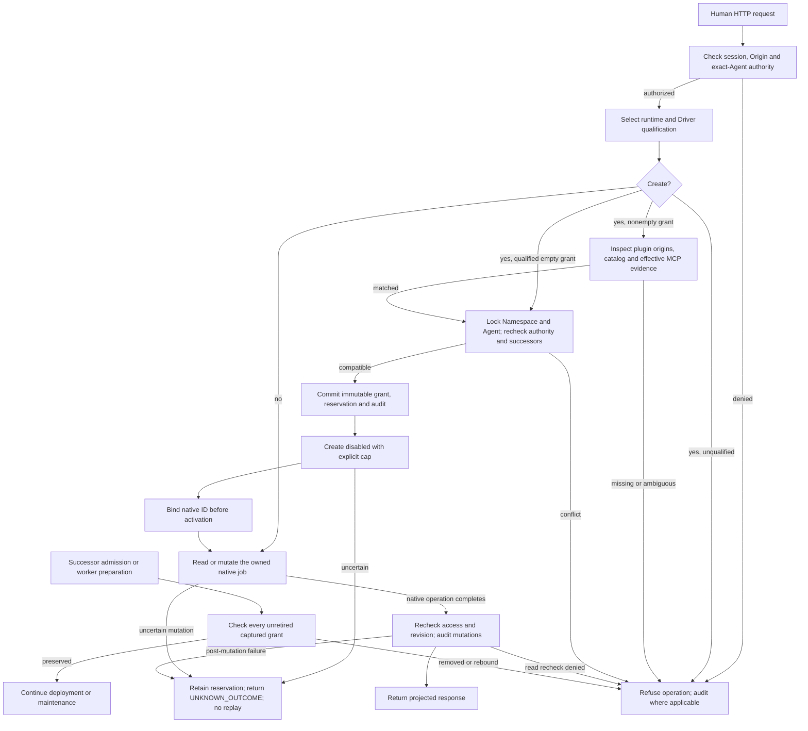

# Agent automation broker flow

## Overview

OpenClaw Control Plane (OCC) authorizes a human, obtains the selected Compute
Driver's qualified static Model Context Protocol (MCP) operations, and saves an immutable grant before native creation. OpenClaw owns
scheduling, execution and history. The same grant constrains successor deployment
and worker preparation. This flow describes the implementation; runtime
qualification remains a separate gate.

## Entry Points

- Trigger: one of the six automation collection, item or history HTTP operations.
- Source: `packages/contracts/src/api/routes.ts:occApiRoutes`
- Source: `apps/controller/src/http/agent-automations.ts:createAgentAutomationHandlers`
- Assumptions: the selected running revision has native access and supported
  provenance. OCC manages its registered jobs; trusted native writers remain
  outside the guarantee.

## Flow

## Execution Trace

### 1. Authorize management without delegating a personal identity

`apps/controller/src/index.ts:admit` refuses service keys for these operations.
`apps/controller/src/http/agent-automations.ts:createAgentAutomationHandlers`
retains closed schemas, mutation Origin/CSRF checks and the refusal of caller-native
authority headers. Creation requires exact-Agent `operate`; management uses creator
`operate` or exact-Agent `administer`.

`packages/occ/src/agent-automations.ts:createAgentAutomations` checks creator
ownership before native access. Foreign and absent records remain indistinguishable.
The final authority mode filters list rows before pagination and snapshot hashing;
a lost administrative grant cannot disclose a previously loaded all-creator view.
Route UUID validation precedes persistence lookup.

The creator owns management access. The execution grant uses the Agent's existing
shared authority, without capturing personal credentials, requester grants or
interactive approvals.

### 2. Qualify the selected runtime and effective MCP operations

`apps/controller/src/composition/agent-automations.ts:createAgentAutomationsAccess`
checks Compute identity and observed main-container provenance before returning
the result of `ComputeDriver.evaluateAgentAutomationPolicy` and a transport from
`ComputeDriver.openAgentAutomationTransport`. Undefined qualification permits
conservative recovery operations only, without relaxing transport provenance.

`apps/controller/src/drivers/compute/kubernetes/index.ts:KubernetesComputeDriver.openAgentAutomationTransport`
selects the revision-specific Service/operator HTTPRoute through existing Envoy
filters. `verifyAutomationRouteInstance` checks the exact selector, route and
EndpointSlice targets against the sole live revision Pod. Observations bind Pod
UID, container/image identity and pinned source; `assertCurrent` repeats them.
Nonempty grants also require the deployed wrapper, endpoint rules and CA assets,
a read-only root filesystem and no mounts replacing `/app`.
`reconcileGatewayRoute` creates these resources; revision cleanup removes them.
The route renders the default backend `weight: 1` explicitly so API defaulting
does not change the spec used for strict readback.

The native adapter checks bounded, nonempty handshake boot ID and same-socket
`system.info` process-instance ID plus positive PID. Only the hostname is compared
with the expected Pod name; boot/process IDs have no prior expected value.
Mutations require the captured identity and the same handshake boot ID.
It rechecks the transport before requests. Connection closure stops the client; no reconnect or replay
selects another Gateway. The Agent-wide route is excluded.

`apps/controller/src/drivers/compute/agent-automations-policy.ts:nativeAutomationPolicy`
qualifies the static provisioning and policy. The Kubernetes implementation owns
the exact anonymous HTTPS endpoint attestation, translated host CIDRs and optional
public CA bundle. Stdio is ineligible. Literal raw operations map to canonical
aliases; unsupported credentials, approval controls, transports or ambiguous names
refuse qualification. A selected nonempty operation on dedicated Codex returns
unqualified before grant creation; it is not replaced by an empty grant. Qualified
model-only paths remain available. Embedded nonempty grants require the supported
public tool/server controls and reject unsupported extra settings. Code Mode and
tool search must already be disabled. This does not modify ordinary chat.

`apps/controller/src/gateway/agent-automations-client.ts:createNativeAgentAutomationsAccess`
checks native administrative scope, the six cron methods and sole native Agent.
For a nonempty grant, `captureToolGrant` checks `plugins.inspect` for admitted
bundled origins and no MCP declarations. `tools.catalog` checks core/plugin alias
collisions without ordinary-session overrides. Bounded `sessions.list` and
`tools.effective` reads match MCP source, server, raw operation and canonical alias,
and reject session-denied entries. These observations corroborate the Driver's
qualification; they do not create authority from a raw filter.

`apps/controller/src/drivers/compute/agent-automation-program.ts:verifyAgentAutomationProgram`
matches the complete deployed wrapper against the rendered program and grant.
`apps/controller/src/drivers/compute/agent-automation-guard.ts:AGENT_AUTOMATION_ORIGIN_GUARD`
checks writable discovery roots, installed-plugin state and bundled manifests. It
also rechecks disabled Code Mode/tool search, node plugin/skill controls and
Agent/model overrides.
`apps/controller/src/drivers/compute/kubernetes/runtime-entrypoints.ts:gatewayRuntimeEntrypoint`
runs this guard before every native Gateway spawn, including respawns and container
startup. This local origin check is separate from OCC grant compatibility checks.

### 3. Freeze the grant under the admission locks

`packages/occ/src/agent-automations.ts:createAgentAutomations` reserves under the
Namespace lock followed by the Agent lock. It rechecks the human's authority after
waiting, selected running revision and Driver evaluation. Later revisions that
could still launch must preserve the proposed grant; a failed candidate is not
safe to ignore until its retirement is confirmed.

The transaction stores the public UUID, creator, exact target, `toolGrant` and
admission audit. The grant contains exact names and opaque binding fingerprints;
credential values are not stored there.
`packages/occ/src/state/postgres-agent-automations.ts` and
`migrations/0088_agent_automations.sql` enforce immutable ownership/grant fields and
one-time native identity binding.

### 4. Create disabled, bind, then activate with native CAS

`apps/controller/src/http/agent-automations.ts:createAgentAutomationHandlers`
creates disabled with `occ-automation:<OCC UUID>`, persists the returned native ID,
then enables only if requested.
`apps/controller/src/gateway/agent-automations-client.ts:createNativeAgentAutomationsAccess`
writes the saved explicit cap, including `[]`, on add and update. Eligibility and
the expected native revision come from one read. Native CAS protects the write;
it cannot establish that an alias still has the same authority. Updates and
explicit re-enablement require current qualified bindings. A disable-only PATCH
keeps the existing authorization and native-shape checks without requiring renewed
policy qualification; DELETE and retained history remain available too.

Inventory recovers a missing native ID only from the reserved declaration key,
then binds it once with audit. Recovery neither replays create nor activates a job.
Only registered, authorized records enter public pagination and history. Native
history can outlive a one-shot job; it is not evidence of grant retirement.

### 5. Fence successors and startup preparation

`packages/occ/src/agent-deployment-admission.ts:admitAgentDeployment` evaluates a
candidate under the Namespace/Agent decision locks. Every unretired grant must be
a subset of its qualified operations with unchanged binding fingerprints.
Unrelated operation additions do not expand an existing job. Removing a captured
operation or changing its authority blocks the candidate.

`apps/controller/src/worker.ts:ControllerWorker.automationAuthorityCurrent` repeats
that check under the live claim's Namespace/Agent locks before Compute binding or
preparation. It covers deployment and selected-revision re-observation/maintenance,
including work resumed after controller startup. A mismatch returns from that preparation attempt with
`AUTOMATION_TOOL_GRANT_MISMATCH`. Active-revision finalization observes/requeues
work; it does not stop the Gateway. This is not a per-call check inside a running
native scheduler. Installation allowlist withdrawal alone is not immediate
revocation of running cron work. A kubelet restart of the same immutable live
revision has no new OCC callback and can resume native catch-up under the captured
grant. These fences cover OCC-managed revision admission/startup/recovery, not a
per-container restart callback.

### 6. Retire authority separately from history

`apps/controller/src/http/agent-automations.ts:createAgentAutomationHandlers` calls
`retireAgentAutomation` after confirmed native removal, or definite absence of a
bound job. `packages/occ/src/agent-automations.ts:createAgentAutomations` rechecks
ownership under Namespace/Agent locks and commits `retiredAt` with audit. Retired
rows remain available for authorized history and are excluded from successor guards.
Paused and uncertain records remain unretired. Agent deletion removes its rows
through the existing lifecycle.

A mutation reply lost after dispatch, failed retirement/success audit, or changed
caller/revision after mutation produces `UNKNOWN_OUTCOME`; no mutation is replayed.
`AutomationCreateNotCommittedError` permits atomic discard only for a proven
noncommitted, still-unbound create. Concurrent binding or failed discard audit
prevents deletion. Other uncertain creates retain their grant and recovery record.

## Debugging and Verification

Use the [automation reference](../reference/agent-automations.md) for public
status codes and the [scheduling guide](../guides/agent-automations.md) for recovery.
On a policy conflict, inspect unretired records, the selected revision and the
owner's binding qualification, including paused and uncertain reservations.
Do not repair a mismatch with a shared-Secret overwrite, raw filter or manual
native job edit. Native `[]` means model-only; an empty MCP include can mean ALL.

The [implementation plan](../../specs/plans/20261121-agent-automations.md#verification)
separates historical model-only evidence from approved-MCP acceptance. Native
protocol fixtures, source filters and rendered settings do not prove equivalent
endpoint, action, credential and standing-approval behavior in ordinary and
scheduled calls. Real MCP execution and policy-change effects must be qualified
for each selected Harness/runtime. Testing procedures belong in the
[runtime testing guide](../testing/docker.md).

## Related docs

- [Automation contract](../reference/agent-automations.md)
- [Schedule Agent automations](../guides/agent-automations.md)
- [Planned replacement](../reference/agents/planned-replacement.md)
- [Compute contract](../reference/drivers/compute.md)
- [Broker RFC](../../specs/rfcs/20261121-agent-automations.md)

## Manual Notes

[keep this for the user to add notes. do not change between edits]

## Changelog

- 2026-11-22 01:19: Clarify uncommitted dedicated MCP refusal and explicit route weight (01a1fc52-9d88-7223-b8a1-3c98595d3fbe - 269ecf6b)

- 2026-11-22 07:40: Trace uncommitted approved-MCP qualification, immutable grants and retirement; retain qualification limits (authoring-run/223f5559-e996-40af-96b1-5591de73ca57 - 63815f0db3b744abc6d7158cc4a8fb28c109486b)

- 2026-11-21 08:48: Trace broker ownership, native dispatch and uncertain outcomes (01a1fc52-9d88-7223-b8a1-3c98595d3fbe - fbf9ad567dde06d0c7a8e2cb4d442f9aaa52c744)

- 2026-11-20 20:31: Require operate for creation while retaining administer for management (01a1fc52-9d88-7223-b8a1-3c98595d3fbe - 465a76013e2d8c6bcdf834e83d76b40c20520017)

- 2026-11-20 20:23: Document uncommitted admission and refusal paths (01a1fc52-9d88-7223-b8a1-3c98595d3fbe - d4a3ab0c9603ce9678995160776dd78d94a7a688)
