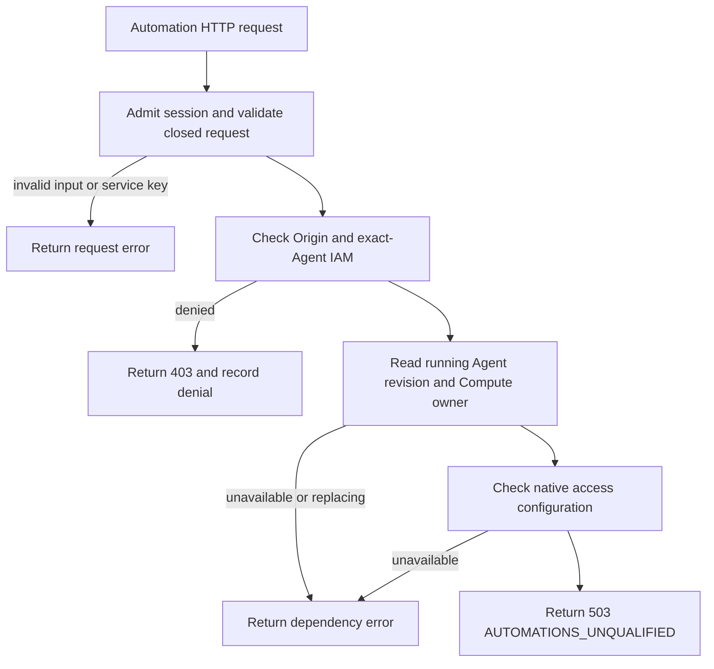

# Agent automation admission flow

## Overview

OCC admits the six automation HTTP request shapes, checks the human and exact
Agent, then refuses native dispatch. This flow ends at refusal. Native scheduling,
execution authority, retained history and mutation recovery remain unimplemented.

## Entry Points

- Trigger: an automation collection, item or history HTTP request.
- Source: `packages/contracts/src/api/routes.ts:occApiRoutes`
- Source: `apps/controller/src/index.ts:createFastifyApp`
- Assumptions: an initialized Installation and the normal OCC authentication and
  request-audit composition. The [reference](../reference/agent-automations.md)
  owns current limits.

## Flow



## Execution Trace

### 1. Admit the HTTP request

`apps/controller/src/index.ts:admit` refuses service keys before native work.
The existing session verifier and identity resolver establish the Principal.
`packages/contracts/src/api/agent-automations.ts` defines closed bodies and query
bounds. The normal Fastify route compiler checks these schemas.

### 2. Authorize the exact Agent

`apps/controller/src/http/agent-automations.ts:createAgentAutomationHandlers`
requires a session, checks CSRF and mutation Origin, and rejects native authority
headers. `packages/occ/src/agent-queries.ts:getAuthorizedAgent` checks exact-Agent
`administer` or `operate` before reading the Agent. The handler does not select
browser credentials or treat browser administration as automation authority.

### 3. Resolve availability and refuse dispatch

`apps/controller/src/http/agent-automations.ts:createAgentAutomationHandlers`
checks native enablement, running state and the selected revision. It verifies
Compute identity, predecessor replacement state and native configuration using
the existing native-access helpers. It returns `AUTOMATIONS_UNQUALIFIED` without
requesting a transport. No prompt leaves OCC and no job or history is read.

`apps/controller/src/drivers/compute/kubernetes/index.ts:getGatewayBrowserRequest`
also refuses automation mode before resolving a private endpoint or credential.
Both refusals remain until the owning RFC's native contract is qualified.

### 4. Record the request outcome

`apps/controller/src/index.ts:createFastifyApp` uses the existing request-audit
hooks for these registered routes. Authorization denials use the normal OCC
denial evidence. Future native mutations need separate attributable success and
indeterminate evidence; those paths are not implemented.

## Debugging and Verification

Run the admission case with the repository-supported Node and installed graph:

```sh
node --test --test-name-pattern='Agent automation admission' tests/integration/native-admin-access.test.mjs
```

The case exercises the real HTTP app, session and Native IAM paths with
in-memory persistence. Its simulated upstream is only a no-dispatch tripwire;
it proves no native scheduling, Harness execution, storage or retention behavior.
See the [plan](../../specs/plans/20261121-agent-automations.md#verification) for
required proof that remains outstanding.

## Related docs

- [Automation API availability](../reference/agent-automations.md)
- [Native browser access flow](agent-native-admin.md)
- [Submitted automation RFC](../../specs/rfcs/20261121-agent-automations.md)

## Manual Notes

[keep this for the user to add notes. do not change between edits]

## Changelog

- 2026-11-20 20:23: Document uncommitted admission and refusal paths (01a1fc52-9d88-7223-b8a1-3c98595d3fbe - d4a3ab0c9603ce9678995160776dd78d94a7a688)
