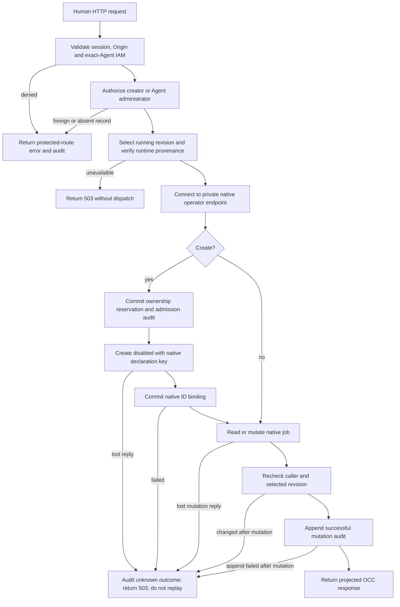

# Agent automation broker flow

## Overview

OCC authorizes a human and managed job ownership, resolves the selected Agent
runtime, then calls native cron through private administrative transport. OCC
retains creator records; OpenClaw owns scheduling, execution and run history.
This flow describes source behavior, not completed runtime qualification.

## Entry Points

- Trigger: one of the six automation collection, item or history HTTP operations.
- Source: `packages/contracts/src/api/routes.ts:occApiRoutes`
- Source: `apps/controller/src/http/agent-automations.ts:createAgentAutomationHandlers`
- Assumptions: OCE is the sole automation manager; the selected runtime has native
  access and matches the supported image source. Native edits are out of scope.

## Flow



## Execution Trace

### 1. Admit and authorize

`apps/controller/src/index.ts:admit` refuses service keys. The normal session and
schema pipeline establishes the human Principal and closed request shape.
`apps/controller/src/http/agent-automations.ts:createAgentAutomationHandlers`
checks mutation Origin/CSRF and refuses caller-native authority headers.
Creation uses `packages/occ/src/controller.ts:getOperableAgent` before lookup.
Management uses exact-Agent `operate` or `administer`.

`packages/occ/src/agent-automations.ts:createAgentAutomations` filters creator
ownership before native access. A foreign record becomes a hidden authorization
denial; an unregistered native ID cannot establish ownership.

### 2. Bind the runtime

`apps/controller/src/http/agent-automations.ts:createAgentAutomationHandlers`
checks running state, selected revision, Compute identity, replacement state and
native configuration. `apps/controller/src/composition/agent-automations.ts:createAgentAutomationsAccess`
checks observed main-container provenance against the supported source before
reading the platform Gateway credential or returning the private endpoint.
Missing support has no identity or transport fallback.

`apps/controller/src/gateway/agent-automations-client.ts:createNativeAgentAutomationsAccess`
verifies native administration, all required methods and sole native Agent
selection. It owns connection deadlines and closes on disconnect without
replaying requests. Each RPC rechecks the human session, authorization and
selected revision through the HTTP handler's `assertCurrent` callback.

### 3. Reserve and dispatch

For POST, `packages/occ/src/agent-automations.ts:createAgentAutomations` reserves a
new public UUID, creator and native Agent in the same transaction as admission audit.
The native client creates disabled with a declaration key derived from that UUID.
OCC binds the returned native ID before requesting activation. Native create
never receives an OCC-selected native job ID.
`packages/occ/src/state/postgres-agent-automations.ts:postgresAgentAutomations`
implements the immutable repository; the schema constrains parent ownership and
removes rows when the Agent is deleted. A reservation persists if a native reply
is lost, but does not prove a native job exists.

The native client maps prompt and schedule to an isolated Agent turn with no
result delivery and the deployed Agent's tool policy. It preserves native
schedule normalization. PATCH compares the caller revision with the same full
read used for eligibility, then passes it to native atomic update. DELETE also
passes its precondition. Native conflicts become 409 responses.

### 4. Project inventory and history

`apps/controller/src/gateway/agent-automations-client.ts:createNativeAgentAutomationsAccess`
reads consistent native inventory pages. Only registered, authorized IDs enter
OCC pagination and totals. The HTTP handler hashes authorized summaries for its
public snapshot token, so another creator's changes do not alter that token.

A missing native ID is recovered by matching the reserved declaration key, then
bound once with audit before disclosure. Recovery does not replay a native write.
History authorizes retained ownership, then reads the bound native job ID from the
exact Gateway's operator history without requiring a live job. Native expiry
still applies. No ownership is inferred or imported from native responses.

### 5. Settle the response

`apps/controller/src/http/agent-automations.ts:createAgentAutomationHandlers`
rechecks the session and revision after native completion and appends mutation
audit before returning success. A lost reply, invalid acknowledgement, changed
revision after dispatch or failed success audit returns `UNKNOWN_OUTCOME`.
It attempts indeterminate audit, logs audit failure without native payloads, and
never retries the mutation. `Location` carries the public recovery path when known.
Ordinary request-audit hooks still record route outcomes.

`AutomationCreateNotCommittedError` identifies a create that was not sent, or a
native rejection followed by confirmed absence from inventory. The controller
removes only that creator's unbound reservation and appends discarded audit in
one transaction. PostgreSQL's conditional deletion cannot remove a concurrently
bound native ID. Failed cleanup audit rolls back deletion. Other sent or uncertain
outcomes retain ownership for recovery.

## Debugging and Verification

With the supported toolchain and installed dependencies:

```sh
node --test --test-name-pattern='Agent automation admission' tests/integration/native-admin-access.test.mjs
```

The refusal case proves real HTTP/session/IAM behavior with in-memory state.
The PostgreSQL case proves durable ownership and admission rollback using the
[disposable database setup](../testing/postgresql.md).
The native protocol case uses real OpenClaw and a transparent fault proxy, with
fixture Compute and in-memory OCC state. It checks concurrent native CAS and
replaces the Gateway container on retained native storage while preserving a
paused job and its OCC ownership record. It executes no model. The registered
`agent-automations` QA scenario owns deployed scheduling, tool effects and history.
See the [plan](../../specs/plans/20261121-agent-automations.md#verification) for
actual results and outstanding proof. Missing model credentials are not mock proof.

## Related docs

- [Automation contract](../reference/agent-automations.md)
- [Schedule an automation](../guides/agent-automations.md)
- [Native browser access](agent-native-admin.md)
- [Broker RFC](../../specs/rfcs/20261121-agent-automations.md)

## Manual Notes

[keep this for the user to add notes. do not change between edits]

## Changelog

- 2026-11-21 08:48: Trace broker ownership, native dispatch and uncertain outcomes (01a1fc52-9d88-7223-b8a1-3c98595d3fbe - fbf9ad567dde06d0c7a8e2cb4d442f9aaa52c744)

- 2026-11-20 20:31: Require operate for creation while retaining administer for management (01a1fc52-9d88-7223-b8a1-3c98595d3fbe - 465a76013e2d8c6bcdf834e83d76b40c20520017)

- 2026-11-20 20:23: Document uncommitted admission and refusal paths (01a1fc52-9d88-7223-b8a1-3c98595d3fbe - d4a3ab0c9603ce9678995160776dd78d94a7a688)
