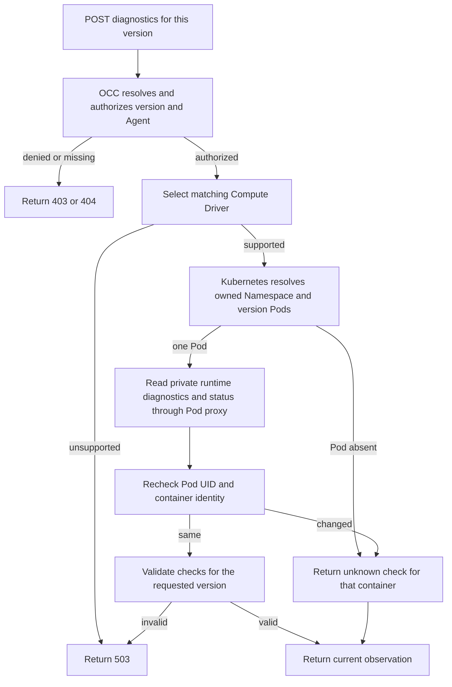

# Agent deployment diagnostics flow

## Overview

An admin requests fresh runtime checks for one saved version through a
bodyless API call. OpenClaw Control Plane (OCC) authorizes the exact target,
asks the selected Compute Driver for runtime checks with time and size limits, and returns that
observation. The call ends at the API response; it does not change deployment
work or select a live version.

## Entry Points

- Trigger: `POST /namespaces/:namespaceId/agents/:agentId/deployments/:deploymentId/diagnostics`.
- Source: `apps/controller/src/index.ts:createFastifyApp`,
  `packages/occ/src/index.ts:OpenClawController.diagnoseAgentDeployment`, and
  `apps/controller/src/drivers/compute/kubernetes/index.ts:KubernetesComputeDriver.diagnoseAgentDeployment`.
- Assumptions: `deploymentId` is the Agent revision ID of a saved version. The caller needs
  exact Agent `read` and `operate` and Agent revision `read` permissions.

## Flow

## Execution Trace

### 1. Authorize the exact deployment

`packages/contracts/src/api/routes.ts:occApiRoutes` declares a bodyless POST.
`apps/controller/src/index.ts:requiredPermissions` requires exact Agent
`operate` and `read` plus Agent revision `read`.
`packages/occ/src/index.ts:OpenClawController.diagnoseAgentDeployment`
resolves the version under the supplied Namespace and Agent, authorizes the
same resources, and selects the Compute Driver recorded in that version.

### 2. Read the current runtime

`apps/controller/src/drivers/compute/kubernetes/index.ts:KubernetesComputeDriver.diagnoseAgentDeployment`
checks the binding and owned Namespace, then reads each version Pod through
the Kubernetes Pod proxy. Dedicated Gateways use their managed Gateway
namespace; dedicated Harnesses use the tenant namespace. The Driver reads a
private endpoint, then checks the Pod name, UID, and container ID again. Missing
or replaced Pods produce `unknown` checks. Invalid endpoint data fails the
request. Collection has a ten-second deadline and a 64 KiB response limit.
The Driver's Kubernetes clients do not follow redirects. For a redirected Pod
status response, the Driver requests body cancellation and fails the read without
retrying.

`apps/controller/src/drivers/compute/kubernetes/runtime-entrypoints.ts:PLUGIN_RUNTIME_HELPERS`
calls `channels.status` through OpenClaw's public Gateway SDK on demand in the
Gateway container. It maps live configuration, authentication, and connectivity
to safe codes without sending a message. The call cancels after six seconds or
when the HTTP caller disconnects. OpenClaw loads the Slack plugin only for a
Configuration with a Slack channel, so for an Agent without one the Gateway
refuses the call as an unknown channel; that refusal maps to configuration
`failed` with `NOT_CONFIGURED`. The probe code is part of the Gateway Pod
specification, so a version deployed by an earlier controller keeps the
earlier mapping (three unknown `PROBE_FAILED` checks) until the Agent is
redeployed. Transport failures return `UNAVAILABLE`; other RPC failures return
`PROBE_FAILED`. Both produce unknown checks; local configuration is not
substituted for the live response. The Agent container
currently returns no channel checks.

`KubernetesComputeDriver.heldRuntimeFailureCheck` also reads each Pod's private
runtime status. A runtime that held startup, such as a Gateway with an unusable
peer configuration record or an Agent whose model check failed, reports its
failure there. The Driver lists it first as a `failed` check named after the
startup step, with the failure code; diagnostics do not rerun that step. The
private boundary accepts only real UTC timestamps, normalizing a valid whole-second
value to the public millisecond form. A failed, impossible-date, or otherwise
invalid status read adds nothing.

An [OpenShell](../reference/drivers/openshell-sandbox.md) Harness listens inside
its Sandbox's own network namespace, not the Pod's, so the Kubernetes API
answers Pod-proxy reads of its private port with `503`, which the Driver treats
as not serving. Its `agent` `runtime-status` check is always `unknown` with code
`UNAVAILABLE`, whether the Harness is healthy or holding a startup failure, and
no held-failure check appears for it. Gateway checks, including a held Gateway
failure, are unaffected.

Beside Compute's checks, `OpenClawController.diagnoseAgentDeployment` asks the
version's Sandbox Driver for its record of a dedicated Harness Sandbox
(`observeHarness`, with a ten-second timeout signal). The result leads the list as an
`agent` `sandbox` check: `succeeded` while the Sandbox runs, `failed` with a code
such as `SANDBOX_FAILED` or `HARNESS_EXITED` once it can no longer serve the
version, `failed` with `HARNESS_RESTARTING` while OpenShell restarts a Harness
process that exited, and `unknown` on a first start (code `STARTING`), when the
record is unreadable (`UNAVAILABLE`), or when a version that is not selected for the running
Agent has no Sandbox, such as a stopped Agent's.

### 3. Return validated evidence

`packages/occ/src/deployment-diagnostics.ts:deploymentDiagnostics` requires
the requested Agent revision ID, valid timestamps, and at most 32 checks with component, check, and code values of 1 to 64 allowed characters. A
component, check or code outside `packages/contracts/src/runtime-failure.mjs`
reads `UNRECOGNIZED`. Native Driver errors become `DEPENDENCY_UNAVAILABLE`
without messages. Stored deployment status, startup evidence, plugin warnings
and Agent state stay unchanged.

## Debugging and Verification

- `403` indicates missing exact permission; `404` indicates the path does not
  identify that Agent revision. `503 DEPENDENCY_UNAVAILABLE` indicates missing
  Driver support, collection failure, or invalid evidence.
- Checks that are all `unknown` with code `UNAVAILABLE` mean the runtime did
  not answer, usually because the Gateway is stopped, starting, or failed to
  start. The console says so and names a failed deployment's recorded error
  code, because these checks do not test model credentials.
- A `failed` check named after a startup step, such as `peer-bridge-record`,
  means the runtime is holding that failure. Its Logs tab shows the remedy.
  `egress-enrollment` with code `UNAVAILABLE` is a protected execution whose
  Harness could not enroll with its egress proxy before the model check.
  An `agent` `state-migration` or `workspace-baseline` check with code
  `UNAVAILABLE` is a dedicated Harness or native worker held before Codex or its
  node started: Doctor left its node state older, or `openclaw setup --baseline`
  failed. The log line names the cause and any invalid setting paths, and
  OpenClaw's own hints to run `openclaw doctor` are dropped, since the
  Harness runs Doctor itself. Fix the cause, then deploy again.
- A `gateway` `gateway-state-lock` check with code `UNAVAILABLE` is a dedicated
  Gateway that OpenClaw refused to configure: an earlier Gateway process did not
  stop cleanly, and the restarted container cannot verify that the lock holder
  stopped. The log line quotes OpenClaw's holder description. Follow
  [unverifiable state owner recovery](../guides/topics/agent-troubleshoot.md#an-embedded-gateway-reports-an-unverifiable-state-owner).
- A dedicated Codex model check cause whose detail ends `-attempt2`, such as
  `turn-failed-attempt2`, means the check was retried once, after a timeout, a
  transient failure or a network or 5xx exit, and the second attempt failed that
  way. A failure whose output names a credential, TLS error or limit is never
  retried. Each failed access-token login attempt logs a `codex.login` line with
  its number and output class. An unreachable
  model provider is transient: each attempt waits out its 30-second limit, so
  `error-event-attempt2` follows about a minute after the check starts. Codex
  reports a refused port, an unresolvable host and a rejected TLS certificate
  the same way, so a permanent mistake such as a wrong endpoint host or port
  or a blocked egress route is also retried once before it is held. If Codex
  reconnects and the model answers in the same attempt, the check passes.
- On an OpenShell Harness, the `agent` `runtime-status` check says nothing about
  its health; the `agent` `sandbox` check does. A failed one means the Sandbox
  is lost; [deploy the Agent again](../guides/topics/agent-troubleshoot.md#an-openshell-agent-stops-answering).
  A failed `HARNESS_RESTARTING` check instead means the Harness process keeps
  exiting while OpenShell restarts it; its Sandbox logs show why.
  A failed deployment's status names the held failure's code and cause, such as
  `RUNTIME_MODEL_PROBE_FAILED`. While it holds a failure, the Harness answers
  the Agent Gateway's connection with `503` naming the held code, but the
  Gateway logs only `Unexpected server response: 503`; Compute's authenticated
  status read carries the code. The
  [Sandbox source](../guides/topics/agent-logs.md#sandbox-source) shows policy
  decisions; an operator can read the
  [Harness output](../guides/topics/agent-troubleshoot.md#read-openshell-sandbox-and-supervisor-logs).
- The focused API test covers exact permissions and sanitized Driver failures.
  The Kubernetes conformance test covers Pod proxy placement, version and Pod
  identity, and missing-Pod behavior. These tests do not prove a live Slack
  connection, message delivery, or a model response.

## Related docs

- [Agent deployment status and diagnostics](../reference/agents.md#deployment-status)
- [Compute Driver diagnostics](../reference/drivers/compute.md#optional-runtime-diagnostics)
- [Kubernetes networking](../reference/drivers/kubernetes-compute/networking-and-isolation.md#networking)

## Manual Notes

[keep this for the user to add notes. do not change between edits]

## Changelog

- 2026-10-29 15:00: Hold a dedicated Gateway's unverifiable Gateway state lock as check `gateway-state-lock` instead of `gateway-tool-policy`. (fix-2864, finding 2864)

- 2026-10-27 09:00: Name the `state-migration` and `workspace-baseline` holds of a dedicated Harness or native worker. (fix-2686-status, finding 2686)

- 2026-10-17 03:40: Say that an unreachable model provider covers permanent connection mistakes, and pass a check whose network wait recovered. (lows-1017d, findings 1621 and 1622)

- 2026-10-17 02:30: Retry the dedicated Codex model check once when the model provider is unreachable. (lows-1017c, finding 1618)

- 2026-10-14 15:27: Reject redirected status responses before reading their bodies. (authoring-run/3ffec2d3-d528-40ec-98a6-f91d0ad55db4 - 8e916a6c)

- 2026-10-11 14:30: Reject impossible private runtime timestamps before returning held failure evidence. (issue-2142)

- 2026-10-10 18:30: Report a Harness that OpenShell is restarting as `HARNESS_RESTARTING`. (fix-1043)

- 2026-10-10 15:30: Lead OpenShell diagnostics with the Harness Sandbox lifecycle check. (fix-1027)

- 2026-10-10 14:30: Document that an OpenShell Harness's runtime status is unreachable to diagnostics. (fix-1022-1019)

- 2026-10-10 10:00: Report a held runtime startup failure as the first diagnostic check. (fix-1013)

- 2026-10-07 12:00: Say that a version deployed by an older controller keeps its diagnostics mapping until the Agent is redeployed. (dogfood-r43)

- 2026-10-07 11:30: An Agent without a Slack channel reports `NOT_CONFIGURED` instead of three `PROBE_FAILED` checks. (fix-member-1007/d531)

- 2026-10-01 15:14: Use SDK queries with request timeouts for live channel diagnostics. (authoring-run/24df37c6-7eef-483a-a31c-d2c14a51ca6c - 521549df)

- 2026-10-01 15:22: Point validation to its private deployment diagnostics module. (authoring-run/089c3e66-9284-44a0-9e60-285ac7f50ab9 - 28debe57)

- 2026-09-27 06:34: Document the diagnostics request for one version and its Compute observation boundary. (authoring-run/d4a7cf04-5ef8-46a6-8a29-814f0292bf66 - ab37f9b)
