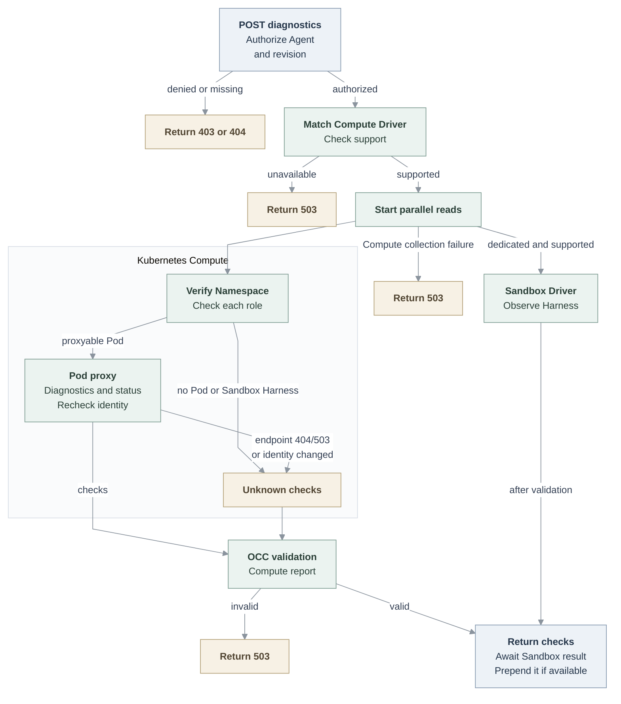

# Agent deployment diagnostics flow

## Overview

A bodyless POST asks OpenClaw Control Plane (OCC) for fresh checks on one saved
Agent revision. OCC returns validated Compute checks and an optional Sandbox
check without changing the deployment or selecting a live version.

## Entry Points

- Send `POST /namespaces/:namespaceId/agents/:agentId/deployments/:deploymentId/diagnostics` without a body.
- `deploymentId` identifies a saved Agent revision. The caller needs Agent `read`
  and `operate` permissions and Agent revision `read` permission.
- The entry points are `apps/controller/src/index.ts:createFastifyApp`,
  `packages/occ/src/agent-runtime-observations.ts:AgentRuntimeObservations.diagnoseAgentDeployment`,
  and `apps/controller/src/drivers/compute/kubernetes/index.ts:KubernetesComputeDriver.diagnoseAgentDeployment`.

## Flow

Kubernetes Compute supplies Pod checks. Unsupported diagnostics return `503` before either read.

## Execution Trace

### 1. Authorize the exact deployment

See `packages/contracts/src/api/routes.ts:occApiRoutes` for the route and
`apps/controller/src/http/permission-metadata.ts:routePermissionMetadata` for its permissions.
`packages/occ/src/agent-runtime-observations.ts:AgentRuntimeObservations.diagnoseAgentDeployment`
resolves and authorizes the revision under the supplied Namespace and Agent,
then authorizes the Agent. The configured Compute Driver must support diagnostics
and match the revision's Driver ID and implementation. Otherwise OCC returns
`503 DEPENDENCY_UNAVAILABLE`.

### 2. Read the current runtime

`apps/controller/src/drivers/compute/kubernetes/index.ts:KubernetesComputeDriver.diagnoseAgentDeployment`
checks the binding and owned Namespace.
`deployment-diagnostics.ts:collectDeploymentChecks` reads diagnostics and startup
status concurrently for each runtime role under a shared ten-second deadline. In a
two-cluster installation, dedicated Gateways use their managed Gateway namespace
and dedicated Harnesses use the tenant namespace.

`apps/controller/src/drivers/compute/kubernetes/private-status-proxy.ts:readPrivateStatusProxy`
decodes up to 64 KiB from the private endpoint. On 404 or 503, the endpoint is
unavailable. On redirect, the Driver requests body cancellation without retrying.
It rechecks the Pod name, UID, and container ID before using the evidence. Missing
or replaced Pods produce `unknown` checks. Invalid diagnostics fail the request.
At the shared deadline, a rejected Gateway diagnostics read can still report
its transport error before the Driver reports a generic timeout.

Before it generates the runtime programs, the Kubernetes renderer loads the
shared failure vocabulary. `runtime-entrypoints.ts:isStringArray` requires a
string at each position in the diagnostic check, code, and startup failure lists.
An empty position or a value of another type stops the renderer from loading
with `Invalid runtime failure vocabulary.`

`apps/controller/src/drivers/compute/kubernetes/runtime-entrypoints.ts:PLUGIN_RUNTIME_HELPERS`
calls `channels.status` through OpenClaw's public Gateway SDK on demand in the
Gateway container. It maps live configuration, authentication, and connectivity
to safe codes without sending a message. The call cancels after six seconds or
when the HTTP caller disconnects. OpenClaw loads the Slack plugin only for a
Configuration with a Slack channel, so for an Agent without one the Gateway
refuses the call as an unknown channel; that refusal maps to configuration
`failed` with `NOT_CONFIGURED`. The probe code is part of the Gateway Pod
specification, so a version deployed by an earlier controller keeps the
earlier mapping (three unknown `PROBE_FAILED` checks) until the Agent is
redeployed. Transport failures return `UNAVAILABLE`; other RPC failures return
`PROBE_FAILED`. Both produce unknown checks; local configuration is not
substituted for the live response. The Agent container
currently returns no channel checks.

`KubernetesComputeDriver.heldRuntimeFailureCheck` reads each Pod's startup status.
For a held failure, such as an unusable Gateway peer record or an Agent model
check failure, Compute leads with a `failed` check for that step and its code.
Diagnostics does not rerun the step. The private endpoint reader accepts real
UTC timestamps and normalizes whole seconds to milliseconds. A failed read
or invalid status contributes no startup check.

For an embedded Harness, Compute checks only the Gateway. When the selected
Sandbox Driver provisions a dedicated Harness, Compute skips its Pod proxy.
Its `agent` `runtime-status` is `unknown` (`UNAVAILABLE`). Gateway checks still run.

Alongside Compute, `AgentRuntimeObservations.observedHarness` asks the matching
Sandbox Driver about a dedicated Harness when supported. It passes a ten-second
timeout signal. Running maps to `succeeded`, loss or restart to `failed`, and first
start (`STARTING`) or an unreadable record (`UNAVAILABLE`) to `unknown`. A missing
or deleting Sandbox counts as lost only for the active version when the Agent's
desired runtime state is `running`.

### 3. Return validated evidence

`packages/occ/src/deployment-diagnostics.ts:deploymentDiagnostics` requires
the requested Agent revision ID, valid timestamps, and at most 32 checks with component, check, and code values of 1 to 64 allowed characters. A
component, check or code outside `packages/contracts/src/runtime-failure.ts`
reads `UNRECOGNIZED`.

If Compute collection or validation fails, OCC signals cancellation of the
Sandbox observation. Otherwise, OCC awaits it.
`packages/occ/src/deployment-diagnostics.ts:withHarnessDiagnostic` prepends any
`agent` `sandbox` check and keeps at most 32 checks.

Compute diagnostics failures return a generic `503 DEPENDENCY_UNAVAILABLE`.
Rejected Sandbox observations return an `unknown` check with code `UNAVAILABLE`.
For a rejected
Gateway diagnostics Pod-proxy request, OCC reconstructs the fixed
`RuntimeDiagnosticsTransportError` without supplier text or causes. The
`http.dependency_unavailable` operator log records its class and message with
the request ID. This identifies a failure to collect diagnostics. Channel
checks supply separate evidence about channel health. The category applies to
the proxy transport, excluding Pod discovery, invalid endpoint data, redirects,
and normal not-serving responses. Diagnostics leaves stored deployment status,
startup evidence, plugin warnings, and Agent state unchanged.

## Guarded first admission

The [Configuration persistence flow](configuration-driver/persistence-and-revisions.md#guarded-first-admission)
traces first-deployment admission and receipt recovery. That path ends when OCC
commits an Agent revision and queues reconciliation. Diagnostics observes runtime
state after admission.

## Debugging and Verification

- `403` indicates missing exact permission; `404` indicates the path does not
  identify that Agent revision. `503 DEPENDENCY_UNAVAILABLE` indicates missing
  Driver support, collection failure, or invalid evidence.
- Checks that are all `unknown` with code `UNAVAILABLE` mean the runtime did
  not answer, usually because the Gateway is stopped, starting, or failed to
  start. The console says so and names a failed deployment's recorded error
  code, because these checks do not test model credentials.
- A `failed` check named after a startup step, such as `peer-bridge-record`,
  means the runtime is holding that failure. Its Logs tab shows the remedy.
  `egress-enrollment` with code `UNAVAILABLE` is a protected execution whose
  Harness could not enroll with its egress proxy before the model check.
  An `agent` `state-migration` or `workspace-baseline` check with code
  `UNAVAILABLE` is a dedicated Harness or native worker held before Codex or its
  node started: Doctor did not complete maintenance, or `openclaw setup --baseline`
  failed. The log line names the cause and any invalid setting paths, and
  OpenClaw's own hints to run `openclaw doctor` are dropped, since the
  Harness runs Doctor itself. A pending marker in the retained `state` directory preserves the repair requirement
  across container replacements; fix the cause, then deploy again.
- A `gateway` `gateway-state-lock` check with code `UNAVAILABLE` is a Gateway
  that OpenClaw refused to configure or to start: an earlier Gateway process did
  not stop cleanly, and this container cannot verify that the holder stopped.
  The log line quotes each holder. A dedicated Kubernetes Gateway holds it when
  `config validate` meets the lock, as after a kill. OpenClaw's own start can
  also refuse, for example on a force-deleted Pod's owner lease, and exit 1. A
  Kubernetes Gateway that never served then runs the read-only
  `openclaw gateway recover-lock --json` (never `--confirm`) and holds when
  holders remain, or exits 1 if none do. Every 5 minutes either hold
  (`runtime-entrypoints.ts:holdGatewayStartupFailure`) retries a failed release
  of its own child's records and inspects again. It restarts on purpose
  (exit 75) once no holder remains; a failed inspection exits 1. Follow
  [unverifiable state owner recovery](../guides/topics/agent-troubleshoot.md#an-embedded-gateway-reports-an-unverifiable-state-owner).
- An `agent` `gateway-state-lock` check is a Kubernetes Harness whose Doctor or
  native setup met node state lock holders. Both fail the deployment with
  `RUNTIME_STATE_LOCK_UNVERIFIED` (`worker.ts:heldRuntimeFailureCode`).
- A dedicated Gateway held at `gateway-tool-policy` with code
  `INCOMPATIBLE_RESPONSE` can have a runtime image provenance failure.
  `apps/controller/src/drivers/compute/gateway-tool-policy.ts:requireGatewayToolPolicyRuntime`
  runs in both Docker and Kubernetes launchers. Its fixed log message distinguishes
  missing, unreadable, or malformed provenance from a source or commit that does
  not match the controller's pinned OpenClaw source/revision. Use the OpenClaw
  Enterprise (OCE) runtime image matching the controller. Neither message includes
  supplied provenance values or read-error details. With matching provenance,
  a policy refusal still names the required tool policy and Gateway tool allowlist.
  These failures keep the Gateway stopped and unready.
- A `gateway` `gateway-config` check with code `UNAVAILABLE` is a Kubernetes
  Gateway that exited before it served, and `openclaw config validate` reports
  its configuration invalid. A plugin entry whose `config` fails the plugin's
  schema causes this even when the plugin is disabled or denied. The log line
  names up to five setting paths, with the schema message where OpenClaw gives
  one, and never a value. Fix or remove those settings, then deploy again.
  A dedicated Gateway's tool policy step holds the same check before OpenClaw
  starts when no invalid setting belongs to the tool policy.
- A `crash-loop` check with code `UNAVAILABLE` is a startup failure Kubernetes
  Compute reads from Pod status, as it does `workspace-setup`; no runtime holds it
  (`apps/controller/src/drivers/compute/kubernetes/index.ts:safeCrashLoopObservation`):
  the role's container waits in `CrashLoopBackOff` after 3 consecutive
  unexplained exits. The Gateway wrapper states that count in its termination
  message (`runtime-entrypoints.ts:countUnexplainedExits`); readiness starts it
  again at 1, and a deliberate restart (exit 75, `stopContainer`) clears it and
  never counts; its `deliberate restart:` message counts 0 whatever the exit
  code. Without a count, and for a Harness, the restart count plus one stands
  in: in backoff the kubelet has not yet counted the restart it waits for.
  The deployment fails with `RUNTIME_STARTUP_FAILED`; the record keeps no check,
  but the runtime description shows the restart count and last exit code.
- When a Codex startup check returns `model_not_found`, the worker saves that
  code. Codex can omit the code from its error event. In that case, the probe
  recognizes the provider’s HTTP 404 missing-model message for the requested model.
  The Console names the model from the failed version. It directs editors to
  Configuration and tells other viewers to ask an editor to choose a model.
  If the viewer cannot redeploy the Agent, it tells them who can.
- A dedicated Codex model check cause whose detail ends `-attempt2`, such as
  `turn-failed-attempt2`, means the check was retried once, after a timeout, a
  transient failure or a network or 5xx exit, and the second attempt failed that
  way. A failure whose output names a credential, TLS error or limit is never
  retried. Each failed access-token login attempt logs a `codex.login` line with
  its number and output class. An unreachable
  model provider is transient: each attempt waits out its 30-second limit, so
  `error-event-attempt2` follows about a minute after the check starts. Codex
  reports a refused port, an unresolvable host and a rejected TLS certificate
  the same way, so a permanent mistake such as a wrong endpoint host or port
  or a blocked egress route is also retried once before it is held. If Codex
  reconnects and the model answers in the same attempt, the check passes.
- For an [OpenShell](../reference/drivers/openshell-sandbox.md) Harness, the
  `agent` `runtime-status` is `unknown`. If the `agent` `sandbox` check fails, read
  its code. `HARNESS_RESTARTING` means OpenShell is restarting the Harness.
  If exits continue, ask an operator to read the
  [Harness and supervisor logs](../guides/topics/agent-troubleshoot.md#read-openshell-sandbox-and-supervisor-logs).
  The [Sandbox source](../guides/topics/agent-logs.md#sandbox-source) shows policy
  decisions and excludes Harness output. If `occ agent runtime AGENT_ID` reports
  `lost`, [deploy the Agent again](../guides/topics/agent-troubleshoot.md#an-openshell-agent-stops-answering).
  While startup holds, the Harness answers the Gateway with `503` and the
  held code. The Gateway logs only `Unexpected server response: 503`.
  Compute reads the code during deployment. OCC reports the error code. For
  `RUNTIME_MODEL_PROBE_FAILED`, it includes a cause when classified.
- The focused API test covers exact permissions and sanitized Driver failures.
  The Kubernetes conformance test covers Pod proxy placement, version and Pod
  identity, and missing-Pod behavior. These tests do not prove a live Slack
  connection, message delivery, or a model response.

## Related docs

- [Agent deployment status and diagnostics](../reference/agents.md#deployment-status)
- [Compute Driver diagnostics](../reference/drivers/compute.md#optional-runtime-diagnostics)
- [Kubernetes networking](../reference/drivers/kubernetes-compute/networking-and-isolation.md#networking)

## Manual Notes

[keep this for the user to add notes. do not change between edits]

## Changelog

- 2026-11-22 13:43: Trace parallel Harness observation and distinguish OpenShell restarts from Sandbox loss. (authoring-run/b0acf937-8ae2-40fe-91c3-ec5df79f6a79 - 8ffd1d56a4bbf10c3e2ff8f2e3637d31237ae585)

- 2026-11-20 16:29: Update source pointers for runtime observation and fleet inventory. (authoring-run/c41017eb-dc85-4c43-90e8-3040fbace6ac - c6acc7271f7753f74d3657251f23a036c08e671c)

- 2026-11-18 03:40: Held `gateway-state-lock` fails as `RUNTIME_STATE_LOCK_UNVERIFIED`. (finding 3348)

- 2026-11-17 23:35: Kubernetes wrappers release an unfinished Doctor's or setup's own state locks; a Harness on an unverifiable holder reports `gateway-state-lock`. (finding 3345)

- 2026-11-17 12:30: Hold a Kubernetes Gateway whose own start refused an unverifiable state lock owner as check `gateway-state-lock`, after a read-only lock inspection; the recheck retries a failed release of its own child's records. (fix-gateway-lock-check, finding 3288)

- 2026-11-14 11:06: Reject missing positions in the lists embedded in generated runtime programs. (authoring-run/927cdccf-0c9c-45b7-9e7c-4e5e39a43260 - 08f8640d5503df1c98e9939ea5cce2763e9c4085)

- 2026-11-12 20:29: Distinguish runtime image provenance failures from tool policy refusals in both generated launchers. (authoring-run/610ff967-1248-450d-a432-c62fe1e8ac7a - a627e44694987459dbbf9aa59a3d76b9a97f48a7)

- 2026-11-11 02:04: Trace the private Pod proxy reader and shared diagnostics deadline. (authoring-run/e028dbec-8765-42b2-b94f-fafcd435d7bc - c5f99318f7e2495afac28ff7ec7b5f8e77891dfc)

- 2026-11-10 23:59: Preserve a fixed private Gateway diagnostics transport category in operator logs. (authoring-run/028ba1b2-5a61-4135-8d59-b919ec55e0eb - 42ffbb69e04e306d32eddcec27e8ea3d9075ec42)

- 2026-11-10 23:30: Count only consecutive unexplained Gateway exits toward a crash loop, from the wrapper's termination message. (crashloop-fix-2, finding 3041)

- 2026-11-10 12:00: Fail a Kubernetes runtime container in a crash loop as check `crash-loop`; deliberate Gateway restarts exit 75. (crashloop-fail-fast, finding 3041)

- 2026-11-04 07:41: Move the first-admission trace to the Configuration persistence owner and retain its diagnostics link. (authoring-run/06bc63c9-f110-4607-a058-a816a61dd579 - 6371064e)

- 2026-10-31 15:00: Hold a dedicated Gateway's invalid settings outside its tool policy as check `gateway-config` instead of `gateway-tool-policy`. (fix-3045, finding 3045)

- 2026-10-31 13:00: Hold a Kubernetes Gateway whose configuration OpenClaw refuses at startup as check `gateway-config`. (fix-3043b, finding 3043)

- 2026-10-30 16:53: Document guarded first admission, receipt recovery, and how both controller calls bind authorization to the request captured on entry. (authoring-run/62495070-6f26-49ba-b4b9-e00ac1a9bccd - 460529c7)

- 2026-10-29 15:00: Hold a dedicated Gateway's unverifiable Gateway state lock as check `gateway-state-lock` instead of `gateway-tool-policy`. (fix-2864, finding 2864)

- 2026-10-27 09:00: Name the `state-migration` and `workspace-baseline` holds of a dedicated Harness or native worker. (fix-2686-status, finding 2686)

- 2026-10-17 03:40: Say that an unreachable model provider covers permanent connection mistakes, and pass a check whose network wait recovered. (lows-1017d, findings 1621 and 1622)

- 2026-10-17 02:30: Retry the dedicated Codex model check once when the model provider is unreachable. (lows-1017c, finding 1618)

- 2026-10-14 15:27: Reject redirected status responses before reading their bodies. (authoring-run/3ffec2d3-d528-40ec-98a6-f91d0ad55db4 - 8e916a6c)

- 2026-10-11 14:30: Reject impossible private runtime timestamps before returning held failure evidence. (issue-2142)

- 2026-10-10 18:30: Report a Harness that OpenShell is restarting as `HARNESS_RESTARTING`. (fix-1043)

- 2026-10-10 15:30: Lead OpenShell diagnostics with the Harness Sandbox lifecycle check. (fix-1027)

- 2026-10-10 14:30: Document that an OpenShell Harness's runtime status is unreachable to diagnostics. (fix-1022-1019)

- 2026-10-10 10:00: Report a held runtime startup failure as the first diagnostic check. (fix-1013)

- 2026-10-07 12:00: Say that a version deployed by an older controller keeps its diagnostics mapping until the Agent is redeployed. (dogfood-r43)

- 2026-10-07 11:30: An Agent without a Slack channel reports `NOT_CONFIGURED` instead of three `PROBE_FAILED` checks. (fix-member-1007/d531)

- 2026-10-01 15:14: Use SDK queries with request timeouts for live channel diagnostics. (authoring-run/24df37c6-7eef-483a-a31c-d2c14a51ca6c - 521549df)

- 2026-10-01 15:22: Point validation to its private deployment diagnostics module. (authoring-run/089c3e66-9284-44a0-9e60-285ac7f50ab9 - 28debe57)

- 2026-09-27 06:34: Document the diagnostics request for one version and its Compute observation boundary. (authoring-run/d4a7cf04-5ef8-46a6-8a29-814f0292bf66 - ab37f9b)
