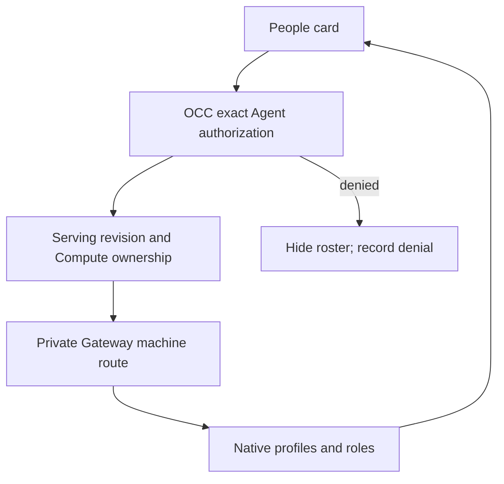

# Gateway people flow

## Overview

The Agent overview reads human profiles and native roles from its running
Gateway. This read-only view does not provision OCC accounts or grant access.
The configured ingress controls identity-provider admission.

## Entry Points

- Trigger: open an Agent, select **Refresh people**, or change its serving version.
- Source: `apps/controller/src/console/agents/people.mjs:renderGatewayPeople`.
- Contract: `packages/contracts/src/api/routes.ts:getAgentGatewayPeople` and
  `getAgentGatewayPersonAvatar`, under the exact Namespace and Agent.
- Authority: OCC authenticates the caller and requires exact Agent `administer`.

## Flow

## Execution Trace

### 1. Select the authorized runtime

`apps/controller/src/index.ts:perform`
`packages/occ/src/index.ts:getAdministerableActiveAgentRevision`

The route resolves its server-owned Namespace/Agent scope before selecting the
active revision. An authorization denial never contacts the Gateway. The HTTP
request owns a five-second deadline and aborts on client disconnect. The Compute
Driver must match the revision's recorded Driver ID and implementation; another
Driver's endpoint is not reused.

### 2. Read profiles without creating OCC identities

`apps/controller/src/composition/gateway-people.ts:createGatewayPeopleAccess`
`apps/controller/src/gateway/people-client.ts:createNativeGatewayPeopleAccess`

Composition uses the existing private Compute endpoint and mounted gateway API
key. The native adapter connects as the existing machine identity, checks its
admin grant, and calls `users.list`. OpenClaw supplies effective native roles.
Merged aliases, `gateway-owner`, and profiles with the `occ-workspace-files`
login alias in native `emails` are excluded. The adapter returns only profile
IDs, display names, roles and avatar availability; linked identities, email
addresses and GitHub metadata remain private.

Avatar reads first load the filtered roster and return `404` for excluded or
unknown profile IDs without fetching an image. Included profiles use a fixed
native profile-avatar path at that Gateway. The adapter accepts raster image
types, rejects bodies larger than 2 MiB, and follows no redirects.
The public avatar operation repeats exact Agent authorization. Missing images
return `404`; roster and avatar responses use `no-store`.

Concurrent roster/avatar reads share only a pending `users.list` operation for
the same revision, endpoint and machine credential. Each caller resolves its
target and retains its own cancellation/deadline; the last departing reader
cancels the shared transport. The Gateway read has a five-second deadline that
starts with the first reader; later readers do not restart it.
Completion or failure removes the entry, so later requests reread profile
exclusions rather than reuse a completed result. Authorization precedes sharing.

### 3. Render and refresh

`apps/controller/src/console/agents/people.mjs:renderGatewayPeople`
`apps/controller/src/console/agents/detail.mjs:updateCurrentAgent`

The first read keeps the card hidden and participates in the Agent overview
reveal gate. Disabled and denied reads therefore never flash a loading card.
The card renders names as text, native role labels, and local authenticated
avatar URLs with initials as fallback. The overview previews six profiles sorted
by display name. Larger rosters offer a modal side panel with the full sorted
list and case-insensitive name search. Its list scrolls independently; Close,
Escape or the backdrop dismisses it and restores focus to the launch button.
Navigation closes open dialogs. Refresh updates an open panel. A failed or
unconfigured read clears both lists and closes the panel; failures leave a retry
action. An empty roster explains that profiles appear after connection. Denied reads hide the card and are remembered in tab session storage
to avoid repeated audited denials on reloads and visits. In
`apps/controller/src/console/console.mjs:loadPage`, the explicit page **Refresh**
forgets only this Agent's roster denial and retries normal HTTP authorization.
A later administration grant can therefore reveal the roster without signing out;
a repeated denial keeps it hidden. A serving-version change refreshes the roster.
An installation without the adapter returns `people: null` and hides the card
without turning normal unavailability into a failed Console read.

## Debugging and Verification

- Confirm the caller's exact Agent `administer` grant before diagnosing Gateway
  availability. An identity-provider login alone grants no OCC access.
- Verify the selected Compute owns the active revision and can read its mounted
  key. Gateway role settings must retain machine administration.
- `tests/integration/native-admin-access.test.mjs` isolates HTTP authorization
  and serialization; it does not establish native profile semantics.
- `tests/browser/console-agent-detail-2.test.mjs` exercises the production card's
  role labels, error/empty recovery, and 50-person preview/search/dismissal through
  the HTTP app.
- `tests/integration/native-admin-k3d-real.test.mjs` reads the roster through the
  installed OCC route and native Gateway RPC.

## Related docs

- [Gateway people contract](../reference/agents/gateway-people.md)
- [Agent overview](../guides/console/agent-people.md)
- [Workspace machine access](workspace-files.md)

## Manual Notes

[keep this for the user to add notes. do not change between edits]

## Changelog

- 2026-10-20 14:57: Add the authorized roster/avatar reads, searchable panel, pending-read sharing and explicit access retry; consolidate PR #2596 history. (agent:roboclaw:dashboard:db15726a-e911-4eff-87c7-9f90ca5b2e3b - fd73e091f)
