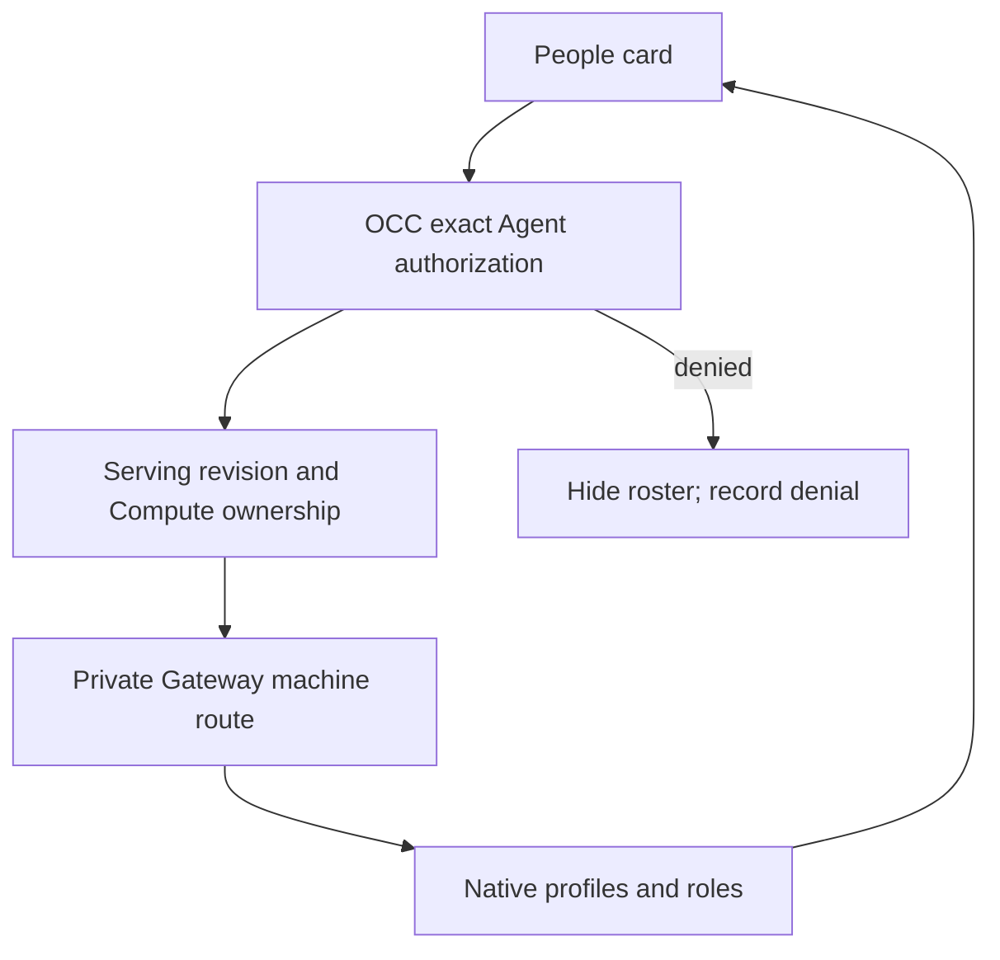

# Gateway people flow

## Overview

The Agent overview reads the serving Gateway's human profiles and native roles.
This is a read-only runtime view, independent of OCC account provisioning and
identity-provider admission. The following paths are implemented in source;
installed proof exercises the deployed controller and Gateway separately.

## Entry Points

- Trigger: open an Agent, select **Refresh people**, or change its serving version.
- Source: `apps/controller/src/console/agents/people.mjs:renderGatewayPeople`.
- Contract: `packages/contracts/src/api/routes.ts:getAgentGatewayPeople` and
  `getAgentGatewayPersonAvatar`, under the exact Namespace and Agent.
- Authority: OCC authenticates the caller and requires exact Agent `administer`.

## Flow

## Execution Trace

### 1. Select the authorized runtime

`apps/controller/src/index.ts:perform`
`packages/occ/src/index.ts:getAdministerableActiveAgentRevision`

The route resolves its server-owned Namespace/Agent scope before selecting the
active revision. An authorization denial never contacts the Gateway. The HTTP
request owns a five-second deadline and aborts on client disconnect. The selected
Compute must own the revision; another Driver's endpoint is not reused.

### 2. Read profiles without creating OCC identities

`apps/controller/src/composition/gateway-people.ts:createGatewayPeopleAccess`
`apps/controller/src/gateway/people-client.ts:createNativeGatewayPeopleAccess`

Composition uses the existing private Compute endpoint and mounted gateway API
key. The native adapter connects as the existing machine identity, checks its
admin grant, and calls `users.list`. OpenClaw supplies effective native roles.
Merged aliases, the shared workspace profile and the loopback owner profile are
excluded. Only profile IDs, display names, roles and avatar availability reach
OCC clients; linked identities, email addresses and GitHub metadata do not.

Avatar reads use a fixed native profile-avatar path at that same Gateway,
validate raster image types, bound the body to 2 MiB, and follow no redirects.
The public avatar operation repeats exact Agent authorization. Missing images
return `404`; roster and avatar responses use `no-store`.

### 3. Render and refresh

`apps/controller/src/console/agents/people.mjs:renderGatewayPeople`
`apps/controller/src/console/agents/detail.mjs:updateCurrentAgent`

The card renders names as text, native role labels, and local authenticated
avatar URLs with initials as fallback. A failed read clears stale entries and
leaves an explicit retry. An empty roster explains that profiles appear after
connection. Denied reads hide the card and are remembered for that view to avoid
repeated audited denials. A serving-version change refreshes the roster.
An installation without the adapter returns `people: null` and hides the card
without turning normal unavailability into a failed Console read.

## Debugging and Verification

- Confirm the caller's exact Agent `administer` grant before diagnosing Gateway
  availability. An identity-provider login alone grants no OCC access.
- Verify the selected Compute owns the active revision and can read its mounted
  key. Gateway role settings must retain machine administration.
- `tests/integration/native-admin-access.test.mjs` isolates HTTP authorization
  and serialization; it does not establish native profile semantics.
- `tests/browser/console-agent-detail-2.test.mjs` exercises the production card's
  role labels and error/empty recovery through the HTTP app.
- `tests/integration/native-admin-k3d-real.test.mjs` reads the roster through the
  installed OCC route and native Gateway RPC.

## Related docs

- [Gateway people contract](../reference/agents/gateway-people.md)
- [Agent overview](../guides/console/agent-people.md)
- [Workspace machine access](workspace-files.md)

## Manual Notes

[keep this for the user to add notes. do not change between edits]

## Changelog

- 2026-10-16 13:02: Added the read-only Gateway people and avatar path. (authoring-run/roster-2596 - d80d214dba75aa446bc8391f19329cb37daa2801)
