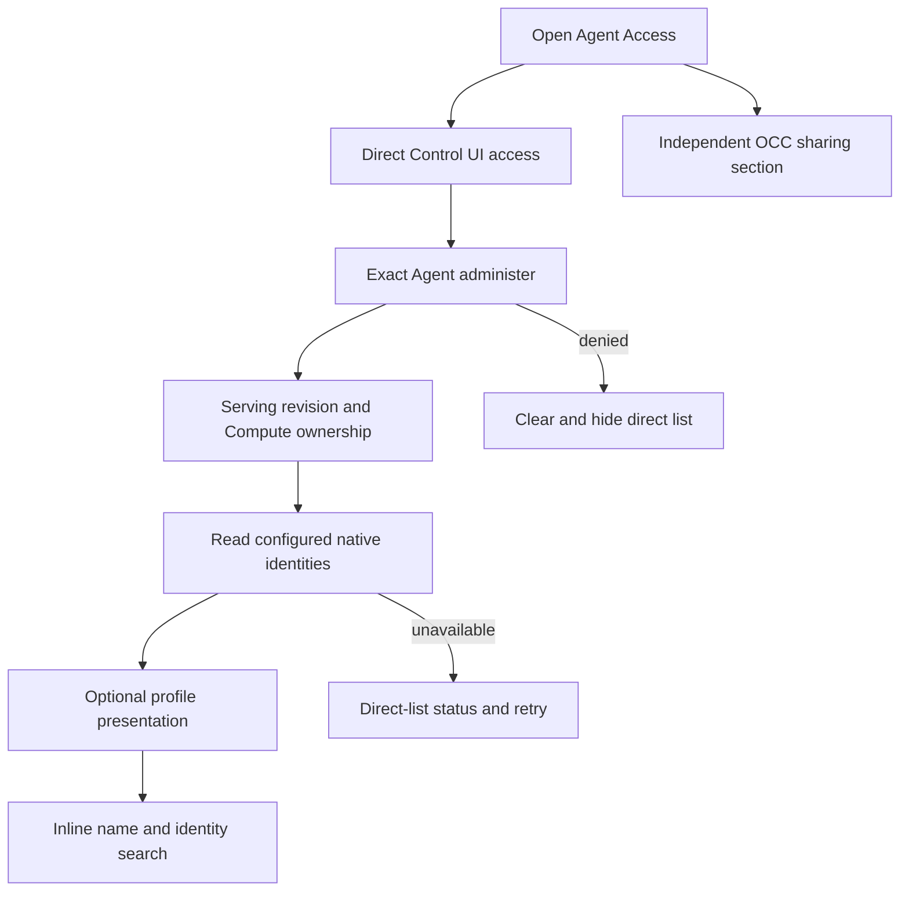

# Gateway people flow

## Overview

The Agent Access view lists configured Gateway identities, enriched with optional
native profile names, avatars and role labels. This read-only view does not provision OCC
accounts or grant access. It does not enumerate OCC proxy users or evaluate external
ingress and identity-provider eligibility.

## Entry Points

- `GET /namespaces/:namespaceId/agents/:agentId/control-ui-bookmark` reads shared
  Agent metadata through `Controller.getAgentControlUiBookmark`.
- `PUT` on that path compares `expectedVersion` and writes or clears the
  bookmark through `Controller.updateAgentControlUiBookmark`.

- Trigger: enter the Agent **Access** view or select **Refresh users** there.
- Source: `apps/controller/src/console/agents/people.mts:renderGatewayPeople`.
- Contract: `packages/contracts/src/api/routes.ts:getAgentGatewayPeople` and
  `getAgentGatewayPersonAvatar`, under the exact Namespace and Agent.
- Authority: OCC authenticates the caller and requires exact Agent `administer`.

## Flow

## Execution Trace

### 1. Select the authorized runtime

`apps/controller/src/index.ts:perform`
`packages/occ/src/index.ts:getAdministerableActiveAgentRevision`

The route resolves its server-owned Namespace/Agent scope before selecting the
active revision. An authorization denial never contacts the Gateway. The HTTP
request owns a five-second deadline and aborts on client disconnect. The Compute
Driver must match the revision's recorded Driver ID and implementation; another
Driver's endpoint is not reused. Roster and avatar reads return `409` without
contacting the Gateway while an exclusive successor replaces the active workload.

### 2. Read configured identities and enrich presentation

`apps/controller/src/composition/gateway-people.ts:createGatewayPeopleAccess`
`apps/controller/src/gateway/people-client.ts:createNativeGatewayPeopleAccess`

Composition uses the existing private Compute endpoint and mounted Gateway API
key. The native adapter checks machine administration and calls `config.get`. It
requires a valid snapshot with the supported `x-occ-identity` trusted-proxy path
and an explicit, nonempty `allowUsers`. The exact reserved `occ-workspace-files`
entry is excluded. Every remaining configured identity creates a row, whether or
not a profile exists. Missing/empty lists and unsupported config fail the read;
they do not imply that nobody has access. The full config is never returned or
logged. This configuration-file snapshot does not prove a pending change is applied.

The adapter optionally calls `users.list`. For the ordinary `x-occ-identity`
path, the native profile writer stores the authenticated login as a trimmed,
lowercase alias in `emails`. That key joins the unchanged configured identity
to a canonical, nonmerged profile. Service/owner profiles and ambiguous aliases
supply no enrichment. Display names are editable presentation. Neither profiles
nor linked aliases create rows. Several configured identities can share one
profile without losing rows. Failed enrichment leaves identity-only rows unless
the request itself is cancelled or times out. Native named-role labels are not
OCC IAM Roles or a complete effective-access answer.

Avatar reads first load the config-derived roster and require a matching native
profile ID with an avatar. Removed, excluded or unknown profiles return `404`
without fetching an image. Eligible profiles use a fixed native profile-avatar
path; configured identities are never substituted into profile URLs. The adapter accepts raster image
types, rejects bodies larger than 2 MiB, and follows no redirects.
The public avatar operation repeats exact Agent authorization. Missing images
return `404`; roster and avatar responses use `no-store`.

Concurrent roster/avatar reads share only an unfinished config/profile lookup for
the same revision, endpoint and machine credential. Each caller resolves its
target and retains its own cancellation/deadline; the last departing reader
cancels the shared transport. The Gateway read has a five-second deadline that
starts with the first reader; later readers do not restart it.
Completion or failure removes the entry, so later requests reread configured
membership rather than retaining withdrawn identities through cached profiles.
Authorization precedes sharing.

### 3. Render on Access without coupling OCC sharing

`apps/controller/src/console/agents/people.mts:renderGatewayPeople`
`apps/controller/src/console/agents/detail.mts:renderAgentDetail`

The Agent overview and unrelated tabs do not mount or probe the roster. Entering
Access shows **Direct Control UI access** before the existing OCC sharing
section. The direct list has its own loading, permission, unavailable and error
outcomes. Its optional read does not hold the entire Access view or wait for
Namespace sharing-policy reads. A sharing-policy denial does not imply a roster
denial; a roster failure does not disable sharing.

The section describes the current serving Gateway configuration, not a selected
saved Agent version. The Access introduction is neutral; the agent-wide scope
statement belongs beside OCC sharing. The direct section is read-only and links
no admission writes to the OCC sharing form. The existing sharing warning and
authoritative server permission checks remain in place.

A current advisory `administer: false` answer clears and hides the direct list
without an audited roster probe. An unknown answer still uses authoritative HTTP
authorization. A remembered roster denial is retained on automatic revisits.
The explicit page **Refresh** in
`apps/controller/src/console/console.mts:loadPage` forgets only this Agent’s roster
denial and retries authorization. A later grant can reveal the list without
signing out; another denial keeps its rows cleared.

Rows show the friendly name above the exact configured identity, or the identity
alone without a name. Known native role labels identify Gateway roles, not OCC
Roles. Avatar URLs use native profile IDs; initials replace missing images.
Search filters names or identities inline. It does not open a preview drawer.
Larger lists keep a usable scroll area without widening the page. Refresh reads
membership again and clears stale rows on failure or denial. Serving-state
changes and Access re-entry request a fresh read. If that refresh supersedes a
read already in progress, the older outcome does not populate the list. Browsing
an old saved version does not select a different roster source.
An installation without the adapter returns `people: null` and hides this
optional section independently of OCC sharing.

### 4. Store the operator-maintained direct-entry bookmark

`packages/occ/src/index.ts:getAgentControlUiBookmark`
`packages/occ/src/index.ts:updateAgentControlUiBookmark`

The dedicated `control-ui-bookmark` GET/PUT operations stay in the existing
Agent owner. `Controller.getAgentControlUiBookmark` authorizes exact Agent read;
`Controller.updateAgentControlUiBookmark` authorizes exact Agent update. The
write validates the HTTPS bookmark without fetching it, then compares the
bookmark version and updates only Agent bookmark metadata. The state transaction
records attributable mutation audit evidence. A stale version cannot overwrite
a newer value, including a cleared bookmark.

The bookmark does not pass through `Controller.updateAgent`, Configuration,
AgentRevision, deployment admission, or a Driver. It must remain usable when
saved Configuration is unreadable or the Gateway is unavailable. Access renders
the bookmark independently from native-profile enrichment, the configured-user
roster, and OCC sharing. Active Access entry, retained resume, and refocus own
its refresh; unrelated tabs must not replay this live metadata read.

`apps/controller/src/console/agents/detail.mts` keeps snapshot authorization
separate from this live Access refresh. After refocus, returning to a retained
snapshot-backed tab checks its snapshot before showing cached private controls.
A successful check preserves the editor and unsaved input. A 403 or 404 removes
those protected controls without blocking the independent Access view.

## Debugging and Verification

- For bookmark failures, check exact Agent read/update permission and the
  bookmark version. Do not diagnose a bookmark read as a native Gateway failure.
  A `409` means the editor must inspect the current saved value, not replay a
  stale update. Saving the URL does not verify destination availability or sign-in.

- Confirm the caller's exact Agent `administer` grant before diagnosing Gateway
  availability. An identity-provider login alone grants no OCC access.
- Verify the selected Compute owns the active revision and can read its mounted
  key. Gateway role settings must retain machine administration.
- `tests/integration/native-admin-access.test.mjs` isolates HTTP authorization
  and serialization. Its TLS/WebSocket peer exercises config membership, native
  alias joins, withdrawal and avatar eligibility through the production adapter;
  it is not an installed native runtime.
- `tests/browser/console-agent-detail-2.test.mjs` exercises the production card's
  names plus identities, never-connected fallback, error/empty recovery, and
  inline Access search and independent sharing/roster outcomes through
  the HTTP app.
- `tests/integration/native-admin-k3d-real.test.mjs` reads the roster through the
  installed OCC route and native Gateway RPC.

## Related docs

- [Gateway people contract](../reference/agents/gateway-people.md)
- [Agent overview](../guides/console/agent-people.md)
- [Workspace machine access](workspace-files.md)

## Manual Notes

[keep this for the user to add notes. do not change between edits]

## Changelog

- 2026-11-04 14:00: Move direct configured users to an independent inline Access section and keep OCC sharing scope separate. (agent:roboclaw:dashboard:41b05c36-846f-4b31-8a13-14ee0d0f6cea - da25193b1)

- 2026-11-02 17:18: Use configured native identities for membership and optional profile enrichment; show names and identities without changing admission. (agent:roboclaw:dashboard:41b05c36-846f-4b31-8a13-14ee0d0f6cea - e38a4986f)

- 2026-11-02 14:14: Rebase onto current main; preserve advisory administration gating and refuse reads during exclusive Gateway replacement. (agent:roboclaw:dashboard:41b05c36-846f-4b31-8a13-14ee0d0f6cea - 08106ca18)

- 2026-10-28 02:10: Rebase the roster onto the current admission stack; use typed Console modules and shared responsive dialog styling. (agent:roboclaw:dashboard:41b05c36-846f-4b31-8a13-14ee0d0f6cea - 19c62e378)

- 2026-10-20 14:57: Add the authorized roster/avatar reads, searchable panel, pending-read sharing and explicit access retry; consolidate PR #2596 history. (agent:roboclaw:dashboard:db15726a-e911-4eff-87c7-9f90ca5b2e3b - fd73e091f)
