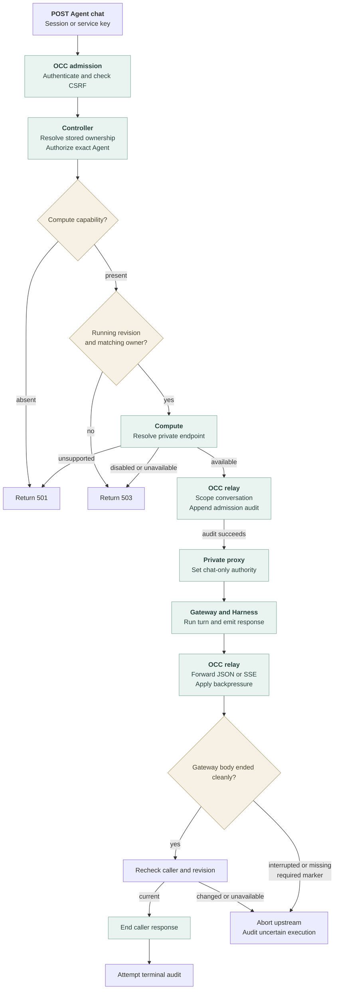

# Agent HTTP chat flow

## Overview

A human or service submits `POST /agents/:agentId/chat`. OCC authenticates,
authorizes the stored Agent, pins its running revision, and relays one native
HTTP completion through the Compute-owned private route. The Gateway and
selected Harness own execution and history. This flow stops when the response
completes or the relay closes; disconnect does not undo tool effects.

## Entry Points

- Source: `apps/controller/src/index.ts:perform`
- Source: `packages/occ/src/agent-queries.ts:resolveAgentChat`
- Source: `apps/controller/src/http/agent-chat.ts:relayAgentChat`
- Assumptions: selected IAM and Compute Drivers, an authenticated session or
  service key, exact-Agent `operate`, and an enabled private runtime route.

## Flow

The diagram follows the current source. Live runtime qualification is separate.

## Execution Trace

### 1. Authenticate and select authority

`apps/controller/src/index.ts:admit` and `resolveIdentity` use the existing
session/CSRF or service-key verifier and selected IAM Driver. The HTTP route has
no Namespace input. `packages/occ/src/agent-queries.ts:resolveAgentChat` finds stored
ownership once per check, enforces a service key's Namespace scope and authorizes `operate`.
Denial audit uses the error's authoritative resource; the route does not copy
stored ownership into request parameters.
A caller with only `read` gets `403`; a hidden or absent Agent gets `404`.

### 2. Select the running revision and private route

`packages/occ/src/agent-queries.ts:resolveAgentChat` checks capability absence before
lifecycle availability, then checks the saved Compute owner before invoking the
Driver. It returns the selected revision with the endpoint result.

`apps/controller/src/drivers/compute/kubernetes/index.ts:getChatCompletionsEndpoint`
checks supported topology and authority, explicit opt-out and route availability
in that order. Compute records HTTP-default admission on new revisions; rendering
and endpoint resolution use that saved decision. A revision without it keeps its
existing settings until redeployment. `reconcileGatewayRoute` creates a revision-specific Service and HTTPRoute
for the exact completion POST. The Service selects only that revision. The route
rewrites the path and supplies the chat scope header. Existing Kubernetes
retirement removes both resources. Core code does not construct Kubernetes paths.

### 3. Forward one request

`apps/controller/src/http/agent-chat.ts:relayAgentChat` rejects native routing
headers, replaces the model target and hashes an explicit conversation label
with stable principal and Agent identities. It constructs upstream headers
without copying caller credentials. Required admission audit precedes the HTTP
request. No retry or redirect follows.

### 4. Bound the relay and record the result

The OCC relay (`apps/controller/src/http/agent-chat.ts:relayAgentChat`)
forwards bytes with backpressure and periodically rechecks the caller and
pinned revision. For `stream: true` with Gateway HTTP 200, OCC retains the
last 128 bytes or fewer and requires a `data: [DONE]` line there. A native
stream error can also end with this marker.

When the Gateway body ends cleanly, OCC waits for any periodic check and
its cleanup, then runs a fresh, bounded check. On success it ends the caller
response and releases any retained bytes. **For JSON the caller may already
have received the entire body**, even if that final check fails.

A failed check, revision change, disconnect, deadline or truncated response
aborts the relay. Before sending headers, OCC can return its error envelope.
After headers, it closes the response. Cleanup clears the timers and disconnect
listeners, aborts the upstream request and attempts one terminal audit after
admission. The audit identifies the principal and revision without message
content. A failed audit write emits `http.audit_append_failed`.

## Debugging and Verification

- `node --test tests/integration/agent-http-chat.test.ts` checks Fastify and IAM
  admission only; it does not prove PostgreSQL or model execution.
- Select `http-chat` in the [real QA matrix](../testing/ci/qa-advisory.md) for
  normal provisioning, real completions and selected Harness tool effects.
- Inspect request IDs, HTTP statuses and revision IDs in audit evidence. A `502`
  after successful resolution points to transport or interruption; `503` can
  precede any upstream request. A `503` `text/plain` body from the route's proxy
  is passed on unchanged: a graceful Gateway Pod deletion cut a non-stream
  request. Do not infer tool rollback from either status.

## Related docs

- [HTTP chat contract](../reference/agent-http-chat.md)
- [Operator procedure](../guides/agent-http-chat.md)
- [Native browser access](agent-native-admin.md)
- [Implementation plan](../../specs/plans/0040-agent-chat-completions.md)

## Manual Notes

## Changelog

- 2026-11-24 15:51: Distinguish JSON and SSE completion after reauthorization. (authoring-run/b555d174-e0cc-47b5-adf4-c60dc37e5995 - 7b0d04f59c01e53e3f19e1e744daee1e428e851c)

- 2026-11-18 05:48: Note that the route proxy's `503` reaches a non-stream caller when a Gateway Pod is deleted. (fix-interrupted-turns-1118 - 8cbb31a68)

- 2026-11-17 02:02: Await the periodic check, then require a fresh post-body delivery check. (authoring-run/28767d0f-55e0-4d91-abb6-1f25ff793a2a - d7c1c305e)

- 2026-11-17 01:37: Share one admission recheck and relay cleanup owner; use stored denial resources. (authoring-run/28767d0f-55e0-4d91-abb6-1f25ff793a2a - 8d3f95dd5)

- 2026-11-16 23:42: Recheck authority before terminal delivery after the real stop-during-stream regression. (authoring-run/e151ca6f-93f3-4976-bad1-585c8dde1264 - 9f342c940)

- 2026-11-16 19:13: Document the accompanying HTTP chat implementation; runtime proof remains pending (authoring-run/e151ca6f-93f3-4976-bad1-585c8dde1264 - 292afc4c5)
