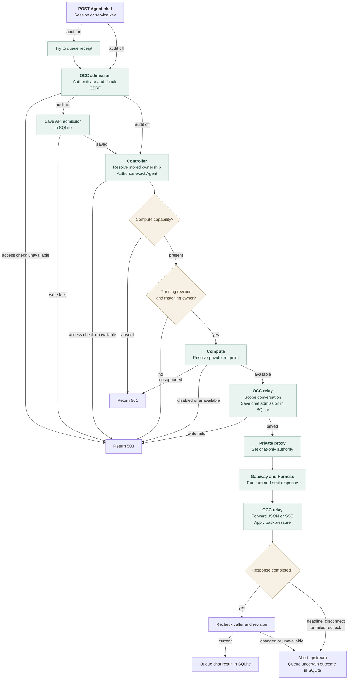

# Agent HTTP chat flow

## Overview

A human or service submits `POST /agents/:agentId/chat`. OCC authenticates,
authorizes the stored Agent, pins its running revision, and relays one native
HTTP completion through the Compute-owned private route. The Gateway and
selected Harness own execution and history. A disconnect does not undo tool
effects. OCC can deliver queued audit records after the relay closes.

## Entry Points

- Source: `apps/controller/src/index.ts:perform`
- Source: `packages/occ/src/index.ts:resolveAgentChat`
- Source: `apps/controller/src/http/agent-chat.ts:relayAgentChat`
- Assumptions: selected IAM and Compute Drivers, an authenticated session or
  service key, exact-Agent `operate`, and an enabled private runtime route.

## Flow

The diagram follows the current source. Live runtime qualification is separate.

## Execution Trace

### 1. Record receipt and check access

After the initial size checks, a chat route with Control Plane audit on calls
`apps/controller/src/index.ts:appendRequestAudit` for
`openclaw.api.request.received` before checking identity or permission.
If the write fails, OCC logs the error and continues these checks.

`apps/controller/src/index.ts:admit` and `resolveIdentity` use the existing
session/CSRF or service-key verifier and selected IAM Driver. With Control
Plane audit on, `requireRequestAuditAdmission` queues
`openclaw.api.request.admitted` before the handler runs.
The HTTP route has no Namespace input. `packages/occ/src/index.ts:resolveAgentChat` finds stored
ownership once per check, enforces a service key's Namespace scope and authorizes `operate`.
Denial audit uses the error's authoritative resource; the route does not copy
stored ownership into request parameters.
A caller with only `read` gets `403`; a hidden or absent Agent gets `404`.

### 2. Select the running revision and private route

`packages/occ/src/index.ts:resolveAgentChat` checks capability absence before
lifecycle availability, then checks the saved Compute owner before invoking the
Driver. It returns the selected revision with the endpoint result.

`apps/controller/src/drivers/compute/kubernetes/index.ts:getChatCompletionsEndpoint`
checks supported topology and authority, explicit opt-out and route availability
in that order. Compute records HTTP-default admission on new revisions; rendering
and endpoint resolution use that saved decision. A revision without it keeps its
existing settings until redeployment. `reconcileGatewayRoute` creates a revision-specific Service and HTTPRoute
for the exact completion POST. The Service selects only that revision. The route
rewrites the path and supplies the chat scope header. Existing Kubernetes
retirement removes both resources. Core code does not construct Kubernetes paths.

### 3. Forward one request

`apps/controller/src/http/agent-chat.ts:relayAgentChat` rejects native routing
headers, replaces the model target and hashes an explicit conversation label
with stable principal and Agent identities. It constructs upstream headers
without copying caller credentials. With audit on or off, the relay queues
`openclaw.agents.chat.admitted` through the State audit sink. If SQLite
cannot save a required record, OCC returns `503` without forwarding.
Otherwise, the relay sends the HTTP request once.

### 4. Bound the relay and record the result

`apps/controller/src/http/agent-chat.ts:relayAgentChat` streams bytes with
backpressure. A timer reauthenticates and reauthorizes the pinned revision.
After the native body completes, terminal delivery awaits any in-flight periodic
check and its cleanup, then starts a fresh bounded admission/revision check.
Checks do not overlap, and terminal bytes stay withheld until the fresh check
succeeds. A check started before body completion cannot authorize delivery.
Failure, revision change, client disconnect or deadline aborts the upstream
connection. One outer cleanup clears the timers and disconnect listeners, aborts
the upstream and queues one chat result. Before headers, OCC can return its
error envelope. After headers, it closes the response. The result identifies
the principal and revision without message content. A PostgreSQL outage
can prevent the access check, but OCC can still queue the interruption.
If OCC cannot queue the result, it logs `http.audit_append_failed`.

When OCC prepares an API response, `apps/controller/src/index.ts:requestAuditHooks`
queues `openclaw.api.request.result` if Control Plane audit is on.
If OCC cannot check access, the result has reason code
`PERMISSION_CHECK_UNAVAILABLE`.
The hook does not run when the relay sends the Gateway response directly.

### 5. Deliver queued records

`packages/occ/src/state/http-chat-audit-queue.ts:startHttpChatAuditQueue`
saves pending HTTP chat events on the API's persistent volume. Delivery
runs in the background while the relay processes the request.

The API checks the queue at startup and every 15 seconds. A new record
also triggers delivery. In
`packages/occ/src/state/postgres-state.ts:startHttpChatAuditDelivery`,
State checks the Installation ID and creation time before each write.
The API removes a record only after PostgreSQL confirms the write to
`occ.audit_events`. If delivery fails, the record stays in SQLite for
another attempt. Other records can arrive first.

If the API stops after PostgreSQL commits but before SQLite removes the
record, the next attempt sends the same event. State accepts an identical
record with the same ID and rejects a conflicting record. The API never
repeats a chat request to recover an audit record.

## Debugging and Verification

- For delayed records, follow [HTTP chat audit recovery](../guides/agent-http-chat.md#retry-delayed-http-chat-audit-records).

- `node --test tests/integration/agent-http-chat.test.ts` checks Fastify and IAM
  admission only; it does not prove PostgreSQL or model execution.
- Select `http-chat` in the [real QA matrix](../testing/ci/qa-advisory.md) for
  normal provisioning, real completions and selected Harness tool effects.
- Inspect request IDs, HTTP statuses and revision IDs in audit evidence. A `502`
  after successful resolution points to transport or interruption; `503` can
  precede any upstream request. A `503` `text/plain` body from the route's proxy
  is passed on unchanged: a graceful Gateway Pod deletion cut a non-stream
  request. Do not infer tool rollback from either status.

## Related docs

- [HTTP chat contract](../reference/agent-http-chat.md)
- [Operator procedure](../guides/agent-http-chat.md)
- [Native browser access](agent-native-admin.md)
- [Implementation plan](../../specs/plans/0040-agent-chat-completions.md)

## Manual Notes

## Changelog

- 2026-11-24 11:24: Trace HTTP chat records from the API volume to PostgreSQL after an outage. (authoring-run/b6bdb7b2-6bd6-4074-9551-f936deb0ad23 - 24f84269c9fa2ae3dc49461b071931b1b27a27fa)

- 2026-11-24 10:21: Trace HTTP chat admission, result and background audit delivery. (authoring-run/e84c6230-3e81-429a-93ee-4459af104384 - de7a98fdbb33b5ed3ac59b2a8ca004b2aeb5f705)

- 2026-11-18 05:48: Note that the route proxy's `503` reaches a non-stream caller when a Gateway Pod is deleted. (fix-interrupted-turns-1118 - 8cbb31a68)

- 2026-11-17 02:02: Await the periodic check, then require a fresh post-body delivery check. (authoring-run/28767d0f-55e0-4d91-abb6-1f25ff793a2a - d7c1c305e)

- 2026-11-17 01:37: Share one admission recheck and relay cleanup owner; use stored denial resources. (authoring-run/28767d0f-55e0-4d91-abb6-1f25ff793a2a - 8d3f95dd5)

- 2026-11-16 23:42: Recheck authority before terminal delivery after the real stop-during-stream regression. (authoring-run/e151ca6f-93f3-4976-bad1-585c8dde1264 - 9f342c940)

- 2026-11-16 19:13: Document the accompanying HTTP chat implementation; runtime proof remains pending (authoring-run/e151ca6f-93f3-4976-bad1-585c8dde1264 - 292afc4c5)
