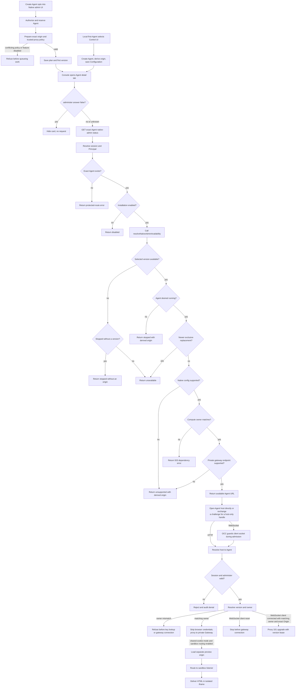

# Agent Native Admin UI Flow

## Overview

The console checks exact-Agent `administer` access and returns a stable native admin URL for the selected gateway version. In shared-cookie mode the Agent host uses the OCE session cookie. In host-only exchange mode the Console keeps that cookie and the Agent receives a separate, revocable handle; OCC rechecks access before proxying HTTP and WebSocket traffic.

## Entry Points

- Trigger: Console opts into native admin during Agent creation, opens an Agent native admin URL, or `scripts/first-agent.mjs --control-ui` creates a compatible local Compose/OpenShell Agent.
- Source: `scripts/first-agent.mjs:nativeConfiguration`
- Source: `apps/controller/src/console/agents/native-admin.mts:renderNativeAdminAccess`
- Source: `apps/controller/src/http/native-admin.ts:resolveNativeAdminAvailability`
- Assumptions: The API has a valid controller session, `agentNativeAdmin.enabled` is true, `agentNativeAdmin.domain` and the [browser session mode](../reference/agent-native-admin.md#host-only-session-exchange) are configured, and private Agent gateway routing can return a `ComputeDriver.getGatewayEndpoint` value.

## Flow

## Execution Trace

### 0. Console opts in before the first deployment

`apps/controller/src/console/agents/create.mts:renderCreateAgent`
`apps/controller/src/http/agents.ts:createAgentHandlers`
`apps/controller/src/gateway/native-admin.ts:prepareNativeAdminConfiguration`
`packages/occ/src/index.ts:provisionAgent`

The unchecked checkbox requires Installation native admin support and runtime
provisioning support. It sends `nativeAdmin: true`. After authorization,
provisioning reserves an Agent ID. The HTTP adapter prepares Configuration from
the configured public origin and Agent domain, never a browser-supplied origin.
It merges the policy or refuses conflicts before queueing. The request fingerprint
includes the preparation choice; retries reuse the saved plan and identity.
The worker creates that Agent and deploys its initial Configuration through
the normal provisioning lifecycle, without a later patch or second deployment.

### 0a. Local first-Agent opts into native admin

`scripts/first-agent.mjs:loadLocalInstallation`
`scripts/first-agent.mjs:nativeConfiguration`
`scripts/first-agent.mjs:ensureManagedConfiguration`

With launcher-owned Compose/OpenShell browser state, the helper saves disabled
Configuration generation 1, creates the Agent, then derives its origin. Before
deployment, generation 2 enables `controlUi`, pins origins, and grants
`occ-workspace-files` trusted-proxy `operator.admin` with device auto-approval.
Identity grants supply admin independently of device scopes.
An existing helper-owned name cannot change this selection.

### 1. Console renders native admin availability

`apps/controller/src/console/agents/native-admin.mts:renderNativeAdminAccess`

Agent detail reads `${path}/native-admin` only when the Agent permission answer
allows `administer` or is unknown. Disabled or denied access stays hidden;
other refusals explain why. Only `available` enables the header **Open Agent UI** control.
Shared-cookie mode opens the link with `noopener noreferrer`. Host-only exchange
opens a window and completes the exchange in step 5a. It accepts challenges only
from that window and origin. Redemption clears `window.opener`; errors close
the pending window. An audited `403` in the session owner’s tab
`sessionStorage` suppresses reads until logout, sign-in, or a new tab. Changes to
`activeRevisionId` or `desiredRuntimeState` refresh access, coalescing concurrent
requests into one follow-up. The target description names the version selected for
service; browsing a historical version does not change the destination. Stopped and
unsupported states offer **Open draft**. An unavailable deployment offers **View deployment**
when a readable version exists. Other unavailable states keep Refresh access.

The warning directs durable changes to OCE and explains Gateway managed mode.

Docker and Kubernetes also pass `OPENCLAW_CONFIG_READONLY_NOTICE` to the Gateway
child when the deployed revision enables managed mode
(`apps/controller/src/drivers/compute/runtime-startup.ts:gatewayManagedModeEnvironment`).
A supporting Gateway uses this text to direct administrators to the Console when
configuration is read-only. A change to the draft's managed mode takes effect at deployment.

### 2. OCC protects the availability route

`apps/controller/src/http/native-admin.ts:nativeAdminStatusOperation`

`createNativeAdminAccess` owns host interception, upgrades and socket shutdown.
A getter supplies the initialized controller after bootstrap. Shared route
admission remains in `apps/controller/src/index.ts`.

`GET /namespaces/:namespaceId/agents/:agentId/native-admin` requires exact-Agent `administer` through `admit` and `resolveIdentity`. `read` and `operate` do not grant access. Even `disabled` is returned only after authorization and existence checks.

### 3. Shared availability resolver checks feature and selected version state

`apps/controller/src/http/native-admin.ts:getNativeAdminStatus`
`apps/controller/src/http/native-admin.ts:resolveNativeAdminAvailability`
`packages/occ/src/index.ts:getAdministerableActiveAgentRevision`

`ResourceConflictError` for an authorized stopped Agent without a selected version becomes only `status: "stopped"`, including new Agents and completed stops. `NoActiveAgentRevisionError` for a running Agent awaiting activation returns `unavailable`. Other dependencies, including IAM/State outages, remain `503` before gateway routing.

With a selected version, OCC derives its native target. Non-running Agents return `stopped` with host/origin; a newer exclusive replacement returns `unavailable`. Unsupported trusted-proxy auth, machine admin grants/device auto-approval, `controlUi.enabled`, exact `allowedOrigins`, or host-header/device-auth settings return `unsupported` with the target.

Then the selected Compute Driver's `id` and `implementation` must match `revision.compute`. Selection changes do not migrate versions. A mismatch raises status `503 DEPENDENCY_UNAVAILABLE` before endpoint/key/transport. Matching ownership proceeds to endpoint validation; a missing or unclean private `wss:` endpoint returns `unsupported`. Only `available` carries `gatewayBase`, which `nativeAdminAvailabilityData` omits from browser responses.

### 4. OCC derives the isolated Agent host

`apps/controller/src/gateway/native-admin.ts:nativeAdminTarget`
`apps/controller/src/gateway/native-admin-host.mjs:deriveNativeAdminHost`

`deriveNativeAdminHost` hashes Installation, Namespace, and Agent IDs into an opaque hostname under the configured domain. `nativeAdminTarget` returns that origin’s `/`.

Native-host admission resolves the hash from Installation, Namespace, and Agent state. Unknown hosts, wrong suffixes, deleted Agents, and non-unique matches fail closed.

`nativeAdminGatewayHttpBase` requires a `wss:` endpoint without userinfo, query, or hash, then converts it to `https:` preserving authority and the Agent base path. Workspace-file WSS behavior stays unchanged.

### 5. Shared cookie admits the Agent host

`apps/controller/src/auth/index.ts:createControllerAuth`

Shared-cookie mode passes the explicit parent domain to Better Auth, validating both hosts and rejecting malformed domains and public suffixes. Disabled native admin keeps host-only cookies. See [cookie scope](../reference/authentication.md#native-admin-shared-sessions).

### 5a. Host-only exchange binds access to the parent session

`apps/controller/src/http/native-admin.ts:launch`
`apps/controller/src/http/native-admin.ts:confirm`
`apps/controller/src/http/native-browser-bridge.ts:landingPage`
`packages/occ/src/state/native-browser-access.ts:PostgresNativeBrowserAccess`

Host-only launch requires the Console session, `x-occ-session-key`, Console
Origin, and exact-Agent `administer`. An intent binds that session, Principal,
Agent, Namespace, revision and origin. The landing page sets its challenge
cookie; the opener confirms it. Redemption checks challenge and exchange, consumes
and audits the intent, and sets the access cookie. It reuses an unexpired handle
only when Installation, parent session, Principal, Agent, Namespace, revision,
origin and parent expiry match; otherwise it replaces it. Reuse preserves existing
WebSockets without allocating another handle. Stored secrets are hashed; expired,
replayed or mismatched exchanges fail closed.

Human authentication owns parent-session currentness. Admission and renewal
recheck that session, exact-Agent access and revision. The exchange creates no
account or grant. See [session limits](../reference/agent-native-admin.md#host-only-session-exchange).

### 6. OCC intercepts native-host HTTP requests

`apps/controller/src/http/native-admin.ts:interceptNativeAdminHttp`

The `onRequest` hook intercepts the native admin domain before routing, so an
Agent origin cannot expose console or controller routes. OCC resolves the shared session
or host-only handle, IAM identity and exact Agent, requires `administer`, then
checks the selected version and native configuration. An attributable IAM
denial records the human and Agent in the denial audit.
Admission owns one audit attempt per such denial, also when it arrives after the
five-second admission wait, a client disconnect or the shutdown wait. A timely HTTP
denial waits for its append before returning `403`; a failed append or admission
timeout returns `503`.

Without a session, a user-activated top-level HTML GET to `/`, `/chat/main` or
`/chat/main/<32 hex>`, optionally with a trailing slash, gets a `302` to the
console; its fragment carries only the opaque host key. Without
`Sec-Fetch-User: ?1` (never sent by Safari) it gets a 403 **Sign in** link there.
Link previews, APIs, writes and WebSockets keep their refusal.

A signed-in `administer` denial on a top-level page load stays HTTP 403. The page does
not name the Agent and links **Go to your Agents** to `/console/agents` on the
configured public origin. A JSON refusal names the `administer` grant but not
the Agent, the same for an unknown host; WebSocket refusals stay unchanged.

Status and proxy checks reuse one Better Auth lookup for identity, expiry and
attribution. Each WebSocket lease checks the current session again. After handling
stopped, replacing or unsupported Agents, admission rechecks both Compute owner
fields. A mismatch returns HTTP `403` or closes an upgrading socket without an
HTTP response, before gateway-key lookup or connection. A failed lease closes
both sockets.

`apps/controller/src/gateway/native-admin-proxy.ts:proxyNativeAdminHttp`

The HTTP proxy normalizes URLs (maximum 4,096 characters), requires an exact
`Origin` except for GET/HEAD, and strips cookies, service keys, forwarding,
identity and scope headers, and upstream `Set-Cookie`. It rejects service-worker
scripts, rewrites same-upstream redirects to the Agent origin, adds CSP
`worker-src 'none'`, and forwards to the private HTTPS Gateway. Avatar `502`
responses become empty `404`s: both show initials when Gravatar is unreachable.

### 7. OCC proxies native WebSocket upgrades

`apps/controller/src/http/native-admin.ts:handleNativeAdminUpgrade`

The API process intercepts `upgrade` before Fastify routing. It accepts only derived Agent hosts and tracks active sockets so `preClose` destroys them during shutdown. Before awaiting session and exact-Agent admission, it handles client socket errors; a TCP reset during admission therefore does not raise an uncaught socket error. A refused socket closes without waiting for its denial audit, which still runs after a reset. An allowed admission checks for client destruction and shutdown before and after resolving the private transport context, so late success cannot open a gateway connection. A connected client proceeds with the selected version.

`apps/controller/src/gateway/native-admin-proxy.ts:proxyNativeAdminWebSocket`

The WebSocket proxy requires a non-null exact Agent `Origin`, forwards a sanitized upgrade request to the private `https:` gateway base, and only connects the browser after the upstream returns `101`. `onConnect` appends `openclaw.agents.native_admin.websocket.connect`; `onClose` appends `openclaw.agents.native_admin.websocket.close`. The `websocket.connect` audit record includes `connectionId`; the matching `websocket.close` audit record reuses that `connectionId` and includes `closeReason`, whose value distinguishes lifecycle, revocation, dependency, client, upstream, and shutdown paths. A timer rechecks session admission every 25 seconds, with each check subject to a five-second timeout. Failed, denied, timed-out, or version-changed lease checks close both sockets. Denial closure does not wait for the append; a late attributable lease denial still gets its single audit attempt. An authorized reconnect uses the selected version. Native chat does not renew the OCE session.

Bridge requests, admission and close audits share one five-second shutdown drain. Bridge handlers stop before subsequent phases or secret delivery after shutdown or client disconnect. Work still pending
afterwards logs `native_admin.pending_work_unresolved` with its count and keeps its
audit attempt while the process lives. The drain neither cancels producers nor
guarantees durable delivery; process exit can prevent or interrupt an audit attempt.

### 8. Runtime renders HTML on a separate origin

`apps/controller/src/drivers/compute/kubernetes/index.ts:gatewaySandboxConfiguration`
`apps/controller/src/drivers/compute/kubernetes/index.ts:reconcileGatewayRoute`

In shared-cookie mode with sandbox routing configured, preparation and activation render the
Agent's stable preview origin and adjacent sandbox port in its native document.
The worker reconciles its GET/HEAD route, public-shell SecurityPolicy and
Agent-scoped backend ingress policy under the serving version. A separate Helm listener admits only configured ingress
peers, and the backend targets the sandbox port instead of the admin port.
The preview domain is outside the shared session cookie scope. Native UI still
reads private file content through its authenticated connection, then delivers
it to the runtime's isolated iframe. The sandbox listener serves public shell
and registered renderer assets; runtime CSP and nested frame isolation remain
responsible for executing generated content. See the [routing contract](../reference/gateway-routing.md#public-preview-routing).

For opted-in Kubernetes gateways, `KubernetesComputeDriver.privateStateInitContainer`
copies the admitted configuration from `/etc/openclaw-managed/openclaw.json` to
`/runtime-state/home/.openclaw/openclaw.json` on the init container's writable
volume. The gateway mounts that same home subdirectory at `/home/node`, so native
edits remain Pod-local and the next Pod starts from the admitted configuration.
The init container cannot write through the gateway's later mount path.

`apps/controller/src/drivers/compute/kubernetes/runtime-entrypoints.ts:configureNativeWorkerProfile`
reuses only the exact generated worker profile after a container restart;
conflicting settings fail. `KubernetesComputeDriver.gatewayPrivateStateVolumeMounts`
retains `client/` and its migration receipt with the Gateway database. Native
admin Configuration remains Pod-local.

## Debugging and Verification

- For startup failures, check the [configuration error codes](../reference/agent-native-admin.md#failure-behavior) against the selected session mode.
- Use the [availability definitions](../reference/agent-native-admin.md#authorization-and-availability). A failed replacement can leave the previous version selected without a workload.
- Unknown Agent hosts fail before proxying. Check host derivation, Agent state, and `agentNativeAdmin.domain`.
- Shared-cookie mode opens the Agent directly. Host-only exchange uses launch, challenge and redemption requests; verify the Console cookie is absent from Agent-host requests and both cookies are absent upstream.
- IAM denial audits should appear for attributable denied status checks, proxy admission, and WebSocket lease renewal, with the human principal and exact Agent target preserved.
- A TCP reset during WebSocket admission leaves the API running and preserves a later authorization-denial audit without opening an upstream connection.
- WebSocket connect and close audits share `connectionId`; close audits add a `closeReason` category from step 7.
- Service-worker registration failure is expected: the HTTP proxy rejects `Service-Worker: script` requests and adds `worker-src 'none'` to proxied responses.
- Browser tests cover panel visibility, warnings, availability, and URL opening. Integration proof covers shared-cookie admission, denied service keys and unknown hosts, assets, WebSocket leases and reconnects, and a reversible native edit.

## Related docs

- [Agent native admin UI](../reference/agent-native-admin.md)
- [Platform console](../reference/console.md#open-the-native-admin-ui)
- [Gateway routing with Envoy](../reference/gateway-routing.md#native-admin-ui-routing)
- [Deploy native admin UI access](../guides/deploy/native-admin.md)
- [Workspace files flow](workspace-files.md)

## Manual Notes

[keep this for the user to add notes. do not change between edits]

## Changelog

- 2026-11-06 07:57: Integrate host-only exchange, repeat launches and current session ownership in accompanying changes. (authoring-run/43cf1307-6d25-4d9d-951e-55fe09a514b8 - a4c2191e73337d73ee27e7fe2c9a51cef40d99f5)

- 2026-11-03 12:55: Sign-in link for unactivated page loads. (fix/native-admin-signed-out-html-fallback)

- 2026-11-02 09:55: Shorten provisioning prose and link shared status definitions after rebasing. (authoring-run/275c0d0a-d040-47d3-9e52-47ff86b87ab9 - 393b1585e4b10a3232abf10c60b766d8e55d85ce)

- 2026-10-28 19:58: Document how managed deployments supply read-only configuration guidance. (codex/01a1558e-c27f-7bc0-a403-af59e9364ddf - aa352e92bcdc7cab58364c692a01042c5e459db0)
- 2026-10-28 12:08: Preserve current native UI navigation and human identity grants during the main refresh. (authoring-run/bafb2708-241b-4261-ab93-1df07dbe94fc - 19c62e378cce0658dff99f5a2d264669a48fc5c6)

- 2026-10-27 11:18: Added creation-time native admin preparation before the first deployment. (authoring-run/5809f10b-3a85-4a0a-8cce-2d3ba6714791 - b91dc40eaaa6e5d29759f5cf4e9dada5a36be86e)
- 2026-10-27 09:30: Document direct Open Agent UI navigation and availability recovery. Accompanying uncommitted changes. (authoring-run/f3434faa-8624-4f34-83a2-521047f80329 - 24a35dff22e1efb2a9b7058f5c90d6d9e2f9caf7)
- 2026-10-27 01:52: Preserve current socket-admission behavior while integrating human Gateway grants. (authoring-run/7761d6fc-94f3-45f2-96c0-171d284aa937 - d56aaf212)

- 2026-10-26 22:00: Close refused sockets and denied leases before their denial audit settles; track admission through its audit attempt and bound the shutdown drain. (wf-land-1707 - #1707)
- 2026-10-26 01:00: A JSON `administer` denial names the grant, not the Agent.
- 2026-10-25 16:40: Preserve current native-admin flow and identity-grant eligibility while rebasing. (authoring-run/7761d6fc-94f3-45f2-96c0-171d284aa937 - e1c6288c28b8dcc62926e44ba43f8edd945dfcd1)

- 2026-10-15 21:41: Allowed narrow device enrollment with machine admin grants. (authoring-run/4a439216-a1ba-4628-b96e-660a9db92d59 - e03429ce3d889b0ac07fedad801aacacc3498a6a)

- 2026-10-25 12:00: Skip the status read when the permission answer denies `administer`.
- 2026-10-24 23:25: Documented the authenticated browser 403 Agents link.
- 2026-10-20 14:54: Extract persistence repair; trim repeated prose. (agent:roboclaw:dashboard:830a6ba7-3357-4ae0-9037-95d98205608c - 1ce18eeea10c83c856c8c08f6b0815e4b39308e0)

[Agent native admin documentation history](agent-native-admin/history.md) preserves the older dated entries.
