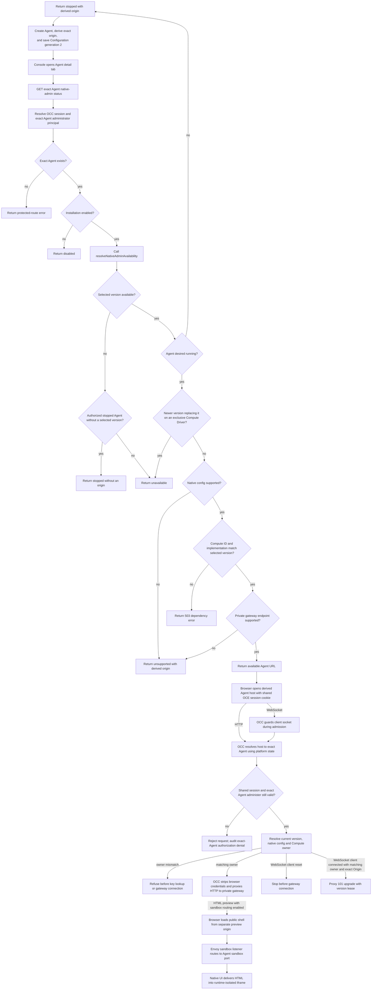

# Agent Native Admin UI Flow

## Overview

The console checks exact-Agent `administer` access and returns a stable native admin URL for the selected gateway version. The Agent host uses the OCE session cookie; OCC rechecks access before proxying HTTP and WebSocket traffic.

## Entry Points

- Trigger: Console opens an Agent native admin URL, or `scripts/first-agent.mjs --control-ui` creates a compatible local Compose/OpenShell Agent.
- Source: `scripts/first-agent.mjs:nativeConfiguration`
- Source: `apps/controller/src/console/agents/native-admin.mjs:renderNativeAdminAccess`
- Source: `apps/controller/src/http/native-admin.ts:resolveNativeAdminAvailability`
- Assumptions: The API has a valid controller session, `agentNativeAdmin.enabled` is true, `agentNativeAdmin.domain` and `agentNativeAdmin.sharedCookieDomain` are configured, Better Auth emits the shared session cookie at that parent domain, and private Agent gateway routing can return a `ComputeDriver.getGatewayEndpoint` value.

## Flow

## Execution Trace

### 0. Local first-Agent opts into native admin

`scripts/first-agent.mjs:loadLocalInstallation`
`scripts/first-agent.mjs:nativeConfiguration`
`scripts/first-agent.mjs:ensureManagedConfiguration`

With launcher-owned Compose/OpenShell browser state, the helper saves disabled
Configuration generation 1, creates the Agent, then derives its origin. Before
deployment, generation 2 enables `controlUi`, pins origins, and grants
`occ-workspace-files` trusted-proxy `operator.admin` with device auto-approval.
An existing helper-owned name cannot change this selection.

### 1. Console renders native admin availability

`apps/controller/src/console/agents/native-admin.mjs:renderNativeAdminAccess`

Agent detail reads `${path}/native-admin`. Disabled or denied access stays hidden;
other refusals explain why. Only `available` shows **Open admin console**, opening
with `noopener noreferrer`. An audited `403` in the session owner’s tab
`sessionStorage` suppresses reads until logout, sign-in, or a new tab. Changes to
`activeRevisionId` or `desiredRuntimeState` refresh access, coalescing concurrent
requests into one follow-up.

The warning says native edits are outside OCE; durable configuration belongs in OCE.

### 2. OCC protects the availability route

`apps/controller/src/http/native-admin.ts:nativeAdminStatusOperation`

`createNativeAdminAccess` owns host interception, upgrades and socket shutdown.
A getter supplies the initialized controller after bootstrap. Shared route
admission remains in `apps/controller/src/index.ts`.

`GET /namespaces/:namespaceId/agents/:agentId/native-admin` requires exact-Agent `administer` through `admit` and `resolveIdentity`. `read` and `operate` do not grant access. Even `disabled` is returned only after authorization and existence checks.

### 3. Shared availability resolver checks feature and selected version state

`apps/controller/src/http/native-admin.ts:getNativeAdminStatus`
`apps/controller/src/http/native-admin.ts:resolveNativeAdminAvailability`
`packages/occ/src/index.ts:getAdministerableActiveAgentRevision`

After the authorization and existence checks above, enabled access requires a public origin/domain and `getAdministerableActiveAgentRevision`.

`ResourceConflictError` for an authorized stopped Agent without a selected version becomes only `status: "stopped"`, including new Agents and completed stops. `NoActiveAgentRevisionError` for a running Agent awaiting activation returns `unavailable`. Other dependencies, including IAM/State outages, remain `503` before gateway routing. The console offers deployment checks and refresh for the selected version, independently of the viewed snapshot. Denials remain `403` with the human IAM audit.

With a selected version, OCC derives its native target. Non-running Agents return `stopped` with host/origin; a newer exclusive replacement returns `unavailable`. Unsupported trusted-proxy auth, admin scopes/device auto-approval, `controlUi.enabled`, exact `allowedOrigins`, or host-header/device-auth settings return `unsupported` with the target.

Then the selected Compute Driver's `id` and `implementation` must match `revision.compute`. Selection changes do not migrate versions. A mismatch raises status `503 DEPENDENCY_UNAVAILABLE` before endpoint/key/transport. Matching ownership proceeds to endpoint validation; a missing or unclean private `wss:` endpoint returns `unsupported`. Only `available` carries `gatewayBase`, which `nativeAdminAvailabilityData` omits from browser responses.

### 4. OCC derives the isolated Agent host

`apps/controller/src/gateway/native-admin.ts:nativeAdminTarget`
`apps/controller/src/gateway/native-admin-host.mjs:deriveNativeAdminHost`

`deriveNativeAdminHost` hashes Installation, Namespace, and Agent IDs into an opaque hostname under the configured domain. `nativeAdminTarget` substitutes it in `publicOrigin` and returns `/`.

Native-host admission resolves the hash from Installation, Namespace, and Agent state. Unknown hosts, wrong suffixes, deleted Agents, and non-unique matches fail closed.

`nativeAdminGatewayHttpBase` requires a `wss:` endpoint without userinfo, query, or hash, then converts it to `https:` preserving authority and the Agent base path. Workspace-file WSS behavior stays unchanged.

### 5. Shared cookie admits the Agent host

`apps/controller/src/auth/index.ts:createControllerAuth`

When enabled, native admin passes the configured shared cookie domain to Better Auth. The controller validates that the console and Agent hosts fit that parent on DNS-label boundaries, rejecting public suffixes and malformed domains. It never infers a parent domain. When disabled, the console uses the host-only `openclaw_occ` cookie. A shared-domain cookie cannot use the `__Host-` prefix; one canonical name and scope prevents ambiguous duplicates.

### 6. OCC intercepts native-host HTTP requests

`apps/controller/src/http/native-admin.ts:interceptNativeAdminHttp`

The `onRequest` hook intercepts the native admin domain before routing, so an
Agent origin cannot expose console or controller routes. OCC authenticates the
shared session, resolves the IAM identity and exact Agent, requires `administer`,
then checks the selected version and native configuration. An attributable IAM
denial records the human and Agent in the denial audit.

Without a valid session, a user-activated, top-level HTML GET to `/`,
`/chat/main`, or `/chat/main/<32 hex digits>` gets a `302` to the configured
console. Its fragment carries only the opaque host key, which the console resolves
after sign-in and exact-Agent authorization. OCC drops queries and session suffixes.
API requests, writes, WebSockets and permission denials never redirect. Reload an
open native tab after expiry.

Status and proxy checks reuse one Better Auth lookup for identity, expiry and
attribution. Each WebSocket lease checks the current session again. After handling
stopped, replacing or unsupported Agents, admission rechecks both Compute owner
fields. A mismatch returns HTTP `403` or closes an upgrading socket without an
HTTP response, before gateway-key lookup or connection. A failed lease closes
both sockets.

`apps/controller/src/gateway/native-admin-proxy.ts:proxyNativeAdminHttp`

The HTTP proxy validates and normalizes the request URL, which must not exceed 4,096 characters, rejects missing or nonmatching `Origin` on non-GET/HEAD requests, strips browser cookies, service keys, forwarding headers, native identity, native scopes, and upstream `Set-Cookie`, rejects service-worker script requests, rewrites same-upstream `Location` values to the Agent origin, appends `worker-src 'none'` to proxied Content Security Policy, and forwards to the private `https:` gateway base. A `502` from the gateway's user-photo route (`/api/users/<id>/avatar`) becomes an empty `404`: it means OpenClaw could not fetch a Gravatar fallback, which a dedicated Gateway without internet egress never can, and the UI shows initials for both. The native gateway never receives the OCE session cookie.

### 7. OCC proxies native WebSocket upgrades

`apps/controller/src/http/native-admin.ts:handleNativeAdminUpgrade`

The API process intercepts `upgrade` before Fastify routing. It accepts only derived Agent hosts and tracks active sockets so `preClose` destroys them during shutdown. Before awaiting shared-session and exact-Agent admission, it handles client socket errors; a TCP reset during admission therefore does not raise an uncaught socket error. An exact-Agent authorization denial still records its attributable audit after a reset. An allowed admission checks whether the client socket was destroyed before and after resolving the private transport context, so a disconnected client does not open a gateway connection. A connected client proceeds with the selected version.

`apps/controller/src/gateway/native-admin-proxy.ts:proxyNativeAdminWebSocket`

The WebSocket proxy requires a non-null exact Agent `Origin`, forwards a sanitized upgrade request to the private `https:` gateway base, and only connects the browser after the upstream returns `101`. `onConnect` appends `openclaw.agents.native_admin.websocket.connect`; `onClose` appends `openclaw.agents.native_admin.websocket.close`. The `websocket.connect` audit record includes `connectionId`; the matching `websocket.close` audit record reuses that `connectionId` and includes `closeReason`, whose value distinguishes lifecycle, revocation, dependency, client, upstream, and shutdown paths. A timer rechecks the shared-session admission path every 25 seconds, with each check subject to a five-second timeout. Failed, denied, timed-out, or version-changed lease checks close both sockets and preserve the IAM denial audit when authorization is the reason. An authorized reconnect uses the selected version. Native chat does not renew the OCE session.

### 8. Runtime renders HTML on a separate origin

`apps/controller/src/drivers/compute/kubernetes/index.ts:gatewaySandboxConfiguration`
`apps/controller/src/drivers/compute/kubernetes/index.ts:reconcileGatewayRoute`

With operator sandbox routing configured, preparation and activation render the
Agent's stable preview origin and adjacent sandbox port in its native document.
The worker reconciles its GET/HEAD route, public-shell SecurityPolicy and
Agent-scoped backend ingress policy under the serving version. A separate Helm listener admits only configured ingress
peers, and the backend targets the sandbox port instead of the admin port.
The preview domain is outside the shared session cookie scope. Native UI still
reads private file content through its authenticated connection, then delivers
it to the runtime's isolated iframe. The sandbox listener serves public shell
and registered renderer assets; runtime CSP and nested frame isolation remain
responsible for executing generated content. See the [routing contract](../reference/gateway-routing.md#public-preview-routing).

For opted-in Kubernetes gateways, `KubernetesComputeDriver.privateStateInitContainer`
copies the admitted configuration from `/etc/openclaw-managed/openclaw.json` to
`/runtime-state/home/.openclaw/openclaw.json` on the init container's writable
volume. The gateway mounts that same home subdirectory at `/home/node`, so native
edits remain Pod-local and the next Pod starts from the admitted configuration.
The init container cannot write through the gateway's later mount path.

`apps/controller/src/drivers/compute/kubernetes/runtime-entrypoints.ts:configureNativeWorkerProfile`
reuses only the exact generated worker profile after a container restart;
conflicting settings fail. `KubernetesComputeDriver.gatewayPrivateStateVolumeMounts`
retains `client/` and its migration receipt with the Gateway database. Native
admin Configuration remains Pod-local.

## Debugging and Verification

- `AGENT_NATIVE_ADMIN_INVALID` at startup points to native admin enablement, the Agent domain, or a missing shared cookie domain. A bad shared cookie domain or public origin reports `AUTH_BASE_URL_INVALID`, short auth secret material `AUTH_SECRET_INVALID`, and a missing gateway API key path `GATEWAY_API_KEY_UNAVAILABLE`.
- `disabled` means the Installation has not enabled the feature.
- `stopped` means the exact Agent is not desired running. Its response has no origin or version after stop reconciliation clears the selected version, or before the first deployment.
- `unavailable` means a desired-running Agent has no selected version, or a newer version on a Compute Driver with `requiresStoppedPredecessors` has stopped the active workload. If replacement fails, the old version remains selected without a workload.
- `unsupported` means the selected Compute Driver, gateway endpoint, or native trusted-proxy/control UI configuration cannot support the selected version.
- Wrong or unknown Agent hosts fail before gateway proxying. Check the derived host calculation, Agent lifecycle state, and `agentNativeAdmin.domain`.
- Browser requests contain no native-admin exchange, callback, verifier, or Agent-specific session-cookie traffic. The native gateway must not receive the OCE cookie.
- IAM denial audits should appear for attributable denied status checks, proxy admission, and WebSocket lease renewal, with the human principal and exact Agent target preserved.
- A TCP reset during WebSocket admission leaves the API running and preserves a later authorization-denial audit without opening an upstream connection.
- `openclaw.agents.native_admin.websocket.connect` audits should include `connectionId`; matching `openclaw.agents.native_admin.websocket.close` audits should reuse `connectionId` and include `closeReason` with one of the expected categories: lifecycle, revocation, dependency, client, upstream, or shutdown.
- Service-worker registration failure is expected: the HTTP proxy rejects `Service-Worker: script` requests and adds `worker-src 'none'` to proxied responses.
- Browser tests cover panel visibility, warnings, availability, and URL opening. Integration proof covers shared-cookie admission, denied service keys and unknown hosts, assets, WebSocket leases and reconnects, and a reversible native edit.

## Related docs

- [Agent native admin UI](../reference/agent-native-admin.md)
- [Platform console](../reference/console.md#open-the-native-admin-ui)
- [Gateway routing with Envoy](../reference/gateway-routing.md#native-admin-ui-routing)
- [Deploy native admin UI access](../guides/deploy/native-admin.md)
- [Workspace files flow](workspace-files.md)

## Manual Notes

[keep this for the user to add notes. do not change between edits]

## Changelog

- 2026-10-20 14:54: Extract persistence repair; trim repeated prose. (agent:roboclaw:dashboard:830a6ba7-3357-4ae0-9037-95d98205608c - 1ce18eeea10c83c856c8c08f6b0815e4b39308e0)

- 2026-10-19 23:14: Retain Gateway client state and reuse the exact generated native worker profile on restart. (authoring-run/45df354e-6d46-4430-83a5-3885d8a9fb76 - c584934287f78a4f3cf7c84cfb02febd9f3437ab)

- 2026-10-19 22:11: Document return to the requested page after session expiry. (authoring-run/e63eaa44-e02d-49aa-b1c6-4711bd49d919 - 332455338271720ef29c63e5e7fb209fa3da6ec2)

- 2026-10-15 21:30: Present the authorized launch and its access boundaries in the Agent overview. (authoring-run/6d9b833d-e4fc-4f58-98a8-f0fac29f709d - 7adac57cc03545bdd3cdc383c88219396a677fd9)
- 2026-10-15 20:27: Redirect copied chat navigation to the canonical console. (authoring-run/98164c0a-da1e-45c5-9d9a-8f6649a3a9c3 - b899534fae0070fab31489d54a8763bb81e4842e)
- 2026-10-14 11:53: Extracted shared hostname derivation so the first-Agent script starts without installed workspace dependencies. (authoring-run/fba0a85c-ba37-4764-871e-9fdf80ee1083 - 5511d28d1)

- 2026-10-14 00:10: Distinguished HTTP refusal from WebSocket socket closure without a response. (01a13783-3cb5-7f53-8668-b2e3affa2b12 - e64d04f12cb80eb438a4c442180e56c2a2adae38)

- 2026-10-13 23:57: Documented the selected version Compute-owner comparison and status/proxy refusal before gateway effects. (01a13783-3cb5-7f53-8668-b2e3affa2b12 - e64d04f12cb80eb438a4c442180e56c2a2adae38)

- 2026-10-08 03:40: Documented client reset handling during native-admin WebSocket admission and the denial-audit and upstream-connection ordering at inspected commit `002d0f796`. (authoring-run/1e4aaf85-2e38-434d-99c0-75881fe9991c - 002d0f79639a9c814eb1fa2799530516a6c90cde)

- 2026-10-06 12:00: Traced the optional first-Agent Configuration generation that derives and allows the exact local native-admin origin before deployment. (authoring-run/0e6b1c8a-1723-4b20-ae51-08fa9457204a - 99641a7ab)

- 2026-10-04 07:30: Only a missing selected version reports `unavailable`; IAM and other dependency outages return `503`, and close or refuse proxied requests as `dependency_failure`. (bh11-native-status)

- 2026-10-03 12:00: Reread availability once when deployment polling observes a new selected version or runtime state.

- 2026-10-01 17:20: Move native-admin admission, availability, sockets and shutdown ownership into the HTTP module. (authoring-run/bef09bf6-deaa-4189-9568-5f13beb451e7 - 7a6cc931d)

- 2026-10-01 21:00: Reported `unavailable` while a newer exclusive version replaces the active workload, including after that replacement fails.
- 2026-10-01 18:20: Answered unreachable user-photo fallbacks with `404` instead of `502`.

- 2026-09-30 19:00: Remembered a denied availability read per tab and session owner so reloads do not add an audited denial per view.

- 2026-09-29 21:35: Corrected native configuration initialization to write through the init volume mount. (89a4ccd7-3974-43c6-b08a-be02269a8d01 - cc96e34f33868555d4a89cb44bc022859d76c815)

- 2026-09-28 16:20: Added the accompanying optional sandbox routing implementation and separate-origin preview flow. (01a0cf72-6985-7712-ba92-d8cc32470f24 - 33a2528163d5bbff311bb685345e60aadb24a70a)

- 2026-09-21 21:20: Distinguished authorized stopped Agents with no selected version from unavailable running deployments. (01a0c750-0c10-7492-97eb-f4124cded820 - 156dd67b7bd280a380d96b5c34a64e402fe3b96b)
- 2026-09-21 21:17: Clarified the console's selected version dependency message and its independence from the viewed configuration snapshot. (01a0c750-0c10-7492-97eb-f4124cded820 - f3dbdd41c8f3b49573d1353a4b06ce510ee43a56)
- 2026-09-20 09:45: Reused session metadata from admission and replaced launch bookkeeping with a direct browser link; socket lifecycle state remains owned by the proxy. (01a0b7fd-13fa-7dc2-8653-5c5814b59305 - bbb864aadc709dcc4f7b95d4b42b74823c18363a)
- 2026-09-20 08:53: Replaced the native-admin exchange flow with shared OCE session cookie admission, host-to-Agent resolution, credential stripping, and current-version reconnect behavior. (cody/01a0b7fd-13fa-7dc2-8653-5c5814b59305 - 5e5f12f37842ae7239d73432e00609547627ded8)
- 2026-09-19 22:27: Documented exact-Agent disabled-status gating, IAM denial audit preservation, and WebSocket `connectionId`/`closeReason` audit fields. (01a0b7fd-13fa-7dc2-8653-5c5814b59305 - 9621ce4e)
- 2026-09-19 21:14: Updated the flow for the shared availability resolver names and service-worker blocking behavior. (01a0b7fd-13fa-7dc2-8653-5c5814b59305 - 06c23b9c)
- 2026-09-19 21:07: Added the `DependencyUnavailableError` to `unavailable` status branch and clarified derived-origin status payloads. (01a0b7fd-13fa-7dc2-8653-5c5814b59305 - 06c23b9c)
- 2026-09-19 20:19: Added the source-backed native admin UI availability, launch, cookie redemption, HTTP proxy, and WebSocket proxy flow. (01a0b7fd-13fa-7dc2-8653-5c5814b59305 - 06c23b9c)
