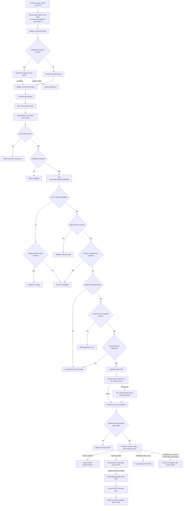

# Agent Native Admin UI Flow

## Overview

Deployment prepares enabled Kubernetes native admin policy in an immutable Agent revision without changing its reusable Configuration. The console returns the active gateway's stable URL after exact-Agent `administer` authorization. The Agent host uses the OCE session cookie; OCC rechecks access before proxying HTTP and WebSockets.

## Entry Points

- Trigger: Deployment/provisioning admits a revision; Console opens native admin; the local first-Agent helper prepares a Compose/OpenShell Agent.
- Source: `scripts/first-agent.mjs:nativeConfiguration`
- Source: `apps/controller/src/console/agents/native-admin.mjs:renderNativeAdminAccess`
- Source: `apps/controller/src/http/native-admin.ts:resolveNativeAdminAvailability`
- Assumptions: The API has a valid controller session, `agentNativeAdmin.enabled` is true, `agentNativeAdmin.domain` and `agentNativeAdmin.sharedCookieDomain` are configured, Better Auth emits the shared session cookie at that parent domain, and private Agent gateway routing can return a `ComputeDriver.getGatewayEndpoint` value.

## Flow

## Execution Trace

### 0. Local first-Agent opts into native admin

`scripts/first-agent.mjs:loadLocalInstallation`
`scripts/first-agent.mjs:nativeConfiguration`
`scripts/first-agent.mjs:ensureManagedConfiguration`

The option requires launcher-owned Compose/OpenShell browser state. Because OCC
assigns the Agent ID, the helper saves disabled Configuration generation 1,
creates the Agent, derives its origin, and patches generation 2 before
deployment. Generation 2 enables `controlUi`, pins its origins, and grants the
`occ-workspace-files` trusted-proxy identity `operator.admin` with device
auto-approval. An existing helper-owned name cannot change this selection.

### 1. Deployment admission prepares the Agent copy

`apps/controller/src/gateway/native-admin-origin.ts:nativeAdminOriginResolver`
`packages/occ/src/index.ts:deployAgentWithAuthorization`
`apps/controller/src/drivers/compute/kubernetes/index.ts:configureAgent`

API composition and worker startup derive origins from trusted Installation
settings through `nativeAdminTarget`; Helm supplies matching inputs. Deployment
and provisioning handoff pass the allocated Agent and frozen Sandbox-adjusted
copy to Compute through `agentRuntimeConfiguration`. Agent save transforms the copy through Sandbox
and logging only. Kubernetes validates its gateway baseline and prepares device
approval, `publicOrigin` and the exact allowed origin. Conflicts refuse admission;
disabled Installation, routing, UI or device approval leaves policy unprepared.
OCC applies logging, validates and freezes the result without changing the source
Configuration or historical revisions. The runtime renderer selects its writable
native copy.

### 2. Console renders native admin availability

`apps/controller/src/console/agents/native-admin.mjs:renderNativeAdminAccess`

The Agent detail tabs request `${path}/native-admin` with the panel hidden. Disabled and denied states hide it; stopped, unavailable, and unsupported states report their status. Only `available` exposes **Open native admin UI**, which opens the returned URL in a new tab with `noopener noreferrer`. An audited `403` stores the denied path in tab `sessionStorage` for the session owner, avoiding repeated reads until logout, a new sign-in, or a new tab. Deployment polling or **Refresh deployment** rereads after `activeRevisionId` or `desiredRuntimeState` changes; a refresh during a read triggers one follow-up read.

The warning text tells operators that native admin access can change gateway state outside OCE and that durable configuration should remain in OCE.

### 3. OCC protects the availability route

`apps/controller/src/http/native-admin.ts:nativeAdminStatusOperation`

`createNativeAdminAccess` owns the host interceptor, upgrade listener and socket shutdown hook. It reads the current controller through a getter so an app created before bootstrap uses the initialized controller on later requests. Shared route admission remains in `apps/controller/src/index.ts`.

`GET /namespaces/:namespaceId/agents/:agentId/native-admin` requires exact-Agent `administer` through `admit` and `resolveIdentity`. `read` and `operate` do not grant access. Even `disabled` is returned only after authorization and existence checks.

### 4. Shared availability resolver checks feature and active revision state

`apps/controller/src/http/native-admin.ts:getNativeAdminStatus`
`apps/controller/src/http/native-admin.ts:resolveNativeAdminAvailability`
`packages/occ/src/index.ts:getAdministerableActiveAgentRevision`

`getNativeAdminStatus` validates the human session and delegates to the shared resolver. Exact-Agent authorization and existence precede even `disabled`. Enabled access requires a public origin/domain and `getAdministerableActiveAgentRevision`.

`ResourceConflictError` for an authorized stopped Agent without an active revision becomes only `status: "stopped"`, including new Agents and completed stops. `NoActiveAgentRevisionError` for a running Agent awaiting activation returns `unavailable`. Other dependencies, including IAM/State outages, remain `503` before gateway routing. The console offers deployment checks and refresh for the active revision, independently of the viewed snapshot. Denials remain `403` with the human IAM audit.

With an active revision, OCC derives its native target. Non-running Agents return `stopped` with host/origin; a newer exclusive replacement returns `unavailable`. Unsupported trusted-proxy auth, admin scopes/device auto-approval, `controlUi.enabled`, exact `allowedOrigins`, or host-header/device-auth settings return `unsupported` with the target.

Then the selected Compute Driver's `id` and `implementation` must match `revision.compute`. Selection changes do not migrate revisions. A mismatch raises status `503 DEPENDENCY_UNAVAILABLE` before endpoint/key/transport. Matching ownership proceeds to endpoint validation; a missing or unclean private `wss:` endpoint returns `unsupported`. Only `available` carries `gatewayBase`, which `nativeAdminAvailabilityData` omits from browser responses.

### 5. OCC derives the isolated Agent host

`apps/controller/src/gateway/native-admin.ts:nativeAdminTarget`
`apps/controller/src/gateway/native-admin-host.mjs:deriveNativeAdminHost`

`deriveNativeAdminHost` hashes Installation, Namespace and Agent IDs beneath the
configured domain. `nativeAdminTarget` substitutes that host in `publicOrigin`,
preserves its scheme and port, and selects `/`.

The first-Agent script imports this Node-only helper without requiring workspace dependencies.

Native-host admission resolves the irreversible hash by checking existing Installation, Namespace, and Agent state without a persistent host registry. Unknown hosts, wrong suffixes, deleted Agents, and non-unique matches fail closed.

`nativeAdminGatewayHttpBase` requires a `wss:` endpoint without userinfo, query, or hash, then converts it to `https:` preserving authority and the Agent base path. Workspace-file WSS behavior stays unchanged.

### 6. Shared cookie admits the Agent host

`apps/controller/src/auth/index.ts:createControllerAuth`

With native admin enabled, startup validates the explicit shared cookie parent
against console and Agent hosts on DNS-label boundaries, refusing malformed
domains and public suffixes. Better Auth receives that parent as
`OCC_AUTH_COOKIE_DOMAIN`; no broader parent is inferred. Disabled native admin
ignores leftover shared-domain settings and retains the legacy host-only
`openclaw_occ` name and scope. A domain-scoped cookie cannot use `__Host-`;
one canonical name/scope avoids duplicate host-only and domain cookies.

### 7. OCC intercepts native-host HTTP requests

`apps/controller/src/http/native-admin.ts:interceptNativeAdminHttp`

The `onRequest` interceptor runs before ordinary OCC routes, preventing Agent
origins from exposing console/API routes. It authenticates the shared cookie,
resolves the IAM identity and exact Agent from platform state, checks
`administer`, selects the active revision and validates native support.
Attributable denials retain the human/exact-Agent IAM audit.

Admission reads Better Auth once, reusing verified session metadata for expiry
and attribution. Each WebSocket lease repeats admission against current state.
Both Compute owner fields are rechecked: mismatch retains HTTP `403`, destroys
new WebSockets without an HTTP response or gateway-key/connection effects, and
closes existing sockets through failed leases. Stopped, replacing and unsupported
configuration outcomes precede that comparison.

`apps/controller/src/gateway/native-admin-proxy.ts:proxyNativeAdminHttp`

The proxy bounds and canonicalizes the path, requires matching `Origin` for
non-GET/HEAD, and strips cookies, service keys, forwarding/identity/scope headers
and upstream `Set-Cookie`. It rejects service-worker scripts, rewrites
same-upstream redirects to the Agent origin and adds `worker-src 'none'` to CSP
before forwarding to the private HTTPS base. Only gateway user-photo
(`/api/users/<id>/avatar`) `502`s become empty `404`s, allowing initials when
Gravatar is unreachable. OCE cookies never reach the gateway.

### 8. OCC proxies native WebSocket upgrades

`apps/controller/src/http/native-admin.ts:handleNativeAdminUpgrade`

The API process intercepts `upgrade` before Fastify routing. It accepts only derived Agent hosts and tracks active sockets so `preClose` destroys them during shutdown. Before awaiting shared-session and exact-Agent admission, it handles client socket errors; a TCP reset during admission therefore does not raise an uncaught socket error. An exact-Agent authorization denial still records its attributable audit after a reset. An allowed admission checks whether the client socket was destroyed before and after resolving the private transport context, so a disconnected client does not open a gateway connection. A connected client proceeds with the selected active revision.

`apps/controller/src/gateway/native-admin-proxy.ts:proxyNativeAdminWebSocket`

The proxy requires a non-null exact Agent `Origin`, sanitizes the upgrade request,
and connects the browser only after the private HTTPS gateway returns `101`.
`onConnect` appends `openclaw.agents.native_admin.websocket.connect`;
`onClose` appends `openclaw.agents.native_admin.websocket.close`. Both records
share `connectionId`; `closeReason` distinguishes lifecycle, revocation,
dependency, client, upstream and shutdown outcomes. Every 25 seconds a timer
rechecks shared-session admission, bounding each lease to 5 seconds. Failed,
denied, timed-out or revision-changed leases close both sockets, preserving IAM
denial audits where applicable. Authorized reconnects select the current active
revision. Native chat does not renew the OCE session.

### 9. Runtime renders HTML on a separate origin

`apps/controller/src/drivers/compute/kubernetes/index.ts:gatewaySandboxConfiguration`
`apps/controller/src/drivers/compute/kubernetes/index.ts:reconcileGatewayRoute`

With operator sandbox routing configured, preparation and activation render the
Agent's stable preview origin and adjacent sandbox port in its native document.
The worker reconciles its GET/HEAD route, public-shell SecurityPolicy and
Agent-scoped backend ingress policy under the serving revision. A separate Helm listener admits only configured ingress
peers, and the backend targets the sandbox port instead of the admin port.
The preview domain is outside the shared session cookie scope. Native UI still
reads private file content through its authenticated connection, then delivers
it to the runtime's isolated iframe. The sandbox listener serves public shell
and registered renderer assets; runtime CSP and nested frame isolation remain
responsible for executing generated content. See the [routing contract](../reference/gateway-routing.md#public-preview-routing).

For opted-in Kubernetes gateways, `KubernetesComputeDriver.privateStateInitContainer`
copies the admitted configuration from `/etc/openclaw-managed/openclaw.json` to
`/runtime-state/home/.openclaw/openclaw.json` on the init container's writable
volume. The gateway mounts that same home subdirectory at `/home/node`, so native
edits remain Pod-local and the next Pod starts from the admitted configuration.
The init container cannot write through the gateway's later mount path.

## Debugging and Verification

- `AGENT_NATIVE_ADMIN_INVALID` at startup points to native admin enablement, the Agent domain, or a missing shared cookie domain. A bad shared cookie domain or public origin reports `AUTH_BASE_URL_INVALID`, short auth secret material `AUTH_SECRET_INVALID`, and a missing gateway API key path `GATEWAY_API_KEY_UNAVAILABLE`.
- `disabled` means the Installation has not enabled the feature.
- `stopped` means the exact Agent is not desired running. Its response has no origin or revision after stop reconciliation clears the active revision, or before the first deployment.
- `unavailable` means a desired-running Agent has no active revision, or a newer revision on a Compute Driver with `requiresStoppedPredecessors` has stopped the active workload. If replacement fails, the old revision remains recorded as active without a workload.
- `unsupported` means the selected Compute Driver, gateway endpoint, or native trusted-proxy/control UI configuration cannot support the active revision.
- Wrong or unknown Agent hosts fail before gateway proxying. Check the derived host calculation, Agent lifecycle state, and `agentNativeAdmin.domain`.
- Browser requests contain no native-admin exchange, callback, verifier, or Agent-specific session-cookie traffic. The native gateway must not receive the OCE cookie.
- IAM denial audits should appear for attributable denied status checks, proxy admission, and WebSocket lease renewal, with the human principal and exact Agent target preserved.
- A TCP reset during WebSocket admission leaves the API running and preserves a later authorization-denial audit without opening an upstream connection.
- `openclaw.agents.native_admin.websocket.connect` audits should include `connectionId`; matching `openclaw.agents.native_admin.websocket.close` audits should reuse `connectionId` and include `closeReason` with one of the expected categories: lifecycle, revocation, dependency, client, upstream, or shutdown.
- Service-worker registration failure is expected: the HTTP proxy rejects `Service-Worker: script` requests and adds `worker-src 'none'` to proxied responses.
- Browser tests cover panel visibility, warnings, availability, and URL opening. Integration proof covers shared-cookie admission, denied service keys and unknown hosts, assets, WebSocket leases and reconnects, and a reversible native edit.

## Related docs

- [Agent native admin UI](../reference/agent-native-admin.md)
- [Platform console](../reference/console.md#open-the-native-admin-ui)
- [Gateway routing with Envoy](../reference/gateway-routing.md#native-admin-ui-routing)
- [Deploy native admin UI access](../guides/deploy/native-admin.md)
- [Workspace files flow](workspace-files.md)

## Manual Notes

[keep this for the user to add notes. do not change between edits]

## Changelog

- 2026-10-15 13:30: Merged deployment preparation with upstream local first-Agent and Compute-owner flows. (authoring-run/40b9b9bd-a17c-4a00-8101-d13ebd2facd5 - 128433480bdc186f460312eece38a8ad486ecdeb)

- 2026-10-14 11:53: Extracted shared hostname derivation so the first-Agent script starts without installed workspace dependencies. (authoring-run/fba0a85c-ba37-4764-871e-9fdf80ee1083 - 5511d28d1)

- 2026-10-14 00:10: Distinguished HTTP refusal from WebSocket socket closure without a response. (01a13783-3cb5-7f53-8668-b2e3affa2b12 - e64d04f12cb80eb438a4c442180e56c2a2adae38)

- 2026-10-13 23:57: Documented the active revision Compute-owner comparison and status/proxy refusal before gateway effects. (01a13783-3cb5-7f53-8668-b2e3affa2b12 - e64d04f12cb80eb438a4c442180e56c2a2adae38)

- 2026-10-12 15:30: Refreshed first-deployment admission for the shared configuration helper on latest inspected upstream; Agent save remains unchanged. (authoring-run/522f2037-41de-4f2e-ae7b-8b26a769aa47 - b195e54e9b0ce98ead2b2306015a5209325e837b)

- 2026-10-12 14:04: Ported first-deployment admission onto inspected pure-main baseline with accompanying code changes. (authoring-run/c4085970-fd77-4614-a01b-95819dc08e6f - 80725162a946f80652b939a32a57ee4e922eeb5c)
- 2026-10-12 12:20: Documented first-deployment Compute admission and provisioning origin preparation. (authoring-run/ed71af64-d4b4-45ac-9ad4-6c2d65a97d17 - b195e54e9b0ce98ead2b2306015a5209325e837b)

- 2026-10-08 03:40: Documented client reset handling during native-admin WebSocket admission and the denial-audit and upstream-connection ordering at inspected revision `002d0f796`. (authoring-run/1e4aaf85-2e38-434d-99c0-75881fe9991c - 002d0f79639a9c814eb1fa2799530516a6c90cde)

- 2026-10-06 12:00: Traced the optional first-Agent Configuration generation that derives and allows the exact local native-admin origin before deployment. (authoring-run/0e6b1c8a-1723-4b20-ae51-08fa9457204a - 99641a7ab)

- 2026-10-04 07:30: Only a missing active revision reports `unavailable`; IAM and other dependency outages return `503`, and close or refuse proxied requests as `dependency_failure`. (bh11-native-status)

- 2026-10-03 12:00: Reread availability once when deployment polling observes a new active revision or runtime state.

- 2026-10-01 17:20: Move native-admin admission, availability, sockets and shutdown ownership into the HTTP module. (authoring-run/bef09bf6-deaa-4189-9568-5f13beb451e7 - 7a6cc931d)

- 2026-10-01 21:00: Reported `unavailable` while a newer exclusive revision replaces the active workload, including after that replacement fails.
- 2026-10-01 18:20: Answered unreachable user-photo fallbacks with `404` instead of `502`.

- 2026-09-30 19:00: Remembered a denied availability read per tab and session owner so reloads do not add an audited denial per view.

- 2026-09-29 21:35: Corrected native configuration initialization to write through the init volume mount. (89a4ccd7-3974-43c6-b08a-be02269a8d01 - cc96e34f33868555d4a89cb44bc022859d76c815)

- 2026-09-28 16:20: Added the accompanying optional sandbox routing implementation and separate-origin preview flow. (01a0cf72-6985-7712-ba92-d8cc32470f24 - 33a2528163d5bbff311bb685345e60aadb24a70a)

- 2026-09-21 21:20: Distinguished authorized stopped Agents with no active revision from unavailable running deployments. (01a0c750-0c10-7492-97eb-f4124cded820 - 156dd67b7bd280a380d96b5c34a64e402fe3b96b)
- 2026-09-21 21:17: Clarified the console's active-revision dependency message and its independence from the viewed configuration snapshot. (01a0c750-0c10-7492-97eb-f4124cded820 - f3dbdd41c8f3b49573d1353a4b06ce510ee43a56)
- 2026-09-20 09:45: Reused session metadata from admission and replaced launch bookkeeping with a direct browser link; socket lifecycle state remains owned by the proxy. (01a0b7fd-13fa-7dc2-8653-5c5814b59305 - bbb864aadc709dcc4f7b95d4b42b74823c18363a)
- 2026-09-20 08:53: Replaced the native-admin exchange flow with shared OCE session cookie admission, host-to-Agent resolution, credential stripping, and current-revision reconnect behavior. (cody/01a0b7fd-13fa-7dc2-8653-5c5814b59305 - 5e5f12f37842ae7239d73432e00609547627ded8)
- 2026-09-19 22:27: Documented exact-Agent disabled-status gating, IAM denial audit preservation, and WebSocket `connectionId`/`closeReason` audit fields. (01a0b7fd-13fa-7dc2-8653-5c5814b59305 - 9621ce4e)
- 2026-09-19 21:14: Updated the flow for the shared availability resolver names and service-worker blocking behavior. (01a0b7fd-13fa-7dc2-8653-5c5814b59305 - 06c23b9c)
- 2026-09-19 21:07: Added the `DependencyUnavailableError` to `unavailable` status branch and clarified derived-origin status payloads. (01a0b7fd-13fa-7dc2-8653-5c5814b59305 - 06c23b9c)
- 2026-09-19 20:19: Added the source-backed native admin UI availability, launch, cookie redemption, HTTP proxy, and WebSocket proxy flow. (01a0b7fd-13fa-7dc2-8653-5c5814b59305 - 06c23b9c)
