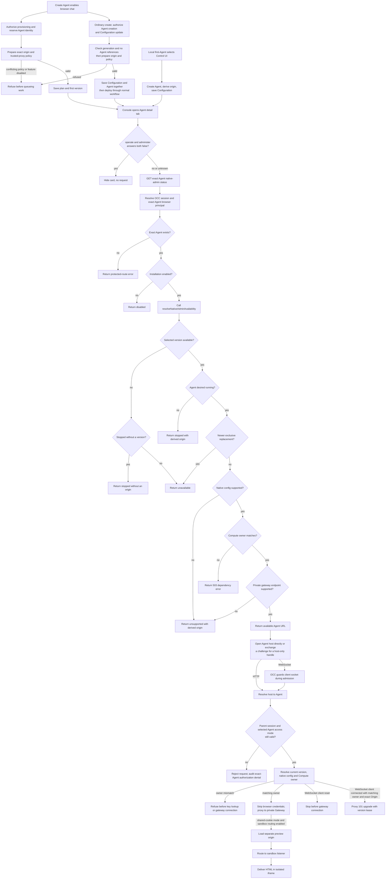

# Agent Native Admin UI Flow

## Overview

OCC authorizes exact-Agent browser access through the OCE session or a host-only handle, then proxies HTTP and WebSockets under the selected access mode.

## Entry Points

- Trigger: Console opts into native admin during Agent creation, opens an Agent native admin URL, or `scripts/first-agent.mjs --control-ui` creates a compatible Agent in Local Setup with OpenShell.
- Source: `scripts/first-agent.ts:nativeConfiguration`
- Source: `apps/controller/src/console/agents/native-admin.mts:renderNativeAdminAccess`
- Source: `apps/controller/src/http/native-admin.ts:resolveNativeAdminAvailability`
- Assumptions: A valid OCE session, enabled `agentNativeAdmin`, configured HTTPS Console origin, Agent domain and [session mode](../reference/agent-native-admin.md#host-only-session-exchange). Compute supplies `getGatewayChatEndpoint` for chat or `getGatewayEndpoint` for administration.

## Flow

## Execution Trace

### 0. Console opts in before the first deployment

`apps/controller/src/console/agents/create.mts:renderCreateAgent`
`apps/controller/src/http/agents.ts:createAgentHandlers`
`apps/controller/src/gateway/native-admin.ts:prepareNativeAdminConfiguration`
`packages/occ/src/index.ts:createAgent`
`packages/occ/src/index.ts:provisionAgent`

**Enable browser chat** sends `nativeAdmin: true`. The adapter derives the origin
from Installation settings, refuses conflicting policy, and limits the normalized
Agent suffix to 214 characters.

`createAgent` authorizes Agent creation and Configuration update, checks
`expectedConfigurationGeneration` and absence of Agent references, then prepares
policy. Configuration and Agent save atomically; the caller deploys normally.

Guided provisioning authorizes and prepares policy before queueing. Retries
reuse its fingerprinted plan and identity. The worker creates and deploys.

### 0a. Local first-Agent opts into native admin

`scripts/first-agent.ts:loadLocalInstallation`
`scripts/first-agent.ts:nativeConfiguration`
`scripts/first-agent.ts:ensureManagedConfiguration`

Using Local Setup browser state, the helper saves disabled Configuration generation 1,
creates the Agent, and derives its origin. Generation 2 enables `controlUi`, pins
origins, requires `x-openclaw-scopes`, and grants `occ-workspace-files` trusted-proxy
`operator.admin` with device auto-approval before deployment. Identity grants supply
admin independently of device scopes. Existing helper-owned names keep this selection.

### 1. Console renders native admin availability

`apps/controller/src/console/agents/native-admin.mts:renderNativeAdminAccess`

Agent detail reads `${path}/native-admin` when `operate` or `administer` is allowed
or unknown. Disabled/denied access stays hidden; other refusals explain why.
Only `available` enables **Open chat** or **Open Agent UI**. Shared-cookie mode
uses `noopener noreferrer`. Host-only exchange opens a window and completes
step 5a, accepting challenges only from that window and origin. Redemption
clears `window.opener`; errors close the pending window. An audited `403` in tab `sessionStorage` suppresses reads
until logout, sign-in, or a new tab. `activeRevisionId` or `desiredRuntimeState`
changes refresh access; concurrent requests coalesce into one follow-up.
Browsing a historical version does not change the selected destination.
Stopped/unsupported states offer **Open draft**. Unavailable states offer
**View deployment** for readable versions, otherwise **Refresh access**.

OCE owns durable configuration. Runtime notices come from
`apps/controller/src/drivers/compute/runtime-startup.ts:gatewayManagedModeEnvironment`;
see [Gateway managed mode](../reference/agents/gateway-managed-mode.md).

### 2. OCC protects the availability route

`apps/controller/src/http/native-admin.ts:nativeAdminStatusOperation`

`createNativeAdminAccess` owns host interception, upgrades and socket shutdown.
A getter supplies the controller after bootstrap. Shared route
admission remains in `apps/controller/src/index.ts`.

`GET /namespaces/:namespaceId/agents/:agentId/native-admin` requires a human session and exact-Agent `operate` or `administer`, not `read`. Administration takes precedence over chat. Authorization and existence checks precede even `disabled`.

### 3. Shared availability resolver checks feature and selected version state

`apps/controller/src/http/native-admin.ts:getNativeAdminStatus`
`apps/controller/src/http/native-admin.ts:resolveNativeAdminAvailability`
`packages/occ/src/index.ts:getBrowserAccessibleActiveAgentRevision`

`getAgentBrowserAccess` handles disabled access; `getBrowserAccessibleActiveAgentRevision` handles enabled access, requiring origin, domain and selected version. Both use `authorizeAgentAccess` and one Agent read. IAM failures propagate, never selecting chat.

`ResourceConflictError` becomes only `status: "stopped"` for an authorized stopped Agent without a selected version, or for an operator whose Agent is stopping. `NoActiveAgentRevisionError` for a running Agent awaiting activation returns `unavailable`. Other dependencies, including IAM/State outages, remain `503` before gateway routing.

With a selected version, OCC derives its native target. An administrator viewing a non-running Agent with a selected version receives `stopped` with host/origin; a newer exclusive replacement returns `unavailable`. Unsupported trusted-proxy auth, machine admin grants/device auto-approval, `controlUi.enabled`, exact `allowedOrigins`, or host-header/device-auth settings return `unsupported` with the target and `reason`.

Compute `id` and `implementation` must match `revision.compute`; changing selection does not migrate versions. A mismatch raises `503 DEPENDENCY_UNAVAILABLE` before endpoint/key/transport. Chat selects `getGatewayChatEndpoint`, administration selects `getGatewayEndpoint`. Missing or unclean private `wss:` endpoints return `unsupported`; chat never falls back to administration. Only `available` carries `gatewayBase`, omitted from browser responses by `nativeAdminAvailabilityData`.

### 4. OCC derives the isolated Agent host

`apps/controller/src/gateway/native-admin.ts:nativeAdminTarget`
`apps/controller/src/gateway/native-admin-host.mjs:deriveNativeAdminHost`

Overlong suffixes refuse native targets after authorization; opt-in fails before persistence.

`deriveNativeAdminHost` hashes scoped Agent identity under the configured domain. `nativeAdminTarget` returns `/`.

`nativeAdminGatewayHttpBase` converts `wss:` to `https:`, preserving authority and Agent path, rejecting userinfo, query or hash. Workspace-file WSS is unchanged.

### 5. Shared cookie admits the Agent host

`apps/controller/src/auth/index.ts:createControllerAuth`

`deriveSharedCookieDomain` computes the longest common DNS-label suffix of the
HTTPS Console origin and Agent domain. It rejects IP addresses, missing hosts,
and public suffixes. In shared-cookie mode this applies even when native
access is disabled and uses `__Secure-openclaw_occ_shared.session_token`.
Sign-out revokes the current session and expires its shared cookie. There is no obsolete-cookie cleanup. See the [session contract](../reference/authentication.md#native-admin-shared-sessions).

### 5a. Host-only exchange binds access to the parent session

`apps/controller/src/http/native-admin.ts:launch`
`apps/controller/src/http/native-admin.ts:confirm`
`apps/controller/src/http/native-browser-bridge.ts:landingPage`
`packages/occ/src/state/native-browser-access.ts:PostgresNativeBrowserAccess`

`createControllerAuth` and `createNativeAdminAccess` restrict host-only exchange to guarded OIDC without Google.

Host-only launch requires the Console session, `x-occ-session-key`, Console
Origin, and exact-Agent `operate` or `administer`. An intent binds that session, Principal,
Agent, Namespace, revision and origin. The landing page sets its challenge
cookie; the opener confirms it. Redemption checks challenge and exchange, consumes
and audits the intent, and sets the access cookie. It reuses an unexpired handle
only when Installation, parent session, Principal, Agent, Namespace, revision,
origin and parent expiry match; otherwise it replaces it. Reuse preserves existing
WebSockets without allocating another handle. Stored secrets are hashed; expired,
replayed or mismatched exchanges fail closed.

Human authentication owns parent-session currentness. Admission and renewal
recheck that session, exact-Agent access and revision. The exchange creates no
account or grant. See [session limits](../reference/agent-native-admin.md#host-only-session-exchange).

### 6. OCC intercepts native-host HTTP requests

`apps/controller/src/http/native-admin.ts:interceptNativeAdminHttp`
`apps/controller/src/http/native-admin.ts:resolveNativeAdminAgentHost`

The `onRequest` hook keeps ordinary controller routes off subdomains of the
configured Agent domain, except the Console host. This also applies when native
access is disabled and the domain is retained.

For proxy admission, OCC authenticates the session or handle and resolves the IAM
identity. Before Agent-reference lookup, OCC requires a normalized hostname of
`agent-` followed by exactly 32 lowercase hexadecimal characters, a dot, and the
exact configured domain. Malformed hostnames fail before lookup or proxying.
For well-formed keys, the same resolver scans Installation Agent references and
refuses unknown, deleted or ambiguous hosts. OCC selects `admin` or `chat` and
checks version and configuration.

Attributable IAM denials get one audit attempt, even after the five-second
admission wait, disconnect or shutdown. Timely denials await that append before
returning `403`. Classified dependency failures, append failures and admission
timeouts return `503`; unavailable Agents remain `403`.
For HTTP admission refusals, `http.completed` records a fixed `nativeAdmissionReason`,
without URLs, cookies, identities or error text. Early guards and post-admission
failures may omit it.

Without a session, supported top-level HTML navigations with
`Sec-Fetch-User: ?1` redirect to the Console, carrying only the opaque host key.
Without that header (including Safari), they get a 403 **Sign in** link.
Link previews, APIs, writes and WebSockets remain refused. See the supported
[paths and session segments](../reference/agent-native-admin.md#authorization-and-availability).

Different-version refusals return eligible navigations an HTTP 403
**Agent version changed** page linking to the Console. Other refusals retain their
handling; cookies remain unchanged and no automatic relaunch occurs.

Browser permission denials return HTTP 403 linking to `/console/agents` on the
configured public origin. JSON refusals name the required permission. Neither
names the Agent; unknown hosts get identical text. WebSocket refusals remain unchanged.

Status and proxy checks reuse one Better Auth lookup for identity, expiry and
attribution. Each WebSocket lease checks the original session, selected mode and Agent again. After handling
stopped, replacing or unsupported Agents, admission rechecks both Compute owner
fields. A mismatch returns HTTP `403` or closes an upgrading socket without an
HTTP response, before gateway-key lookup or connection. A failed lease closes
both sockets.

`apps/controller/src/gateway/native-admin-proxy.ts:proxyNativeAdminHttp`

The HTTP proxy normalizes URLs (maximum 4,096 characters), requires exact `Origin` except for GET/HEAD, and strips cookies, service keys, forwarding/identity/scope headers and upstream `Set-Cookie`. It blocks service-worker scripts, rewrites same-upstream redirects to the Agent origin, adds CSP `worker-src 'none'`, and forwards to private HTTPS. Avatar `502`s become empty `404`s, preserving the initials fallback. Both modes use `occ-workspace-files`; chat overwrites `x-openclaw-scopes` with `operator.sessions.write`. Runtime authority intersects that ceiling with identity/device grants; client headers cannot widen it.

### 7. OCC proxies native WebSocket upgrades

`apps/controller/src/http/native-admin.ts:handleNativeAdminUpgrade`

Before Fastify routing, the API intercepts derived-host upgrades and tracks sockets for `preClose`. It handles socket errors before awaiting admission, preventing uncaught errors on TCP reset. Refused sockets close without waiting for denial audits, which still run after reset. Admission checks client destruction and shutdown before and after transport resolution; late success cannot connect. Accepted clients use the selected version.

`apps/controller/src/gateway/native-admin-proxy.ts:proxyNativeAdminWebSocket`

The WebSocket proxy requires non-null exact Agent `Origin`, sanitizes the private HTTPS upgrade, and connects only after upstream `101`. `onConnect` and `onClose` append `openclaw.agents.native_admin.websocket.connect` and `.close` with the same `connectionId`. Close records include `closeReason` for lifecycle, revocation, dependency, client, upstream or shutdown. A timer rechecks admission every 25 seconds with a five-second timeout. Failed, denied, timed-out, session-changed, mode-changed, or version-changed lease checks close both sockets. Denial closure does not wait for the append; a late attributable lease denial still gets its single audit attempt. An authorized reconnect uses the selected version. Native chat does not renew the OCE session. Cookie replacement cannot transfer an existing socket to another session; reconnect authenticates the current cookie.

Bridge requests, admission and close audits share one five-second shutdown drain. Bridge handlers stop before subsequent phases or secret delivery after shutdown or client disconnect. Work still pending
afterwards logs `native_admin.pending_work_unresolved` with its count and keeps its
audit attempt while the process lives. The drain neither cancels producers nor
guarantees durable delivery; process exit can prevent or interrupt an audit attempt.

### 8. Runtime renders HTML on a separate origin

`apps/controller/src/drivers/compute/kubernetes/index.ts:gatewaySandboxConfiguration`
`apps/controller/src/drivers/compute/kubernetes/index.ts:reconcileGatewayRoute`

In shared-cookie mode with sandbox routing configured, preparation and activation render the
Agent's stable preview origin and adjacent sandbox port in its native document.
The worker reconciles its GET/HEAD route, public-shell SecurityPolicy and
Agent-scoped backend ingress policy under the serving version. A separate Helm listener admits only configured ingress
peers, and the backend targets the sandbox port instead of the admin port.
The preview domain is outside the shared session cookie scope. Native UI still
reads private file content through its authenticated connection, then delivers
it to the runtime's isolated iframe. The sandbox listener serves public shell
and registered renderer assets; runtime CSP and nested frame isolation remain
responsible for executing generated content. See the [routing contract](../reference/gateway-routing.md#public-preview-routing).

For opted-in Kubernetes gateways, `KubernetesComputeDriver.privateStateInitContainer`
copies the admitted configuration from `/etc/openclaw-managed/openclaw.json` to
`/runtime-state/home/.openclaw/openclaw.json` on the init container's writable
volume. The gateway mounts that same home subdirectory at `/home/node`, so native
edits remain Pod-local and the next Pod starts from the admitted configuration.
The init container cannot write through the gateway's later mount path.

`apps/controller/src/drivers/compute/kubernetes/runtime-entrypoints.ts:configureNativeWorkerProfile`
reuses only the exact generated worker profile after a container restart;
conflicting settings fail. `KubernetesComputeDriver.gatewayPrivateStateVolumeMounts`
retains `client/` and its migration receipt with the Gateway database. Native
admin Configuration remains Pod-local.

## Debugging and Verification

- For startup failures, check the [configuration error codes](../reference/agent-native-admin.md#failure-behavior) against the selected session mode.
- Use the [availability definitions](../reference/agent-native-admin.md#authorization-and-availability). A failed replacement can leave the previous version selected without a workload.
- Unknown Agent hosts fail before proxying. Check host derivation, Agent state, and `agentNativeAdmin.domain`.
- Shared-cookie mode opens the Agent directly. Host-only exchange uses launch, challenge and redemption requests; verify the Console cookie is absent from Agent-host requests and both cookies are absent upstream.
- IAM denial audits should appear for attributable denied status checks, proxy admission, and WebSocket lease renewal, with the human principal and exact Agent target preserved.
- A TCP reset during WebSocket admission leaves the API running and preserves a later authorization-denial audit without opening an upstream connection.
- WebSocket connect and close audits share `connectionId`; close audits add a `closeReason` category from step 7.
- Service-worker registration failure is expected: the HTTP proxy rejects `Service-Worker: script` requests and adds `worker-src 'none'` to proxied responses.
- Browser tests cover panel visibility, warnings, availability, and URL opening. Integration proof covers shared-cookie admission, denied service keys and unknown hosts, assets, WebSocket leases and reconnects, and a reversible native edit.

## Related docs

- [Agent native admin UI](../reference/agent-native-admin.md)
- [Platform console](../reference/console.md#open-the-native-admin-ui)
- [Gateway routing with Envoy](../reference/gateway-routing.md#native-admin-ui-routing)
- [Deploy native admin UI access](../guides/deploy/native-admin.md)
- [Workspace files flow](workspace-files.md)

## Manual Notes

[keep this for the user to add notes. do not change between edits]

## Changelog

- 2026-11-11 21:13: Describe hostname validation before Agent-reference lookup. (authoring-run/c70a6869-705d-495a-85dd-f0c603db8196 - dfbdd7bfa6ccfba7d3d2e6b28f2770988c0cfc0d)

- 2026-11-11 20:31: Persist the first-Agent native UI scope-header requirement. (authoring-run/4eb36434-af9e-40b8-8958-e8a2f9f2b662 - be754f513bcfdee8c898c33df1fe37bff4581261)

- 2026-11-11 18:51: Integrate admission classification; retain canonical domain refusal. (authoring-run/6c64aee6-cdeb-442f-b8bf-936f62eb5bc5 - d7f1a5a6196545a406f46a616278c123ab970095)

- 2026-11-11 17:17: Normalize opt-in admission; accompanying changes. (authoring-run/73aeafdb-519f-47fb-b027-583d0eb74522 - a6d44b96ce4c4029e6e2e24be61b97d71da75df1)

- 2026-11-11 09:26: Classify native admission failures. (authoring-run/28db5867-56df-4145-a1c5-07be7a7874ee - f0b9c002c0577bcc8854913b0eafa5449bd5fbe3)

- 2026-11-10 08:30: Add named chat and stale-version browser recovery. (authoring-run/37c71df8-7e9c-4224-bc36-e4091f387620 - eef0b3f10d0e0f4ed09fd32086c84628c41f1b93)

- 2026-11-09 14:07: Consolidate browser authorization and document current-cookie logout. (authoring-run/f217fd51-af6b-4d6a-a888-b2be4880aa91 - e39be9803)

- 2026-11-09 12:12: Added OIDC sessions and scoped chat. (codex/oidc-agent-chat - f1ebda062)
- 2026-11-06 07:57: Integrate host-only exchange, repeat launches and current session ownership in accompanying changes. (authoring-run/43cf1307-6d25-4d9d-951e-55fe09a514b8 - a4c2191e73337d73ee27e7fe2c9a51cef40d99f5)

- 2026-11-03 12:55: Sign-in link for unactivated page loads. (fix/native-admin-signed-out-html-fallback)

- 2026-11-02 09:55: Shorten provisioning prose and link shared status definitions after rebasing. (authoring-run/275c0d0a-d040-47d3-9e52-47ff86b87ab9 - 393b1585e4b10a3232abf10c60b766d8e55d85ce)

[Agent native admin documentation history](agent-native-admin/history.md) preserves the older dated entries.
