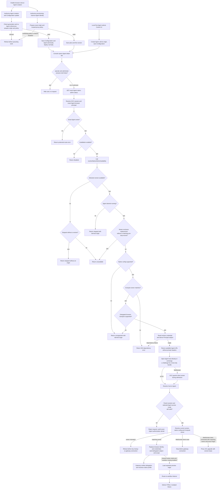

# Agent Native Admin UI Flow

## Overview

OCC authorizes and proxies exact-Agent HTTP/WebSocket browser access using OCE sessions or host-only handles.

## Entry Points

- Trigger: Enable native admin at Agent creation, open its URL, or run `scripts/first-agent.ts --control-ui` in Local Setup with OpenShell.
- Source: `scripts/first-agent.ts:nativeConfiguration`
- Source: `apps/controller/src/console/agents/native-admin.mts:renderNativeAdminAccess`
- Source: `apps/controller/src/http/native-admin.ts:resolveNativeAdminAvailability`
- Assumptions: A valid OCE session, enabled `agentNativeAdmin`, configured HTTPS Console origin, Agent domain and [session mode](../reference/agent-native-admin.md#host-only-session-exchange). Compute supplies `getGatewayBrowserRequest` for both browser modes.

## Flow

## Execution Trace

### 0. Console opts in before the first deployment

`apps/controller/src/console/agents/create.mts:renderCreateAgent`
`apps/controller/src/http/agents.ts:createAgentHandlers`
`apps/controller/src/gateway/native-admin.ts:prepareNativeAdminConfiguration`
`packages/occ/src/index.ts:createAgent`
`packages/occ/src/index.ts:provisionAgent`

**Enable browser chat** sends `nativeAdmin: true`. The adapter derives the origin
from Installation settings, refuses conflicting policy, and limits the normalized
Agent suffix to 214 characters.

`createAgent` authorizes Agent creation and Configuration update, checks
`expectedConfigurationGeneration` and absence of Agent references, then prepares
policy. Configuration and Agent save atomically; the caller deploys normally.

Guided provisioning authorizes and prepares policy before queueing. Retries
reuse its fingerprinted plan and identity. The worker creates and deploys.

### 0a. Local first-Agent opts into native admin

`scripts/first-agent.ts:loadLocalInstallation`
`scripts/first-agent.ts:nativeConfiguration`
`scripts/first-agent.ts:ensureManagedConfiguration`

Using Local Setup browser state, the helper saves disabled Configuration generation 1,
creates the Agent, and derives its origin. Generation 2 enables `controlUi`, pins
origins, requires `x-openclaw-scopes`, and grants `occ-workspace-files` trusted-proxy
`operator.admin` for machine access before deployment. Delegated browser access
does not enroll devices or issue reusable device tokens. Existing helper-owned names keep this selection.

### 0b. Compute prepares delegated browser transport

`apps/controller/src/drivers/compute/kubernetes/index.ts:browserDelegationCredential`
`apps/controller/src/drivers/compute/kubernetes/index.ts:gatewayConfiguration`
`apps/controller/src/drivers/compute/kubernetes/index.ts:gatewayRouteHeaderFilter`

Preparation creates or reuses the revision's immutable browser Secret, mounted
only in the Gateway. Configuration specifies its file; the protocol fixes
authority and subject prefix.
`/native-browser/` preserves delegated headers; machine/node routes remove the
credential. Retirement removes the Secret, retaining native profiles.

### 1. Console renders native admin availability

`apps/controller/src/console/agents/native-admin.mts:renderNativeAdminAccess`

Agent detail reads `${path}/native-admin` if either permission is allowed or
unknown. Disabled or denied access stays hidden. Only `available` offers
**Open chat** or **Open Agent UI**. Shared cookies use `noopener noreferrer`.
Step 5a accepts challenges from the opened window and origin. Redemption clears
`window.opener`. Errors close the window. An audited `403` suppresses reads via
`sessionStorage` until logout, sign-in or a new tab. Changes to `activeRevisionId`
or `desiredRuntimeState` refresh access. Concurrent reads coalesce into one
follow-up. Historical browsing keeps the selected destination. Stopped or
unsupported offers **Open draft**. Unavailable offers **View deployment** if
readable or **Refresh access**.

OCE owns durable configuration. Runtime notices come from
`apps/controller/src/drivers/compute/runtime-startup.ts:gatewayManagedModeEnvironment`;
see [Gateway managed mode](../reference/agents/gateway-managed-mode.md).

### 2. OCC protects the availability route

`apps/controller/src/http/native-admin.ts:nativeAdminStatusOperation`

`createNativeAdminAccess` owns host interception, upgrades and socket shutdown.
A getter supplies the controller after bootstrap. Shared route
admission remains in `apps/controller/src/index.ts`.

`GET /namespaces/:namespaceId/agents/:agentId/native-admin` requires a human session and exact-Agent `operate` or `administer`, not `read`. Administration takes precedence over chat. Authorization and existence checks precede even `disabled`.

### 3. Shared availability resolver checks feature and selected version state

`apps/controller/src/http/native-admin.ts:getNativeAdminStatus`
`apps/controller/src/http/native-admin.ts:resolveNativeAdminAvailability`
`packages/occ/src/index.ts:getBrowserAccessibleActiveAgentRevision`

`getAgentBrowserAccess` handles disabled access; `getBrowserAccessibleActiveAgentRevision` handles enabled access, requiring origin, domain and selected version. Both use `authorizeAgentAccess` and one Agent read. IAM failures propagate, never selecting chat.

`ResourceConflictError` becomes only `status: "stopped"` for an authorized stopped Agent without a selected version, or for an operator whose Agent is stopping. `NoActiveAgentRevisionError` for a running Agent awaiting activation returns `unavailable`. Other dependencies, including IAM/State outages, remain `503` before gateway routing.

OCC derives the selected version's target. An administrator viewing a non-running Agent receives `stopped` with the host and origin. For a newer exclusive replacement, OCC rechecks access to the selected predecessor. The saved record must name that predecessor and have phase `pre-stop`. OCC returns `unavailable` after the worker records [`stopping`](../reference/agents/planned-replacement.md) or if the matching record is missing.

The target accompanies an [`unsupported` reason](../reference/agent-native-admin.md#unsupported-reasons). `not-enabled` means the Configuration did not opt this Agent into browser chat. `configuration` means another native setting prevents access.

After ownership checks, `getGatewayBrowserRequest` takes the revision, server-owned Installation/Principal IDs, mode and signal. Ownership or credential failure returns `503`; unsupported transport returns `unsupported` (`compute`). `nativeAdminAvailabilityData` omits endpoint, subject and credential headers from browser responses. No machine fallback.

### 4. OCC derives the isolated Agent host

`apps/controller/src/gateway/native-admin.ts:nativeAdminTarget`
`apps/controller/src/gateway/native-admin-host.ts:deriveNativeAdminHost`

Overlong suffixes refuse native targets after authorization; opt-in fails before persistence.

`deriveNativeAdminHost` hashes scoped Agent identity under the configured domain. `nativeAdminTarget` returns `/`.

`nativeAdminGatewayHttpBase` converts `wss:` to `https:`, preserving authority and Agent path, rejecting userinfo, query or hash. Workspace-file WSS is unchanged.

### 5. Shared cookie admits the Agent host

`apps/controller/src/auth/index.ts:createControllerAuth`

`deriveSharedCookieDomain` computes the longest common DNS-label suffix of the
HTTPS Console origin and Agent domain. It rejects IP addresses, missing hosts,
and public suffixes. In shared-cookie mode this applies even when native
access is disabled and uses `__Secure-openclaw_occ_shared.session_token`.
Sign-out revokes the current session and expires its shared cookie. There is no obsolete-cookie cleanup. See the [session contract](../reference/authentication.md#native-admin-shared-sessions).

### 5a. Host-only exchange binds access to the parent session

`apps/controller/src/http/native-admin.ts:launch`
`apps/controller/src/http/native-admin.ts:confirm`
`apps/controller/src/http/native-browser-bridge.ts:landingPage`
`packages/occ/src/state/native-browser-access.ts:PostgresNativeBrowserAccess`

`createControllerAuth` and `createNativeAdminAccess` restrict host-only exchange to guarded OIDC without Google.

Host-only launch requires the Console session, `x-occ-session-key`, Console
Origin, and exact-Agent `operate` or `administer`. An intent binds that session, Principal,
Agent, Namespace, revision and origin. The landing page sets its challenge
cookie; the opener confirms it. Redemption checks challenge and exchange, consumes
and audits the intent, and sets the access cookie. It reuses an unexpired handle
only when Installation, parent session, Principal, Agent, Namespace, revision,
origin and parent expiry match; otherwise it replaces it. Reuse preserves existing
WebSockets without allocating another handle. Stored secrets are hashed; expired,
replayed or mismatched exchanges fail closed.

Human authentication owns parent-session currentness. Admission and renewal
recheck that session, exact-Agent access and revision. The exchange creates no
account or grant. See [session limits](../reference/agent-native-admin.md#host-only-session-exchange).

### 6. OCC intercepts native-host HTTP requests

`apps/controller/src/http/native-admin.ts:interceptNativeAdminHttp`
`apps/controller/src/http/native-admin.ts:resolveNativeAdminAgentHost`

The `onRequest` hook blocks ordinary controller routes on Agent subdomains
except the Console host, even when native access is disabled.

OCC authenticates the session or handle and resolves IAM identity. It requires
`agent-<32 lowercase hex>.<configured domain>` before lookup, then rejects unknown,
deleted or ambiguous Installation Agent references. It selects `admin` or `chat`
and checks the version and Configuration.

Attributable IAM denials receive one audit attempt despite the five-second
admission timeout, disconnect or shutdown. Timely denials await the append before
`403`. Dependency failures, append failures, timeouts and an authorized deployment
transition (`agent_transition`) return `503`, keeping the Agent UI reconnecting.
Stopped or unsupported Agents remain `403`; authorized page loads show **Agent
unavailable**.
For HTTP admission refusals, `http.completed` records a fixed `nativeAdmissionReason`,
without URLs, cookies, identities or error text. Early guards and post-admission
failures may omit it.

See [navigation and sign-in rules](../reference/agent-native-admin.md#authorization-and-availability)
for Console redirects, **Sign in**, and **Agent version changed**. Version
refusals preserve cookies without relaunch. Permission refusals link to
public-origin `/console/agents` or name the required permission in JSON, omitting
Agent identity like unknown-host refusals.

Status and proxy checks share one Better Auth lookup for identity, expiry and
attribution. Every WebSocket lease rechecks the original session, mode and Agent.
After lifecycle/configuration checks, admission verifies both Compute owner
fields. Mismatch returns HTTP `403` or closes an upgrading socket without an HTTP
response before gateway-key lookup; failed leases close both sockets.

`apps/controller/src/gateway/native-admin-proxy.ts:proxyNativeAdminHttp`

The HTTP proxy normalizes URLs up to 4,096 characters, checks exact Agent
`Origin` (optional for GET/HEAD), and strips cookies, service keys and forwarding,
identity, and scope headers. Over private HTTPS it preserves surviving
`Content-Length`; otherwise, it uses chunked framing only when inbound headers
specify framing.

Compute supplies the human subject, revision credential and scope. Gateway profile
resolution precedes access. Native roles can narrow authority; static/device grants
cannot widen it. Profile or credential failure refuses access without machine fallback.

The proxy blocks service-worker scripts, adds CSP `worker-src 'none'`, rewrites
same-upstream redirects to the Agent origin, and strips upstream `Set-Cookie`
and `Clear-Site-Data`.

A transfer failure, or the route proxy's `503` for an unreachable Gateway, before
response headers gives `503` (a page load: **Agent not responding**); afterwards
the proxy aborts the response. An avatar `502` becomes an empty `404` (initials
fallback); the proxy cancels its upstream body.

### 7. OCC proxies native WebSocket upgrades

`apps/controller/src/http/native-admin.ts:handleNativeAdminUpgrade`

Before Fastify routing, the API intercepts derived-host upgrades and tracks sockets for `preClose`. Socket error handling covers admission-time resets. Refusals close before denial audits settle; those audits survive resets. Admission checks destruction and shutdown before and after transport resolution; late success cannot connect.

`apps/controller/src/gateway/native-admin-proxy.ts:proxyNativeAdminWebSocket`

The proxy requires non-null exact Agent `Origin`, sanitizes the private HTTPS upgrade, and connects after upstream `101`. `onConnect` and `onClose` append `openclaw.agents.native_admin.websocket.connect` and `.close` with the same `connectionId` and `details.nativeAdmin.subject`. `closeReason` records lifecycle, revocation, dependency, client, upstream or shutdown. Admission renews every 25 seconds with a five-second timeout. Failed, denied, timed-out, session-changed, mode-changed, or version-changed lease checks close both sockets. Denial closure does not wait for the append; a late attributable lease denial still gets its single audit attempt. Reconnects authenticate the current cookie and use the selected version. Cookie replacement cannot transfer a socket to another session. Native chat does not renew the OCE session.

`apps/controller/src/http/native-admin.ts:drainNativeAdminWork`

Bridge requests, admission, connect and close audits share one five-second shutdown
drain. `preClose` destroys sockets and drains batches, including follow-on close
audits, under one deadline. Composition then closes storage in `onClose`. Bridge handlers stop before
subsequent phases or secret delivery after shutdown or disconnect. Unsettled work
logs `native_admin.pending_work_unresolved` with its count and retains its audit
attempt while the process lives. The drain neither cancels producers nor guarantees
durable delivery; process exit can interrupt attempts.

### 8. Runtime renders HTML on a separate origin

`apps/controller/src/drivers/compute/kubernetes/index.ts:gatewaySandboxConfiguration`
`apps/controller/src/drivers/compute/kubernetes/index.ts:reconcileGatewayRoute`

In shared-cookie mode with sandbox routing configured, preparation and activation render the
Agent's stable preview origin and adjacent sandbox port in its native document.
The worker reconciles GET/HEAD routing and SecurityPolicy under the serving
version. The Helm listener admits configured ingress peers to the sandbox port.
The preview domain remains outside session-cookie scope. Native UI still
reads private file content through its authenticated connection, then delivers
it to the runtime's isolated iframe. The sandbox listener serves public shell
and registered renderer assets; runtime CSP and nested frame isolation remain
responsible for executing generated content. See the [routing contract](../reference/gateway-routing.md#public-preview-routing).

`KubernetesComputeDriver.privateStateInitContainer` copies
`/etc/openclaw-managed/openclaw.json` to
`/runtime-state/home/.openclaw/openclaw.json`. The Gateway mounts that home at
`/home/node`; native edits remain Pod-local. A new Pod restores managed configuration.

`apps/controller/src/drivers/compute/kubernetes/runtime-entrypoints.ts:configureNativeWorkerProfile`
reuses only the exact generated worker profile after a container restart;
conflicting settings fail. `KubernetesComputeDriver.gatewayPrivateStateVolumeMounts`
retains `client/` and its migration receipt with the Gateway database. Native
admin Configuration remains Pod-local.

## Debugging and Verification

- For startup failures, check the [configuration error codes](../reference/agent-native-admin.md#failure-behavior) against the selected session mode.
- Use the [availability definitions](../reference/agent-native-admin.md#authorization-and-availability). A failed replacement can leave the previous version selected without a workload.
- Unknown Agent hosts fail before proxying. Check host derivation, Agent state, and `agentNativeAdmin.domain`.
- Shared-cookie mode opens the Agent directly. Host-only exchange uses launch, challenge and redemption requests; verify the Console cookie is absent from Agent-host requests and both cookies are absent upstream.
- IAM denial audits should appear for attributable denied status checks, proxy admission, and WebSocket lease renewal, with the human principal and exact Agent target preserved.
- A TCP reset during WebSocket admission leaves the API running and preserves a later authorization-denial audit without opening an upstream connection.
- WebSocket connect and close audits share `connectionId`; close audits add a `closeReason` category from step 7.
- Service-worker registration failure is expected: the HTTP proxy rejects `Service-Worker: script` requests and adds `worker-src 'none'` to proxied responses.
- [Native browser tests](../testing/native-agent-browser.md) check distinct profiles, creator/sender attribution, reconnect/regrant, retained-storage restart, and delegated scope limits through the real browser workflow. Source and passing unit checks do not establish runtime qualification.

## Related docs

- [Agent native admin UI](../reference/agent-native-admin.md)
- [Platform console](../reference/console.md#open-the-native-admin-ui)
- [Gateway routing with Envoy](../reference/gateway-routing.md#native-admin-ui-routing)
- [Deploy native admin UI access](../guides/deploy/native-admin.md)
- [Workspace files flow](workspace-files.md)

## Manual Notes

[keep this for the user to add notes. do not change between edits]

## Changelog

- 2026-11-19 06:03: Add the **Agent unavailable** page. (authoring-run/08c23986-7eaa-48cf-aeff-d53da1475676 - 4c2da280f8ee1c143ac1d34c63b6e7fac6a3ac83)

- 2026-11-19 01:23: A deployment in progress answers authorized Agent-host HTTP with `503`. (authoring-run/ef3e9c03-7ddd-43c6-a55f-0460c8daed7b - 50ba6e3c180341cddc63528b98c21da57508ad2b)

- 2026-11-13 06:32: Clarify replacement records and native access reasons. (authoring-run/97aeaabf-7b1c-40d2-bd48-f7e3e105e434 - 4ab097ffe6f1bce048629dcdec005ed666e536c0)

- 2026-11-13 06:14: Integrate replacement stop and native status behavior. (authoring-run/cd6f8893-5bd3-40ea-b1c2-9767439f54b9 - 4ab097ffe6f1bce048629dcdec005ed666e536c0)

- 2026-11-12 11:33: Document connect and follow-on close audit draining in the accompanying fix. (authoring-run/5c61b5ae-c933-43cd-8aef-ad925fada92c - 2e2f7efbb0c1d430bc30a0185fc21ae1ffbdf581)

- 2026-11-12 00:02: Shorten relay trace. (authoring-run/bae4d18e-05ed-457e-9c6a-96ef2b959619 - cbca5166c168531ada145c95da19ef04c7a34488)

- 2026-11-11 23:34: Clarify request framing. (authoring-run/2dccf6f5-0340-47b6-88a4-eb047f929fff - a8ccd21095bf8f651c8dbc270e069808251fd0db)

- 2026-11-11 23:20: Document native admin HTTP relay handling. (authoring-run/30741f75-946a-4c47-952b-1afd8ff10888 - a8ccd21095bf8f651c8dbc270e069808251fd0db)

- 2026-11-11 21:13: Describe hostname validation before Agent-reference lookup. (authoring-run/c70a6869-705d-495a-85dd-f0c603db8196 - dfbdd7bfa6ccfba7d3d2e6b28f2770988c0cfc0d)

- 2026-11-11 20:31: Persist the first-Agent native UI scope-header requirement. (authoring-run/4eb36434-af9e-40b8-8958-e8a2f9f2b662 - be754f513bcfdee8c898c33df1fe37bff4581261)

- 2026-11-11 18:51: Integrate admission classification; retain canonical domain refusal. (authoring-run/6c64aee6-cdeb-442f-b8bf-936f62eb5bc5 - d7f1a5a6196545a406f46a616278c123ab970095)

- 2026-11-11 17:17: Normalize opt-in admission; accompanying changes. (authoring-run/73aeafdb-519f-47fb-b027-583d0eb74522 - a6d44b96ce4c4029e6e2e24be61b97d71da75df1)

- 2026-11-11 09:26: Classify native admission failures. (authoring-run/28db5867-56df-4145-a1c5-07be7a7874ee - f0b9c002c0577bcc8854913b0eafa5449bd5fbe3)

- 2026-11-11 01:50: Share the predecessor stop boundary. (authoring-run/01a17edc-73a7-74a3-86e5-aa8c53bfb1b9)

- 2026-11-10 12:28: Describe delegated profiles, revision credentials, and private browser routing in accompanying implementation. Runtime qualification pending. (authoring-run/a88e2937-bfa9-4cff-8dfd-d108048d60d6 - eff92cc67c38da5f9f4b86a839fb3ce4281a28b6)

- 2026-11-10 08:30: Add named chat and stale-version browser recovery. (authoring-run/37c71df8-7e9c-4224-bc36-e4091f387620 - eef0b3f10d0e0f4ed09fd32086c84628c41f1b93)

- 2026-11-09 14:07: Consolidate browser authorization and document current-cookie logout. (authoring-run/f217fd51-af6b-4d6a-a888-b2be4880aa91 - e39be9803)

- 2026-11-09 12:12: Added OIDC sessions and scoped chat. (codex/oidc-agent-chat - f1ebda062)
- 2026-11-06 07:57: Integrate host-only exchange, repeat launches and current session ownership in accompanying changes. (authoring-run/43cf1307-6d25-4d9d-951e-55fe09a514b8 - a4c2191e73337d73ee27e7fe2c9a51cef40d99f5)

- 2026-11-03 12:55: Sign-in link for unactivated page loads. (fix/native-admin-signed-out-html-fallback)

- 2026-11-02 09:55: Shorten provisioning prose and link shared status definitions after rebasing. (authoring-run/275c0d0a-d040-47d3-9e52-47ff86b87ab9 - 393b1585e4b10a3232abf10c60b766d8e55d85ce)

[Agent native admin documentation history](agent-native-admin/history.md) preserves the older dated entries.
