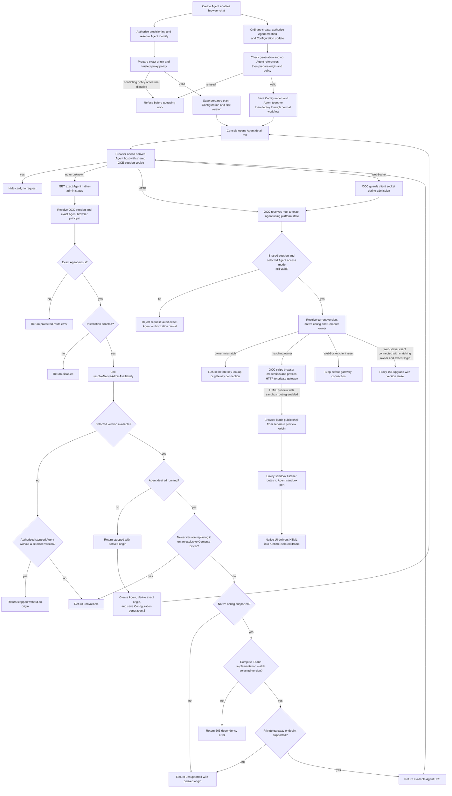

# Agent Native Admin UI Flow

## Overview

The console checks exact-Agent `operate` or `administer` and returns its stable browser URL. OCC rechecks the shared OCE session before proxying HTTP and WebSocket traffic.

## Entry Points

- Trigger: Console opts into native admin during Agent creation, opens an Agent native admin URL, or `scripts/first-agent.mjs --control-ui` creates a compatible local Compose/OpenShell Agent.
- Source: `scripts/first-agent.mjs:nativeConfiguration`
- Source: `apps/controller/src/console/agents/native-admin.mjs:renderNativeAdminAccess`
- Source: `apps/controller/src/http/native-admin.ts:resolveNativeAdminAvailability`
- Assumptions: A valid OCE session, enabled `agentNativeAdmin`, configured HTTPS Console origin and Agent domain with a derived shared cookie domain. Compute supplies `getGatewayChatEndpoint` for chat or `getGatewayEndpoint` for administration.

## Flow

## Execution Trace

### 0. Console opts in before the first deployment

`apps/controller/src/console/agents/create.mts:renderCreateAgent`
`apps/controller/src/http/agents.ts:createAgentHandlers`
`apps/controller/src/gateway/native-admin.ts:prepareNativeAdminConfiguration`
`packages/occ/src/index.ts:createAgent`
`packages/occ/src/index.ts:provisionAgent`

**Enable browser chat** sends `nativeAdmin: true`. The adapter derives the origin
from Installation settings and refuses conflicting policy.

Ordinary creation also sends `expectedConfigurationGeneration`. `createAgent`
authorizes Agent creation and Configuration update, checks the generation and
absence of Agent references, then prepares the new Agent's policy. It saves
Configuration and Agent in one transaction. The caller deploys normally.

Guided provisioning authorizes, reserves an Agent ID, and prepares policy before
queueing. The request fingerprint includes this choice; retries reuse the saved
plan and identity. The worker creates and deploys the Agent.

### 0a. Local first-Agent opts into native admin

`scripts/first-agent.mjs:loadLocalInstallation`
`scripts/first-agent.mjs:nativeConfiguration`
`scripts/first-agent.mjs:ensureManagedConfiguration`

With launcher-owned Compose/OpenShell browser state, the helper saves disabled
Configuration generation 1, creates the Agent, then derives its origin. Before
deployment, generation 2 enables `controlUi`, pins origins, and grants
`occ-workspace-files` trusted-proxy `operator.admin` with device auto-approval.
Identity grants supply admin independently of device scopes.
An existing helper-owned name cannot change this selection.

### 1. Console renders native admin availability

`apps/controller/src/console/agents/native-admin.mjs:renderNativeAdminAccess`

Agent detail reads `${path}/native-admin` when `operate` or `administer` is allowed
or unknown. Disabled/denied access stays hidden; other refusals explain why.
Only `available` enables **Open chat** or **Open Agent UI**, with
`noopener noreferrer`. An audited `403` in tab `sessionStorage` suppresses reads
until logout, sign-in, or a new tab. `activeRevisionId` or `desiredRuntimeState`
changes refresh access; concurrent requests coalesce into one follow-up.
Stopped/unsupported states offer **Open draft**. Unavailable states offer
**View deployment** for readable versions, otherwise **Refresh access**.

The warning points administrators to OCE for durable configuration. Runtime
managed-mode notices come from
`apps/controller/src/drivers/compute/runtime-startup.ts:gatewayManagedModeEnvironment`;
see [Gateway managed mode](../reference/agents/gateway-managed-mode.md).

### 2. OCC protects the availability route

`apps/controller/src/http/native-admin.ts:nativeAdminStatusOperation`

`createNativeAdminAccess` owns host interception, upgrades and socket shutdown.
A getter supplies the initialized controller after bootstrap. Shared route
admission remains in `apps/controller/src/index.ts`.

`GET /namespaces/:namespaceId/agents/:agentId/native-admin` requires a human session and exact-Agent `operate` or `administer` through the selected IAM Driver. `read` alone does not grant access. Administration takes precedence; otherwise OCC selects chat mode. Even `disabled` is returned only after authorization and existence checks.

### 3. Shared availability resolver checks feature and selected version state

`apps/controller/src/http/native-admin.ts:getNativeAdminStatus`
`apps/controller/src/http/native-admin.ts:resolveNativeAdminAvailability`
`packages/occ/src/index.ts:getBrowserAccessibleActiveAgentRevision`

`getAgentBrowserAccess` handles disabled access; `getBrowserAccessibleActiveAgentRevision` handles enabled access. Both select authority through `authorizeAgentAccess` and read the Agent once. Enabled access also requires the public origin, Agent domain and selected version. IAM failures propagate instead of selecting chat mode.

`ResourceConflictError` becomes only `status: "stopped"` for an authorized stopped Agent without a selected version, or for an operator whose Agent is stopping. `NoActiveAgentRevisionError` for a running Agent awaiting activation returns `unavailable`. Other dependencies, including IAM/State outages, remain `503` before gateway routing.

With a selected version, OCC derives its native target. An administrator viewing a non-running Agent with a selected version receives `stopped` with host/origin; a newer exclusive replacement returns `unavailable`. Unsupported trusted-proxy auth, machine admin grants/device auto-approval, `controlUi.enabled`, exact `allowedOrigins`, or host-header/device-auth settings return `unsupported` with the target.

Compute `id` and `implementation` must match `revision.compute`; changing selection does not migrate versions. A mismatch raises `503 DEPENDENCY_UNAVAILABLE` before endpoint/key/transport. Chat selects `getGatewayChatEndpoint`, administration selects `getGatewayEndpoint`. Missing or unclean private `wss:` endpoints return `unsupported`; chat never falls back to administration. Only `available` carries `gatewayBase`, omitted from browser responses by `nativeAdminAvailabilityData`.

### 4. OCC derives the isolated Agent host

`apps/controller/src/gateway/native-admin.ts:nativeAdminTarget`
`apps/controller/src/gateway/native-admin-host.mjs:deriveNativeAdminHost`

`deriveNativeAdminHost` hashes Installation, Namespace, and Agent IDs into an opaque hostname under the configured domain. `nativeAdminTarget` substitutes it in `publicOrigin` and returns `/`.

Native-host admission resolves the hash through platform state. Unknown, deleted or ambiguous Agent hosts fail closed.

`nativeAdminGatewayHttpBase` requires a `wss:` endpoint without userinfo, query, or hash, then converts it to `https:` preserving authority and the Agent base path. Workspace-file WSS behavior stays unchanged.

### 5. Shared cookie admits the Agent host

`apps/controller/src/auth/index.ts:createControllerAuth`

`deriveSharedCookieDomain` computes the longest common DNS-label suffix of the
HTTPS Console origin and Agent domain. It rejects IP addresses, missing hosts,
and public suffixes. This shared cookie configuration applies even when native
access is disabled and uses `__Secure-openclaw_occ_shared.session_token`.
Sign-out revokes the current session and expires its shared cookie. There is no obsolete-cookie cleanup. See the [session contract](../reference/authentication.md#native-admin-shared-sessions).

### 6. OCC intercepts native-host HTTP requests

`apps/controller/src/http/native-admin.ts:interceptNativeAdminHttp`

The `onRequest` hook intercepts the native admin domain before routing, so an
Agent origin cannot expose console or controller routes. OCC authenticates the
shared session, resolves the IAM identity and exact Agent, selects `admin` or `chat` from exact-Agent IAM grants,
then checks the selected version and native configuration. An attributable IAM
denial records the human and Agent in the denial audit.
Admission owns one audit attempt per such denial, also when it arrives after the
five-second admission wait, a client disconnect or the shutdown wait. A timely HTTP
denial waits for its append before returning `403`; a failed append or admission
timeout returns `503`.

Without a session, a user-activated top-level HTML GET to `/`, `/chat/main` or
`/chat/main/<32 hex>`, optionally with a trailing slash, gets a `302` to the
console; its fragment carries only the opaque host key. Without
`Sec-Fetch-User: ?1` (never sent by Safari) it gets a 403 **Sign in** link there.
Link previews, APIs, writes and WebSockets keep their refusal.

A signed-in denial of both browser permissions on a top-level page load stays HTTP 403. The page does
not name the Agent and links **Go to your Agents** to `/console/agents` on the
configured public origin. A JSON refusal names the required Agent access but not
the Agent, the same for an unknown host; WebSocket refusals stay unchanged.

Status and proxy checks reuse one Better Auth lookup for identity, expiry and
attribution. Each WebSocket lease checks the original session, selected mode and Agent again. After handling
stopped, replacing or unsupported Agents, admission rechecks both Compute owner
fields. A mismatch returns HTTP `403` or closes an upgrading socket without an
HTTP response, before gateway-key lookup or connection. A failed lease closes
both sockets.

`apps/controller/src/gateway/native-admin-proxy.ts:proxyNativeAdminHttp`

The HTTP proxy validates and normalizes the request URL, which must not exceed 4,096 characters, rejects missing or nonmatching `Origin` on non-GET/HEAD requests, strips browser cookies, service keys, forwarding headers, native identity, native scopes, and upstream `Set-Cookie`, rejects service-worker script requests, rewrites same-upstream `Location` values to the Agent origin, appends `worker-src 'none'` to proxied Content Security Policy, and forwards to the private `https:` gateway base. A `502` from `/api/users/<id>/avatar` becomes an empty `404`, preserving the initials fallback when Gravatar is unreachable. Both administrative and chat routes use `occ-workspace-files`; the chat route overwrites `x-openclaw-scopes` with `operator.sessions.write`. The runtime intersects that ceiling with the identity and device grants. Client headers cannot widen it.

### 7. OCC proxies native WebSocket upgrades

`apps/controller/src/http/native-admin.ts:handleNativeAdminUpgrade`

The API intercepts `upgrade` before Fastify routing, accepts only derived Agent hosts, and tracks sockets for `preClose` shutdown. Before awaiting shared-session and exact-Agent admission, it handles client socket errors; a TCP reset during admission therefore does not raise an uncaught socket error. A refused socket closes without waiting for its denial audit, which still runs after a reset. An allowed admission checks for client destruction and shutdown before and after resolving the private transport context, so late success cannot open a gateway connection. A connected client proceeds with the selected version.

`apps/controller/src/gateway/native-admin-proxy.ts:proxyNativeAdminWebSocket`

The WebSocket proxy requires a non-null exact Agent `Origin`, forwards a sanitized upgrade request to the private `https:` gateway base, and only connects the browser after the upstream returns `101`. `onConnect` appends `openclaw.agents.native_admin.websocket.connect`; `onClose` appends `openclaw.agents.native_admin.websocket.close`. The `websocket.connect` audit record includes `connectionId`; the matching `websocket.close` audit record reuses that `connectionId` and includes `closeReason`, whose value distinguishes lifecycle, revocation, dependency, client, upstream, and shutdown paths. A timer rechecks admission every 25 seconds with a five-second timeout. Failed, denied, timed-out, session-changed, mode-changed, or version-changed lease checks close both sockets. Denial closure does not wait for the append; a late attributable lease denial still gets its single audit attempt. An authorized reconnect uses the selected version. Native chat does not renew the OCE session. Cookie replacement cannot transfer an existing socket to another session; reconnect authenticates the current cookie.

Admission and close audits share one five-second shutdown drain. Work still pending
afterwards logs `native_admin.pending_work_unresolved` with its count and keeps its
audit attempt while the process lives. The drain neither cancels producers nor
guarantees durable delivery; process exit can prevent or interrupt an audit attempt.

### 8. Runtime renders HTML on a separate origin

`apps/controller/src/drivers/compute/kubernetes/index.ts:gatewaySandboxConfiguration`
`apps/controller/src/drivers/compute/kubernetes/index.ts:reconcileGatewayRoute`

With operator sandbox routing configured, preparation and activation render the
Agent's stable preview origin and adjacent sandbox port in its native document.
The worker reconciles its GET/HEAD route, public-shell SecurityPolicy and
Agent-scoped backend ingress policy under the serving version. A separate Helm listener admits only configured ingress
peers, and the backend targets the sandbox port instead of the admin port.
The preview domain is outside the shared session cookie scope. Native UI still
reads private file content through its authenticated connection, then delivers
it to the runtime's isolated iframe. The sandbox listener serves public shell
and registered renderer assets; runtime CSP and nested frame isolation remain
responsible for executing generated content. See the [routing contract](../reference/gateway-routing.md#public-preview-routing).

For opted-in Kubernetes gateways, `KubernetesComputeDriver.privateStateInitContainer`
copies the admitted configuration from `/etc/openclaw-managed/openclaw.json` to
`/runtime-state/home/.openclaw/openclaw.json` on the init container's writable
volume. The gateway mounts that same home subdirectory at `/home/node`, so native
edits remain Pod-local and the next Pod starts from the admitted configuration.
The init container cannot write through the gateway's later mount path.

`apps/controller/src/drivers/compute/kubernetes/runtime-entrypoints.ts:configureNativeWorkerProfile`
reuses only the exact generated worker profile after a container restart;
conflicting settings fail. `KubernetesComputeDriver.gatewayPrivateStateVolumeMounts`
retains `client/` and its migration receipt with the Gateway database. Native
admin Configuration remains Pod-local.

## Debugging and Verification

- Check the required HTTPS Console and Agent DNS hosts before native access settings. A missing shared suffix or public suffix reports `AUTH_BASE_URL_INVALID`; removed cookie-domain inputs are rejected. Short auth secrets report `AUTH_SECRET_INVALID`, and a missing gateway API key path reports `GATEWAY_API_KEY_UNAVAILABLE`.
- For `disabled`, `stopped`, `unavailable`, and `unsupported`, use the [availability status definitions](../reference/agent-native-admin.md#authorization-and-availability). A failed replacement can leave the previous version selected without a workload.
- Wrong or unknown Agent hosts fail before gateway proxying. Check the derived host calculation, Agent lifecycle state, and `agentNativeAdmin.domain`.
- Browser requests use the shared session without Agent-specific exchange or cookies.
- IAM denial audits should appear for attributable denied status checks, proxy admission, and WebSocket lease renewal, with the human principal and exact Agent target preserved.
- A TCP reset during WebSocket admission leaves the API running and preserves a later authorization-denial audit without opening an upstream connection.
- WebSocket connect and close audits share `connectionId`; close audits add a `closeReason` category from step 7.
- Service-worker registration failure is expected: the HTTP proxy rejects `Service-Worker: script` requests and adds `worker-src 'none'` to proxied responses.
- Browser tests cover panel visibility, warnings, availability, and URL opening. Integration proof covers shared-cookie admission, denied service keys and unknown hosts, assets, WebSocket leases and reconnects, and a reversible native edit.

## Related docs

- [Agent native admin UI](../reference/agent-native-admin.md)
- [Platform console](../reference/console.md#open-the-native-admin-ui)
- [Gateway routing with Envoy](../reference/gateway-routing.md#native-admin-ui-routing)
- [Deploy native admin UI access](../guides/deploy/native-admin.md)
- [Workspace files flow](workspace-files.md)

## Manual Notes

[keep this for the user to add notes. do not change between edits]

## Changelog

- 2026-11-09 14:07: Consolidate browser authorization and document current-cookie logout. (authoring-run/f217fd51-af6b-4d6a-a888-b2be4880aa91 - e39be9803)

- 2026-11-09 12:12: Added OIDC sessions and scoped chat. (codex/oidc-agent-chat - f1ebda062)

- 2026-11-03 12:55: Sign-in link for unactivated page loads. (fix/native-admin-signed-out-html-fallback)

- 2026-11-02 09:55: Shorten provisioning prose and link shared status definitions after rebasing. (authoring-run/275c0d0a-d040-47d3-9e52-47ff86b87ab9 - 393b1585e4b10a3232abf10c60b766d8e55d85ce)

- 2026-10-28 19:58: Document how managed deployments supply read-only configuration guidance. (codex/01a1558e-c27f-7bc0-a403-af59e9364ddf - aa352e92bcdc7cab58364c692a01042c5e459db0)
- 2026-10-28 12:08: Preserve current native UI navigation and human identity grants during the main refresh. (authoring-run/bafb2708-241b-4261-ab93-1df07dbe94fc - 19c62e378cce0658dff99f5a2d264669a48fc5c6)

- 2026-10-27 11:18: Added creation-time native admin preparation before the first deployment. (authoring-run/5809f10b-3a85-4a0a-8cce-2d3ba6714791 - b91dc40eaaa6e5d29759f5cf4e9dada5a36be86e)
- 2026-10-27 09:30: Document direct Open Agent UI navigation and availability recovery. Accompanying uncommitted changes. (authoring-run/f3434faa-8624-4f34-83a2-521047f80329 - 24a35dff22e1efb2a9b7058f5c90d6d9e2f9caf7)
- 2026-10-27 01:52: Preserve current socket-admission behavior while integrating human Gateway grants. (authoring-run/7761d6fc-94f3-45f2-96c0-171d284aa937 - d56aaf212)

- 2026-10-26 22:00: Close refused sockets and denied leases before their denial audit settles; track admission through its audit attempt and bound the shutdown drain. (wf-land-1707 - #1707)
- 2026-10-26 01:00: A JSON `administer` denial names the grant, not the Agent.
- 2026-10-25 16:40: Preserve current native-admin flow and identity-grant eligibility while rebasing. (authoring-run/7761d6fc-94f3-45f2-96c0-171d284aa937 - e1c6288c28b8dcc62926e44ba43f8edd945dfcd1)

- 2026-10-15 21:41: Allowed narrow device enrollment with machine admin grants. (authoring-run/4a439216-a1ba-4628-b96e-660a9db92d59 - e03429ce3d889b0ac07fedad801aacacc3498a6a)

- 2026-10-25 12:00: Skip the status read when the permission answer denies `administer`.
- 2026-10-24 23:25: Documented the authenticated browser 403 Agents link.
- 2026-10-20 14:54: Extract persistence repair; trim repeated prose. (agent:roboclaw:dashboard:830a6ba7-3357-4ae0-9037-95d98205608c - 1ce18eeea10c83c856c8c08f6b0815e4b39308e0)

[Agent native admin documentation history](agent-native-admin/history.md) preserves the older dated entries.
