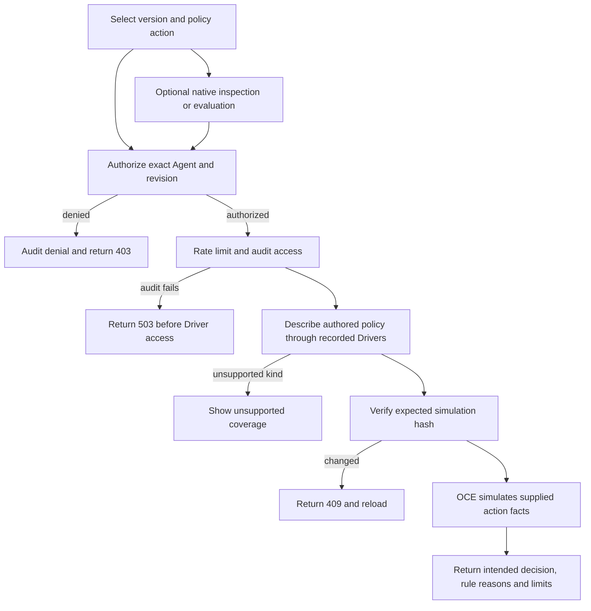

# Agent policy simulation and inspection flow

## Overview

OCE predicts authored network and plugin policy decisions through an Agent
version's Policy tester. Drivers describe supported intent; OCE owns the pure
simulator. Native Sandbox inspection/evaluation remain separate optional adapters.
No action is executed by the tester.

## Entry Points

- `GET` or `POST .../deployments/:deploymentId/runtime/policy-simulation` describes
  or simulates authored policy. Existing `GET .../runtime/network-policy` and
  `POST .../runtime/network-policy/evaluate` inspect or evaluate native policy.
- `apps/controller/src/index.ts:perform` dispatches authorized operations.
- `packages/occ/src/index.ts:OpenClawController.describeAgentPolicySimulation`
  and `simulateAgentPolicy` bind the exact revision and run the simulator.
- Assumptions: admitted revision, Agent operate/read and revision read. Log
  permission and runtime log support are independent.

## Flow

## Execution Trace

### 1. Authorize, audit and bind

`packages/contracts/src/api/routes.ts:occApiRoutes` declares closed action unions
and bounded responses. `OpenClawController.agentRuntimeTarget` checks exact
revision ownership, Agent operate/read and revision read, then recorded Compute
identity. The controller audits access before describing policies and records
revision identity only. Failure refuses access; disconnect and deadline signals
bound Driver work. Compute log methods and the log feature switch are not required.

### 2. Describe intended policy

`packages/contracts/src/index.ts:SandboxDriver` declares simulation descriptions.
`SandboxDriver.describePolicySimulation` supplies portable network rules and
unsupported conditions. `OpenShellSandboxDriver.describePolicySimulation` maps
current authored Driver options, independently of provider reads, global/provider
composition and generated connectivity rules. It preserves default audit mode.

`PluginDriver.describePolicySimulation` supplies immutable revision selections,
capability constraints and verified tool identities. Bundled OpenClaw uses its
pinned catalog; Codex inventory remains unknown without verified native ownership.
The core validates and bounds descriptors, hashes them with OCE semantics version
`oce-policy-simulation-v2`, and returns each supported kind independently. If the Sandbox policy cannot be read, the
description can still show saved plugin policy. Simulating a plugin action never reads Sandbox placement.

### 3. Simulate and optionally inspect enforcement

`packages/occ/src/policy-simulation.ts:simulatePolicy` implements OCE selector,
method-preset and plugin precedence semantics. Network selectors support simple
segment wildcards and ancestor paths, excluding spoofable command-line paths.
Unmodeled HTTP canonicalization, unsupported syntax, and overlapping HTTP presets that
would give different answers return unknown. The simulator does not guess the provider’s precedence. Plugin
selection disablement is terminal; tool overrides precede defaults. Provider
approval defaults, missing annotations, opaque Driver policy and unsupported
review modes retain explicit uncertainty.

`simulateAgentPolicy` rejects stale intent hashes. The console module
`apps/controller/src/console/agents/network-policy.mjs:createPolicyTester`
shows simulation separately from historical decisions and native provider evidence.
If a subsequent log read is refused, the Console clears the log and closes any
tester opened from it. An operator with policy access can still open an empty tester.

Existing native `describeAgentNetworkPolicy` and `evaluateAgentNetworkPolicy`
remain Sandbox-owned. The OpenShell adapter reads effective policy and exact Ready
runtime admission, and calls its native evaluator when available. Native rule IDs
use `policy:` and `builtin:default-deny` to avoid authored-name collisions. Native
availability does not gate OCE simulation.

## Debugging and Verification

- HTTP/IAM integration: `node --test tests/integration/agent-policy-simulation.test.mjs`.
- Plugin intent/translation coverage: `node --test tests/conformance/plugin-driver.test.mjs`.
- Sandbox translation and native engine parity: set the test-only native source
  option documented in [plugin and sandbox proof notes](../testing/plugins.md),
  then run `tests/integration/sandbox-driver-startup.test.mjs`.
- Browser tests exercise the real OCE API/simulator with authored fixtures and
  actual plugin Driver descriptors. Storybook media remains simulated UI proof.
- Existing opt-in plugin and OpenShell Kubernetes Agent lanes compare simulation
  with actual tool/network enforcement. Missing infrastructure is reported as a
  skipped/unrun real-runtime lane, never native parity proof.

## Related docs

- [Operator workflow](../guides/topics/agent-network-policy.md)
- [Sandbox Driver contract](../reference/drivers/sandbox.md)
- [Plugin Driver contract](../reference/drivers/plugin.md)
- [Runtime logs](agent-runtime-logs.md)

## Manual Notes

## Changelog

- 2026-10-13 16:30: Add OCE-owned network/plugin simulation and Driver conformance; retain native evaluation adapters. (authoring-run/57611bd1-494b-4484-940a-7767f8814376 - 0989be91e37275f690a9c048a9ff001b269f3aa6)
- 2026-10-13 13:43: Document native network policy inspection and synthetic evaluation. (authoring-run/57611bd1-494b-4484-940a-7767f8814376 - 0989be91e37275f690a9c048a9ff001b269f3aa6)
