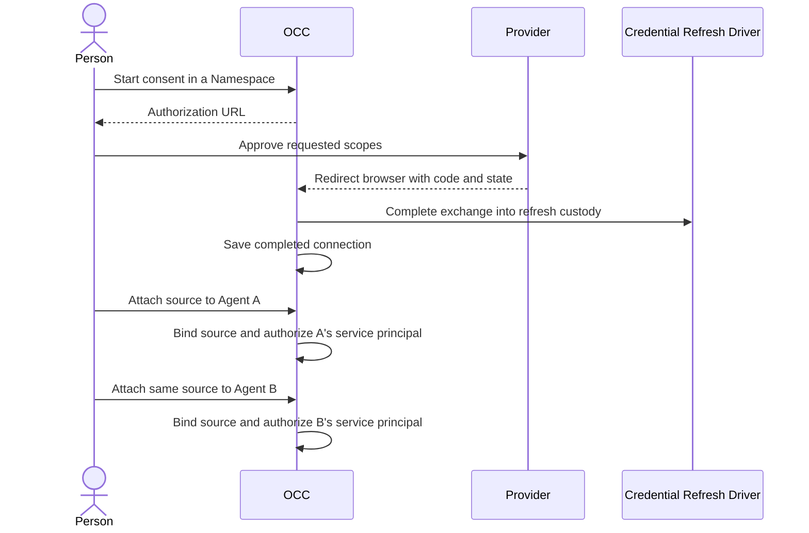

# Agent OAuth connection lifecycle Flow

## Overview

A person approves an account once. OCC records who consented and saves the approved
connection in its Namespace. Someone with access to both that account and an Agent
can then attach it. Deploying the Agent uses its service principal's grant.

## Entry Points

- Start consent with `POST /namespaces/:namespaceId/connections`. An existing
  client can start consent from an Agent's connections collection as well.
- The provider redirects the signed-in person to `GET /oauth/callback`.
- Attach or detach a specific account with `POST` or `DELETE` on
  `/namespaces/:namespaceId/agents/:agentId/connections/:credentialSourceId`.
- Disconnect the saved account with `DELETE /namespaces/:namespaceId/connections/:credentialSourceId`.

## Flow

## Execution Trace

1. `startAgentConnection` checks the human session, Namespace access and
   `connection_template:use`. An Agent-originated request also requires access
   to that Agent. OCC pins the approved template version, registers the pending
   source, and starts the provider's authorization flow.
2. `completeAgentConnection` consumes the starting person's one-time state,
   rechecks authorization and calls the selected refresh Driver to exchange the
   code. OCC marks the source ready and saves its consent record in a transaction.
   At this point no Agent has received the account.
3. `attachAgentConnection` checks Agent update permission and the caller's
   authority to use the completed source. It binds the source and grants the
   target service principal exact-source access. Other Agents can be attached
   individually. New deployments and queued work check the Agent's authority.
4. `disconnectAgentConnection` detaches the source from that Agent and requests
   withdrawal from revisions holding the credential. Other attached Agents keep
   their grants. Disconnecting the saved account at the Namespace endpoint
   instead withdraws it from every Agent. OCC records the intent before retiring
   the stored refresh material so a worker can resume interrupted cleanup.

## Debugging and Verification

Inspect the [callback failure reasons](../reference/connection-templates.md#callback-failures)
when consent fails. To verify delegation, use two attached Agents and one
unattached Agent. Detach the first and check its withdrawal state separately
from the second Agent's ability to deploy. A successful provider request needs
a deployed runtime, a supported credential policy, and a real provider account.

## Related docs

- [Connection templates and saved accounts](../reference/connection-templates.md)
- [Credential source lifecycle](credential-source-lifecycle.md)
- [Credential source refresh](credential-source-refresh.md)
- [OpenShell Credential Gateway](../reference/drivers/openshell-credential-gateway.md#configure-the-driver)
- [Connect Google Gmail](../guides/deploy/google-gmail-connection.md)

## Manual Notes

[keep this for the user to add notes. do not change between edits]

## Changelog

- 2026-10-20 21:44: Document the RFC-0023 connection lifecycle (claude-code/session_01HzmRt1DGB79VEnEWHt7PRy - 0400c9f6729f6ce5efd91040f2802a21dfc1d90e)
