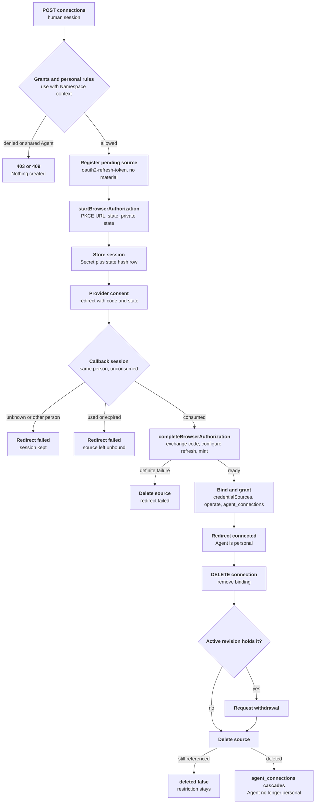

# Agent OAuth connection lifecycle Flow

## Overview

A person connects their own OAuth account to their Agent through an
Installation connection template. OCC registers a pending credential source,
the person approves on the provider's consent page, and the callback has the
Credential Refresh Driver exchange the code into OpenShell refresh custody. OCC
then binds the source to the Agent and treats the Agent as personal until the
source is deleted. This flow stops when the source is bound, or when disconnect
removes it. Deployment and attachment continue in the
[credential source lifecycle](credential-source-lifecycle.md).

## Entry Points

- Trigger: `POST /namespaces/:namespaceId/agents/:agentId/connections`, the
  provider redirect to `GET /oauth/callback`, and
  `DELETE /namespaces/:namespaceId/agents/:agentId/connections/:credentialSourceId`.
- Source: `packages/occ/src/index.ts:startAgentConnection`
- Source: `packages/occ/src/index.ts:completeAgentConnection`
- Source: `apps/controller/src/http/connections.ts:createConnectionCallback`
- Assumptions: a `ready` Namespace and active Agent; a connection template with a
  registered client; selected OpenShell Credential Gateway (with `toolBinaries`)
  and Credential Refresh Driver (with `clientWorkspace`); Backend `operatorTls`; a
  configured public origin; the caller's human session with exact `agent:read`,
  `agent:update`, and `connection_template:use` for the Agent's Namespace.

## Flow

## Execution Trace

### 1. Admit the connect request

`apps/controller/src/index.ts:perform` and
`packages/occ/src/index.ts:startAgentConnection`

The dispatcher refuses a service key with `403` and answers `503` when no
callback URI is configured. The controller checks exact Agent `read` and
`update`, then `use` on the template through `authorizationDecision` with the
Agent's Namespace as `namespaceContext`. These checks and the personal-Agent
rules also authorize the source and Secret the connection creates, so the person
needs no Namespace `credential_source` or `secret` grant (`CONNECTION_AUTHORIZED`).
It requires a `ready` Namespace and active Agent. `assertPersonalAgentOwner` refuses
a different existing owner, exact-Agent grants to other people, Group grants,
and plugin approvers. OCC reads the Agent's Configuration and refuses enabled
channels.

### 2. Register the pending source and start authorization

`packages/occ/src/index.ts:createCredentialSource` with `CONNECTION_AUTHORIZED`,
`apps/controller/src/drivers/credential-refresh/openshell.ts:startBrowserAuthorization`

OCC registers an `oauth2-refresh-token` source whose config is the current
template version's endpoint, variable, token URL, client ID, and scope, with no
Secret fields. The Gateway creates the provider; OCC skips the first mint. The
Refresh Driver builds the consent URL with an S256 PKCE challenge and random
`state` (`apps/controller/src/drivers/credential-refresh/browser-authorization.ts:startBrowserAuthorization`)
and returns private state holding the verifier and fixed refresh request IDs. OCC
stores that private state in a Namespace Secret and inserts an
`occ.connection_sessions` row keyed by the SHA-256 of `state`, expiring after ten
minutes. The response carries `authorizationUrl` with `Cache-Control: no-store`.

### 3. Complete the callback

`apps/controller/src/http/connections.ts:createConnectionCallback` and
`packages/occ/src/index.ts:completeAgentConnection`

The callback route admits the session and rate-limits by peer. OCC finds the
session row by state hash; a missing row or another actor fails without consuming
it. It then consumes the row with a conditional update, which PostgreSQL allows
once and only before expiry, so a replay never reaches the Driver. A provider
`error` becomes `consent_denied` or `provider_error`. OCC rechecks Agent `update`
and `use`, reads the private state, and calls `completeBrowserAuthorization`.

### 4. Exchange the code into refresh custody

`apps/controller/src/drivers/credential-refresh/openshell.ts:completeBrowserAuthorization`

The Driver compares `state` in constant time, reads the client secret from the
`clientWorkspace` provider over operator TLS, and posts the code, verifier,
client ID, and secret to the token endpoint without following redirects
(`browser-authorization.ts:exchangeAuthorizationCode`). A refused grant or
client, a server error, or a missing refresh token throws
`BrowserAuthorizationError`. On success it configures the source provider's
refresh with client ID, scope, client secret, and refresh token, and forces the
first mint. The refresh token goes only to OpenShell.

A `BrowserAuthorizationError` makes OCC delete the pending source. Any other
error leaves the outcome uncertain; the source stays registered and unbound.

### 5. Bind the source and make the Agent personal

`packages/occ/src/index.ts:completeAgentConnection`

In one transaction OCC locks the Agent, re-runs the personal-Agent check, appends
the source to `credentialSources` (at most eight), grants the Agent's service
principal `operate` through `ensureAgentOperateGrants`, and inserts the
`occ.agent_connections` row with owner and template version. The callback audits
the completion on the Agent and redirects to its console page with
`connection=connected`, without the query string.

From here `personalAgentOwner` returns the owner. Deploy
(`deployAgentWithAuthorization`), the worker's `authorizeRevision`
(`apps/controller/src/worker.ts`, code `PERSONAL_AGENT_OWNER_REQUIRED`), native
admin (`getAuthorizedActiveAgentRevision`), Namespace access bindings,
Configuration saves, and `authorizeAgentCredentialSources` enforce it.

### 6. Disconnect

`packages/occ/src/index.ts:disconnectAgentConnection`

OCC removes the source from `credentialSources`, calls
`withdrawAgentCredentialSource` (ignoring the case where the active revision
never held it), and calls `deleteCredentialSource`. Deletion succeeds only when
nothing holds the source; its foreign key then deletes the
`occ.agent_connections` row and the Agent stops being personal. Otherwise the
response reports `deleted: false` and the restriction stays until a later
deletion.

## Debugging and Verification

- Connect responses: `403` for a service key or missing grant, `409` for a shared
  Agent, channels, or plugin approvers, `501` without browser-capable Drivers,
  `503` without a public origin.
- Callback failures redirect to `/console/?connection=failed&reason=<code>`; see
  [callback failures](../reference/connection-templates.md#callback-failures).
  Each refused or failed callback is audited with its reason code
  (`createConnectionCallback` calls `rejectedMutation`).
- Inspect state: `SELECT state_hash, consumed_at, expires_at FROM occ.connection_sessions`
  and `SELECT * FROM occ.agent_connections WHERE agent_id = '<agent>'`.
- Refresh status of the source: `occ credential-source get <id> -o json`
  (`status.refresh`).
- `tests/integration/postgres-agent-connections.test.mjs` (keycloak-oidc lane)
  proves the HTTP, PostgreSQL, IAM, and real Keycloak authorization-code + PKCE
  path with an OpenShell transport double. It does not prove OpenShell refresh,
  operator-TLS readback against a real gateway, or substitution in a Sandbox.

## Related docs

- [Connection templates and personal Agents](../reference/connection-templates.md)
- [Credential source lifecycle](credential-source-lifecycle.md)
- [Credential source refresh](credential-source-refresh.md)
- [OpenShell Credential Gateway](../reference/drivers/openshell-credential-gateway.md#configure-the-driver)
- [Connect Google Gmail](../guides/deploy/google-gmail-connection.md)

## Manual Notes

[keep this for the user to add notes. do not change between edits]

## Changelog

- 2026-10-20 21:44: Document the RFC-0023 connection lifecycle (claude-code/session_01HzmRt1DGB79VEnEWHt7PRy - 0400c9f6729f6ce5efd91040f2802a21dfc1d90e)
