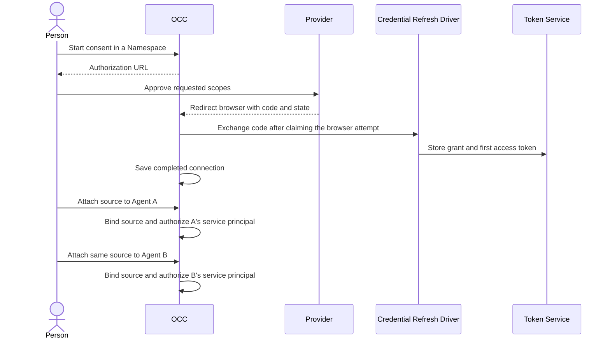

# Agent OAuth connection lifecycle Flow

## Overview

A person approves an account once. OCC records who consented and saves the approved
connection in its Namespace. Someone with access to both that account and an Agent
can then attach it. Deploying the Agent uses its service principal's grant.

## Entry Points

- Start consent with `POST /namespaces/:namespaceId/connections`. An existing
  client can start consent from an Agent's connections collection as well.
- The provider redirects the signed-in person to `GET /oauth/callback`.
- Attach or detach a specific account with `POST` or `DELETE` on
  `/namespaces/:namespaceId/agents/:agentId/connections/:credentialSourceId`.
- Disconnect the saved account with `DELETE /namespaces/:namespaceId/connections/:credentialSourceId`.

## Flow

## Execution Trace

When a template needs a new OAuth client registration, OCC stages the client secret
before it saves the template and its audit event. After a confirmed rollback, OCC
asks the Refresh Driver to remove the staged secret. If OCC loses the commit
acknowledgment, it keeps the secret because the template may already reference it.

1. `startAgentConnection` checks the human session, Namespace access and
   `connection_template:use`. An Agent-originated request also requires access
   to that Agent. OCC pins the approved template version, registers the pending
   source, and stores the PKCE verifier in a private database row with the
   identity, browser session and ten-minute expiry.
2. `completeAgentConnection` consumes the attempt before exchange and rechecks
   authorization. The Refresh Driver exchanges the code with the provider. The
   Token Service accepts the grant, and OpenShell receives the access token and
   expiry. OCC then marks the source ready, records consent and grants the owner
   exact-source read and operate in one transaction. A worker expires abandoned
   attempts. An exchange with an uncertain outcome requires explicit recovery.
3. To rotate a connected account, OCC first marks its published token version due.
   The API and the worker can both fulfill that request. If the Token Service
   already holds a replacement, OCC delivers it to the sender. It records the
   next renewal time after the sender accepts the replacement.
4. `attachAgentConnection` checks Agent update permission and the caller's
   authority to use the completed source. It binds the source and grants the
   target service principal exact-source access. Other Agents can be attached
   individually. New deployments and queued work check the Agent's authority.
5. `disconnectAgentConnection` detaches the source from that Agent and requests
   withdrawal from revisions holding the credential. Those revisions can still
   send requests until the worker confirms withdrawal or they stop. Other attached Agents keep
   their grants. Disconnecting the saved account at the Namespace endpoint
   instead withdraws it from every Agent. OCC records the intent before retiring
   the stored refresh material so a worker can resume interrupted cleanup.

## Debugging and Verification

Inspect the [callback failure reasons](../reference/connection-templates.md#callback-failures)
when consent fails. To verify delegation, use two attached Agents and one
unattached Agent. Detach the first and check its withdrawal state separately
from the second Agent's ability to deploy. A successful provider request needs
a deployed runtime, a supported credential policy, and a real provider account.

## Related docs

- [Connection templates and saved accounts](../reference/connection-templates.md)
- [Credential source lifecycle](credential-source-lifecycle.md)
- [Credential source refresh](credential-source-refresh.md)
- [OpenShell Credential Gateway](../reference/drivers/openshell-credential-gateway.md#configure-the-driver)
- [Connect Google Gmail](../guides/deploy/google-gmail-connection.md)

## Manual Notes

[keep this for the user to add notes. do not change between edits]

## Changelog

- 2026-10-20 21:44: Document the RFC-0023 connection lifecycle (claude-code/session_01HzmRt1DGB79VEnEWHt7PRy - 0400c9f6729f6ce5efd91040f2802a21dfc1d90e)
