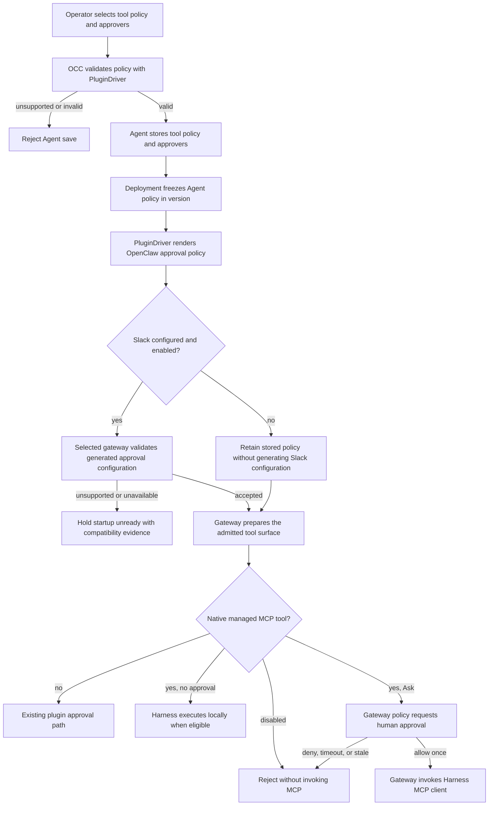

# Agent Plugin Approvals Flow

## Overview

An operator selects approvers and, for a dedicated OpenClaw MCP plugin, chooses
which enabled tools require human review. OpenClaw Control Plane (OCC) freezes
the selection in the Agent revision. The Gateway requests approval before
dispatching an Ask tool to the Harness. Name lookup is described in the
[channel directory flow](agent-channel-directory.md).

## Entry Points

- Trigger: the Console Plugins editor or an authorized caller creates, updates,
  or deploys an Agent with plugin approvers.
- Assumptions: the actor has Agent create or exact Agent update permission, and
  the selected PluginDriver supports approvers.
- Source: `apps/controller/src/console/agents/slack-approvers.mjs:createSlackApproverField`,
  `packages/occ/src/index.ts:OpenClawController.updateAgent`, and
  `apps/controller/src/drivers/plugin/runtime-translator.ts:pluginApprovalOverlay`.

## Flow

## Execution Trace

### 1. Save and freeze approver policy

`packages/occ/src/index.ts:OpenClawController.updateAgent`

Agent `pluginApprovers` supplies the default. A plugin's `approvers` replaces
the default; a tool's `approvers` replaces the plugin list. Omission inherits
and `[]` denies Slack approvers at that scope. The selected PluginDriver
validates supported identities before OCC saves the Agent. The Codex
PluginDriver rejects plugin and tool approvers because Codex approval requests
carry no plugin or tool identity; it accepts only the Agent default. Deploying the Agent
records the current default and selection map in an Agent revision.
Later edits do not change the saved version.
An Agent update sends `pluginApprovers: null` to remove a previously saved
default and return to omitted-policy behavior.

### 2. Hand off runtime enforcement

`apps/controller/src/drivers/plugin/runtime-translator.ts:pluginApprovalOverlay`

The PluginDriver renders raw or workspace-qualified Slack user IDs into the
OpenClaw plugin approval configuration. It preserves unrelated approval
settings and rejects native lists that conflict with an inherited managed list.
An omitted Agent default leaves the runtime's legacy Slack account
approval destinations in effect for scopes without an override; an explicit
empty list denies them. The prepared gateway receives this configuration only
for the saved version.

### 3. Check the selected gateway before launch

`apps/controller/src/drivers/compute/kubernetes/runtime-entrypoints.ts:applyOpenClawPluginConfiguration`

The shared Docker and Kubernetes gateway setup omits the generated Slack
approver overlay when `channels.slack` is absent or `enabled: false`. The
admitted policy remains unchanged, including explicit empty lists. Other native
approval settings remain in the effective configuration.

When Slack is configured and enabled, setup writes only the generated approval
policy into a private temporary file and runs the selected image's native
`config validate --json`. This tests the actual configuration contract without
a version cutoff or requiring external plugins to be installed first. The
probe has a 30-second timeout and removes the file afterward. Only a successful
validation permits the policy to be merged into the gateway configuration.

An unsupported policy or unavailable validator holds startup unready before
launching the gateway. Logs tell the operator to select a compatible gateway
image or remove the approver overrides. Kubernetes publishes
`plugin-approvers / INCOMPATIBLE_RESPONSE` startup evidence through its existing
runtime status endpoint. Version admission still precedes this runtime check;
the worker reads startup evidence during reconciliation. A compatible runtime
owns each subsequent request-time approval decision.

### 4. Execute a managed MCP tool

`apps/controller/src/drivers/plugin/managed-catalog.ts:managedMcpCredentialBinding`

The selected upstream names remain in `driverPolicy.toolNames`.
`tools[name].approval: all_actions` adds human review for that enabled tool;
omitting approval or selecting `none` adds no review. Compute gives the Gateway
the selected names and review requirements for the saved revision. The worker
keeps the MCP client and credential placeholder.

When at least one selected tool requires review, the Gateway launcher verifies
the image-packaged policy files, adds the extension to `plugins.load.paths`,
and writes each selected server and tool as `allow` or `ask` in its configuration.
When the worker pairs, the launcher adds its node ID to that configuration.

`deploy/runtime/managed-mcp-policy/index.mjs:register`

The OCE-managed Gateway policy allows eligible tools without review to use
their same-node execution grant. An Ask tool uses Gateway dispatch. The policy
requests an allow-once decision for its server and upstream tool name, then
invokes the node only after approval. This pilot does not display tool arguments.
Denial, timeout, cancellation, or stale authority prevents the native invocation.
OpenClaw can continue startup after a policy registration failure; rejecting MCP
execution in that case is a follow-up. Gateway readiness does not prove registration.

Direct scripts can use an enabled tool's credential placeholder without going
through this Gateway gate. Disabled upstream names remain denied by the
credentialed MCP request policy.

## Debugging and Verification

- Compare `Agent.pluginApprovers`, nested selection overrides, and the admitted
  Agent revision. A successful save does not prove the running gateway applies
  the new policy; check deployment status and use a real plugin approval request
  to verify the runtime image.
- Selecting a directory result displays its name and handle immediately. The Console
  saves the workspace-qualified user ID and resolves its current name when reopened.
  If lookup is unavailable, the selection stays in place and exact IDs can still be pasted.
- The channel directory flow describes Secret permissions and lookup failures.
  Approval enforcement needs a compatible runtime and an authorized test bot.
- For a gateway that remains unready, check its runtime startup evidence and
  logs for `plugin-approvers`. A capability failure leaves the native
  configuration unchanged and does not launch an invalid gateway.

## Related docs

- [Agent plugin deployment flow](agent-plugins.md)
- [Agent plugin policy](../reference/agent-plugins.md#slack-approver-users)
- [Channel directory flow](agent-channel-directory.md)

## Manual Notes

[keep this for the user to add notes. do not change between edits]

## Changelog

- 2026-11-18 05:23: Document managed MCP human approval and its direct-script boundary. (01a13641-ad1f-7e93-a453-f1fd8c3ad711 - c8c1fb2d1)

- 2026-09-29 09:30: Reject Codex plugin and tool approvers at admission. (authoring-run/b28f3746-f8be-4f03-9f5e-33cf08d9a535 - d040b86dd780e7a9ac3bbbacf1646203881e2990)

- 2026-09-29 00:11: Check gateway approval compatibility and omit inactive Slack policy. (01a0d4f7-8085-70e0-9d0c-69a465a81fe3 - 33a2528163d5bbff311bb685345e60aadb24a70a)

- 2026-09-28 01:19: Document raw Slack user IDs for plugin approvers. (01a0e579-79b9-7a22-b707-d5bc1e024e31 - f90ca58bf4085a6075faa1c46e75ee96d2fbdafb)

- 2026-09-27 02:03: Describe Agent plugin approval handoff. (01a0df20-f340-7810-bb59-b1df6c0bbbd3 - b2de165412191a4c9d124acf59fa1efb25cc29d6)
