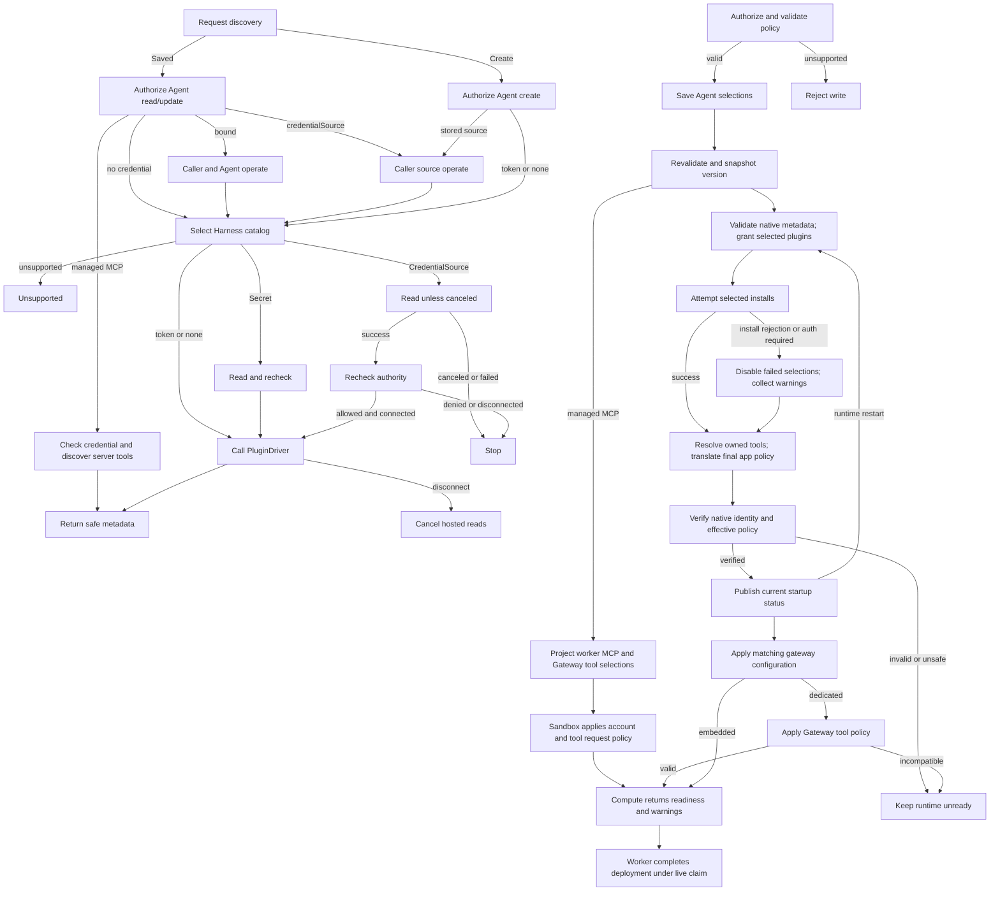

# Agent Plugin Deployment Flow

## Overview

OCC validates selections against the Harness catalog and snapshots the Driver and policy at deployment. The Harness owns tools and approvals.

## Entry Points

`apps/controller/src/index.ts:createFastifyApp`

- Trigger: Agent create/update with `plugins`, then deployment.
- Requires Agent permission, valid selections and a compatible PluginDriver.
- Source: [HTTP handlers](../../apps/controller/src/index.ts),
  [OpenClawController](../../packages/occ/src/index.ts), and
  [bundled PluginDrivers](../../apps/controller/src/drivers/plugin/index.ts).

## Flow

## Execution Trace

### Credential-scoped discovery

[Create discovery](../reference/drivers/plugin.md#selection-and-catalogs) requires
Agent `create` and caller `operate` on stored sources. OCC rechecks both before
Driver use. With multiple catalogs, specify the Harness. Wrong Namespace returns `400`, missing Secret `404`, unavailable
explicit CredentialSource `409`. Unsupported discovery reads no credential.

Saved discovery requires a dedicated Agent with caller `read` and `update`.
OCC offers admissible plugins. It rechecks attachment and both caller and Agent
`operate` for bound sources, and caller `operate` for explicit sources.
Missing or unready bound sources return `404`. Hosted catalogs use the saved
bearer; curated catalogs need none.

CredentialSource reads honor timeout and cancellation. Before provider access, OCC rechecks grants and catalog. Disconnect discards late tokens.

`packages/occ/src/index.ts:OpenClawController.discoverManagedMcpTools`

For managed MCP, the Plugin Driver matches the release slot. OCC reads the bearer
through the Secret Driver and rechecks grants and attachment before `tools/list`.
`driverPolicy.toolNames` pins upstream names for worker, Gateway and OpenShell.

Console cancels reads on picker or view close and clears results on account
change. Harness changes clear selections. Hosted reads reject redirects and credential echoes, limit size and
time, and return safe metadata with `Cache-Control: no-store`.
See [catalog browsing](../reference/drivers/plugin-bundled.md#selection-and-catalogs).

The optional `NativeCodexPluginCatalogReader` calls `plugin/list` over stdio,
rejects invalid results and stops the child on teardown. HTTP uses the hosted reader.

### 1. Validate desired state under exact-Agent authority

`apps/controller/src/index.ts:createFastifyApp`

HTTP contracts validate input before [OpenClawController](../../packages/occ/src/index.ts)
checks the exact Namespace and Agent. Reads require Agent `read`; create/PATCH
stores the `plugins` map and its Driver identity. `validateAgentPlugins` uses the Harness catalog for policy and Configuration checks on Agent and provisioning writes. Deployment rechecks Configuration. The OpenClaw Driver refuses a selection
whose tools `tools.deny`, the sole `agents.entries` entry's list, the primary provider's
`byProvider` lists, or these together block, any selection beside an entry denying `*`, or one a
sole entry's `alsoAllow` hides under a profile. With an OpenClaw Harness,
[`openClawPluginSettingConflict`](../../apps/controller/src/drivers/plugin/openclaw-plugin-settings.ts)
first refuses [plugin settings the Gateway refuses](../reference/drivers/plugin-bundled.md#native-mappings-and-limits).
Unsupported controls and incompatible selections return `400 INVALID_REQUEST`. Startup checks native app mapping, authentication, and release metadata. Agent updates store desired state and audit evidence atomically. Omission preserves selections, `{}` clears them, and a nonempty map replaces them. Clear selections with an unknown or different owner before changing catalogs.

Installation uses `GET /installation`; Agent editors use
`GET .../plugins/capabilities` with Agent read/update. Both return policy capabilities.

### 2. Admit an immutable plugin deployment

`packages/occ/src/index.ts:OpenClawController.deployAgent`

OCC snapshots the Configuration, Driver, and selections in the revision. Before cutover, the worker checks the pinned Driver against the catalog. Compute projects a package descriptor. Startup verifies its release and assets.

- **CLI packages.** The Gateway loads skill instructions. The Harness runs its image’s pinned executable. The shared guard checks operation and credential restrictions before injection.
- **Hosted MCP packages.** With an account and selected tools, the worker advertises those tools from Compute’s pinned descriptor. Per-turn Gateway grants allow same-node execution. For other nodes or Gateway hooks, the Gateway returns structured results or policy denials to Code Mode. The credential driver attaches the source. Sandbox delivers its placeholder and scopes worker and script requests to the selection. OpenShell enforces exact MCP names and rejects overlapping routes.
- **Native runtime plugins.** Startup installs packages and verifies native tool policy.

Credential withdrawal removes injection. Recovery preserves other attachments.

### 3. Deliver requested state through Compute preparation

`apps/controller/src/drivers/compute/plugin-runtime.ts:pluginRuntimeSpecForRevision`

Compute validates admitted state, Driver, and Harness. Kubernetes projects the
nonsecret request; Docker uses environment delivery with a 64 KiB size limit. For Codex, Compute
writes the policy the Gateway runs into native `approval_policy` before startup
validation: the configured `appServer.approvalPolicy`, with `on-failure` as
`on-request`. Omission preserves native defaults; incompatible explicit policies
remain subject to reviewer checks. At Agent save, provisioning and deployment, the Codex
PluginDriver refuses an automatic reviewer unless the policy is `on-request` or
`on-failure`, because an omitted policy lets the Gateway pick one the startup
check cannot see. Configuration save and Compute Drivers refuse policies the
Gateway refuses at load, such as `untrusted`.

The Kubernetes ConfigMap is immutable and per version. A version prepared
by an earlier controller keeps its earlier `config.toml` (without
`[plugins._default]` (#508), without `approval_policy` (#1995), or with
`on-failure` as written) until the Agent is deployed again; `KubernetesComputeDriver.reconcilePluginRuntimeConfigMap` refuses any
other difference. OpenShell dedicated Codex has no such allowance and needs a
new deployment after that upgrade.

SSH Compute rejects nonempty plugin maps and Agent default plugin approver
policies before host effects.

Initial embedded Kubernetes gateway preparation applies exact-Agent HTTPS
egress before installation. For existing gateways, `prepareRevision` avoids
duplicate Agent database access. `activateRevision` uses `Recreate`, stopping
the old gateway before installation. Version files stay private and the native
registry stays in the Agent-owned database. Docker keeps native state in the
container's private temporary home.

### 4. Prepare native runtime state and hand off readiness

`apps/controller/src/drivers/compute/kubernetes/runtime-entrypoints.ts:installOpenClawPlugins`

Embedded OpenClaw validates selections against its bundled catalog and policy.
Grants enter nonempty `tools.allow`, otherwise `tools.alsoAllow`; denies and profiles
remain. Tool `enabled` overrides `toolDefaults.enabled`; disabled tools emit denies.
Master disable and operator denies prevail. The supported modes
`provider_default` and `none` add no plugin review. Version-private installs use `--pin --force --no-enable`,
preserving enablement and tool policy. Preparation refreshes the registry and verifies
configuration, plugin/package identity, versions, integrity and source containment
within the install path. Verification failures keep the Gateway unready. Confirmed
install rejection disables the optional selection and removes its tool allowance
before startup.

Dedicated launchers capture the [Gateway tool policy](../reference/configuration.md#gateway-tool-policy)
from the saved Agent revision before plugin grants. Startup and peer respawn
enforce it; failures keep the Gateway unready. Changes require deployment replacement
after affected old work ends. Human permissions stay unchanged. An embedded Gateway
applies a policy that the Configuration sets without this composition, so Compute checks
it at Configuration save and deployment admission with the same rules
(`gateway-tool-policy.ts:validateGatewayToolPolicy`), not on maintenance passes.

Dedicated Codex uses isolated `CODEX_HOME`, disabling app/plugin defaults.
Selections enable apps, plugins and remote plugins; disabled entries cannot execute.
The [native policy mappings](../reference/drivers/plugin-bundled.md#native-mappings-and-limits)
describe the generated bridge.

<!-- Internal preparation threads one explicit RPC caller through these reads,
writes, reviewer checks, and no-account disablement; ordinary transport is unchanged. -->

Startup enables experimental APIs and resolves selected IDs through `plugin/search`.
`codex-plugin-stdio.ts:withCodexPluginStdio` retains fixed
`nativeErrorType`/`nativeSubErrorType` values, discarding other stderr/RPC content
and lines over 64 KiB while draining. RPC errors alone do not prove backend
installation.

`runtime-entrypoints.ts:readCodexPluginDetails` reads up to four
selections concurrently before and after installs. Batches preserve order and drain
before retries and final verification; writes stay sequential.
`codexRuntimeArtifact` uses `detail.apps`, excluding `appTemplates`.
`codexInstallPlan` validates policy and [component support](../reference/drivers/plugin-bundled.md),
then grants selected plugin IDs through `config/batchWrite` before `plugin/install`
can report authentication requirements. App/tool grants follow; plugin defaults stay
off. Bundled skills need the compatible runtime below for selected-only activation.
Install rejections or missing app authentication warn. Explicit tool policies
require `mcpServerStatus/list`'s `codex_apps` inventory; `codexAppToolSettings`
binds catalog action IDs through `_meta._codex_apps.resource_uri`. Native IDs
work. Unknown, unowned, ambiguous, or duplicate IDs fail startup.

After installation, startup rechecks catalog identity, version, apps and components
before final app/tool grants; `plugin/read` cannot inspect bundles.
`writeCodexPluginConfiguration` replaces owned plugin/app tables, enables successful
selections, disables failed/disabled plugins and unselected apps, and writes
inherited tool/account approvals from merged workspace settings. Lower-layer
descendants remain. Unspecified enablement stays unset; requirements still apply.
Failed-only apps stay disabled; disabled selections skip installation/status.

Workspace-aware readback rejects policy conflicts before readiness. Disabled apps may
retain inherited fields. Categories resolve app → global → native `true`; equivalent
values/nulls pass. Tool enablement cannot bypass categories.
`verifyCodexPluginConfiguration` rejects explicit enablement of unselected plugins;
approval-only or MCP-policy-only entries inherit the verified plugin default-off
setting. Source/account-disabled plugins remain disabled.

`runtime-entrypoints.ts:startAuthenticatedCodex` passes the admitted Harness model,
without its provider prefix, to the app-server after the authentication probe
succeeds. Native configuration readback therefore exposes the model used for
startup policy validation.

`runtime-entrypoints.ts:verifyCodexReviewerConfiguration` checks app/link reviewers
and `configRequirements/read`. Forbidden reviewers, incompatible automatic-review
settings or conflicting model requirements block startup. Checks exclude later
workspace/session/model changes and strict review. Codex 0.156 readback omits
execution-time managed app/tool requirements; [effective-policy proof](../testing/plugins.md#current-proof-notes)
remains necessary.

`runtime-entrypoints.ts:disableCodexSelectionsWithoutChatGptLogin` disables enabled
selections and app/plugin features for API-key logins when best-effort preparation
allows authentication warnings. API-key logins cannot install remote plugins.
Startup verifies both default-off tables before handing off readiness.

For Compute-owned Kubernetes workloads, only an admitted `{pluginId, code}`
warning results from a selected OpenClaw install's normal nonzero exit, a
matching Codex `plugin/install` error, or a successful Codex install needing app
authentication. Transport loss, timeouts, signals, malformed responses,
discovery failures, and policy failures retain ordinary startup failure
behavior. Provider-owned Harnesses keep their existing startup path.

Kubernetes Compute streams private startup status with a 65,536-byte limit.
Overflow cancels the response without retry, even for a 404/503; within the limit
those codes mean not serving. Readiness verifies workload, version, startup
instance, selection keys and warnings. Docker Codex healthchecks fail on
interrupted status bodies, preserving the transport code or original reason.

With the tool proxy enabled, dedicated Codex reads bundled skills at
`/home/node/.codex/skills/.system` without a repository broker or neighboring
credentials. Startup links `/home/node/.openclaw/plugin-skills` to
`/home/node/openclaw-runtime-assets/plugin-skills`, keeping gateway state private.

Gateway blocks failed bridges before serving and retry during turns. Startup
changes refresh effective configuration; untrusted status cannot establish
readiness or change version selections.

Compute installs status NetworkPolicies before the first dedicated gateway and
creates it only when the Agent and plugin status are ready and its Service selects
the version. Existing gateways and full runtime policies retain their activation
boundary.

The Agent and gateway derive an app-server credential from the transport Secret,
Agent revision ID, and Agent startup ID. The gateway receives it after matching status
and rendering exclusions. After a Harness restart, the old credential cannot open
a new authenticated app-server WebSocket to the replacement Harness. It does not
revoke access to a still-running old Harness or an established connection. For a
changed peer, the supervisor publishes non-ready, restarts only OpenClaw and
rechecks peer startup, Pod, successes and failures after it serves. Changed or
unavailable peers trigger container restart.
The supervisor repeats a stop signal that OpenClaw ignored during its own in-place
restart, seen as readiness returning after its server closed.
For writable native-admin configuration, recovery reads the bridge baseline from
the read-only managed snapshot. A Pod-local record binds the last and pending
generated bridges to the version and snapshot hash before configuration writes.
Process and same-Pod container restarts rebuild only a matching generated bridge.
Other native edits survive; conflicting bridge edits retain the existing refusal.
An unreadable or mismatched record holds startup unready, reporting runtime
failure `peer-bridge-record` (`UNAVAILABLE`), and logs the remedy: replace the
Pod, which restores the snapshot and clears this private record.
During an outage, the supervisor reports unready. Kubernetes propagates that
state asynchronously, so the signal alone is not a per-request traffic fence.
If OpenClaw exits while the supervisor waits for its peer, the wrapper exits
for container recovery.

### 5. Complete version reconciliation

`apps/controller/src/worker.ts:finalizeRevision`

Before the worker commits `activeRevisionId`, preparation failure leaves the
prior pointer unchanged. After commit, activation/finalization failure retains
the candidate pointer and records `REVISION_FINALIZATION_INCOMPLETE` for retry.
Embedded Kubernetes replacement runs after commit; the old gateway may already
be stopped. The previous version remains stored, without pointer rollback or
an availability guarantee during cutover. See the [controller worker flow](controller-worker.md).

Successful completion reports `REVISION_ACTIVATED` or `REVISION_ALREADY_ACTIVE`.
A candidate pointer alone is not readiness evidence. Agent turns use native
policy; the workspace and gateway database remain Agent-owned.

The worker saves plugin warnings with successful work under its live claim; the
[worker flow](controller-worker.md#7-defer-retry-or-stop-and-hand-off-the-next-iteration)
covers persistence and deployment status. Claim loss blocks stale completion;
later workers recheck readiness. No receipt acknowledgment, failed-plugin
shutdown, or permanent failure latch exists. Warnings describe deployment completion, not ongoing health.

## Debugging and Verification

The OpenClaw model probe's CPU-based deadline cannot exceed 600 seconds. CPU wait is the larger PSI or throttled
delta; throttled time is capped by throttled periods. Missing, nonfinite or reset samples give no delta and cannot
establish starvation.

- Compare `Agent.plugins` with the selected version snapshot and deployment status.
  A successful Agent write alone is not runtime installation evidence.
- Invalid or unsupported policy leaves Agent desired state unchanged. Catalog
  membership, authenticated metadata, ownership, and effective native configuration
  are checked during startup; failure keeps the candidate unready.
- Check missing native packages, release drift, connector authentication, and
  effective policy when readiness fails; preserve credential values in protected
  runtime state rather than copying them into logs.
- Before host effects, SSH Compute rejects nonempty requested Agent plugin maps or
  default plugin approver policies. Clear both or use compatible Kubernetes.
- For plugin warnings, check deployment status for `PLUGIN_INSTALL_FAILED` or
  `PLUGIN_AUTH_REQUIRED` and the admitted `pluginId`. Confirm the corresponding
  runtime and gateway entries are disabled. Do not infer plugin attribution
  from arbitrary native logs.
- Prove behavior with a model-chosen plugin call in a normal Agent turn, then
  disable or remove the plugin and verify another Agent is unchanged. Source or
  fixture tests are not native runtime proof.

## Related docs

- [Agent plugin reference](../reference/agent-plugins.md).
- [Agent plugin approvals and channel directory flow](agent-plugin-approvals.md).
- [PluginDriver selection and limits](../reference/drivers/plugin-bundled.md).
- [Controller worker](controller-worker.md).
- [Harness execution topology](harness-execution-topology.md).
- [Deployment guide](../guides/deploy.md).
- [Agent plugin testing](../testing/plugins.md).

## Manual Notes

[keep this for the user to add notes. do not change between edits]

## Changelog

- 2026-11-05 01:02: Select the Harness catalog and recheck its identity before cutover. (01a169f0-a851-7b81-8e83-ff597893aa21 - 0e9575278)

- 2026-11-03 01:10: Describe hosted MCP packages and Driver-owned request policy. (authoring-run/1bd8c7a3-997a-45b2-93a4-e24d114c9ca8 - 4178b555ac5dc711c818055bd7fe34c3e4d4943b)

- 2026-11-03 00:16: Describe plugin types. (authoring-run/c005ad62-46dd-4f91-8224-3934bc3dbfe7 - e1a6ce75ac414131e759b985d280833b3b26b90e)

- 2026-11-02 23:59: Discover live MCP tools. (authoring-run/f6c72b81-af00-4c3d-9758-96b1d6ca64b1 - 6f95625048a1d20ebb5cc6e26368192b3300849c)

- 2026-11-02 23:45: Describe discovery and deployment from a managed MCP release. (authoring-run/39268f6b-739c-4af1-82dd-3ecfe85d6ffa - 5d58446a2a6e200510da738698ef832612aab50d)

- 2026-11-02 22:29: Trace the Slack account and tool selection through dedicated Agent deployment. (authoring-run/84451153-a081-4e74-aa29-e1a4acecddad - 5c0623f136d881356cec3c104b8657c761c14782)

- 2026-10-31 05:52: Classify native install failures. (authoring-run/86b48c89-0c80-493f-b48a-6999988d4766 - 6d941c15081e95ef36b4ba1ffbbbc0b117972c0a)
- 2026-10-31 03:36: Restore experimental plugin search with the upstream Codex version. (authoring-run/dc99918c-2f5c-4141-bffd-b216830017d0 - 25364fcfdc905e95b5a813a6cd7b2de47b66ca71)

- 2026-10-28 14:40: Trace worker installation and discovery of Slack MCP tools. (authoring-run/55da35a7-f123-436e-9c32-65036b85894d - 0ba3c0fd5a26a82dba6551f04b74a697c5324fdd)

[Agent plugin deployment documentation history](agent-plugins/history.md) preserves the older dated entries.
