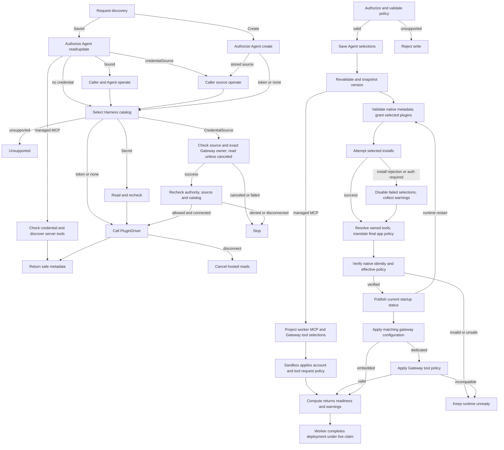

# Agent Plugin Deployment Flow

## Overview

OCC validates selections and snapshots the Driver and policy at deployment. The Harness owns tools and approvals.

## Entry Points

`apps/controller/src/index.ts:createFastifyApp`

- Trigger: Save `plugins`, then deploy.
- Requires Agent permission, valid selections and a compatible PluginDriver.
- Source: [HTTP handlers](../../apps/controller/src/index.ts),
  [OpenClawController](../../packages/occ/src/controller.ts), and
  [bundled PluginDrivers](../../apps/controller/src/drivers/plugin/index.ts).

## Flow

## Execution Trace

### Credential-scoped discovery

[Create discovery](../reference/drivers/plugin.md#selection-and-catalogs) rejects
cross-Namespace requests (`400`), missing Secrets (`404`) and unavailable explicit
CredentialSources (`409`). Saved discovery requires dedicated Agents.
Unavailable bound sources return `404`. Only hosted catalogs need credentials.

OpenShell metadata/exports use operator mTLS. External Gateways support
`withSourceToken`. OCC rechecks attachment before dispatch. Owners refresh credentials.
Cancellation discards late credentials.

`packages/occ/src/plugin-discovery.ts:discoverManagedMcpTools` reads tokens via the Secret Driver,
rechecking target and grants around `tools/list`. `driverPolicy.toolNames` pins upstream names.

Closing cancels. Account changes clear results. Harness changes clear
selections/approvers. [Hosted reads](../reference/drivers/plugin-bundled.md#selection-and-catalogs)
cap size/time, reject redirects/credential echoes, set `Cache-Control: no-store`.
Canonical duplicates return `503 PLUGIN_DISCOVERY_INVALID_RESPONSE`.
Console rejects missing/mismatched detail IDs with retry.

On `409 RESOURCE_CONFLICT`, [Console](../../apps/controller/src/console/agents/plugin-discovery.mts)
retires stale **Add**, preserves drafts and offers **Load plugins** (catalog), **Load tools** (connection)
or **Retry tools** (details).

For saved Agents, catalog or hosted-details `403` clears cached **Add** and tools.
Use **Load plugins** unless managed tool discovery requires **Recheck access**.
Both tabs keep current refusal guidance and IDs on cancel or failure. The
capabilities `GET` checks Driver, policy, release, slot bindings and unique valid
source IDs. A later discovery `403` can reopen recovery. After success,
**Recheck access** disappears. Load plugins and tools with an eligible,
independently connected source.

After managed refusal recovery, choose **Recheck accounts** on an enabled card
with an empty slot. Both rechecks clear discovery and cancel pending reads. Drafts and
approvers stay intact. `409 AGENT_DELETING` blocks recovery.

`apps/controller/src/drivers/plugin/hosted-catalog.ts:catalogEntry` accepts omitted
`requires_local_executor`. `true` requires skills. Details reject unmatched
MCP/scheduled tasks. Invalid `plugin/list` stops optional stdio
`NativeCodexPluginCatalogReader`.

### 1. Validate desired state under exact-Agent authority

`apps/controller/src/index.ts:createFastifyApp`

HTTP validates input. [`getAgentForBrowsing`](../../packages/occ/src/agent-queries.ts)
requires exact Agent `read` in its Namespace.
[Create and PATCH](../../packages/occ/src/agent-drafts.ts) save `plugins` and Driver
identity. Updates commit state and audit together. Omitted selections
persist, `{}` clears them, and nonempty maps replace them. Clear selections with
unknown or different owners before changing catalogs.

`validateAgentPlugins` checks policy and Configuration against the Harness
catalog on Agent/provisioning writes. Deployment rechecks Configuration.
OpenClaw refuses selections blocked by `tools.deny`, the sole `agents.entries`
tool list, the primary provider's `byProvider` lists, or their combination.
It also refuses selections beside an entry denying `*` or hidden under a
profile by the sole entry's `alsoAllow`.
[`openClawPluginSettingConflict`](../../apps/controller/src/drivers/plugin/openclaw-plugin-settings.ts)
checks [Gateway-rejected settings](../reference/drivers/plugin-bundled.md#native-mappings-and-limits)
first for OpenClaw Harnesses.
Unsupported controls or incompatible selections return `400 INVALID_REQUEST`.

[`validatePolicies`](../../apps/controller/src/drivers/plugin/runtime-translator.ts)
detects conflicting enablement defaults. `BundledPluginDriverBase.validate`
allowlists it for OCC's fixed `PluginPolicyValidationError` advice.
Unrecognized refusals stay generic. The Console preserves rejected drafts.

[Save](../../apps/controller/src/console/agents/plugins.mts#L396) keeps out-of-range
**Plugin selections JSON** text and skips Agent `GET`/`PATCH`.
[Picker edits](../../apps/controller/src/console/agents/plugin-fields.mts#L414)
stop. [Available catalogs](../guides/console/configuration-plugins-and-files.md#plugins-tab)
remain browsable.

Read capabilities from `GET /installation` or `GET .../plugins/capabilities`
(Agent `read`/`update`).

### 2. Admit an immutable plugin deployment

`packages/occ/src/agent-deployment-admission.ts:admitAgentDeployment`

At save and deploy, the [credential validator](../../apps/controller/src/drivers/plugin/managed-catalog.ts) passes plugin identity and connections to [`describeDeployment`](../../apps/controller/src/drivers/plugin/index.ts). It checks the result against OCC-authorized Sources. The description separates network access from credential-eligible requests; other requests remain network-only. Discovery may be public or authenticated.

OCC saves the Configuration, Driver, and selections. Worker checks Driver–Harness compatibility; Gateway and Worker verify artifacts against Compute's descriptors.

- **CLI packages.** Gateway loads skills; Harness runs the pinned executable. For Google, [Sandbox](../../apps/controller/src/drivers/sandbox/openshell-plugin-policy.ts) checks the guard version before attachment; the signed guard enforces Source scope and approved requests.
- **Hosted MCP packages.** Worker advertises selected tools. Gateway grants same-node execution; hooks and cross-node calls return results or policy denials through Code Mode. The credential Driver attaches the Source, Sandbox supplies its placeholder, and OpenShell scopes requests, enforces exact tool names, and rejects overlapping routes.
- **Native runtime plugins.** Startup installs packages and verifies tool policy.

Existing Plugin withdrawal removes credential injection; recovery preserves other attachments. The common TokenService and Credential Proxy policy path remains [work in progress](../reference/credential-sources.md#implementation-status).

### 3. Deliver requested state through Compute preparation

`apps/controller/src/drivers/compute/plugin-runtime.ts:pluginRuntimeSpecForRevision`

Compute validates admitted state, Driver, and Harness. Kubernetes projects the
nonsecret request; Docker uses environment delivery with a 64 KiB size limit. For Codex, Compute
writes the policy the Gateway runs into native `approval_policy` before startup
validation: the configured `appServer.approvalPolicy`, with `on-failure` as
`on-request`. Omission preserves native defaults; incompatible explicit policies
remain subject to reviewer checks. At Agent save, provisioning and deployment, the Codex
PluginDriver refuses an automatic reviewer unless the policy is `on-request` or
`on-failure`, because an omitted policy lets the Gateway pick one the startup
check cannot see. Configuration save and Compute Drivers refuse policies the
Gateway refuses at load, such as `untrusted`.

The Kubernetes ConfigMap is immutable and per version. A version prepared
by an earlier controller keeps its earlier `config.toml` (without
`[plugins._default]` (#508), without `approval_policy` (#1995), or with
`on-failure` as written) until the Agent is deployed again; `KubernetesComputeDriver.reconcilePluginRuntimeConfigMap` refuses any
other difference. OpenShell dedicated Codex has no such allowance and needs a
new deployment after that upgrade.

SSH Compute rejects nonempty plugin maps and Agent default plugin approver
policies before host effects.

Initial embedded Kubernetes gateway preparation applies exact-Agent HTTPS
egress before installation. For existing gateways, `prepareRevision` avoids
duplicate Agent database access. `activateRevision` uses `Recreate`, stopping
the old gateway before installation. Version files stay private and the native
registry stays in the Agent-owned database. Docker keeps native state in the
container's private temporary home.

### 4. Prepare native runtime state and hand off readiness

`apps/controller/src/drivers/compute/kubernetes/runtime-entrypoints.ts:installOpenClawPlugins`

Embedded OpenClaw validates selections against its bundled catalog and policy.
Grants enter nonempty `tools.allow`, otherwise `tools.alsoAllow`; denies and profiles
remain. Tool `enabled` overrides `toolDefaults.enabled`; disabled tools emit denies.
Master disable and operator denies prevail. The supported modes
`provider_default` and `none` add no plugin review. Version-private installs use `--pin --force --no-enable`,
preserving enablement and tool policy. Preparation refreshes the registry and verifies
configuration, plugin/package identity, versions, integrity and source containment
within the install path. Verification failures keep the Gateway unready. Confirmed
install rejection disables the optional selection and removes its tool allowance
before startup.

Dedicated launchers capture the [Gateway tool policy](../reference/configuration.md#gateway-tool-policy)
from the saved Agent revision before plugin grants. Startup and peer respawn
enforce it; failures keep the Gateway unready. Changes require deployment replacement
after affected work ends. Human permissions stay unchanged. The default adds
Gateway-side read-only `skills_search` and `skills_read`; dedicated Codex reads
pinned Skill Library skills by name through `skills_read`, without Gateway paths.
Embedded Gateways apply a Configuration-set policy without this composition; Compute checks
it at Configuration save and deployment admission with the same rules
(`gateway-tool-policy.ts:validateGatewayToolPolicy`), not on maintenance passes.

Dedicated Codex uses isolated `CODEX_HOME`, disabling app/plugin defaults.
Selections enable apps, plugins and remote plugins; disabled entries cannot execute.
The [native policy mappings](../reference/drivers/plugin-bundled.md#native-mappings-and-limits)
describe the generated bridge.

<!-- Internal preparation threads one explicit RPC caller through these reads,
writes, reviewer checks, and no-account disablement; ordinary transport is unchanged. -->

Startup enables experimental APIs and resolves selected IDs through `plugin/search`.
`codex-plugin-stdio.ts:withCodexPluginStdio` retains fixed
`nativeErrorType`/`nativeSubErrorType` values, discarding other stderr/RPC content
and lines over 64 KiB while draining. RPC errors alone do not prove backend
installation.

`runtime-entrypoints.ts:readCodexPluginDetails` reads up to four
selections concurrently before and after installs. Batches preserve order and drain
before retries and final verification; writes stay sequential.
`codexRuntimeArtifact` uses `detail.apps`, excluding `appTemplates`.
`codexInstallPlan` validates policy and [component support](../reference/drivers/plugin-bundled.md),
then grants selected plugin IDs through `config/batchWrite` before `plugin/install`
can report authentication requirements. App/tool grants follow; plugin defaults stay
off. Bundled skills need the compatible runtime below for selected-only activation.
Install rejections or missing app authentication warn. Explicit tool policies
require `mcpServerStatus/list`'s `codex_apps` inventory; `codexAppToolSettings`
binds catalog action IDs through `_meta._codex_apps.resource_uri`. Native IDs
work. Unknown, unowned, ambiguous, or duplicate IDs fail startup.

After installation, startup rechecks catalog identity, version, apps and components
before final app/tool grants; `plugin/read` cannot inspect bundles.
`writeCodexPluginConfiguration` replaces owned plugin/app tables, enables successful
selections, disables failed/disabled plugins and unselected apps, and writes
inherited tool/account approvals from merged workspace settings. Lower-layer
descendants remain. Unspecified enablement stays unset; requirements still apply.
Failed-only apps stay disabled; disabled selections skip installation/status.

Workspace-aware readback rejects policy conflicts before readiness. Disabled apps may
retain inherited fields. Categories resolve app → global → native `true`; equivalent
values/nulls pass. Tool enablement cannot bypass categories.
`verifyCodexPluginConfiguration` rejects explicit enablement of unselected plugins;
approval-only or MCP-policy-only entries inherit the verified plugin default-off
setting. Source/account-disabled plugins remain disabled.

`runtime-entrypoints.ts:startAuthenticatedCodex` passes the admitted Harness model,
without its provider prefix, after the authentication probe succeeds; startup
policy validation reads it back.

`runtime-entrypoints.ts:verifyCodexReviewerConfiguration` checks app/link reviewers
and `configRequirements/read`. Forbidden reviewers, incompatible automatic-review
settings or conflicting model requirements block startup. Checks exclude later
workspace/session/model changes and strict review. Codex 0.156 readback omits
execution-time managed app/tool requirements; [effective-policy proof](../testing/plugins.md#current-proof-notes)
remains necessary.

`runtime-entrypoints.ts:disableCodexSelectionsWithoutChatGptLogin` disables enabled
selections and app/plugin features for API-key logins when best-effort preparation
allows authentication warnings. API-key logins cannot install remote plugins.
Startup verifies both default-off tables before handing off readiness.

For Compute-owned Kubernetes workloads, only an admitted `{pluginId, code}`
warning results from a selected OpenClaw install's normal nonzero exit, a
matching Codex `plugin/install` error, or a successful Codex install needing app
authentication. Transport loss, timeouts, signals, malformed responses,
discovery failures, and policy failures retain ordinary startup failure
behavior. Provider-owned Harnesses keep their existing startup path.

Kubernetes Compute streams private startup status with a 65,536-byte limit.
Overflow cancels the response without retry, even for a 404/503; within the limit
those codes mean not serving. Readiness verifies workload, version, startup
instance, selection keys and warnings. Docker Codex healthchecks fail on
interrupted status bodies, preserving the transport code or original reason.

With the tool proxy enabled, dedicated Codex reads bundled skills at
`/home/node/.codex/skills/.system` without a repository broker or neighboring
credentials. Startup links `/home/node/.openclaw/plugin-skills` to
`/home/node/openclaw-runtime-assets/plugin-skills`, keeping gateway state private.

Gateway blocks failed bridges before serving and retry during turns. Startup
changes refresh effective configuration; untrusted status cannot establish
readiness or change version selections.

Compute installs status NetworkPolicies before the first dedicated gateway and
creates it only when the Agent and plugin status are ready and its Service selects
the version. Existing gateways and full runtime policies retain their activation
boundary.

The Agent and gateway derive an app-server credential from the transport Secret,
Agent revision ID, and Agent startup ID. The gateway receives it after matching status
and rendering exclusions. After a Harness restart, the old credential cannot open
a new authenticated app-server WebSocket to the replacement Harness. It does not
revoke access to a still-running old Harness or an established connection. For a
changed peer, the supervisor publishes non-ready, restarts only OpenClaw and
rechecks peer startup, Pod, successes and failures after it serves. Changed or
unavailable peers trigger container restart.
The supervisor repeats a stop signal that OpenClaw ignored during its own in-place
restart, seen as readiness returning after its server closed.
For writable native-admin configuration, recovery reads the bridge baseline from
the read-only managed snapshot. A Pod-local record binds the last and pending
generated bridges to the version and snapshot hash before configuration writes.
Process and same-Pod container restarts rebuild only a matching generated bridge.
Other native edits survive; conflicting bridge edits retain the existing refusal.
An unreadable or mismatched record holds startup unready, reporting runtime
failure `peer-bridge-record` (`UNAVAILABLE`), and logs the remedy: replace the
Pod, which restores the snapshot and clears this private record.
During an outage, the supervisor reports unready. Kubernetes propagates that
state asynchronously, so the signal alone is not a per-request traffic fence.
If OpenClaw exits while the supervisor waits for its peer, the wrapper exits
for container recovery.

### 5. Complete version reconciliation

`apps/controller/src/worker.ts:finalizeRevision`

Before the worker commits `activeRevisionId`, preparation failure leaves the
prior pointer unchanged. After commit, activation/finalization failure retains
the candidate pointer and records `REVISION_FINALIZATION_INCOMPLETE` for retry.
Embedded Kubernetes replacement runs after commit; the old gateway may already
be stopped. The previous version remains stored, without pointer rollback or
an availability guarantee during cutover. See the [controller worker flow](controller-worker.md).

Successful completion reports `REVISION_ACTIVATED` or `REVISION_ALREADY_ACTIVE`.
A candidate pointer alone is not readiness evidence. Agent turns use native
policy; the workspace and gateway database remain Agent-owned.

The worker saves plugin warnings with successful work under its live claim; the
[worker flow](controller-worker.md#7-defer-retry-or-stop-and-hand-off-the-next-iteration)
covers persistence and deployment status. Claim loss blocks stale completion;
later workers recheck readiness. No receipt acknowledgment, failed-plugin
shutdown, or permanent failure latch exists. Warnings describe deployment completion, not ongoing health.

## Debugging and Verification

The OpenClaw model probe's CPU-based deadline cannot exceed 600 seconds. CPU wait is the larger PSI or throttled
delta, capped by throttled periods; missing, nonfinite or reset samples cannot establish starvation. An OpenClaw
timeout is starved only if over a quarter of its last 15 s is CPU wait and no 5 s stretch is idle
(`timeoutWindowMs`, `timeoutWindowCpuWaitMs`, `timeoutWindowIdleMs`).

- Compare `Agent.plugins` with the version snapshot and deployment status.
  An Agent write alone does not prove runtime installation.
- Invalid or unsupported policy leaves Agent desired state unchanged. Startup checks
  catalog membership, authenticated metadata, ownership and effective native
  configuration; failure keeps the candidate unready.
- When readiness fails, check native packages, release drift, connector
  authentication and effective policy; keep credentials out of logs.
- On an SSH Compute refusal (section 3), clear plugin maps and default approver
  policies, or use compatible Kubernetes.
- For plugin warnings, check deployment status for `PLUGIN_INSTALL_FAILED` or
  `PLUGIN_AUTH_REQUIRED` and the admitted `pluginId`. Confirm its runtime and
  gateway entries are disabled. Never infer plugin attribution from native logs.
- Prove behavior with a model-chosen plugin call in a normal Agent turn, then
  disable or remove it and verify another Agent is unchanged. Source or
  fixture tests are not native runtime proof.

## Related docs

- [Agent plugin reference](../reference/agent-plugins.md).
- [Agent plugin approvals and channel directory flow](agent-plugin-approvals.md).
- [PluginDriver selection and limits](../reference/drivers/plugin-bundled.md).
- [Controller worker](controller-worker.md).
- [Harness execution topology](harness-execution-topology.md).
- [Deployment guide](../guides/deploy.md).
- [Agent plugin testing](../testing/plugins.md).

## Manual Notes

[keep this for the user to add notes. do not change between edits]

## Changelog

- 2026-11-22 10:23: Distinguish existing Plugin delivery from the credential-design policy path. (authoring-run/65ea33a1-3a10-4bd1-b35f-421997b57a4e - 6747afc21)
- 2026-11-21 22:12: Document saved-Agent access recovery. (authoring-run/dfd37ee2-8f11-43a2-812e-455e2951d356 - e9abd3462452c20c0919e8b96ae1db2f5cd79507)
- 2026-11-21 21:19: Conflicts. (authoring-run/187efa80-5ecc-4bff-97f1-1898033f5a60 - 7ce0780b5f15899d0899a399460bc2b7ad3d6ed4)
- 2026-11-21 15:08: Detail-ID refusal. (authoring-run/9fa66906-eefe-4497-818f-876448b9d7fa - b0da800df32dc5311524ef462b5c94a3cbe0264e)

[Agent plugin deployment documentation history](agent-plugins/history.md) preserves the older dated entries.
