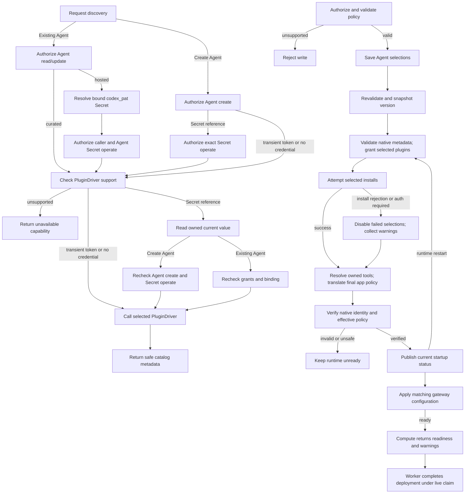

# Agent Plugin Deployment Flow

## Overview

An authorized caller saves plugin selections, then deploys. OCC validates and
snapshots policy, selections, and Driver. Startup resolves metadata, translates
policy, and prepares the version. Version selection may precede cutover; the
Harness owns tools and approvals.

## Entry Points

`apps/controller/src/index.ts:createFastifyApp`

- Trigger: Agent create/update with `plugins`, including a Console new-version
  plugin save, followed by Agent deployment.
- Assumptions: exact Agent permission, valid selections, compatible trusted
  PluginDriver, and deployment prerequisites.
- Source: [HTTP handlers](../../apps/controller/src/index.ts),
  [OpenClawController](../../packages/occ/src/index.ts), and
  [bundled PluginDrivers](../../apps/controller/src/drivers/plugin/index.ts).

## Flow

## Execution Trace

### Credential-scoped discovery

[Create discovery](../reference/drivers/plugin.md#selection-and-catalogs) accepts
transient PATs, same-Namespace Secrets/CredentialSources, or credential-free access.
OCC checks Agent `create` and source `operate` before credential access and the
Driver call. Cross-Namespace references return `400 INVALID_REQUEST`; missing
sources return `404`. Unsupported discovery reads no credential.

Existing-Agent discovery requires active Agent `read`/`update`. Hosted discovery
uses a bound PAT through [`SecretDriver.withValue`](../reference/drivers/secret.md)
or Credential Gateway `withSourceToken`, which may refresh before returning an
access token and account metadata. The callback rechecks binding and
caller/Agent source `operate`. Stored sources outlive
[login sessions](credential-source-lifecycle.md#device-authorization-and-configuration).
Curated discovery needs no credential. Unavailable or unauthorized sources fail
before discovery. Reads may precede rotation; discovery persists no state or credentials.

The [Codex Driver](../../apps/controller/src/drivers/plugin/index.ts) hydrates
identity, searches `q`, and pages GLOBAL entries with opaque cursors.
[Console discovery](../../apps/controller/src/console/agents/plugin-discovery.mjs)
prefetches Create Agent and editable Agent Plugin catalogs. Credential changes
clear results, preserving selections. Search invalidates stale responses before
its [delay](../reference/drivers/plugin-bundled.md#selection-and-catalogs);
Enter/paging bypass it. Closing, configured view, credential changes and
cancellation abort requests. Tools (`null`: unknown) load before selection;
unsupported releases stay unavailable. Curated catalogs verify neither tools nor account access.

Hosted reads forbid redirects, with a 15-second timeout and 4 MiB response limit. Responses are `no-store`, reject credential
echoes, and omit upstream errors/artifacts and Driver links/setup guidance.
Connections stay unverified. HTTPS logos omit referrers; initials are the default.

Optional `CodexPluginDriver.listCatalog` uses
[`NativeCodexPluginCatalogReader`](../../apps/controller/src/drivers/plugin/stdio-catalog-reader.ts)
with a configured executable and Codex home. It reads app-server JSON-RPC stdout.
Invalid JSON-RPC envelopes or `plugin/list` results reject with `NotImplementedError`;
teardown sends `SIGTERM`, then `SIGKILL` after one second if needed. HTTP discovery does not call this reader.

### 1. Validate desired state under exact-Agent authority

`apps/controller/src/index.ts:createFastifyApp`

HTTP contracts validate input before [OpenClawController](../../packages/occ/src/index.ts)
checks the exact Namespace and Agent. Reads require Agent `read`; create/PATCH
stores the `plugins` map. Shared validators check the nested selection shape.
`OpenClawController.validatePluginPolicies` calls the selected Driver's
`validatePolicies` before Agent create/update and provisioning writes. Its optional
`validateAgentConfiguration` checks selections against Configuration values here and at
deployment. The OpenClaw Driver refuses a selection whose tools `tools.deny`, the sole
`agents.entries` entry's list, the primary provider's `byProvider` lists, or these together block,
any selection beside an entry denying `*`, or one a sole entry's `alsoAllow` hides under a profile. Unsupported
controls, reviewer scopes, and combinations return `400 INVALID_REQUEST`;
a missing selected Driver returns `501 NOT_IMPLEMENTED`. Validation is static: native app mapping,
authentication, and release/tool metadata remain startup checks. Agent mutations store desired state and audit evidence atomically without changing
the reusable Configuration or active runtime. On update, omission preserves the
map, `{}` clears it, and a nonempty map replaces it.

Installation uses `GET /installation`; Agent editors use
`GET .../plugins/capabilities` with Agent read/update. Both return policy capabilities.

### 2. Admit an immutable plugin deployment

`packages/occ/src/index.ts:OpenClawController.deployAgent`

Deployment revalidates selections and Configuration, records the Driver and
policy-only plugin map in an Agent revision, and queues it. Native app mapping,
release metadata, and configuration resolve later.

### 3. Deliver requested state through Compute preparation

`apps/controller/src/drivers/compute/plugin-runtime.ts:pluginRuntimeSpecForRevision`

Compute validates admitted state, Driver, and Harness. Kubernetes projects the
nonsecret request; Docker uses environment delivery with a 64 KiB size limit. For Codex, Compute
writes the policy the Gateway runs into native `approval_policy` before startup
validation: the configured `appServer.approvalPolicy`, with `on-failure` as
`on-request`. Omission preserves native defaults; incompatible explicit policies
remain subject to reviewer checks. At Agent save, provisioning and deployment, the Codex
PluginDriver refuses an automatic reviewer unless the policy is `on-request` or
`on-failure`, because an omitted policy lets the Gateway pick one the startup
check cannot see. Configuration save and Compute Drivers refuse policies the
Gateway refuses at load, such as `untrusted`.

The Kubernetes ConfigMap is immutable and per version. A version prepared
by an earlier controller keeps its earlier `config.toml` (without
`[plugins._default]` (#508), without `approval_policy` (#1995), or with
`on-failure` as written) until the Agent is deployed again; `KubernetesComputeDriver.reconcilePluginRuntimeConfigMap` refuses any
other difference. OpenShell dedicated Codex has no such allowance and needs a
new deployment after that upgrade.

SSH Compute rejects nonempty plugin maps and Agent default plugin approver
policies before host effects.

Initial embedded Kubernetes gateway preparation applies exact-Agent HTTPS
egress before installation. For existing gateways, `prepareRevision` avoids
duplicate Agent database access. `activateRevision` uses `Recreate`, stopping
the old gateway before installation. Version files stay private and the native
registry stays in the Agent-owned database. Docker keeps native state in the
container's private temporary home.

### 4. Prepare native runtime state and hand off readiness

`apps/controller/src/drivers/compute/kubernetes/runtime-entrypoints.ts:installOpenClawPlugins`

Embedded OpenClaw validates selections against its bundled catalog and policy.
Grants enter nonempty `tools.allow`, otherwise `tools.alsoAllow`, preserving denies and profiles. A tool's `enabled`
override precedes `toolDefaults.enabled`; disabled tools emit native denies.
Master disable and operator denies prevail; `provider_default` and `none` add no
Diffs review step. Version-private configuration uses `--pin --force --no-enable`,
preserving enablement and allow/deny lists. Preparation refreshes the registry
and verifies admitted configuration; the pinned runtime release lacks this flag.
Native inspection verifies plugin ID, package name, runtime/install version,
recorded integrity, and the runtime source's containment in the install path.
Failure prevents gateway readiness. Confirmed install rejection disables the
optional selection and removes its managed tool allowance before startup.

Dedicated Codex bootstraps isolated `CODEX_HOME` with
`apps._default.enabled:false` and `plugins._default.enabled:false`.
Nonempty selections enable apps, plugins, and remote plugins. The bridge sets
`codexPlugins.enabled:true`, `allow_all_plugins:false`, and per-selection entries;
disabled entries cannot execute.

After `plugin/list`, `runtime-entrypoints.ts:readCodexPluginDetails` reads up to
four selections concurrently, preserving selection order; batches drain before retries. Install
and configuration writes stay sequential; post-install reads use the same
batching before final policy verification.
`codexRuntimeArtifact` uses concrete `detail.apps`, excluding `appTemplates`.
`codexInstallPlan` validates policy and [component support](../reference/drivers/plugin-bundled.md)
before granting only the selected plugin IDs through `config/batchWrite`, keeping
the plugin default off. The plugin grants precede `plugin/install` so native
installation can report required authentication; app/tool grants follow later.
Codex loads bundled skills; selected-only activation requires the compatible
runtime described below.
Install rejections or missing app authentication warn. Explicit tool policies
require `mcpServerStatus/list`'s `codex_apps` inventory; `codexAppToolSettings`
binds catalog action IDs through `_meta._codex_apps.resource_uri`. Native IDs
work. Unknown, unowned, ambiguous, or duplicate IDs fail startup.

`codexRuntimeArtifact` applies the [native policy mappings](../reference/drivers/plugin-bundled.md).

After installation, startup rechecks catalog identity, version, apps, and reported
components before granting final app/tool policy; `plugin/read` cannot inspect bundles.
`writeCodexPluginConfiguration` replaces the owned plugin/app tables, enabling
successful enabled selections and disabling failed/disabled plugins. It reads
merged workspace settings, disables unselected apps, and writes inherited
tool/account approvals; table replacement leaves lower-layer descendants.
Unspecified tool enablement stays unset; native requirements remain enforced.
Failed-only apps are disabled and disabled selections skip installation/status.

Workspace-aware readback rejects policy conflicts before readiness. Disabled apps may
retain inherited fields. Categories resolve app → global → native `true`; equivalent
values/nulls pass. Tool enablement cannot bypass categories.
`verifyCodexPluginConfiguration` rejects explicit enablement of unselected plugins;
approval-only or MCP-policy-only entries inherit the verified plugin default-off
setting. Source/account-disabled plugins remain disabled.

`runtime-entrypoints.ts:startAuthenticatedCodex` passes the admitted Harness model,
without its provider prefix, to the app-server after the authentication probe
succeeds. Native configuration readback therefore exposes the model used for
startup policy validation.

`runtime-entrypoints.ts:verifyCodexReviewerConfiguration` checks explicit app/link
reviewers and `configRequirements/read`, rejecting forbidden reviewers, incompatible
automatic-review settings, or conflicting model requirements. Startup checks do not
cover later workspace/session/model changes or strict review. Codex 0.156 readback
omits managed app/tool requirements applied during execution; native effective-policy
introspection remains required. See [remaining proof](../testing/plugins.md#current-proof-notes).
Codex owns cache integrity and health. Older binaries may ignore echoed plugin
defaults; see [runtime prerequisites](../reference/drivers/plugin-bundled.md#native-mappings-and-limits).

`runtime-entrypoints.ts:disableCodexSelectionsWithoutChatGptLogin` disables enabled
selections and app/plugin features for API-key logins when best-effort preparation
allows authentication warnings. API-key logins cannot install remote plugins.
Startup verifies both default-off tables before handing off readiness.

For Compute-owned Kubernetes workloads, only an admitted `{pluginId, code}`
warning results from a selected OpenClaw install's normal nonzero exit, a
matching Codex `plugin/install` error, or a successful Codex install needing app
authentication. Transport loss, timeouts, signals, malformed responses,
discovery failures, and policy failures retain ordinary startup failure
behavior. Provider-owned Harnesses keep their existing startup path.

Kubernetes Compute streams private startup status with a 65,536-byte limit.
Overflow cancels the response without retry, even for a 404/503; within the limit
those codes mean not serving. Readiness verifies workload, version, startup
instance, selection keys and warnings. Docker Codex healthchecks fail on
interrupted status bodies, preserving the transport code or original reason.

With the tool proxy enabled, dedicated Codex reads bundled skills at
`/home/node/.codex/skills/.system` without a repository broker or neighboring
credentials. Startup links `/home/node/.openclaw/plugin-skills` to
`/home/node/openclaw-runtime-assets/plugin-skills`, keeping gateway state private.

Gateway blocks failed bridges before serving and retry during turns. Startup
changes refresh effective configuration; untrusted status cannot establish
readiness or change version selections.

Compute installs status NetworkPolicies before the first dedicated gateway and
creates it only when the Agent and plugin status are ready and its Service selects
the version. Existing gateways and full runtime policies retain their activation
boundary.

The Agent and gateway derive an app-server credential from the transport Secret,
Agent revision ID, and Agent startup ID. The gateway receives it after matching status
and rendering exclusions. After a Harness restart, the old credential cannot open
a new authenticated app-server WebSocket to the replacement Harness. It does not
revoke access to a still-running old Harness or an established connection. For a
changed peer, the supervisor publishes non-ready, restarts only OpenClaw and
rechecks peer startup, Pod, successes and failures after it serves. Changed or
unavailable peers trigger container restart.
For writable native-admin configuration, recovery reads the bridge baseline from
the read-only managed snapshot. A Pod-local record binds the last and pending
generated bridges to the version and snapshot hash before configuration writes.
Process and same-Pod container restarts rebuild only a matching generated bridge.
Other native edits survive; conflicting bridge edits retain the existing refusal.
An unreadable or mismatched record holds startup unready, reporting runtime
failure `peer-bridge-record` (`UNAVAILABLE`), and logs the remedy: replace the
Pod, which restores the snapshot and clears this private record.
During an outage, the supervisor reports unready. Kubernetes propagates that
state asynchronously, so the signal alone is not a per-request traffic fence.
If OpenClaw exits while the supervisor waits for its peer, the wrapper exits
for container recovery.

### 5. Complete version reconciliation

`apps/controller/src/worker.ts:finalizeRevision`

Before the worker commits `activeRevisionId`, preparation failure leaves the
prior pointer unchanged. After commit, activation/finalization failure retains
the candidate pointer and records `REVISION_FINALIZATION_INCOMPLETE` for retry.
Embedded Kubernetes replacement runs after commit; the old gateway may already
be stopped. The previous version remains stored, without pointer rollback or
an availability guarantee during cutover. See the [controller worker flow](controller-worker.md).

Successful completion reports `REVISION_ACTIVATED` or `REVISION_ALREADY_ACTIVE`.
A candidate pointer alone is not readiness evidence. Agent turns use native
policy; the workspace and gateway database remain Agent-owned.

The worker saves plugin warnings with successful work under its live claim; the
[worker flow](controller-worker.md#7-defer-retry-or-stop-and-hand-off-the-next-iteration)
covers persistence and deployment status. Claim loss blocks stale completion;
later workers recheck readiness. No receipt acknowledgment, failed-plugin
shutdown, or permanent failure latch exists. Warnings describe deployment completion, not ongoing health.

## Debugging and Verification

The OpenClaw model probe's CPU-based deadline cannot exceed 600 seconds. CPU wait is the larger PSI or throttled
delta; throttled time is capped by throttled periods. Missing, nonfinite or reset samples give no delta and cannot
establish starvation.

- Compare `Agent.plugins` with the selected version snapshot and deployment status.
  A successful Agent write alone is not runtime installation evidence.
- Invalid or unsupported policy leaves Agent desired state unchanged. Catalog
  membership, authenticated metadata, ownership, and effective native configuration
  are checked during startup; failure keeps the candidate unready.
- Check missing native packages, release drift, connector authentication, and
  effective policy when readiness fails; preserve credential values in protected
  runtime state rather than copying them into logs.
- Before host effects, SSH Compute rejects nonempty requested Agent plugin maps or
  default plugin approver policies. Clear both or use compatible Kubernetes.
- For plugin warnings, check deployment status for `PLUGIN_INSTALL_FAILED` or
  `PLUGIN_AUTH_REQUIRED` and the admitted `pluginId`. Confirm the corresponding
  runtime and gateway entries are disabled. Do not infer plugin attribution
  from arbitrary native logs.
- Prove behavior with a model-chosen plugin call in a normal Agent turn, then
  disable or remove the plugin and verify another Agent is unchanged. Source or
  fixture tests are not native runtime proof.
- The opt-in [Agent plugin testing](../testing/plugins.md) real-runtime lane covers
  Kubernetes, database, credential, native-runtime, and historical proof. Skipped
  native tests are not proof.

## Related docs

- [Agent plugin reference](../reference/agent-plugins.md).
- [Agent plugin approvals and channel directory flow](agent-plugin-approvals.md).
- [PluginDriver selection and limits](../reference/drivers/plugin-bundled.md).
- [Controller worker](controller-worker.md).
- [Harness execution topology](harness-execution-topology.md).
- [Deployment guide](../guides/deploy.md).
- [Agent plugin testing](../testing/plugins.md).

## Manual Notes

[keep this for the user to add notes. do not change between edits]

## Changelog

- 2026-10-18 03:00: Check the primary model's `tools.byProvider` deny lists and a sole entry's `alsoAllow` under a profile (findings 1855, 1857). (lows-1018c)
- 2026-10-18 02:20: Check roster entries' `tools.deny` in the OpenClaw Driver's selection check (finding 1848). (lows-1018b - 628ee9fbf)

- 2026-10-17 06:05: Preserve OAuth discovery changes while integrating the native reader fix. (authoring-run/629826fb-b521-49bb-865a-dbc1b5c975a5 - 23965d64cc2824f0c5a2b5d704f767fead13f11b)

- 2026-10-17 00:10: Contain non-object native catalog envelopes in the discovery error path. (authoring-run/3d8efdc8-6da6-4cf9-99f7-adebd5e5649d - 42fb0a90337209e28318765c1b537bc4f3623506)
- 2026-10-15 22:26: Reconcile main and OpenShell OAuth in the accompanying merge. (authoring-run/41e4bb7a-c8eb-4332-b1f9-07fb8e234f63 - b747cf5b6402ad36ce9f1ae6dbed08928ddcf3dc)

- 2026-10-15 04:39: Grant read-only access to bundled Codex system skills. (authoring-run/97a67c3a-0aaa-4d59-bccf-19183079b169 - 00bbc7cd976ab7be317ce1e0a9d36ad72ce10567)

- 2026-10-14 12:23: Document runtime-status streaming limits and oversized error responses. (authoring-run/a404e7a3-9acf-4b50-9307-31e50b1b3582 - 4727e9b109a2127150e03e39e859d45e0668f82f)

- 2026-10-14 17:46: Preserve Docker Codex readiness reasons and transport codes when a loopback status response is interrupted. (issue-2403 - 944068b35b5a9bd86a3b1cf7361038a12b3de71a)

- 2026-10-13 09:37: Reconcile current admission and lifecycle behavior with external OAuth custody in the accompanying merge. (authoring-run/fd902939-ed58-4508-8d33-95a863d966af - e8d39978d801e7a5a8ac7242f32035f426da94e1)

- 2026-10-10 09:00: Render `on-failure` as the Gateway's `on-request`; Compute refuses `untrusted`, and the Codex PluginDriver an automatic reviewer without an explicit policy. (fix-987-988)

- 2026-10-10 04:49: Preserve writable native configuration during Harness peer recovery and same-Pod container restarts. (codex/thirty-compute-07-oct10 - 8e5a06ce)

- 2026-10-10 04:10: Check the Codex automatic reviewer policy at Agent create and update too. (fix-994-995)

[Agent plugin deployment documentation history](agent-plugins/history.md) preserves the older dated entries.
