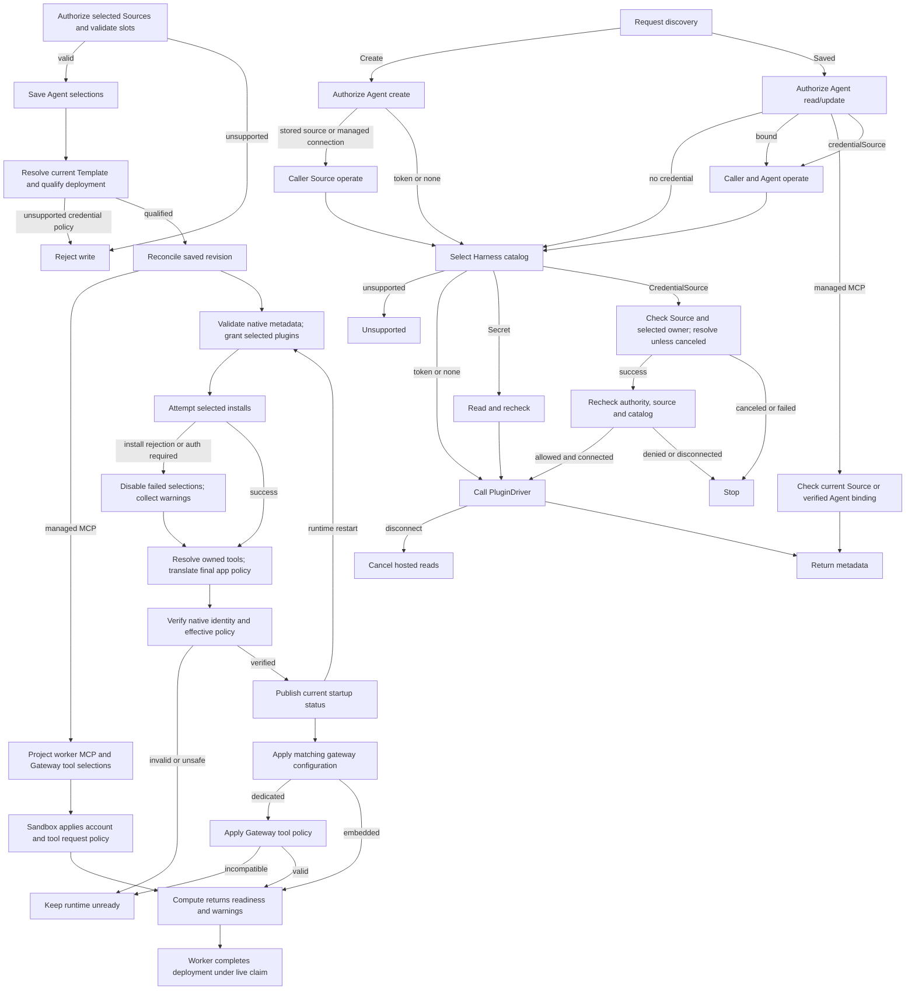

# Agent Plugin Deployment Flow

## Overview

OCC freezes selections, Driver and policy at deployment. The Harness owns tools and approvals.

## Entry Points

`apps/controller/src/index.ts:createFastifyApp`

- Trigger: Save `plugins`, then deploy.
- Requires Agent permission and compatible PluginDriver.
- Source: [HTTP handlers](../../apps/controller/src/index.ts),
  [OpenClawController](../../packages/occ/src/controller.ts), and
  [bundled PluginDrivers](../../apps/controller/src/drivers/plugin/index.ts).

## Flow

## Execution Trace

### Credential-scoped discovery

[Create discovery](../reference/drivers/plugin.md#selection-and-catalogs) requires Agent `create`; catalog `credentialSlots` expose eligible readable Sources. Managed MCP details use `managedConnection` and require caller Source `operate`. Saved discovery requires Agent `read`/`update`; delegation requires a Driver-validated saved release, slot, Source and Template plus Agent Source `operate`.

`plugin-discovery.ts:withPluginDiscoveryCredential` checks caller and saved-Agent Source access. OCC resolves the bearer through TokenService and passes it and consent account metadata to PluginDriver. Gateway Sources use their reader. OCC rechecks authority before dispatch; cancellation discards late credentials.

For managed MCP, OCC resolves the Source through its TokenService and rechecks the target and authorization before each server request. `driverPolicy.toolNames` pins upstream names; changing accounts clears names and overrides. [Hosted reads](../reference/drivers/plugin-bundled.md#selection-and-catalogs) limit size and time, refuse redirects and credential echoes, and send `Cache-Control: no-store`. Canonical duplicates return `503 PLUGIN_DISCOVERY_INVALID_RESPONSE`.

Console connects accounts before creation or reconnects saved Plugins. The verified callback reports the Source through a nonce-bound popup; Console stages it or PATCHes the Agent and confirms by GET. If confirmation fails, reload: the attachment may have changed.

On `409 RESOURCE_CONFLICT`, [Console](../../apps/controller/src/console/agents/plugin-discovery.mts) removes stale **Add**, preserves drafts and offers **Load plugins** (catalog), **Load tools** (connection) or **Retry tools** (details).

Saved catalog/details `403` clears cached **Add** and tools. **Load plugins** retries discovery. For managed tools, **Recheck access** validates Driver, policy, release, slot bindings and unique Source IDs through the capabilities GET. Failure or cancellation preserves refusal guidance and IDs in both tabs. Success hides **Recheck access** until another denial. Reload plugins and tools with an eligible connected Source.

After recovery, **Recheck accounts** checks empty slots on enabled cards. Both rechecks cancel discovery and clear results while preserving drafts and approvers. `409 AGENT_DELETING` blocks recovery.

`apps/controller/src/drivers/plugin/hosted-catalog.ts:catalogEntry` accepts omitted
`requires_local_executor`. `true` requires skills. Details reject unmatched
MCP/scheduled tasks. Invalid `plugin/list` stops optional stdio
`NativeCodexPluginCatalogReader`.

### 1. Validate desired state under exact-Agent authority

`apps/controller/src/index.ts:createFastifyApp`

[`getAgentForBrowsing`](../../packages/occ/src/agent-queries.ts) checks exact Agent `read`. [Create and PATCH](../../packages/occ/src/agent-drafts.ts) save `plugins`, Driver identity and audit together. Omitted selections persist. `{}` clears them. Nonempty maps replace them. Clear unknown or differently owned selections before switching catalogs.

`validateAgentPlugins` checks writes against the Harness catalog and Configuration. Deployment rechecks Configuration. OpenClaw checks `tools.deny`, the sole `agents.entries` tool list, primary-provider `byProvider` lists and their combination. It refuses entries denying `*` and selections hidden by the sole entry’s profile and `alsoAllow`. [Gateway settings](../reference/drivers/plugin-bundled.md#native-mappings-and-limits) take priority in [`openClawPluginSettingConflict`](../../apps/controller/src/drivers/plugin/openclaw-plugin-settings.ts). Incompatible selections or controls return `400 INVALID_REQUEST`.

[`validatePolicies`](../../apps/controller/src/drivers/plugin/runtime-translator.ts) detects conflicting enablement defaults. `BundledPluginDriverBase.validate` maps known errors to OCC’s `PluginPolicyValidationError` guidance. Other refusals stay generic. Console preserves rejected drafts.

Out-of-range **Plugin selections JSON** blocks [Save](../../apps/controller/src/console/agents/plugins.mts#L396), Agent `GET`/`PATCH` and [picker edits](../../apps/controller/src/console/agents/plugin-fields.mts#L414). The draft and [catalogs](../guides/console/configuration-plugins-and-files.md#plugins-tab) remain available.

`GET .../plugins/capabilities` requires Agent `read`/`update`. [Slot choices](../reference/drivers/plugin.md#selection-and-catalogs) require Source `read`; `boundSourceId` reports only a validated saved selection and Agent grant.

### 2. Admit an immutable plugin deployment

`packages/occ/src/agent-deployment-admission.ts:admitAgentDeployment`

On save, the [Plugin Driver](../../packages/occ/src/plugin-credential-bindings.ts) reports Sources; OCC checks `operate`, Template and slot eligibility. On deploy, OCC rechecks caller and Agent authority, intersects reviewed requests with the current approved Template, and freezes its version and policy in the revision. See [delivery limits](../reference/credential-sources.md#bind-a-source-to-an-agent).

Worker checks Driver–Harness compatibility. Gateway and Worker verify Compute descriptors.

- **CLI packages.** Gateway loads skills; Harness runs the pinned executable. OpenShell restricts staged Google injection by endpoint/method/path; Google enforces permissions. The legacy [Sandbox](../../apps/controller/src/drivers/sandbox/openshell-plugin-policy.ts) verifies the [Gateway guard](../../apps/controller/src/drivers/egress-proxy/openshell-online-authority.ts) version before attachment; that guard enforces Source scope and requests. Unsigned WebSockets and timely frames naming another Sandbox return `PERMISSION_DENIED`; matching or live late frames return `http_only`. Signed silence waits up to 400 ms, unless the caller deadline expires first. Preflights, independent of HTTP, cap at 256 per Sandbox and 1,024 per guard.
- **Hosted MCP packages.** Worker advertises selected tools. Gateway grants same-node execution. Hooks and cross-node calls return Code Mode results or denials. The credential Driver attaches the Source. Sandbox supplies its placeholder. OpenShell enforces tool names and rejects overlapping routes.
- **Native runtime plugins.** Startup installs packages and verifies tool policy.

Plugin withdrawal removes credential injection. Recovery preserves other attachments.

### 3. Deliver requested state through Compute preparation

`apps/controller/src/drivers/compute/plugin-runtime.ts:pluginRuntimeSpecForRevision`

Compute validates admitted state, Driver, and Harness. Kubernetes projects the
nonsecret request; Docker uses environment delivery with a 64 KiB size limit. For Codex, Compute
writes the policy the Gateway runs into native `approval_policy` before startup
validation: the configured `appServer.approvalPolicy`, with `on-failure` as
`on-request`. Omission preserves native defaults; incompatible explicit policies
remain subject to reviewer checks. At Agent save, provisioning and deployment, the Codex
PluginDriver refuses an automatic reviewer unless the policy is `on-request` or
`on-failure`, because an omitted policy lets the Gateway pick one the startup
check cannot see. Configuration save and Compute Drivers refuse policies the
Gateway refuses at load, such as `untrusted`.

The Kubernetes ConfigMap is immutable and per version. A version prepared
by an earlier controller keeps its earlier `config.toml` (without
`[plugins._default]` (#508), without `approval_policy` (#1995), or with
`on-failure` as written) until the Agent is deployed again; `KubernetesComputeDriver.reconcilePluginRuntimeConfigMap` refuses any
other difference. OpenShell dedicated Codex has no such allowance and needs a
new deployment after that upgrade.

SSH Compute rejects nonempty plugin maps and Agent default plugin approver
policies before host effects.

Initial embedded Kubernetes gateway preparation applies exact-Agent HTTPS
egress before installation. For existing gateways, `prepareRevision` avoids
duplicate Agent database access. `activateRevision` uses `Recreate`, stopping
the old gateway before installation. Version files stay private and the native
registry stays in the Agent-owned database. Docker keeps native state in the
container's private temporary home.

### 4. Prepare native runtime state and hand off readiness

`apps/controller/src/drivers/compute/kubernetes/runtime-entrypoints.ts:installOpenClawPlugins`

Embedded OpenClaw validates selections against its bundled catalog and policy.
Grants enter nonempty `tools.allow`, otherwise `tools.alsoAllow`; denies and profiles
remain. Tool `enabled` overrides `toolDefaults.enabled`; disabled tools emit denies.
Master disable and operator denies prevail. The supported modes
`provider_default` and `none` add no plugin review. Version-private installs use `--pin --force --no-enable`,
preserving enablement and tool policy. Preparation refreshes the registry and verifies
configuration, plugin/package identity, versions, integrity and source containment
within the install path. Verification failures keep the Gateway unready. Confirmed
install rejection disables the optional selection and removes its tool allowance
before startup.

Dedicated launchers capture the saved revision's [Gateway tool policy](../reference/configuration.md#gateway-tool-policy) before grants. Startup and peer respawn enforce it; failure keeps the Gateway unready. Changes require replacement after affected work ends; human permissions stay unchanged. Default read-only `skills_search` and `skills_read` let dedicated Codex read pinned Skill Library skills by name, without Gateway paths. Embedded Gateways apply Configuration policy directly; Compute validates it at Configuration save and deployment admission, not maintenance (`gateway-tool-policy.ts:validateGatewayToolPolicy`).

Dedicated Codex uses isolated `CODEX_HOME`, disabling app/plugin defaults.
Selections enable apps, plugins and remote plugins; disabled entries cannot execute.
The [native policy mappings](../reference/drivers/plugin-bundled.md#native-mappings-and-limits)
describe the generated bridge.

<!-- Internal preparation threads one explicit RPC caller through these reads,
writes, reviewer checks, and no-account disablement; ordinary transport is unchanged. -->

Startup enables experimental APIs and resolves selected IDs through `plugin/search`.
`codex-plugin-stdio.ts:withCodexPluginStdio` retains fixed
`nativeErrorType`/`nativeSubErrorType` values, discarding other stderr/RPC content
and lines over 64 KiB while draining. RPC errors alone do not prove backend
installation.

`runtime-entrypoints.ts:readCodexPluginDetails` reads up to four
selections concurrently before and after installs. Batches preserve order and drain
before retries and final verification; writes stay sequential.
`codexRuntimeArtifact` uses `detail.apps`, excluding `appTemplates`.
`codexInstallPlan` validates policy and [component support](../reference/drivers/plugin-bundled.md),
then grants selected plugin IDs through `config/batchWrite` before `plugin/install`
can report authentication requirements. App/tool grants follow; plugin defaults stay
off. Bundled skills need the compatible runtime below for selected-only activation.
Install rejections or missing app authentication warn. Explicit tool policies
require `mcpServerStatus/list`'s `codex_apps` inventory; `codexAppToolSettings`
binds catalog action IDs through `_meta._codex_apps.resource_uri`. Native IDs
work. Unknown, unowned, ambiguous, or duplicate IDs fail startup.

After installation, startup rechecks catalog identity, version, apps and components
before final app/tool grants; `plugin/read` cannot inspect bundles.
`writeCodexPluginConfiguration` replaces owned plugin/app tables, enables successful
selections, disables failed/disabled plugins and unselected apps, and writes
inherited tool/account approvals from merged workspace settings. Lower-layer
descendants remain. Unspecified enablement stays unset; requirements still apply.
Failed-only apps stay disabled; disabled selections skip installation/status.

Workspace-aware readback rejects policy conflicts before readiness. Disabled apps may
retain inherited fields. Categories resolve app → global → native `true`; equivalent
values/nulls pass. Tool enablement cannot bypass categories.
`verifyCodexPluginConfiguration` rejects explicit enablement of unselected plugins;
approval-only or MCP-policy-only entries inherit the verified plugin default-off
setting. Source/account-disabled plugins remain disabled.

`runtime-entrypoints.ts:startAuthenticatedCodex` passes the admitted Harness model,
without its provider prefix, after the authentication probe succeeds; startup
policy validation reads it back.

`runtime-entrypoints.ts:verifyCodexReviewerConfiguration` checks app/link reviewers
and `configRequirements/read`. Forbidden reviewers, incompatible automatic-review
settings or conflicting model requirements block startup. Checks exclude later
workspace/session/model changes and strict review. Codex 0.156 readback omits
execution-time managed app/tool requirements; [effective-policy proof](../testing/plugins.md#current-proof-notes)
remains necessary.

`runtime-entrypoints.ts:disableCodexSelectionsWithoutChatGptLogin` disables enabled
selections and app/plugin features for API-key logins when best-effort preparation
allows authentication warnings. API-key logins cannot install remote plugins.
Startup verifies both default-off tables before handing off readiness.

For Compute-owned Kubernetes workloads, only an admitted `{pluginId, code}`
warning results from a selected OpenClaw install's normal nonzero exit, a
matching Codex `plugin/install` error, or a successful Codex install needing app
authentication. Transport loss, timeouts, signals, malformed responses,
discovery failures, and policy failures retain ordinary startup failure
behavior. Provider-owned Harnesses keep their existing startup path.

Kubernetes Compute streams private startup status with a 65,536-byte limit.
Overflow cancels the response without retry, even for a 404/503; within the limit
those codes mean not serving. Readiness verifies workload, version, startup
instance, selection keys and warnings. Docker Codex healthchecks fail on
interrupted status bodies, preserving the transport code or original reason.

With the tool proxy enabled, dedicated Codex reads bundled skills at
`/home/node/.codex/skills/.system` without a repository broker or neighboring
credentials. Startup links `/home/node/.openclaw/plugin-skills` to
`/home/node/openclaw-runtime-assets/plugin-skills`, keeping gateway state private.

Gateway blocks failed bridges before serving and retry during turns. Startup
changes refresh effective configuration; untrusted status cannot establish
readiness or change version selections.

Compute installs status NetworkPolicies before the first dedicated gateway and
creates it only when the Agent and plugin status are ready and its Service selects
the version. Existing gateways and full runtime policies retain their activation
boundary.

The Agent and gateway derive an app-server credential from the transport Secret, Agent revision ID and startup ID. Gateway receives it after status matches and exclusions render. After Harness restart, the old credential cannot open a new authenticated WebSocket to the replacement; it does not revoke access to a still-running old Harness or an established connection. For a changed peer, the supervisor publishes non-ready, restarts only OpenClaw and rechecks peer startup, Pod, successes and failures after serving. Changed or unavailable peers trigger container restart. If OpenClaw ignores a stop signal during in-place restart and readiness returns after server closure, the supervisor repeats the signal.
For writable native-admin configuration, recovery reads the bridge baseline from
the read-only managed snapshot. A Pod-local record binds the last and pending
generated bridges to the version and snapshot hash before configuration writes.
Process and same-Pod container restarts rebuild only a matching generated bridge.
Other native edits survive; conflicting bridge edits retain the existing refusal.
An unreadable or mismatched record holds startup unready, reporting runtime
failure `peer-bridge-record` (`UNAVAILABLE`), and logs the remedy: replace the
Pod, which restores the snapshot and clears this private record.
During an outage, the supervisor reports unready. Kubernetes propagates that
state asynchronously, so the signal alone is not a per-request traffic fence.
If OpenClaw exits while the supervisor waits for its peer, the wrapper exits
for container recovery.

### 5. Complete version reconciliation

`apps/controller/src/worker.ts:finalizeRevision`

Preparation failure before `activeRevisionId` commit preserves the prior pointer. After commit, activation/finalization failure retains the candidate pointer and records `REVISION_FINALIZATION_INCOMPLETE` for retry. Embedded Kubernetes replacement follows commit; the old gateway may already be stopped. The previous version remains stored without rollback or guaranteed availability.

Completion reports `REVISION_ACTIVATED` or `REVISION_ALREADY_ACTIVE`; the pointer alone does not prove readiness. Agent turns use native policy. The workspace and gateway database remain Agent-owned.

The worker saves warnings under its live claim; the [worker flow](controller-worker.md#7-defer-retry-or-stop-and-hand-off-the-next-iteration) covers persistence and status. Claim loss blocks stale completion; successors recheck readiness. No receipt acknowledgment, failed-plugin shutdown or permanent failure latch exists. Warnings do not prove ongoing health.

## Debugging and Verification

OpenClaw model probes cap CPU-based deadlines at 600 s. CPU wait is max(PSI, throttled delta), capped by throttled periods. Missing, nonfinite or reset samples cannot prove starvation. Starvation requires over 25% CPU wait in the last 15 s without an idle 5 s stretch (`timeoutWindowMs`, `timeoutWindowCpuWaitMs`, `timeoutWindowIdleMs`).

- Check deployment status and version snapshot; `Agent.plugins` records selections. Invalid or unsupported policy preserves desired state.
- Failed startup validation keeps the candidate unready. Check catalog membership, authenticated metadata, ownership, effective configuration, packages, release drift and connector authentication; exclude credentials from logs.
- SSH Compute refusal: clear plugin maps and default approver policies or use compatible Kubernetes.
- Attribute `PLUGIN_INSTALL_FAILED` or `PLUGIN_AUTH_REQUIRED` through deployment status and admitted `pluginId`, never native logs; confirm runtime and Gateway entries are disabled.
- Source or fixture tests are not native runtime proof. Verify a model-chosen plugin call in a normal Agent turn, then disable or remove the plugin and check another Agent remains unchanged.

## Related docs

- [Agent plugin reference](../reference/agent-plugins.md).
- [Agent plugin approvals and channel directory flow](agent-plugin-approvals.md).
- [PluginDriver selection and limits](../reference/drivers/plugin-bundled.md).
- [Controller worker](controller-worker.md).
- [Harness execution topology](harness-execution-topology.md).
- [Deployment guide](../guides/deploy.md).
- [Agent plugin testing](../testing/plugins.md).

## Manual Notes

[keep this for the user to add notes. do not change between edits]

## Changelog

- 2026-11-24 05:34: Trace Plugin account connection, Source-scoped discovery, and saved binding recovery. (authoring-run/b4223689-a451-496c-b340-82c77ada247b - d6403c2401e338964f5486f8db2fcb40a3758448)
- 2026-11-24 02:32: Trace Codex and Gateway discovery. (authoring-run/3020b1e1-86c1-4a99-bb6b-890205dab49b - 1f256635c37842e2d94846259303fa17cfe83be2)
- 2026-11-23 09:56: Clarify current Template destinations. (authoring-run/dd61beab-f923-4970-a46a-5bfc34f8a38b - c0f1cf9e9)
- 2026-11-23 08:39: Resolve current Plugin Templates. (authoring-run/82130fc5-2b62-4e13-b10f-9521fbd7b536 - 5dcfdf664)

[Agent plugin deployment documentation history](agent-plugins/history.md) preserves the older dated entries.
