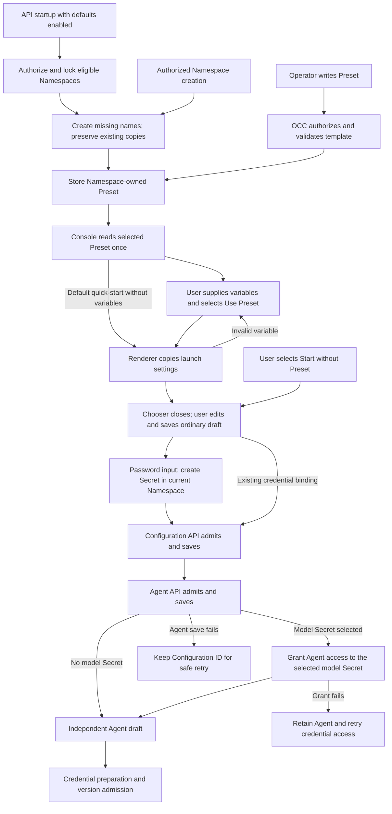

# Agent Presets flow

## Overview

The Console renders a Namespace Preset and saves an independent Configuration
and Agent through existing APIs. This flow stops at the draft; deployment follows
[version admission](configuration-driver/persistence-and-revisions.md).

## Entry Points

- [Preset file loader](../../apps/controller/src/composition/installation-presets.ts):
  `loadInstallationPresets` reads `presets.includeDefaults` and `presets.files` before Driver composition.
  Bundled defaults are `default-codex`, **Standard Codex**, and **Standard OpenClaw**; the custom SWE Agent
  file is loaded only when explicitly listed.

- Source: `packages/contracts/src/api/routes.ts:occApiRoutes`.
- [Preset routes](../../packages/contracts/src/api/routes.ts): authenticated
  collection and exact-resource operations in a Namespace.
- [OCC Preset methods](../../packages/occ/src/index.ts): `createPreset`,
  `updatePreset`, `listPresets`, `getPreset`, and `deletePreset` own lifecycle.
- [CLI](../../internal/occcli/cli.go): `presetCommand` provides `occ preset list`,
  `get`, and `delete` over the same routes; create and update stay HTTP-only.
- [Console selector](../../apps/controller/src/console/agents/presets.mts):
  `createPresetFields` requires a selected Namespace and an authenticated user.
  Saving also needs the existing Configuration, Agent, and credential grants.

## Flow

## Execution Trace

Before serving requests, [migration 0024](../../migrations/0024_agent_presets.sql)
creates Preset storage and adds Preset CRUD grants to the unchanged built-in
administrator Role. Its guarded update preserves customized Roles; the exact
[eligibility rules](../reference/presets.md#crud-and-permissions) belong to the Preset contract.

### 1. Include configured defaults

`apps/controller/src/composition/installation-presets.ts:loadInstallationPresets`

The loader validates the opt-in boolean and file list, reads bundled JSON, and
resolves explicit paths beside the startup YAML. It validates names/templates and rejects missing,
malformed, invalid, or duplicate-name files; a file named like a bundled default
replaces it, and API composition warns `presets.bundled-default-shadowed`. API and worker share the startup
snapshot and source path (files are not watched), but only the API applies
defaults and logs Preset warnings. [Production composition](../../apps/controller/src/composition/production.ts)
and [development composition](../../apps/controller/src/composition/development-postgres.ts)
pass generic definitions into `ControllerOptions.defaultPresets` and initialize
defaults after selecting Configuration and IAM Drivers. They try each persisted
Installation administrator in turn, moving on when one cannot create a
Namespace's Presets (say, its grant stops at the Installation); startup fails
only when none can seed. Native template contents
remain in the application bundle; OCC owns generic Preset lifecycle. Seeding and
rendering copy the native policy of the [standard Codex artifact](../../deploy/presets/standard-codex.json)
([build hosts](../guides/topics/standard-codex-preset.md#build-network-allowlist));
the deployed Codex plugin enforces it. `loadBundledPresetVersions` also loads every shipped version
listed in `deploy/presets/archive/versions.json`, whether or not defaults are
enabled, into `ControllerOptions.bundledPresetVersions`. A conformance test in
`tests/conformance/presets.test.mjs` fails when a bundled file changes without
its previous version archived there.

`packages/occ/src/index.ts:OpenClawController.initializeDefaultPresets`

Initialization authorizes Installation administration, locks Namespaces in ID
order in one transaction, and skips failed/deleting Namespaces. Missing names
require Preset create permission and ordinary template/Driver validation before
storage and mutation audit. A deny Restriction on a creation leaves the name
missing with one `presets.default-create-skipped` warning; a missing grant
still needs another administrator. While `includeDefaults` is enabled, an
existing copy of a bundled default that still equals a superseded shipped version requires
Preset update permission; its
template is replaced in place and audited with `source: installation-defaults-refresh`.
A refresh the policy refuses keeps the copy and logs one
`presets.default-refresh-skipped` warning naming it and the reason. Startup
first skips only refusals from a deny Restriction, which binds every
administrator; only when no single administrator can then complete
initialization does it skip every refused refresh. Removing the Restriction, or
granting `preset:update` to an Installation administrator, lets the next startup
refresh the copy.
Other existing copies are untouched. Any other failure rolls back
the transaction and prevents API startup. Namespace creation uses the same
helper before queuing provisioning, so denied or invalid defaults also roll back
the new Namespace. Disabling defaults leaves persisted copies alone.

### 2. Admit and store a template

`apps/controller/src/index.ts:createFastifyApp` gives Preset POST/PATCH a
transport budget for 1 MiB templates, JSON escapes and the envelope; overflow
returns 413. Their `onRequest` hook runs `authorizePresetWrite`: callers without
the grant get 403 before any body is read.

`packages/occ/src/index.ts:OpenClawController.createPreset`

[`OpenClawController.createPreset` and `admitPresetTemplate`](../../packages/occ/src/index.ts)
lock the Namespace, check the exact collection grant and ready state, then call
[`normalizePresetTemplate`](../../packages/contracts/src/presets.ts).
The normalizer copies the template and fills omitted `namespaceId` fields in
Harness authentication and Configuration Secret binding sources from the locked
Namespace. Explicit scopes remain unchanged for same-Namespace validation.
Template structure, variable declarations, default types, and credential
references are checked without requiring unfilled variables. Password definitions
have no defaults and can appear only as whole tokens at `agent.harnessAuth.secret`;
literal credentials and substitution into ordinary settings are rejected. Literal Agent
launch fields get create's rules (`validatePresetLaunchFields`); tokens wait. When native values exist,
the selected Configuration Driver's
`validateValues` checks their native credential rules; missing capability fails
closed. Core owns no native configuration interpretation.

The [repository](../../packages/occ/src/state/postgres-state.ts) stores the whole
template in `occ.presets`. PATCH locks the resource and replaces an included
template atomically. DELETE removes its exact IAM bindings in the transaction.
Presets prevent Namespace deletion while present. The controller's normal audit
path records mutations and denials without template or variable contents.

### 3. Read and render the selected copy

`apps/controller/src/console/agents/presets.mts:createPresetFields`

[`createPresetFields`](../../apps/controller/src/console/agents/presets.mts)
lists readable Preset summaries, requiring Namespace read, then reads the selection
once. **Start with default Preset** reads the listed `default-codex` resource.
Variable-free templates apply immediately; customized variables keep the chooser
and its shortcut origin. Missing defaults or failed reads do not open a hardcoded
starter; other readable Presets remain selectable. **Start without Preset** opens
the form without a Preset read, not as a fallback for a denied selection. Normal
creation authorization applies.

`console-assets.ts:readConsoleAsset` serves the public
[`default-codex`](../../deploy/presets/default-codex.json) as
`/console/default-codex-preset.mjs`. `configurationTemplate` uses this base for
empty templates, reset and Harness transitions, adding model routing. Installed
Namespace templates are never exposed by that module.

The chooser prefills typed defaults. String controls accept multiple lines;
untouched defaults and restored drafts retain exact line endings, while edits use
browser LF. Empty strings override defaults. Referenced variables without defaults
are required; defaulted or unused variables are optional. The password variable
offers a masked new token or an existing same-Namespace Secret. The chooser reads
Secret metadata, validates the original template, then substitutes the selected
reference in a temporary copy. Changing mode discards tokens; stale catalog
responses cannot replace a later selection.
The user then selects **Use Preset**. The shared
[`renderPresetTemplate`](../../packages/contracts/src/preset-variables.mjs)
walks JSON once, rejects missing or mistyped inputs and duplicate rendered native
keys, and preserves runtime placeholders and unresolved SecretRefs.

Rendering makes no requests. Success opens the Agent form with rendered settings
and optional ephemeral Secret metadata for grants. The alphabetic chooser moves
password values into the masked credential input and clears detached controls;
later Preset changes cannot alter the form. Before saving, **Start over** confirms
discard and opens a fresh chooser. A successful or uncertain save disables restart
and uses ordinary creation recovery.

`apps/controller/src/console/console.mjs:loadPage`

`loadPage` captures JSON, model controls, workspace files, repositories and staged
Secret references per user/Namespace before resetting views. Explicit
Preset, default-shortcut and bare forms all return from this copy with fresh
capability and repository discovery. A confirmed **Cancel** removes creation and
channel snapshots and the retained view; re-entry opens the chooser and preserves
saved resources. `beforeunload` asks first while any capture holds changes. Invalid JSON stays text; passwords
and discovery results are excluded. Start over, session loss, logout, user change or
page exit clears captures, not a failed `/namespaces` read. A known Create refusal keeps
the capture and its saved resources, unless repository policy refused it or an Agent,
provisioning job or credential registration exists.

`agents/create.mts:updateModelConfiguration` synchronizes qualified shared primaries
and existing local policies. Empty maps and inherited selections remain. Invalid
rosters stay for admission validation. JSON selection edits update controls and clear pending
state. Clearing/navigation retain policies, fallbacks and referenced metadata.

### 4. Save an independent draft

`apps/controller/src/console/agents/create.mts:renderCreateAgent`

[The creation form](../../apps/controller/src/console/agents/create.mts) copies
rendered settings into editable fields and checks their form representation.
A method-only Preset authentication default selects API key or Service Accounts
without binding a Secret. The shared Secret picker requires a same-Namespace
selection. **Create new Secret...** saves immediately and stages the reference;
the browser never reads existing Secret bytes. Final Agent admission still
requires a complete authentication binding.
Rendered `agent.pluginApprovers` remains ordinary Agent draft data. Omission
inherits the form default, an empty array keeps the explicit no-approver default,
and selected channel identities are submitted through the normal Agent create
body. The Agent API and selected Plugin Driver validate the concrete approvers
after variable rendering.
The approver finder uses the staged Slack bot binding or a separately selected
same-Namespace Secret, held only for search. OCC authorizes Agent creation and
`operate` on the exact Secret per lookup. Results add workspace-qualified IDs.
Preset `agent.initialWorkspaceFiles` override matching workspace defaults,
including explicit empty strings. The shared Preset validator checks supported
filenames, Unicode, NUL, and byte limits before and after expansion; password
variables remain confined to the credential field. User-edited workspace bytes
follow the existing private workspace setup path in both regular and provisioning
creation. The form keeps Secret bindings internally and exposes channel-specific
Secret controls rather than a raw bindings editor.
Model Secret references survive draft navigation; passwords do not. Provider or
authentication-method changes clear the selection. Existing or Preset-bound
references are reused. Ordinary creation grants the Agent service principal
exact Secret `operate` access; Agent-conflict and grant retries retain the
reference. The caller needs grant-management permission. A failed grant keeps
the saved Agent and offers retry. Provisioning derives it from `harnessAuth.source`.
Password inputs first create a same-Namespace Secret, clear the input, and
retain the reference. Save then creates Configuration and Agent resources and
grants access; dedicated provisioning follows its existing flow. Password bytes
reach only Secret creation. Each API request performs schema, native credential
and authorization admission before persistence.

A confirmed duplicate-name Secret response offers the existing permission-aware
picker or an independent new Secret name in the same form. Selection clears the
entered key; neither path deletes or reads the existing value. Other draft fields
remain. Other known refusals keep the masked input for correction or retry;
uncertain writes clear it and lock creation. Agent-name conflicts do not enable
Secret recovery. Credential-context changes clear the notice, alternate name,
and required state. Returning to a password method does not revive that recovery.
The notice and choices share a focused block under the model credential field.
The notice belongs to the attempted Secret name. Changing that name or submitting
a new attempt clears the old feedback without discarding an edited alternate name.
Submit trims and validates alternate names before any write. Choosing an existing
Secret restores the normal optional service-account plugin discovery token field.
If a later save fails, its saved Secret reference is reused.
If Configuration creation succeeds but Agent creation fails, the form retains
the Configuration ID and locks Configuration-affecting controls. A safe retry
reuses the saved Configuration. An uncertain response requires inspection before
another creation attempt. See [creation recovery](../reference/console/create-and-deploy.md#create-an-agent).

### 5. Hand off to deployment

`packages/occ/src/index.ts:OpenClawController.deployAgent`

The saved Agent has a new identity and no Preset reference. Variable inputs are
not stored as a separate map. Rendered values are ordinary Agent/Configuration
settings. Credential preparation and [version admission](configuration-driver/persistence-and-revisions.md)
read those resources, not the Preset. Later Preset changes cannot change a draft
or an immutable saved version.

## Debugging and Verification

- A missing selector entry can mean missing exact Preset `read` permission;
  compare the Namespace and the authenticated list response.
- Chooser errors identify variable or form-field problems before any save. Save errors
  come from existing Configuration or Agent admission; retain request and saved
  Configuration IDs when investigating partial or uncertain outcomes.
- [Controller integration coverage](../../tests/integration/presets-controller.test.mjs)
  exercises the HTTP workflow, admission, isolation, and copy independence.
  [PostgreSQL coverage](../../tests/integration/postgres-presets.test.mjs) exercises
  persistence; [browser coverage](../../tests/browser/console-agent-presets.test.ts)
  exercises the real selection form. Coverage names are not proof of a live model response.
- The standard Preset's [clean-build network trace](../guides/topics/standard-codex-preset.md#build-network-allowlist)
  covers source builds with cold dependency caches behind an enforcing HTTPS
  proxy. It establishes required destinations for those targets, not native
  Codex enforcement or cached-search model behavior.
- The local cluster attempt for this implementation stopped at a cgroup v2
  startup failure. A Kubernetes deployment and real model response remain
  unverified; use the [Kubernetes testing guide](../testing/kubernetes.md) on a
  supported host for that proof.

## Related docs

- [Preset contract](../reference/presets.md) and [usage guide](../guides/topics/agent-presets.md)
- [Configuration Driver](../reference/drivers/configuration.md)
- [Console creation and recovery](../reference/console/create-and-deploy.md)

## Manual Notes

## Changelog

- 2026-10-29 11:06: Clear Secret recovery when credential context changes and group its notice with choices. (authoring-run/1839d93c-8cde-4ebb-b994-4b1333cc7ada - 6e83f6e7409fb4fa238cd4230f1136d278794926)

- 2026-10-29 10:28: Add deliberate model Secret conflict recovery in the current draft. (authoring-run/daf33de1-41b3-4148-86b6-62eade385b72 - bd67c46d5e5340e95d5e80bc850ebe41bc80f6ed)

- 2026-10-24 14:11: Align Console roster model selections and local policies. (authoring-run/f070add2-5557-42f3-a399-1af757d219cd - de058b77e4f996c848520d8bee2e9c6122d3e2e1)

- 2026-10-15 18:50: Allow search-only Slack Secret selection during Agent creation. (authoring-run/23d60562-6525-4593-ad0c-29ce57483c38 - aad21c63837ef24f9f9bae152877812abe9b1abd)

- 2026-10-14: The Preset list returns summaries. (fix-1323-lists)

- 2026-10-10 07:02: Integrate main without changing the model-selection repair; retain both flow histories. (authoring-run/93ddce15-e08f-4d84-9e30-6c2cb0f1e838 - 500ca364793d117e7996ef568ac144df877e5b8b)

- 2026-10-10 06:42: Preserve referenced fallback model metadata and retire obsolete primary catalog entries during Console selection. (authoring-run/d6d98411-224c-4a17-8bb9-5bd060b1dd59 - f27f55ce2bfb3d54b8e95c8c3f0f670425717a52)

- 2026-10-10 04:52: Preserve multiline strings and exact restored defaults in the Preset chooser. (authoring-run/0f2600bb-f524-4114-9ba6-7ff3cbee3d29 - 64dff25990334c8cf1e9372d5452c38cdcadfa61)

- 2026-10-10 02:23: Admit contract-sized Preset writes at the HTTP boundary; template limits and mutation checks remain unchanged. (authoring-run/6f54c753-eb8a-4e11-b078-b178ba613240 - 5bf37b274fcdfefb49dfa99984a15d99b757dc8e)

[Agent Presets documentation history](agent-presets/history.md) preserves the older dated entries.
