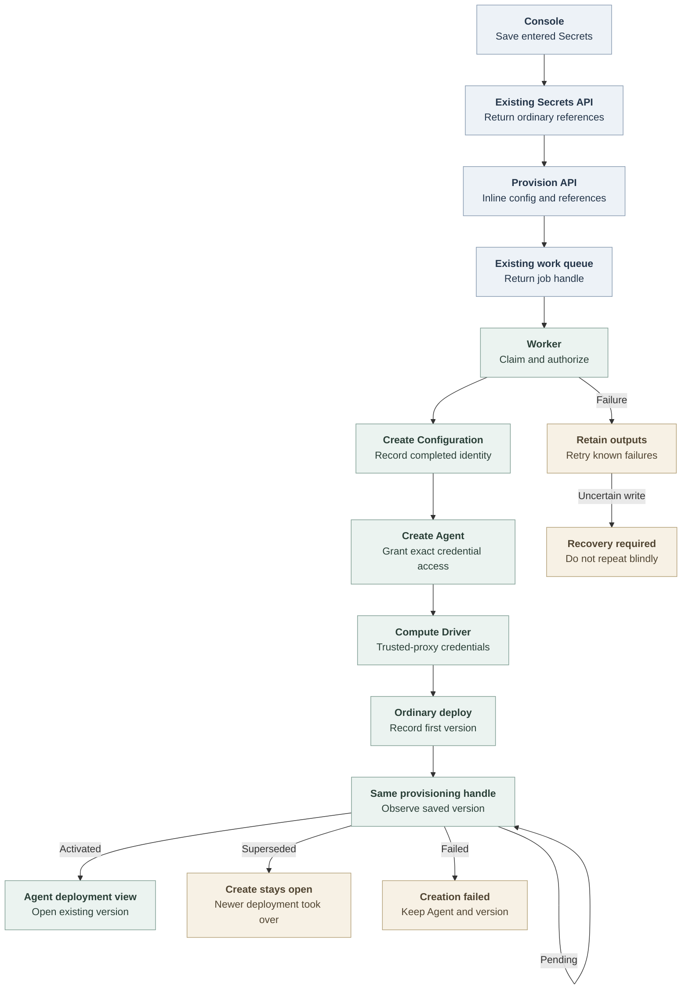

# Agent provisioning flow

## Overview

Console saves Slack and model Secrets, submits inline Configuration and credential references, and retains Preset bindings. OCC queues setup without placeholder resources. The worker creates Configuration and Agent, grants exact Secret or source access, provisions trusted-proxy credentials, and admits the first deployment.

The original provisioning handle follows the first deployment to activation or failure. The [controller worker](controller-worker.md) and [Harness execution topology](harness-execution-topology.md) own runtime reconciliation; later deployments use separate handles.

## Entry Points

- Console: `apps/controller/src/console/agents/create.mts`, with the shared Slack Secret select/create modal in `apps/controller/src/console/channels/slack.mjs`.
- API: `packages/contracts/src/api/routes.ts:provisionAgent`, `apps/controller/src/http/agents.ts:createAgentHandlers`, and `packages/occ/src/index.ts:OpenClawController.provisionAgent`.
- Preconditions: a ready Namespace, Dedicated runtime and selected Drivers, PostgreSQL-backed work storage, required Agent/Configuration/deploy permissions, exact Secret access and existing transactional IAM authority. No provisioning-input keyring is required.

## Flow

## Execution Trace

### 1. Console saves credentials and freezes a provisioning request

`apps/controller/src/console/agents/create.mts:renderCreateAgent`

Console keeps the configured Harness separate from execution mode: dedicated
OpenClaw uses the same provisioning, retry, and deployment navigation as
dedicated Codex. Preset restoration and Credentials read native model runtime
policy through `apps/controller/src/console/agents/harness-auth.mjs:configuredHarnessId`.

The Slack modal immediately saves new tokens through `POST /namespaces/:namespaceId/secrets`, before an Agent exists, then clears entered values. Apply stages references and environment bindings; Cancel discards selections but retains created Secrets. Model discovery uses an API key or service account token without saving it. Create Agent runs its preflight, then saves it as a Namespace Secret, clears the input, and reuses the reference on retries. Bound Presets retain their credential/provider. A lost Secret-save response requires recovery, not automatic repetition.

A selected Credential Gateway's catalog directs Console to register the model
Secret before source-backed provisioning. [Console recovery](../reference/console/create-and-deploy.md)
reuses confirmed sources and safely retries uncertain registration.
Installation discovery preserves catalog metadata.

Create Agent sends a stable request ID, inline Configuration, Secret and model-auth references, Agent options, and repository bindings with an explicit access profile. The worker grants Secret access, including Slack. After uncertain admission, Retry sends the same ID and inputs without saving Secrets again.

For a draft, Console creates the Configuration and Agent, then grants access to selected Slack Secrets. Retry credential access keeps that Agent.

### 2. OCC admits one job

`packages/occ/src/index.ts:OpenClawController.provisionAgent`

`apps/controller/src/http/agents.ts:createAgentHandlers` receives schema-validated inputs after shared admission. It supplies the Namespace from the route and creates the audit event inside the controller transaction.

OCC first authorizes Agent `create`, Configuration `create` and Installation `administer` for the Namespace, as status and retry do, so a caller without them gets `403` whatever the body says. It then validates the accepted Configuration, references, workspace inputs, supported execution mode and current authority, then refuses a taken Agent name with Agent create's `409`. Reserved Secret destinations, cross-Namespace Secret references, and missing or `runtime` Harness authentication give `400 INVALID_REQUEST` naming the rule; a Secret absent from the Namespace stays `404`. Before the Compute plan check, a Secret binding gets Agent save's Harness authentication check and its named `400`.

A selected Credential Gateway requires a supported, ready model Credential Source the caller can `operate`, and OCC preserves its canonical binding. Unsupported authentication methods fail before a job or external resource is created.

After an Installation selects another Secret Driver, request, status and retry answer `503` for a Secret owned by the previous Driver, after authorization and lookup. The message asks the caller to save replacement Secrets and submit a new request. The worker fails that attempt with `PROVISIONING_REJECTED`; an unavailable Secret Driver still retries.

Before admission, OCC applies Configuration rules, then the ChannelDriver checks credentials through authorized Secret callbacks. Slack reads a token that is one whole `${NAME}` as the env reference to NAME, and checks token roles and bot authentication without pinning Secret versions or adding worker revalidation. The repository Driver validates Namespace selections before queueing and when creating the Agent. Undeliverable repository bindings, including Sandbox repositories, keep Agent create's `409` on admission and retry ([Compute admission](../reference/drivers/compute-admission.md)). Initial workspace files require the selected Sandbox's `validateWorkspaceSetup` capability; Compute delegates validation or refuses unsupported placement before staging files. Deployment checks the exact Harness topology.

OCC stores the accepted request and deduplication fingerprint in `agent_provisioning_work`, then queues `controller_work` with `work_kind = 'provisioning'`. Configuration and Agent creation happen later. The same actor, Namespace and request ID return the existing work; changed input conflicts.

The `202` response contains `data.provisioning`, with the work ID and status URL. Public progress exposes result IDs and safe errors without input values or backend credentials.

### 3. The worker creates resources and credentials

`packages/occ/src/index.ts:OpenClawController.processAgentProvisioning`

Under its queue claim, the worker verifies ownership, Namespace readiness and authority before
effects and result commits. Retries reuse completed outputs. It creates the Configuration from the accepted inline
values and bindings, then creates a stopped Agent, records the auth, provider, plugin, repository and
workspace selections, and grants its service principal the exact Secret permissions.

Source-backed provisioning records the canonical model source and grants only source `operate`.
Admission, replay, retry and execution recheck caller authority, source readiness and Gateway
ownership. Queued or running work prevents source deletion.

Compute prepares runtime credentials without loopback HTTP. Kubernetes owns trusted-proxy
configuration and credential protection; provisioning supplies neither gateway token nor trust
override. Losing the provisioning claim cancels outstanding Kubernetes Configuration requests,
freeing the serial worker.

### 4. Deployment becomes the lifecycle owner

`packages/occ/src/index.ts:OpenClawController.deployAgent`

The job records its first Agent revision ID. `packages/occ/src/index.ts:observeProvisioningDeployment`
defers work without consuming retries until that version activates or fails. The same handle reports
success or the deployment’s safe error; meanwhile `progress` names its wait. Stop during rollout yields `REVISION_STOPPED`; Stop or deletion
before handoff yields `PROVISIONING_CANCELLED` and says which happened. Status retains the Agent ID; both IDs survive restart.

Create Agent (`apps/controller/src/console/agents/create.mts:waitForProvisioning`) shows the job's named
wait and waits one second between status reads, spending it on details such as a full Pod quota, cancelling unfinished reads
at the next poll. Admission, status and retry report the stored client `requestId`.
If absent or different, Create keeps the original request and any confirmed job.
`meta.requestId` identifies each HTTP request. Leaving stops polling, not provisioning.
If a newer deployment takes over, Create explains what happened without a retry or a link:
the job identifies only the deployment that ended. For a failure, follow the linked version's
recovery guidance. After a Stop, deploy when ready.
Reconciliation owns startup and activation; later versions use Deploy.

Dedicated OpenClaw admission requires native worker support and a Sandbox Driver
with all required containment facets. The pinned runtime declares native support;
custom images still require an operator declaration in
[Installation startup configuration](../reference/configuration.md#installation-startup-configuration).
`packages/occ/src/index.ts:requireDedicatedNativeSupport` enforces both requirements.
Admission does not prove workload delivery. Sandbox receives the setup identity and Secret
reference through `HarnessWorkloadRequirements.workspaceSetup`; OpenShell runs
[workspace initialization](workspace-files.md#2-deployment-initializes-storage-before-execution)
through `ExecSandbox` before Harness startup.
Stock OpenShell rejects Secret-backed environment projection; the
[OpenShell flow](openshell-sandbox-provisioning.md#3-validate-and-serialize-the-sandbox)
covers remaining limits and verification-only support.

### 5. Failures preserve useful outputs

`packages/occ/src/state/postgres-state.ts:provisioning`

Safe failed steps can retry under a fresh claim and authorization check. Completed resources are retained and reused. An unresolved external write keeps its exact target and ownership evidence; lease expiry or a not-found response alone does not justify dispatching it again, except a Configuration create still absent 90 seconds after it began, which is [resent](configuration-driver.md#2-resolve-singleton-state-and-select-drivers). Only a refusal before the Configuration record exists rolls back: it deletes the written Configuration, or marks it for a later attempt.

While initialization owns an Agent, conflicting edits and manual deployment are guarded. Stop/Delete invalidate provisioning, and stale workers cannot hand off a deployment afterward. Ordinary deletion retains its lifecycle and in-flight credential safety. A cancelled provisioning never runs again. Agent deletion settles an effect it left pending one worker lease after cancellation: it removes runtime credentials and records the receipt with its finalizer, deferring without spending attempts. Deploy, Agent update and runtime-credential requests settle it once the cancelled claim's stored lease expires, returning `409` until then. Namespace deletion waits for queued or running work and for any effect without a matching receipt, not for settled effects on terminal work. Namespace Secrets and completed Configurations remain available.

No API deletes a provisioning request. Agent deletion removes the Agent's requests; a request that never created an Agent stays. To clear one that blocks migration `0049`, see [legacy bindings](../reference/settings/operations.md#clear-legacy-managed-pat-bindings-before-0049).

## Debugging and Verification

- Poll `data.provisioning.url` or `GET /namespaces/:namespaceId/agents/provision/:workId`; failed work reports a safe error. Status checks stored ownership and provisioning grants, while retry also revalidates the accepted plan. See [admission](#2-occ-admits-one-job) for refusal rules. Explicit pre-handoff retry uses the same URL plus `/retry` and an empty body; only the initiating actor can read or retry work. Match request IDs in `agent_provisioning.compute_refused` and `worker.completed`.
- Status does not repeat plugin policy, runtime-image support, Compute plan validation or Harness authentication checks; retry can refuse a readable record. Missing accepted Secrets, Credential Sources or ServiceAccounts give `409`; changed selected Driver IDs or Sandbox containment can give `503`. Caller-owned Configuration refusals name the setting without its value; other Compute refusals use fixed public text. A worker refusal fails that attempt with `PROVISIONING_REJECTED` after inspecting earlier unsettled writes; an unobservable write still retries. Kubernetes provisioning requires explicit `dedicated`, because omission defaults to `embedded`. An accepted account without an access token requires the ChatGPT Backend.
- Inspect `worker.completed`, `worker.error` and the `agent_provisioning` work metric. PostgreSQL job state lives in `occ.controller_work` and `occ.agent_provisioning_work`.
- Use `tests/integration/postgres-agent-provisioning.test.mjs` for persisted admission, deduplication, safe retry, retained outputs and authorization behavior.
- Use Console browser coverage for channel Secret creation before provisioning, reference reuse after failure and job-to-deployment navigation. The disposable Kubernetes fixture proves actual Driver handoff, not native enrollment, model execution or Slack replies.

## Related docs

- [Console creation and API example](../reference/console/create-and-deploy.md)
- [Controller worker and durable reconciliation](controller-worker.md)
- [Configuration Driver flow](configuration-driver.md)
- [Secret storage and delivery](secret-storage-and-delivery.md)
- [Workspace files](workspace-files.md)
- [Asynchronous Agent provisioning spec](../../specs/plans/35-agent-provisioning.md)

## Manual Notes

[keep this for the user to add notes. do not change between edits]

## Changelog

- 2026-10-25: Name Slack's whole `${NAME}` token reading; move older entries to the history page. (finding 2512)
- 2026-10-25: Check Configuration rules before channel credentials. (finding 2506)
- 2026-10-25: Refuse a taken Agent name at admission. (finding 2420)
- 2026-10-25 03:30: Check a Secret binding's placement before the Compute plan check; Console runs the preflight first. (fix-postland-1025b - 2b1f510594)

- 2026-10-17: Bound optional deployment details to the provisioning poll interval. (PR #2685)

- 2026-10-14: Merge current contracts with native provisioning and retained-workspace preparation. (Codex/01a13654-be66-7741-b54f-f8ae80f2d496)

- 2026-10-15 07:00: A later attempt retries a failed unrecorded-Configuration delete. (fix-1399)
- 2026-10-15 06:30: Refused provisioning deletes its unrecorded Configuration. (fix-1395)
- 2026-10-14 23:59: Name the Stop or deletion that cancelled provisioning. (fix-1375-1377)
- 2026-10-14 20:21: Name a stopped initial deployment without changing its failed and non-retryable outcome. (authoring-run/b98d803a-436a-4437-84af-01be278a6460 - 8642bef0e3a39ff73459ef9e96a3404084135837)

[Agent provisioning documentation history](agent-provisioning/history.md) preserves the older dated entries.
