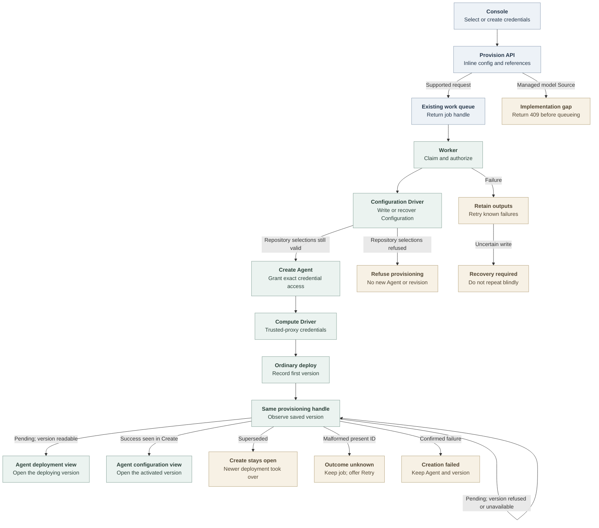

# Agent provisioning flow

## Overview

Console selects Slack Credential Sources and model authentication, then submits Configuration, credential references, and retained Preset bindings. OCC queues setup without placeholders. The worker creates Configuration and Agent and submits deployment for admission. Its handle tracks activation or failure; later deployments use separate handles.
See [worker reconciliation](controller-worker.md) and [Harness topology](harness-execution-topology.md).

## Entry Points

- Console: `apps/controller/src/console/agents/create.mts`, with the Slack Source picker in `apps/controller/src/console/channels/slack.mts`.
- API: `packages/contracts/src/api/routes.ts:provisionAgent`, `apps/controller/src/http/agents.ts:createAgentHandlers`, and `packages/occ/src/agent-provisioning-requests.ts:provisionAgent`.
- Preconditions: ready Namespace, Dedicated runtime, selected Drivers, PostgreSQL work storage, Agent/Configuration/deploy permissions, exact credential access and transactional IAM authority. No provisioning-input keyring required.

## Flow

## Execution Trace

### 1. Console saves credentials and freezes a provisioning request

`apps/controller/src/console/agents/create.mts:renderCreateAgent`

Console keeps the configured Harness separate from execution mode: dedicated
OpenClaw uses the same provisioning, retry, and deployment navigation as
dedicated Codex. Preset restoration and Credentials read native model runtime
policy through `apps/controller/src/console/agents/harness-auth.mts:configuredHarnessId`.

The Slack editor selects a ready static Source or calls `POST /namespaces/:namespaceId/credential-sources` with Namespace Source `create`. Pending enrollment holds navigation. Unconfirmed results, including `409`, block another create; check inventory and owner before reloading. Apply stages the reference in `Configuration.secretBindings`; saving requires exact Source `operate`.

For supported models, Console enrolls a TokenService Source. Codex PAT enrollment can precede Apps discovery. Retries reuse confirmed Sources; check Credentials after uncertain enrollment. Direct authentication runs preflight before writing a Namespace Secret.

Create Agent sends a stable request ID, inline Configuration, credential and model-auth references, Agent options, and repository bindings with an explicit access profile. Retry reuses the ID and inputs after uncertain admission.

Draft creation saves the Configuration and Agent. At deployment, admission checks Source access. OCC-managed transactional Native IAM can create missing exact Agent grants; otherwise, selected IAM must authorize the Agent. Credential-access retry retains the Agent but cannot grant Slack Source access.

### 2. OCC admits one job

`packages/occ/src/agent-provisioning-requests.ts:provisionAgent`

`apps/controller/src/http/agents.ts:createAgentHandlers` receives schema-validated inputs after shared admission. It supplies the Namespace from the route and creates the audit event inside the controller transaction.

Source-backed models deploy through the Agent draft path. [Credential Source lifecycle](credential-source-lifecycle.md#3-bind-and-admit-an-agent-revision) describes its admission and delivery.

OCC requires Agent `create`, Configuration `create`, and Installation `administer` for the Namespace; status and retry require the same grants or return `403`. It validates Configuration, references, workspace inputs, execution mode, and authority. A taken Agent name returns `409`; reserved Secret destinations, cross-Namespace references, or missing/`runtime` Harness authentication return `400 INVALID_REQUEST` naming the rule. An absent Secret returns `404`. Before Compute planning, Secret bindings receive Agent save’s Harness authentication check and named `400`.

For supported model presets with selected TokenService and native delivery, OCC requires Source-backed authentication at Agent save and deployment. Guided provisioning refuses a direct model Secret for those presets before creating a job.

After a Secret Driver change, authorized request, status, and retry return `503` for Secrets owned by the previous Driver and ask for replacement Secrets and a new request. The worker fails with `PROVISIONING_REJECTED`; an unavailable Driver still retries.

OCC applies Configuration rules before Channel credential validation. Slack credential references require Source bindings; old Namespace Secret bindings are refused before provider use. A Slack app or bot token binds a ready static OCC-owned Source for a qualified dedicated Kubernetes Gateway. OCC requires exact caller `operate`; after TokenService resolution, it rechecks provisioning authority, Source ownership and the qualified Compute/TokenService pair before handing the value to Slack. Slack checks token roles and authenticates bot tokens. This does not pin credential versions or revalidate Slack credentials in queued work.

OCC validates Namespace repository selections before queueing. Undeliverable bindings, including Sandbox repositories, retain Agent create's `409` on admission and retry ([Compute admission](../reference/drivers/compute-admission.md)). Initial workspace files require the selected Sandbox's `validateWorkspaceSetup`; Compute delegates validation or refuses unsupported placement before staging. Deployment checks the Harness topology.

OCC stores the request and deduplication fingerprint in `agent_provisioning_work`, then queues `controller_work` with `work_kind = 'provisioning'`. The same actor, Namespace, and request ID return existing work; changed input conflicts. Configuration and Agent creation follow.

The `202` response contains `data.provisioning`, with the work ID and status URL. Public progress exposes result IDs and safe errors without input values or backend credentials.

### 3. The worker creates resources and credentials

`packages/occ/src/agent-provisioning-worker.ts:processAgentProvisioning`

Under its queue claim, the worker verifies ownership, Namespace readiness and authority before
effects and result commits. Retries reuse completed outputs. It creates the Configuration from the accepted inline
values and bindings, then creates a stopped Agent, records the auth, provider, plugin, repository and
workspace selections, and grants its service principal access to the exact credentials.

The bundled worker uses the Installation's selected repository policy for saved selections and first revision admission. A programmatic controller without this binding uses its registered repository Driver. After fencing the claim and checking that the Namespace is ready, the worker checks the saved selections before creating the Agent. The Configuration Driver may already have written the Configuration. If the check refuses, the worker creates no new Agent or revision and follows the existing Configuration recovery rules.

Compute prepares runtime credentials without loopback HTTP. Kubernetes
`apps/controller/src/drivers/compute/kubernetes/index.ts:provisionAgentRuntimeCredentials` confirms complete owned Secrets after
create-only provisioning. Failure retains them and blocks configured success or
first revision admission.
`kubernetesGatewayConfigurationDocument` defaults to machine-only trusted-proxy
administration and preserves human identities/scopes. Provisioning and
deploy admission reject an invalid `allowUsers` or malformed `deviceAutoApprove` (Configuration
save also refuses both), unknown or padded operator scopes, blank or padded identity keys,
grants for identities outside `allowUsers`, malformed `requiredHeaders`, and human
admission with admin device scopes, including whitespace; human allowlists render
`x-openclaw-scopes` as required. With private status, `validateConfiguration`
also refuses a Codex Configuration without `gateway.auth.password`, which the
workspace node check signs in with. These refusals precede workload replacement.
Human ingress and its network policy remain operator-managed; no OCE human
account is required. See [Gateway authentication](../reference/drivers/kubernetes-compute/gateway-authentication.md).
Provisioning supplies no Gateway token or trust override; losing its claim cancels
Kubernetes Configuration requests.

### 4. Deployment becomes the lifecycle owner

`packages/occ/src/agent-provisioning-worker.ts:observeProvisioningDeployment`

Handoff records the first revision in its Read Committed admission transaction.
Provisioning waits without using attempts. On success, PostgreSQL
marks provisioning `succeeded`.
If the claim has an audit attempt ID, PostgreSQL saves `openclaw.controller_work.completed`
in the same transaction.

The job reports the wait, success, or a safe deployment error. During rollout,
Stop gives `REVISION_STOPPED`. Stop or Delete before handoff gives
`PROVISIONING_CANCELLED` with its action. Agent and revision IDs survive restart.

Create Agent (`apps/controller/src/console/agents/create.mts:waitForProvisioning`) polls the job.
When a pending job names its Agent and first revision, Create gives the deployment read one
second to finish. If it succeeds, Create stops polling and opens that revision's Deployment tab
for progress, Stop, and recovery. A 403 or 404 keeps Create on the job with generic status and
ends deployment checks for this attempt. If the read is unavailable or times out, Create shows
any wait reported by the job and checks the deployment again on the next poll. A 401 sends the
caller to sign in again. If Create sees job success before opening Deployment, it opens Configuration.

While the job is in flight, the step meter
(`apps/controller/src/console/agents/provisioning-progress.mts`) pins in the sticky action bar
beside Create Agent: one step per reported phase, marked done only when the job's own `phase`
says it completed, an indeterminate throbber on the current step (static under reduced motion)
and a silent elapsed line. A failure names its step and the job's safe reason in the bar; the
form's error line keeps the recovery action.

The **Latest visible deployment** summary shows the version's recorded wait, even with Deployment
details folded. A temporary read failure labels a retained wait as last recorded. A refused read
clears it.

Admission, status, and retry report the stored client `requestId`.
If absent or different, Create keeps the original request and any confirmed job.
`meta.requestId` identifies each HTTP request. Leaving stops polling, not provisioning.
If Create sees that a newer deployment took over, it explains what happened without a retry
or a link. The job identifies only the deployment that ended. For a failure, follow the linked
version's recovery guidance. After a Stop, deploy when ready.
Reconciliation owns startup and activation; later versions use Deploy.

Console parses each reply in
`apps/controller/src/console/agents/provisioning-job.mts:provisioningJob` before
`apps/controller/src/console/agents/create.mts:submitProvisioningAttempt` selects
recovery. A malformed present `agentId` or `revisionId` makes even a terminal
`failed` reply unknown. The form keeps the accepted job URL and original request,
disables Create, and offers Retry without a recovery link. Retry posts to the same
job's `/retry`. `packages/occ/src/agent-provisioning-requests.ts:retryAgentProvisioning` refuses a changed
Agent lifecycle or an existing deployment handoff with `409`. After refusal during
unknown-outcome recovery, the form enables a resend of the original request ID.

With valid IDs, a failure whose message is absent or not a nonempty string stays
confirmed. `ProvisioningFailure` uses “Provisioning did not complete.” while keeping
the failure code and any applicable recovery link. For a confirmed failure with a linked
version, follow its [recovery guidance](../reference/console/create-and-deploy.md).

Dedicated OpenClaw admission requires native worker support and a Sandbox Driver
with all required containment facets. The pinned runtime declares native support;
custom images still require an operator declaration in
[Installation startup configuration](../reference/configuration.md#installation-startup-configuration).
`packages/occ/src/agent-harness-topology.ts:requireDedicatedNativeSupport` enforces them.
Admission does not prove workload delivery. Sandbox receives the setup identity and Secret
reference through `HarnessWorkloadRequirements.workspaceSetup`; OpenShell runs
[workspace initialization](workspace-files.md#2-deployment-initializes-storage-before-execution)
through `ExecSandbox` before Harness startup.
Stock OpenShell rejects Secret-backed environment projection; the
[OpenShell flow](openshell-sandbox-provisioning.md#3-validate-and-serialize-the-sandbox)
covers remaining limits and verification-only support.

### 5. Failures preserve useful outputs

`packages/occ/src/state/postgres-state.ts:provisioning`

Safe failures retry with a fresh claim/authorization, reusing completed resources.
Unresolved writes retain target/ownership evidence; expiry or not-found alone
does not permit redispatch. Exception: Configuration creates absent after 90 seconds
are [resent](configuration-driver.md#2-resolve-singleton-state-and-select-drivers).
Only pre-record Configuration refusals roll back, deleting the written Configuration
or marking it for later cleanup.

Provisioning blocks conflicting edits and manual deployment. Stale workers
cannot hand off. Stop or Delete saves `openclaw.agents.provision.cancelled`
with cancellation if request audit is enabled or the claim has an audit
attempt ID. The event saves `workId` and available request and attempt IDs.

Agent deletion defers runtime credential removal for one lease without spending
attempts. It saves the receipt with deletion. Deploy, Agent update, and
runtime-credential requests return `409` until lease expiry, then settle
the effect. Namespace deletion waits for queued or running work and effects
without receipts. Namespace Secrets and completed Configurations remain.

Requests have no delete API; Agent deletion removes its requests. Agent-less requests
remain; for migration `0049` blockers, see [legacy bindings](../reference/settings/operations.md#clear-legacy-managed-pat-bindings-before-0049).

## Debugging and Verification

- Poll `data.provisioning.url` or `GET /namespaces/:namespaceId/agents/provision/:workId`; failed work reports a safe error. Status checks stored ownership and provisioning grants, while retry also revalidates the accepted plan. See [admission](#2-occ-admits-one-job) for refusal rules. Explicit pre-handoff retry uses the same URL plus `/retry` and an empty body; only the initiating actor can read or retry work. Match request IDs in `agent_provisioning.compute_refused` and `worker.completed`.
- Status skips write-admission checks for repository selections, Plugin policy, runtime-image support, Compute planning and Harness compatibility. For a stored Source-backed job, it checks the caller's exact Source grant, a ready Source in the same Namespace, its TokenService owner and the selected Sandbox. If the Agent exists, status also checks its exact Source grant. Retry rechecks that Agent's repository selections before lifecycle checks and can refuse a readable job.
- If a failed job's accepted Secret, Credential Source or ServiceAccount was deleted, status and retry return `409`. Changed Driver IDs or Sandbox containment can give `503`. Caller-owned Configuration refusals name the setting without its value. Other Compute refusals use fixed public text. A worker refusal fails that attempt with `PROVISIONING_REJECTED` after inspecting earlier unsettled writes. An unobservable write still retries. Kubernetes provisioning requires explicit `dedicated`, because omission defaults to `embedded`.
- Inspect `worker.completed`, `worker.error` and the `agent_provisioning` work metric. PostgreSQL job state lives in `occ.controller_work` and `occ.agent_provisioning_work`.
- Use `tests/integration/postgres-agent-provisioning.test.ts` for persisted admission, deduplication, safe retry, retained outputs and authorization behavior.
- Use Console browser coverage for channel Source selection before provisioning, reference reuse after failure and job-to-deployment navigation. The disposable Kubernetes fixture proves actual Driver handoff, not native enrollment, model execution or Slack replies.

## Related docs

- [Console creation and API example](../reference/console/create-and-deploy.md)
- [Controller worker and durable reconciliation](controller-worker.md)
- [Configuration Driver flow](configuration-driver.md)
- [Secret storage and delivery](secret-storage-and-delivery.md)
- [Workspace files](workspace-files.md)
- [Asynchronous Agent provisioning spec](../../specs/plans/35-agent-provisioning.md)

## Manual Notes

[keep this for the user to add notes. do not change between edits]

## Changelog

- 2026-11-26 23:36: Trace Slack enrollment failures. (authoring-run/3897c8a4-2327-47c6-a552-30b5e7ed61c2 - 0978257f991a04b699ce411820326119c09be20a)
- 2026-11-26 15:03: Trace inline Slack Source enrollment. (authoring-run/b01217a9-df42-4b2b-9110-e266330732d6 - 95d045c383baa1eb4bac2677ff4f5067e361ee45)
- 2026-11-26 10:14: Replace Slack Namespace Secret selection and Channel validation with Source bindings. (authoring-run/289d45aa-7fc1-43db-bc12-472d3ac827c5 - a4ca743d6a6be2bdeb50bad94cd6718e91a4239d)
- 2026-11-26 08:44: Trace Slack Channel validation through qualified OCC-owned Gateway Sources and the existing Secret path. (authoring-run/289d45aa-7fc1-43db-bc12-472d3ac827c5 - 5ce532c9533b8f14aabb245f4dd979c2449ec23f)
- 2026-11-22 10:05: Clarify the current guided managed-credential provisioning gap. (authoring-run/826943be-2c00-410c-8d78-b6eff00ea692 - 591f2311aa59379852d9ad57547ad00ba9b9091d)
- 2026-11-20 19:04: Refresh sources. (authoring-run/8a8bde8b-71de-4de5-80bf-e32f0e335c34 - 220f62d86ceb3dfc6f66dbee7c6f86cda50e5d05)
- 2026-11-13 16:01: Clarify provisioning audit. (authoring-run/6f9b8960-1432-46e9-97af-330142c01422 - e3e113d4111af1e467f10db2c6eef8e8d10a5b48)

- 2026-11-13 12:50: Recheck provisioning authority and Secret ownership before provider use. (authoring-run/01a1d4f7-afbf-7f20-8109-a5f81d8b7d5b - a056cbd25)

- 2026-11-12 14:06: Record provisioning cancellation. (authoring-run/b3f389f0-d5ed-434d-930a-11b1f97eef2d - 8658496ea654b960bebabca40d18c7d71994db50)

- 2026-11-12 07:02: Verify Kubernetes credentials after creation. (authoring-run/388069bb-c78c-4541-98c1-3ed46dc565ec - 25608d82659d7094e267a8dd106b728a5ccaca7b)

- 2026-11-10 23:12: Explain how the deployment summary shows a recorded wait at handoff. (authoring-run/8df1087c-23a7-43b9-8a29-537fd34e2d6e - cdd1e754e36d)

- 2026-11-10 19:32: Explain when Create opens the first deployment and how it follows the job if the deployment read fails. (authoring-run/a1d8ded8-9b07-4489-a86a-3cf43cf3891b - fb0fb0f46331)
- 2026-11-06 18:20: Add the Create Agent step meter, driven by the polled job's status and phase. (feat/create-agent-progress - a18e07d2c)
- 2026-11-06 19:35: Pin the Create Agent step meter in the sticky action bar; a failure names its step and reason there, and Retry appears only once the request has ended. (feat/create-agent-progress - f13b519d8)

- 2026-11-04 16:38: Explain how Create Agent handles malformed provisioning IDs and error messages. (authoring-run/03df9caf-3a28-496d-bb70-f5b0d838a028 - fe3f13a48d54e3ad3a0dc872f6e5313c783c1ed0)

- 2026-11-03 20:51: Document the selected repository policy during queued provisioning and the ordering of Configuration writes. (authoring-run/e4018630-07e7-4296-a60f-d51180ca700d - 43485a276ad6891f42ba7e0016ba8d0b3f574ae4)

- 2026-10-30 07:41: Omit admission-only Gateway catalog lookup from source-backed provisioning status; retain ownership and grant checks. (authoring-run/6e73ff4f-8905-4066-a81d-d629e40296e7 - 429951edfc002c1c6ef98970696e655e03ba3ec7)

- 2026-10-29 19:27: Use the resolved credential source type for Harness admission. (authoring-run/c2280447-76aa-4fbf-8243-bc452c961d6d - d19e41caf)

- 2026-10-29: Keep saved provisioning status readable after repository policy changes. Retry still checks current policy.

- 2026-10-27 01:52: Preserve current provisioning lifecycle while integrating required human scope headers. (authoring-run/7761d6fc-94f3-45f2-96c0-171d284aa937 - d56aaf212)
- 2026-10-25 16:40: Require human ingress scope headers and preserve current provisioning checks while rebasing. (authoring-run/7761d6fc-94f3-45f2-96c0-171d284aa937 - e1c6288c28b8dcc62926e44ba43f8edd945dfcd1)

- 2026-10-25: Name Slack's whole `${NAME}` token reading; move older entries to the history page. (finding 2512)
- 2026-10-25: Check Configuration rules before channel credentials. (finding 2506)

- 2026-10-21 13:21: Validate native identity grants before rollout and clarify external human ingress; accompanying local changes. (authoring-run/aba975bf-8e97-4c9d-9e34-dc2c9c79d591 - 4accde87c)

- 2026-10-20 14:57: Preserve human Gateway identities and reject malformed or automatic administrator grants; consolidate PR #2596 history. (PR #3049 - fd73e091f)

- 2026-10-25: Refuse a taken Agent name at admission. (finding 2420)
- 2026-10-25 03:30: Check a Secret binding's placement before the Compute plan check; Console runs the preflight first. (fix-postland-1025b - 2b1f510594)

- 2026-10-17: Bound optional deployment details to the provisioning poll interval. (PR #2685)

- 2026-10-14: Merge current contracts with native provisioning and retained-workspace preparation. (Codex/01a13654-be66-7741-b54f-f8ae80f2d496)

- 2026-10-15 07:00: A later attempt retries a failed unrecorded-Configuration delete. (fix-1399)
- 2026-10-15 06:30: Refused provisioning deletes its unrecorded Configuration. (fix-1395)
- 2026-10-14 23:59: Name the Stop or deletion that cancelled provisioning. (fix-1375-1377)
- 2026-10-14 20:21: Name a stopped initial deployment without changing its failed and non-retryable outcome. (authoring-run/b98d803a-436a-4437-84af-01be278a6460 - 8642bef0e3a39ff73459ef9e96a3404084135837)

[Agent provisioning documentation history](agent-provisioning/history.md) preserves the older dated entries.
