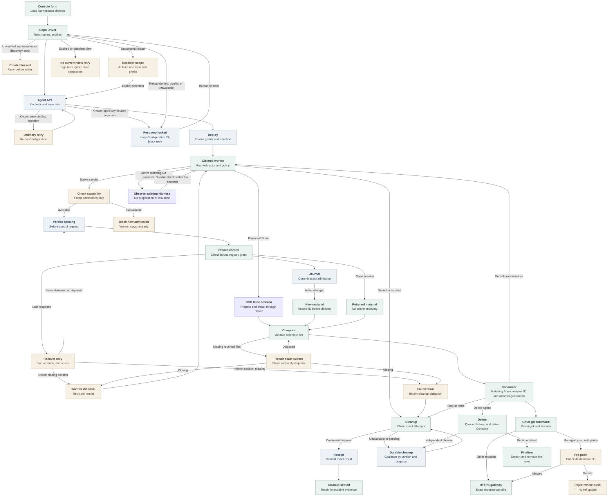

# Agent repository credential flow

## Overview

The Console lists approved repositories; deployment freezes grants. Prepared native sessions reach
Compute-owned dedicated Codex without a Sandbox Driver. The opt-in
[OpenShell path](../reference/repository-credentials/protected-openshell-git.md) gives the sandbox a
placeholder: the worker delivers prepared material to the provider and checks each signed
request against the live grant without returning a token.
See [service forwarding and retirement](repository-credentials.md) and
[runtime qualification](../testing/repository-credentials.md).

## Entry Points

- `apps/controller/src/index.ts:createFastifyApp` registers repository-option and
  Agent lifecycle routes. Discovery requires Agent-create or exact-Agent update.
- `apps/controller/src/console/agents/repositories.mts:createRepositoryFields`
  renders discovery and inherited or custom access.
- `apps/controller/src/worker.ts:ControllerWorker.prepareRevision` prepares
  repository sessions before invoking Compute.

For access across session expiry, see [standing repository approval](../guides/repository-credentials.md#keep-git-access-on-the-same-running-agent).

## Flow

## Execution Trace

### 1. Project choices and resolve Namespace policy during Agent admission

`OpenClawController.listRepositoryOptions` authorizes Namespace Agent creation or
exact-Agent update, checks Compute-owned availability, then projects opaque references, names and
profiles through `GitHubRepositoryPolicy.listOptions`. Exact Harness validation remains at
deployment. No approvals yields `[]`, and no `repository` settings `[]` with `meta.notConfigured`;
closed Namespaces conflict. Classified optional discovery failures map to
`503 REPOSITORY_OPTIONS_UNAVAILABLE`.

`createRepositoryFields` searches up to 1,000 choices with 16 attachments.
`repositorySettings` resolves inheritance through RepositoryPolicyDriver; the database
checks bindings. Only fresh, empty drafts permit the classified outage. The approved
registry supplies GitHub choices; the native sender does not issue metadata credentials
or enrich choices with provider descriptions.

The form saves Configuration first and preserves it after known Agent rejections.
Retries reuse it; repository retries require a successful reload and nonempty reselection.
Failed reloads block creation; obsolete completions cannot change the view. Unknown
outcomes require stored Agent and Configuration reads.

`packages/occ/src/index.ts:OpenClawController.repositoryBindingSelections`
uses `resolveRepositoryBindings` after authorization. Without a repository Driver, save answers
`409 RESOURCE_CONFLICT`. Inputs contain distinct opaque
references and optional profiles, never provider tokens or caller-selected grant identities;
selections keep request order. The
`apps/controller/src/drivers/repo/github/policy.ts:GitHubRepositoryPolicy.resolve`
uses local registry policy, defaults omitted legacy profiles to `git-write`, and
makes no control-socket or GitHub calls.

`apps/controller/src/drivers/repo/github/credentials/registry.ts:resolveGitHubRepositoryBinding`
requires the exact Namespace/reference/profile combination. Its fingerprint binds provider,
App, installation, repository, duration policy, complete Namespace profile policy, exact permissions
and optional normalized push-ref allowlist. Each binding has one grant; installations can
supply several repositories. OCC stores normalized selections; an omitted update array
preserves them and an empty array clears them.

### 2. Freeze a deployable version

`packages/occ/src/index.ts:OpenClawController.admitRepositoryCredentials`
re-resolves the draft, validates Compute topology and freezes Driver identity,
grants and an absolute deadline unaffected by renewal or recovery.
`validateRepositoryBrokerNetworkProxy` then refuses a Codex proxy setting that
blocks the broker, as Agent save does.

`apps/controller/src/composition/installation-config.ts:loadInstallationConfiguration`
selects `GitHubRepositoryPolicy`, with its ID pinned by the GitHub Backend's `repo`
member. Protected installations select `repository.preparedGitHub` and the installed
Sandbox/Credential Proxy Driver. OCC creates finite sessions without a native sender,
control socket, broker CA or session files.

Explicit `repository.nativeSender` selects `GitHubNativeRepositorySender` and requires
prepared GitHub custody. It owns session operations and files, receives no App key, and
cannot coexist with protected delivery. Controller startup rejects `drivers.repo` in
every mode, before it constructs a worker or allocates an attempt. Operators must
drain accepted work on the original owner before cutover.
Cleanup matches recorded owner identity without resolving policy or restoring authority.
The worker's prepared provider owns issuance and custody.

### 3. Record ownership before opening a session

`apps/controller/src/worker/repository-credentials.ts:RepositoryCredentialLifecycle.prepare`
rechecks actor, Namespace, Agent, revision, Driver, grant and deadline.
`GitHubNativeRepositorySender.checkAdmissionReady` checks broker capability with a
two-second timeout. Failure blocks fresh admission, not recovery or cleanup. Each fresh
OPEN carries `preparedOnly: true`: an old parser rejects it after socket replacement,
and current control requires a prepared backend.
Under the live claim and Namespace/Agent locks, State records immutable cleanup
context before calling the Driver. Stopped or deleting owners are rejected.
State stores identifiers and phases, never bearers or files.

`apps/controller/src/backends/repository-credentials/control-client.ts:UnixRepositoryCredentialControlClient`
sends the bound request over the private socket.
`apps/controller/src/drivers/repo/github/credentials/warm-registry-factory.ts:createPreparedGitHubRegistryFactory`
resolves and compares its grant. The client validates status: `DISPOSED` permits historical
revoked/expired counts, but no outstanding obligations. Only a created response contains a bearer.
`apps/controller/src/drivers/repo/github/credentials/client/config.ts:encodeRepositoryCredentialSessionFiles`
encodes files; the worker records the session ID before passing them to Compute.

Confirmed open sessions yield `retained` bindings without files. `recoverOnly` finds or
fences unfinished admissions and closes recovered sessions. Fresh material requires
confirmed disposal or a missing opening without a recorded session ID. Invalidated known
sessions block replacement. Closing raises `REPOSITORY_CLEANUP_PENDING`, subject to Work
bounds and the revision deadline. Cleanup uses the configured interval while any session
closes. Otherwise, an unsettled obligation retains its code and retries at `age / 40`,
bounded by the configured interval and ten minutes.
`apps/controller/src/worker.ts:processRepositoryCleanup` logs
`worker.repository-cleanup-warning` with `cause` once per worker.

`apps/controller/src/drivers/repo/credentials/control.ts:createControlAdmission`
reserves before releasing material.
`apps/controller/src/backends/repository-credentials/receipt-store.ts:RepositoryReceiptStore`
retains fences and original-broker disposal evidence across service pruning.
Transport failure cannot establish absence. The receipt store matches
`preparedOnly` to protocol 3 throughout receipt operations. Unmarked v1 requests
can recover and close on their original IDs but cannot reserve.
`RepositoryCredentialLifecycle.verifyRelease` and
`apps/controller/src/drivers/repo/github/credentials/prepared-repository-git.ts:sessionQuery`
require protocol 3 for native release and prepared-material selection.
Protected sessions retain protocol 2. The query matches policy-reduction version 2
with execution admission v7. It retains the exact installed-plan, recipient,
standing-approval and session-lifetime checks before selecting prepared material.

### 4. Deliver and retain one complete runtime generation

`apps/controller/src/drivers/compute/kubernetes/repository-material.ts:repositoryMaterialSpec`
validates `new | retained` bindings against the version and hashes sorted
reference/session pairs.
`apps/controller/src/drivers/compute/kubernetes/repository-material-store.ts:RepositoryMaterialStore.prepare`
validates ownership, contents and deadlines before creating immutable Agent/version-owned
Secrets. It rechecks deadlines after requests and before creation or return; expiry
leaves Secrets for owned cleanup. For missing retained bindings,
`RepositoryCredentialLifecycle.repair` closes that subset, requires disposal and
retries Compute once. Missing inventory fails; pending closure blocks replacement
until disposal is confirmed.

`apps/controller/src/drivers/compute/kubernetes/repository-material.ts:repositoryMaterialDeployment`
mounts Secrets only in the first initializer. Sorted projections prevent key-order rollouts;
session replacement still rolls.
`apps/controller/src/drivers/compute/kubernetes/repository-material-init.ts:REPOSITORY_MATERIAL_INIT_ENTRYPOINT`
validates the complete projection, then writes mode-0700 directories and
mode-0600 files in memory. `REPOSITORY_NATIVE_GIT_INIT_ENTRYPOINT` mounts the
private subPath at `/run/oce/repository-credentials`, avoiding the fsGroup-writable root. It calls
`apps/controller/src/drivers/repo/github/credentials/client/native-git.ts:prepareNativeGitConfiguration`
with private-file checks. Retry removes only a validated private `gitconfig`.
Both gate startup; the consumer mount is read-only. Metadata and gateway
bearers remain separate.

`apps/controller/src/drivers/compute/kubernetes/index.ts:KubernetesComputeDriver.activateRevision`
replaces consumers when material changes, even within one version. Readiness requires
role, version, generation and current deadlines. Dedicated replacement preserves enrollment
and version-private storage.
`KubernetesComputeDriver.prepareRevision` rechecks material after plugin,
gateway and node observations; generation changes, lost readiness or expiry return incomplete.
Activation rechecks deadlines after final observations.
Dedicated gateways lack repository material and repository-gateway egress.
Both consumers trust CAs through `SSL_CERT_FILE`, `GIT_SSL_CAINFO` and
`NODE_EXTRA_CA_CERTS`; overrides fail.
Compute grants consumer egress; Helm admits consumers through
[credential-sidecar ingress selectors](../reference/drivers/kubernetes-compute/networking-and-isolation.md#networking).
For [prepared native Git](../reference/repository-credentials/prepared-native-git.md),
`apps/controller/src/drivers/compute/kubernetes/repository-compute-ingress.ts:reconcilePreparedRepositoryIngress`
admits the revision's ingress peer only when the session's hostname, TLS port and
worker selector match the Helm-recorded broker Service. A mismatch refuses admission
without widening policy. Native preparation writes aggregate `gitconfig` without reading
bearers. System Git includes
`/run/oce/repository-credentials/gitconfig`, preserving HOME/global configuration.
Embedded `repositoryNativeConfiguration` keeps the `gh` router first in
`tools.exec.pathPrepend`. `AGENT_RUNTIME_ENTRYPOINT` sets Codex's
`allow_login_shell=false` and `shell_environment_policy.set.PATH`, and keeps the Pod's
`NODE_EXTRA_CA_CERTS` for sandboxed commands. Model authentication remains intact.
App keys, JWTs, installation tokens and the control socket never enter consumer material.
The [networking contract](../reference/drivers/kubernetes-compute/networking-and-isolation.md#networking)
defines Codex plugin and repository-bound filesystem and proxy access, explicit denies,
and dedicated/embedded eligibility. Unbound policy, broker authorization and TLS
verification stay in force.

### 5. Authenticate native Git and route GitHub CLI commands

Stock Git owns commands, remotes, push URLs, worktrees and settings. Configuration
rewrites canonical HTTPS hosts to their gateway origin. The scoped helper checks host/path,
generation and deadline before supplying the bearer. `OCE_REPOSITORY_REF` disambiguates
bindings, not destinations. Local identity, hooks, aliases, overrides and other helpers
remain available; there is no whole-command preflight or egress confinement.
See the [routing limits](../reference/repository-credentials.md#client-routing-and-limits).
`pushRefAllowlist` selects image-owned hooks.
`apps/controller/src/drivers/repo/github/credentials/client/hook-dispatch.ts:checkPush`
checks every destination ref and rejects the whole push before updates, though discovery may
contact the service. It delegates original arguments and input to common-directory hooks.
Custom hook paths and API writes remain outside this
[best-effort guardrail](../reference/repository-credentials/push-ref-guardrail.md), which
also describes matching and linked worktrees.

`apps/controller/src/drivers/repo/github/credentials/client/router.ts:routeRepositoryClient`
routes supported `gh` commands using explicit targets or effective Git remotes. It pins
generation, reference and session, selects private `gh` configuration and preserves HOME
without changing shared selection.

See [draft creation from a prepared Git session](../reference/repository-credentials/protected-openshell-git.md#use-the-admitted-repository).

`apps/controller/src/drivers/repo/github/credentials/profiles.ts` owns the exact
Reader, Contributor and Collaborator permission maps. The GitHub route classifier admits
profile-selected REST operations and GraphQL limited by token permissions for all three.
Every GraphQL POST is a possible write; Reader's token, not a query parser, enforces its
read-only grant. See
[access levels](../reference/repository-credentials/access-levels.md).

The [service exchange flow](repository-credentials.md#4-reserve-acquire-and-dispatch)
enforces bearer, immutable repository/profile, capacity and deadlines, acquiring
fresh installation tokens under the same grant until the version deadline.

### 6. Maintain, recover and retire ownership

The [worker](../../apps/controller/src/worker.mjs) passes only the selected `ProtectedRepositoryGitAuthority`
to the [sender binder](../../apps/controller/src/composition/repository-credentials/transport.ts).
The worker retains maintenance and shutdown. Missing authority or mismatched Drivers stop
binding before route-store or sender calls.
Bundled OpenShell connects its route store before binding; a bare Sandbox runs without Git.

If an external binding provides `reconcile`, the worker calls it serially with a 25-second abort
signal and a one-second delay between calls.
Close aborts and joins. Independent readback settles the original OCC delivery without
reinstalling or restoring withdrawn access.

The worker commits activation and next maintenance together, preserving the actor. Maintenance uses
30 seconds, the native sender interval or a shorter Compute interval. After restart, the worker invalidates missing known sessions without reminting. Users can deploy during cleanup.

[Preview, save and deploy](../../packages/occ/src/index.ts) require explicit repository policy
permission and current scope for standing approval. The
[worker](../../apps/controller/src/worker/repository-credentials.ts) rechecks
[eligibility](../../packages/occ/src/repository-approval.ts) under Namespace then Agent locks.
Withdrawal or a changed scope fingerprint raises `REPOSITORY_STANDING_POLICY_CHANGED` before successor release.

Prepared native Git issues a version's first token only after activation publishes it. The
deployment's Work then runs `apps/controller/src/worker.ts:ControllerWorker.assertRepositoryGitMaterial`
(`PreparedRepositoryGitStore.revisionMaterial`): it waits at `REPOSITORY_GIT_MATERIAL_PENDING`
until each open session has a committed token and fails with `REPOSITORY_GIT_TOKEN_QUARANTINED`
when an attempt is quarantined. For an existing Agent (`activatedEarlierRevision`),
`continueRevisionWithoutGit` fails the deployment with `continuingRevision` and queues maintenance
in one transaction under Namespace then Agent locks, so the version keeps running. A token still
pending at the convergence deadline takes the same path with `REPOSITORY_GIT_TOKEN_PENDING`;
maintenance accepts only these two failure codes. Otherwise the
version is retired like any failed repository version
([reference](../reference/repository-credentials/prepared-native-git.md#deployment-and-the-first-token)).

If standing Git evidence is missing, the worker keeps Git closed and observes the existing
Harness without preparing or activating it. It checks again within five seconds, rechecking
model authority, withdrawal, stop and replacement each pass. Harness readiness is not Git
authority. See the [standing worker integration test](../../tests/integration/postgres-standing-session-worker.test.ts).

`apps/controller/src/worker.ts:ControllerWorker.processRepositoryCleanup` consumes
owner-bound Work without admission or material delivery. Terminal-runtime Work fences
attempts, closes sessions and calls `stopRevision` for the original version, preserving
its replacement. Compute mismatch or stop failure remains retryable beyond foreground
limits. Completion requires session disposal and runtime retirement; `CLOSED`, missing
inventory and invalidation do not prove disposal. Retained attempts survive version deletion.

`ControllerWorker.withdrawExpiredRepositoryAccess` retires the original version for IAM
refusal, confirmed actor or Agent-principal absence, required model-source withdrawal,
or unsupported Git withdrawal. Model withdrawal precedes Gateway readiness.
Failed reads stay pending unless independent facts prove authority loss. Optional withdrawals
cannot justify retirement. Maintenance recovers exhausted original and companion source work
through `recoverPendingCredentialWithdrawals`, preserving outstanding work and manual-replay
holds. The v7 reducer observes stored operations without reapplying.
See [tests](../../tests/integration/postgres-standing-expiry-authority.test.ts).

`ControllerWorker.processAgentDeletion` retires Compute and queues cleanup without waiting
for sessions. Cleanup uses its version key for dispatch and audits.
`PostgresWorkQueue.completeAgentDeletion` calls `occ.finalize_agent_deletion` under the claim
to detach attempts, delete live rows and audit deletion atomically. Attempts and cleanup
survive without fabricated disposal. Unresolved provisioning effects defer completion
without consuming retries.

Compute retirement waits for owned Pods to stop before removing material. It preserves Secrets
referenced by Pods and current Deployments, and limits deletion to exact ownership with UID
preconditions. Stop removes only the stopped version's route and preserves newer shared
resources. Route and Deployment deletion require the observed resourceVersion. Shared cleanup
remains retryable after partial failure; service restart cannot prove remote token revocation.

## Debugging and Verification

Compare `occ agent get AGENT_ID --output json` with the admitted `activeRevisionId`.
Inspect worker events for
`REPOSITORY_BINDING_CHANGED`, `REPOSITORY_CREDENTIAL_DEADLINE_EXCEEDED`,
`REPOSITORY_SESSION_RECOVERY_UNSAFE`, `REPOSITORY_GIT_TOKEN_QUARANTINED`, `REPOSITORY_GIT_TOKEN_PENDING`, `REPOSITORY_CLEANUP_PENDING` or
`REPOSITORY_CLEANUP_COMPLETE`. Check registry identity and deadline before retry.
A cleanup that stays pending logs `worker.repository-cleanup-warning` with its
`cause` once.

`repository-not-admitted` means an unselected target; `name-one-repository-target`
or `name-one-repository-ref` requires explicit selection. Inspect metadata
and Pod generation without printing credentials.

The [test guide](../testing/repository-credentials.md) distinguishes lifecycle,
installed-runtime and live-provider proof. The
[image volume case](../testing/docker.md#repository-runtime-volume-test-environment)
checks Docker mounts; Helm checks rendered ingress. Neither proves CNI enforcement.
Console recordings cover fixture/API behavior, not model, Slack or GitHub execution.
The registered Driver test pushes two commits to one draft PR at a local provider.
On the same Agent revision, the shipped Codex client completes a turn before and after Git
withdrawal. On a team installation, verify that the Agent updates the PR itself, Git is
denied before reaching the provider, and chat continues.

## Related docs

- [Repository credential reference](../reference/repository-credentials.md)
- [Install repository access](../guides/repository-credentials/installation.md)
- [Create and use a repository Agent](../guides/repository-credentials.md)
- [Controller worker lifecycle](controller-worker.md)
- [Credential service execution](repository-credentials.md)

## Manual Notes

[keep this for the user to add notes. do not change between edits]

## Changelog

- 2026-10-30 03:58: Load the native repository transport only for explicit native delivery. (authoring-run/43b61103-4082-4fc2-b9a0-511a18ebc761 - 87ed6c37e543e5501eae6285450d01d03d8abe7d)

- 2026-10-29 21:00: Keep an existing Agent's new version running when its first GitHub token is still pending at the convergence deadline (`REPOSITORY_GIT_TOKEN_PENDING`). (finding 2894)

[Agent repository credential documentation history](agent-repository-credentials/history.md) preserves the older dated entries.
