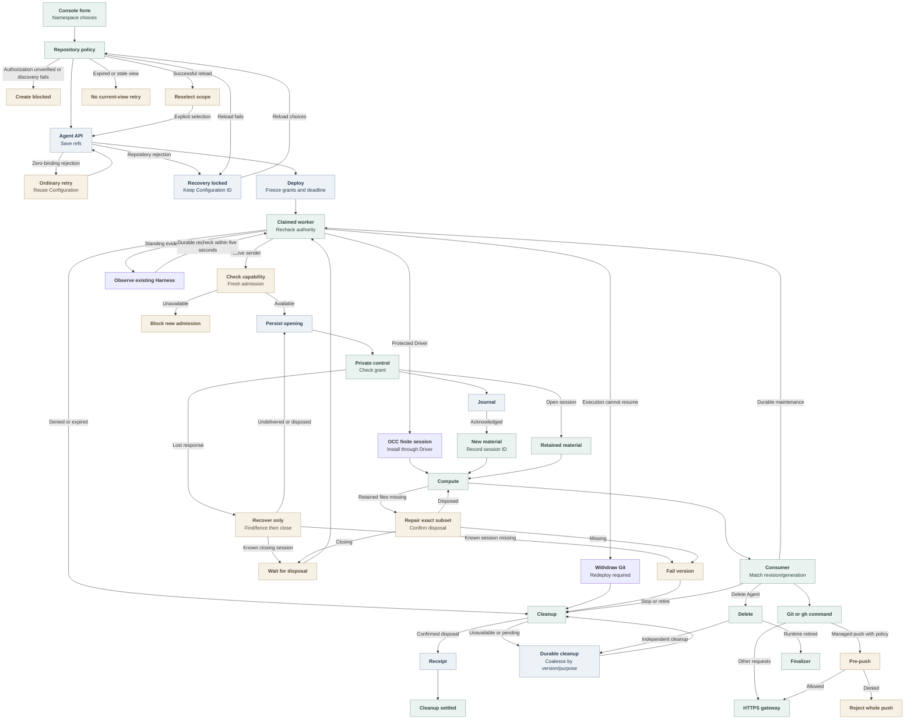

# Agent repository credential flow

## Overview

Dedicated Codex uses prepared sessions without a Sandbox Driver. [OpenShell sandboxes](../reference/repository-credentials/protected-openshell-git.md) receive placeholders.
Workers deliver credentials and check signed requests against live grants. See [mandatory hooks](../guides/repository-credentials/openshell-enrollment.md) and the [service lifecycle](repository-credentials.md).

## Entry Points

- `apps/controller/src/index.ts:createFastifyApp` registers repository options and Agent lifecycle routes.
- `apps/controller/src/console/agents/repositories.mts:createRepositoryFields` renders discovery and inherited/custom access.
- `apps/controller/src/worker.ts:ControllerWorker.prepareRevision` prepares sessions before Compute.

## Flow

## Execution Trace

### 1. Project choices and resolve Namespace policy during Agent admission

`listRepositoryOptions` checks Namespace create or exact Agent update permission
and Compute availability. Bundled listing uses the bound GitHub catalog. Programmatic listing uses
the registered Repo Driver. Stale owner results fail. Deploy checks the exact Harness.
Empty catalogs return `[]`. Absent `repository` adds `meta.notConfigured`. Closed
Namespaces conflict. Classified discovery failures return `503 REPOSITORY_OPTIONS_UNAVAILABLE`.

`createRepositoryFields` searches up to 1,000 choices with 16 attachments.
`repositorySettings` checks explicit and inherited saves against the bound Installation policy,
or uses the registered Repo Driver when unbound. Database constraints check bindings.
Only fresh empty drafts tolerate classified outages. Catalogs omit sender metadata,
credentials and provider descriptions.

Save Configuration first and reuse it after known Agent rejections. Repository retries
require reload and explicit repo/profile reselection. Sign in if the view expired and ignore
stale results. After unknown outcomes, read the stored Agent and Configuration.

Requests carry distinct opaque refs and optional profiles, never tokens or grant IDs.
Nonempty selections require a Repo Driver (`409 RESOURCE_CONFLICT`). OCC saves normalized
selections in request order. Legacy GitHub profiles default to `git-write` without GitHub or socket calls.

`apps/controller/src/drivers/repo/github/credentials/registry.ts:resolveGitHubRepositoryBinding`
requires an exact Namespace/ref/profile. The fingerprint binds provider, App,
installation, repository, duration, full Namespace profile policy, exact permissions
and optional normalized push-ref allowlist. One grant per binding; installations
can supply several repositories. Omitted updates preserve selections; `[]` clears them.

### 2. Freeze a deployable version

`apps/controller/src/composition/installation-config.ts:loadInstallationConfiguration`
selects GitHub policy by registry-matched Backend ID. Before Driver package or registry loading,
startup copies validated policy for policy construction and the protected Git Driver's configuration ID. `packages/occ/src/index.ts:OpenClawController.forInstallation`
binds the owner and rejects missing or mismatched ownership. All modes reject
`drivers.repo` before creating workers or attempts.

`apps/controller/src/drivers/egress-proxy/openshell-configuration.ts`
owns OpenShell parsing and chart constraints.

Bound `OpenClawController.admitRepositoryCredentials` requires `resolveBindings`.
Unbound controllers call `RepositoryPolicyDriver.resolve`. OCC checks Compute topology
and freezes Driver identity, grants and an absolute deadline through renewal and recovery. `validateRepositoryBrokerNetworkProxy`
rejects Codex settings that block the broker.

Deploy rechecks its bound owner or unbound Driver after approval lookup. Owner
replacement returns 503 without invoking it. Denial or changed binding or scope
blocks revision creation.

Protected `repository.preparedGitHub` uses the installed Sandbox/Credential Proxy Driver.
Finite sessions omit the native sender, control socket, broker CA and session files.

`repository.nativeSender` selects `GitHubNativeRepositorySender` to own native
sessions and files without an App key. The worker's prepared provider issues and holds
credentials. Drain accepted work on its original owner before cutover. Cleanup uses
recorded identity without resolving policy or restoring authority.

### 3. Record ownership before opening a session

`apps/controller/src/worker/repository-credentials.ts:RepositoryCredentialLifecycle.prepare`
rechecks actor, Namespace, Agent, revision, Driver, grant and deadline.
`GitHubNativeRepositorySender.checkAdmissionReady` gives the broker two seconds to
confirm capability. Failure blocks fresh admission and leaves the worker unready.
Fresh OPEN carries `preparedOnly: true`. Old parsers reject it after socket replacement.
Current control requires a prepared backend.
Under the live claim and Namespace/Agent locks, State rejects stopped or deleting
owners and records immutable cleanup context before Driver calls. It stores identifiers
and phases only.

`apps/controller/src/backends/repository-credentials/control-client.ts:UnixRepositoryCredentialControlClient` sends the bound request over the private socket.
`apps/controller/src/drivers/repo/github/credentials/warm-registry-factory.ts:createPreparedGitHubRegistryFactory` resolves and compares the grant. `DISPOSED` may
include historical revoked or expired counts, but no outstanding obligations.
Only created responses carry bearers. `apps/controller/src/drivers/repo/github/credentials/client/config.ts:encodeRepositoryCredentialSessionFiles` encodes
files, and the worker records the session ID before Compute delivery.

Confirmed open sessions return `retained` bindings without files. `recoverOnly` finds
or fences unfinished admissions and closes recovered sessions. Replacement requires
confirmed disposal or a missing opening with no recorded session ID. Known invalidated
sessions block replacement. Closing raises `REPOSITORY_CLEANUP_PENDING` within Work and
revision limits. Cleanup retries at the configured interval while any session closes.
Other unsettled obligations retain their code and retry at `age / 40`, bounded by that interval and ten minutes. `processRepositoryCleanup` logs `worker.repository-cleanup-warning`
with `cause` once per worker.

`apps/controller/src/drivers/repo/credentials/control.ts:createControlAdmission` reserves before release. `apps/controller/src/backends/repository-credentials/receipt-store.ts:RepositoryReceiptStore` preserves
fences and original-broker disposal evidence after pruning. Transport failure cannot
establish absence. Protocol 3 gates `preparedOnly`, native release (`verifyRelease`) and
material selection (`sessionQuery`). Unmarked v1 can recover and close original IDs only.

Protected protocol 2 selection checks policy-reduction v2 against admission v7, exact
installed plan, recipient, standing approval and session lifetime. `apps/controller/src/drivers/repo/credentials/protected-repository-git-installation.ts:selectedRepositoryGrantSql`
shares per-member selection, Driver and expiry checks across production and withdrawal.
Frozen identities block session replacement. Transaction locks remain.

### 4. Deliver and retain one complete runtime generation

`apps/controller/src/drivers/compute/kubernetes/repository-material.ts:repositoryMaterialSpec` validates `new | retained` bindings against the version and
hashes sorted reference/session pairs. `apps/controller/src/drivers/compute/kubernetes/repository-material-store.ts:RepositoryMaterialStore.prepare` checks ownership,
contents and deadlines before creating immutable Agent/version-owned Secrets. It rechecks
deadlines after requests and before creation or return. Expiry leaves Secrets for owned
cleanup. `RepositoryCredentialLifecycle.repair` closes only missing retained bindings and
retries Compute once after disposal. Missing inventory fails. Pending closure blocks replacement.

`apps/controller/src/drivers/compute/kubernetes/repository-material.ts:repositoryMaterialDeployment` mounts Secrets only in the first initializer. Sorting
prevents key-order rollouts. Session replacement rolls consumers. `apps/controller/src/drivers/compute/kubernetes/repository-material-init.ts:REPOSITORY_MATERIAL_INIT_ENTRYPOINT`
validates the whole projection, then writes in-memory mode-0700 directories and mode-0600 files.
`REPOSITORY_NATIVE_GIT_INIT_ENTRYPOINT` mounts the private subPath at `/run/oce/repository-credentials`,
avoiding the fsGroup-writable root. `apps/controller/src/drivers/repo/github/credentials/client/native-git.ts:prepareNativeGitConfiguration` checks private files.
Retry removes only a validated private `gitconfig`. Both initializers gate startup.
The consumer mounts read-only, with separate metadata and bearers.

`apps/controller/src/drivers/compute/kubernetes/index.ts:KubernetesComputeDriver.activateRevision` replaces consumers on material changes within
or across versions. Readiness checks role, version, generation and deadlines. Dedicated
replacement preserves enrollment and version-private storage. `prepareRevision` rechecks
material after plugin, gateway and node observations. Changed generation, lost readiness
or expiry leaves preparation incomplete. Activation rechecks deadlines after observation.

Dedicated gateways lack repository material and repository-gateway egress. Both consumers
trust `SSL_CERT_FILE`, `GIT_SSL_CAINFO` and `NODE_EXTRA_CA_CERTS`. Overrides fail. Compute grants
consumer egress. Helm uses [credential-sidecar ingress selectors](../reference/drivers/kubernetes-compute/networking-and-isolation.md#networking).
`apps/controller/src/drivers/compute/kubernetes/repository-compute-ingress.ts:reconcilePreparedRepositoryIngress` matches peer hostname, TLS port and worker selector to
Helm’s broker Service for [prepared native Git](../reference/repository-credentials/prepared-native-git.md).

Native preparation writes `gitconfig` without reading bearers. System Git includes
`/run/oce/repository-credentials/gitconfig` alongside global settings.
Embedded `repositoryNativeConfiguration` puts the `gh` router first in `tools.exec.pathPrepend`.
`AGENT_RUNTIME_ENTRYPOINT` sets Codex's `allow_login_shell=false` and `shell_environment_policy.set.PATH`.
Sandboxed commands keep the Pod's `NODE_EXTRA_CA_CERTS`. Model authentication persists.
App keys, JWTs, installation tokens and the control socket stay outside consumer material.

The [networking contract](../reference/drivers/kubernetes-compute/networking-and-isolation.md#networking)
defines Codex plugin and repository filesystem/proxy access, explicit denies and dedicated/embedded eligibility.
Unbound policy, broker authorization and TLS verification apply. Codex checks the named profile at
thread start, resume, fork and turns.

### 5. Authenticate native Git and route GitHub CLI commands

Stock Git retains commands, remotes, settings and hooks. Configuration rewrites canonical
HTTPS hosts to the gateway origin. The helper checks host/path, generation and deadline
before supplying a bearer. `OCE_REPOSITORY_REF` only selects bindings. [Routing](../reference/repository-credentials.md#client-routing-and-limits)
provides neither whole-command preflight nor egress confinement. `pushRefAllowlist` selects
image-owned hooks.
`scripts/build-repository-credentials.ts:stage` emits Node launchers that resolve the
dispatcher from their module URL, supporting symlink chains and package relocation.
`apps/controller/src/drivers/repo/github/credentials/client/hook-dispatch.ts:checkPush`
rejects disallowed refs before updates and forwards arguments/input to common-directory hooks.
Discovery may contact the service. The [guardrail](../reference/repository-credentials/push-ref-guardrail.md)
excludes custom hook paths and API writes.

`apps/controller/src/drivers/repo/github/credentials/client/router.ts:routeRepositoryClient`
routes supported `gh` by explicit target or effective Git remote. It pins generation,
ref and session, selects private configuration and preserves HOME and shared selection.

`apps/controller/src/drivers/repo/github/credentials/routes/request-selection.ts:requestHead`
validates OpenShell [CLI metadata](../reference/repository-credentials/protected-openshell-git.md#use-the-admitted-repository).
Cache hints never replace authorization.
`apps/controller/src/drivers/egress-proxy/openshell-online-git-authority.ts:validBinding`
uses `normalizePushRefAllowlist` for [Git-only policies](../reference/repository-credentials/access-levels.md),
including terminal `/*` patterns. Draft-pull heads require concrete refs. Receive-pack rejects denied destinations before durable approval.

The [service exchange flow](repository-credentials.md#4-reserve-acquire-and-dispatch)
checks bearer, immutable repository/profile, capacity and deadlines. It refreshes
installation tokens under the same grant until the version deadline.

### 6. Maintain, recover and retire ownership

The [worker](../../apps/controller/src/worker.mjs) supplies `ProtectedRepositoryGitAuthority` for
maintenance and shutdown ([transport.ts:bindRepositoryGitTransport](../../apps/controller/src/composition/repository-credentials/transport.ts#L63)).
The binder requires authority and matching Drivers. OpenShell connects storage first. Bare Sandboxes lack Git.
Serial `reconcile` uses a 25-second timeout and one-second interval. Close aborts and joins.
Readback settles delivery without reinstalling or restoring access.

Activation and maintenance commit atomically with the same actor. Maintenance uses 30 seconds,
the sender interval or a shorter Compute interval. Restart invalidates missing sessions without
reminting. Cleanup permits deployment.
[Prepared custody](../../apps/controller/src/drivers/repo/github/credentials/prepared-postgres.ts)
erases standing tokens after verified expiry plus skew. Uncertain revocations remain unresolved.

[Preview, save and deploy](../../packages/occ/src/index.ts) require standing permission and current scope.
[Reconciliation](../../apps/controller/src/worker/repository-credentials.ts) keeps the startup policy owner
(bound Installation or unbound Repo Driver). Conflicts block startup.
[Eligibility](../../packages/occ/src/repository-approval.ts) is rechecked under Namespace then Agent locks.
Withdrawal or scope changes raise `REPOSITORY_STANDING_POLICY_CHANGED` before successor release.
The [registry](../../apps/controller/src/drivers/repo/github/credentials/registry.ts) fingerprints `github-repository`
identity and canonical permissions. Issuance and delivery recheck opt-ins and grants. Standing delivery requires one binding.
The [observer](../../apps/controller/src/drivers/egress-proxy/openshell-git-installation.ts)
rechecks predecessor policy and recipient after hook acknowledgement, refusing expired requests,
unacknowledged launches and observed-only previews.

[Cold verification](../../apps/controller/src/drivers/egress-proxy/openshell-git-runtime.ts) can recognize a persisted
`github-installation` predecessor after restart despite aggregate `WITHHELD/CREDENTIAL_EXPIRED`.
`witnessOpenShellGitLaunch` derives the launch hash from the workload and admitted identity.
[`observeOpenShellGitPredecessor`](../../apps/controller/src/drivers/egress-proxy/openshell-expired-git.ts)
guards subtraction and succession. Evidence must match generation, session, process and network.
Read back the same ready Sandbox after the report. Nanosecond observation age plus monotonic read time must be under
15 seconds. Evaluation and observation must each be less than 30 seconds from local time. Missing evidence or exhausted
read budget defers. Stale or mismatched evidence fails without issuance, preparation or route fencing.
A match establishes only launch identity. Issuance and delivery require current authority, eligibility and
installation evidence. New installs and post-detach model completion require ready credentials.

`subtractExpiredOpenShellGit` confirms revoked Git, ready model and
[retained profiles](../../apps/controller/src/drivers/egress-proxy/openshell-git-installation.ts)
between reports, including recovery.
[`GrpcOpenShellGatewayClient.getProviderProfile`](../../apps/controller/src/drivers/sandbox/openshell-gateway-client.ts)
checks profile identity and defaults omitted protobuf endpoint/credential lists to empty. Files-only
profiles pass. Missing, mismatched or Git-overlapping profiles (GitHub endpoints or `GITHUB_TOKEN`) block retention.

After activation, `assertRepositoryGitMaterial` waits at `REPOSITORY_GIT_MATERIAL_PENDING` for each open
session's committed token. Quarantine or convergence timeout fails deployment. For Agents with an earlier activated revision,
`continueRevisionWithoutGit` keeps the new revision running and atomically records `REPOSITORY_GIT_TOKEN_QUARANTINED`
or `REPOSITORY_GIT_TOKEN_PENDING` and queues maintenance under ownership locks. Otherwise, the worker retires it. See [first-token handling](../reference/repository-credentials/prepared-native-git.md#deployment-and-the-first-token).

Missing standing evidence closes Git. Within five seconds, the worker rechecks model authority,
withdrawal, stop and replacement without preparation or activation. Harness readiness cannot authorize Git ([test](../../tests/integration/postgres-standing-session-worker.test.ts)).

`OpenShellGitRuntime.verifyExecution` raises `RepositoryExecutionRequiresRedeployError` when a v5 held
route's persisted owner, binding and stable fence rule out adoption. `completeStandingRepositoryWithdrawal`
rechecks ownership, closes sessions and queues withdrawal atomically. Work records
`REPOSITORY_EXECUTION_REDEPLOY_REQUIRED`. `getDeploymentStatus` projects `repositoryAccess`, preserving history ([regression](../../tests/integration/postgres-openshell-standing-selected-repository.test.ts)).

`processRepositoryCleanup` handles owner-bound Work without admission or delivery. Terminal-runtime
Work fences attempts, closes sessions and calls `stopRevision` for the original only. Compute mismatch
or stop failure retries beyond foreground limits. Completion requires disposal and retirement.
`CLOSED`, missing inventory and invalidation cannot prove disposal. Attempts survive version deletion.

`withdrawExpiredRepositoryAccess` retires the original version for IAM refusal, confirmed actor or
Agent-principal absence, required model-source withdrawal or unsupported Git withdrawal. Model
withdrawal precedes Gateway readiness. Failed reads stay pending absent other authority-loss evidence.
Optional withdrawals cannot justify retirement. `recoverPendingCredentialWithdrawals` recovers exhausted
original and companion maintenance, preserving Work and manual-replay holds. The v7 reducer observes
stored operations without replay. [Tests](../../tests/integration/postgres-standing-expiry-authority.test.ts).

`ControllerWorker.processAgentDeletion` retires Compute and queues version-keyed cleanup without
awaiting sessions. Under claim, `PostgresWorkQueue.completeAgentDeletion` calls `occ.finalize_agent_deletion`
to detach attempts, delete live rows and audit atomically. Attempts and cleanup survive.
Unresolved provisioning defers without consuming retries.

Compute removes material after owned Pods stop, preserving Secrets referenced by Pods or Deployments.
Deletion requires exact ownership and UID. Stop removes only its version's route. Route and Deployment
deletion require observed `resourceVersion`. Partial cleanup retries. Restart cannot prove token revocation.

## Debugging and Verification

`occ agent get AGENT_ID --output json` reports `activeRevisionId`. Inspect
`REPOSITORY_BINDING_CHANGED`, `REPOSITORY_CREDENTIAL_DEADLINE_EXCEEDED`,
`REPOSITORY_SESSION_RECOVERY_UNSAFE`, `REPOSITORY_GIT_TOKEN_QUARANTINED`, `REPOSITORY_GIT_TOKEN_PENDING`, `REPOSITORY_CLEANUP_PENDING` or
`REPOSITORY_CLEANUP_COMPLETE`. Check registry identity and deadline before retry.

`repository-not-admitted` identifies unselected targets. `name-one-repository-target` and
`name-one-repository-ref` require explicit selection. Inspect metadata and Pod generation without printing credentials.

[Tests](../testing/repository-credentials.md) distinguish lifecycle, installed-runtime
and live-provider proof. [Docker/Helm checks](../testing/docker.md#repository-runtime-volume-test-environment)
exclude CNI; console fixtures exclude model, Slack and GitHub execution.
Verify live PR updates, denial before provider contact and continued chat separately.

## Related docs

- [Repository credential reference](../reference/repository-credentials.md)
- [Install repository access](../guides/repository-credentials/installation.md)
- [Create and use a repository Agent](../guides/repository-credentials.md)
- [Controller worker lifecycle](controller-worker.md)
- [Credential service execution](repository-credentials.md)

## Manual Notes

[keep this for the user to add notes. do not change between edits]

## Changelog

- 2026-11-07 05:27: Reconcile predecessor identity and observation freshness. (authoring-run/6c9b5f78-aa31-4b52-9acc-f4b7b99f0dd6 - 8b62face5f6d3e8bda91f18e44755663542efcad)

- 2026-11-07 03:14: Capture policy. (authoring-run/ca379ce8-200d-4822-9b71-87f49f7644dc - 8c600ad53844dca9d2f9eda87ba8733c628d28aa)
- 2026-11-06 20:39: Distinguish terminal held-launch replacement from transient standing verification. (authoring-run/d966f693-ccc4-4b07-8fbc-f66738672284 - 21a933338904531c51a67f9aaf98c3401ceff025)
- 2026-11-06 20:36: Document expired predecessor evidence. (authoring-run/b722f746-1774-4354-b82c-00dfe10fb371 - 7e80c3a05be9b84bb1c2fd502675111ca7621d54)

- 2026-11-06 02:37: Include read latency. (authoring-run/5827ecb1-a6f5-4466-82a4-17f1e5e31257 - 86fc243e09cc3dd9e23cbf6fe8d611890863f2c4)

- 2026-11-05 17:57: Qualify expiry. (authoring-run/3a354167-c2fd-45c5-97ef-b9e0e6dbdd4e - 6cd36f95f8184beb29fd2126543e64761696d5a4)

- 2026-11-05 17:50: Merge standing renewal and retained-profile flow updates. (authoring-run/3a354167-c2fd-45c5-97ef-b9e0e6dbdd4e - 77e658f9a5459afc747230e26356191b6446f60b)

- 2026-11-05 16:24: Merge main. (authoring-run/41190ba0-f53f-4124-ba36-e534677757a9 - 70a8ebc24780a6c547c3d8170b5b025c5584eae2)

- 2026-11-05 15:33: Document profile wire defaults. (authoring-run/6cd890b4-603a-482b-85a1-f9f601ae5c3c - 821ce63ee1)
- 2026-11-05 14:57: Bind selected-repository standing approval to exact permissions and recheck delivery. (authoring-run/97c319f2-8bb0-4db4-9cfb-50478db52fdb - a383313636fc348a2325c0b1f6e05ae80327fd30)

- 2026-11-05 14:59: Verify the live expired predecessor. (authoring-run/ee922707-f7d0-41ed-8771-8616413f3488 - d0f452ea7b2e8040d330e6e6d851dc1f042002c3)

- 2026-11-05 14:14: Merge flow updates. (authoring-run/bef19a68-8a96-4f07-9be2-414c284f8c50 - 2446db2c52e4a9cec230b84ee0f50d0063f013a5)

- 2026-11-05 13:46: Admit CLI cache hints without caching authorization. (authoring-run/1247283d-6d2a-4d1f-9804-287f1ae13518 - a825988313)

- 2026-11-05 13:02: Merge configuration ownership and profile verification. (authoring-run/39d1461a-eab1-4cec-8122-86c74cb4dd3f - 8d8d6143aba4362c00a414f8f0c5de408d49f0d1)

- 2026-11-05 12:15: Combine flow updates. (authoring-run/b4f3318d-1490-44c4-83ed-29c470715c8f - 17ed5c428c74952d299cf9dbd627551a7d7c24fa)

- 2026-11-05 11:58: Trace files-only profile verification. (authoring-run/59690b44-bb41-4790-af17-a75ac75d5ea7 - bc8ce0445c880b5cc69f5514efe13c1633589796)

- 2026-11-05 11:46: Document OpenShell configuration ownership. (authoring-run/507ebdda-c10f-4840-acd7-1667d5919fab - f960b469e2c6dfb6653fd72ba1c1a39b97a9bcf0)

- 2026-11-05 11:20: Trace the selected repository policy in Worker validation. (authoring-run/69db70f5-508f-488f-9329-f7df994260ec - 66bc76b266fe0ba0e35498bbe6d7abe2e74ac0e5)

- 2026-11-05 01:05: Trace Git-only branch-pattern authorization. (authoring-run/f65a98dd-79e1-45e2-a740-b7e73c1d9dd3 - dde29ac47a)

- 2026-11-04 07:04: Trace symlink-safe native Git hook launchers. (authoring-run/e75a374f-d42f-4f95-bbfc-4e708fcaa195 - e122eaced28cdaff6cbf9d78e0fab4d038f9c380)

- 2026-11-03 16:24: Document bound repository admission. (authoring-run/91f06442-80cf-47b7-9473-cc87a5256fc7 - 47a126079e6037a1ad1d27db1b514fde1cde345c)

- 2026-10-30 15:01: Reuse validated policy owner identity. (authoring-run/58b286d1-0e1a-4666-b77e-e8da815c7d88 - 5b20ec5b1501bf1c6c2254ec36d9dc1e0e0bd730)

- 2026-10-30 03:58: Load the native repository transport only for explicit native delivery. (authoring-run/43b61103-4082-4fc2-b9a0-511a18ebc761 - 87ed6c37e543e5501eae6285450d01d03d8abe7d)

- 2026-10-30 02:21: Admit CLI metadata. (authoring-run/086003c3-b067-490a-b33b-8083e88519bd - 35f44276ed5cdcb69b5fd707b085fd59b06009dd)

- 2026-10-29 23:23: Share selected-repository grant projection. (authoring-run/033567f0-1b76-4fba-83a3-d83d36dae4bd - a198a93e81cc88f7ba83edc4de7a949a43b19e17)

- 2026-10-29 21:00: Keep an existing Agent's new version running when its first GitHub token is still pending at the convergence deadline (`REPOSITORY_GIT_TOKEN_PENDING`). (finding 2894)

[Earlier changes](agent-repository-credentials/history.md)
