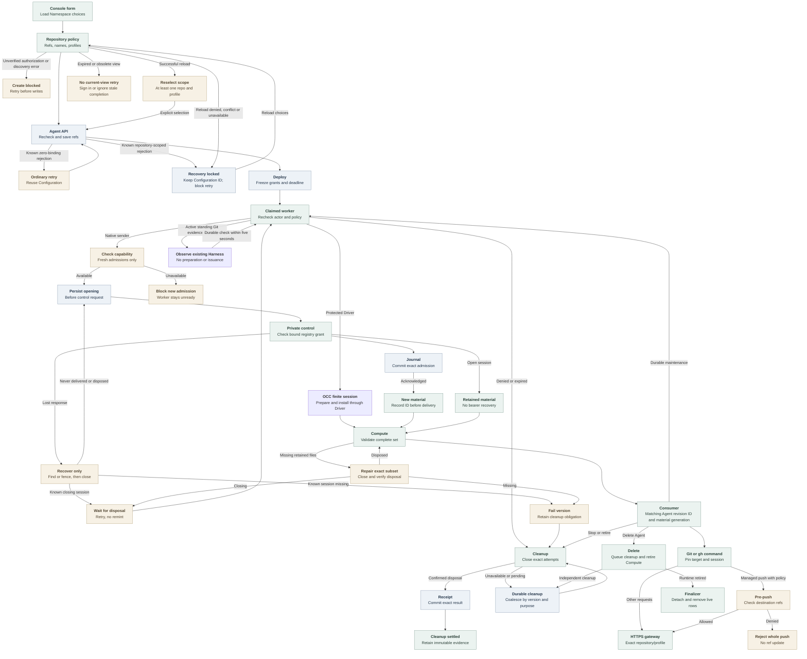

# Agent repository credential flow

## Overview

Dedicated Codex uses prepared sessions without a Sandbox Driver;
[OpenShell sandboxes](../reference/repository-credentials/protected-openshell-git.md) receive placeholders.
Workers deliver credentials and check signed requests against live grants.
See [enrollment and mandatory hooks](../guides/repository-credentials/openshell-enrollment.md),
[service forwarding and retirement](repository-credentials.md) and [runtime qualification](../testing/repository-credentials.md).

## Entry Points

- `apps/controller/src/index.ts:createFastifyApp` registers repository-option and Agent lifecycle routes.
- `apps/controller/src/console/agents/repositories.mts:createRepositoryFields`
  renders discovery and inherited or custom access.
- `apps/controller/src/worker.ts:ControllerWorker.prepareRevision` prepares
  repository sessions before invoking Compute.

## Flow

## Execution Trace

### 1. Project choices and resolve Namespace policy during Agent admission

`listRepositoryOptions` checks Namespace create or exact Agent update permission
and Compute availability. Bundled listing uses the bound GitHub catalog;
programmatic listing uses the registered Repo Driver. Stale owner results are
rejected. Deploy checks the exact Harness. An empty Namespace catalog yields `[]`;
absent `repository` adds `meta.notConfigured`. Closed Namespaces conflict.
Classified discovery failures return `503 REPOSITORY_OPTIONS_UNAVAILABLE`.

`createRepositoryFields` searches up to 1,000 choices with 16 attachments.
`repositorySettings` requires the bound Installation policy for explicit and
inherited saves, refusing mismatches. Without that binding it uses the registered
Repo Driver. The database checks bindings. Only fresh, empty drafts tolerate a
classified outage. The catalog omits sender metadata, credentials and provider descriptions.

Save Configuration first; reuse it after known Agent rejections.
Repository retries require reload and nonempty reselection. Failed reloads block
creation; ignore stale results. After unknown outcomes, read stored Agent and Configuration.

Requests carry distinct opaque refs and optional profiles, never tokens or grant IDs.
Nonempty selections without a configured Repo Driver return `409 RESOURCE_CONFLICT`.
OCC saves normalized selections in request order. GitHub’s registry defaults legacy profiles to
`git-write` without GitHub or control-socket calls.

`apps/controller/src/drivers/repo/github/credentials/registry.ts:resolveGitHubRepositoryBinding`
requires an exact Namespace/ref/profile. The fingerprint binds provider, App,
installation, repository, duration, full Namespace profile policy, exact permissions
and optional normalized push-ref allowlist. One grant per binding; installations
can supply several repositories. Omitted updates preserve selections; `[]` clears them.

### 2. Freeze a deployable version

`apps/controller/src/composition/installation-config.ts:loadInstallationConfiguration`
selects the Backend's GitHub policy with a registry-matched Backend ID.
`packages/occ/src/index.ts:OpenClawController.forInstallation` binds that owner
and rejects missing or mismatched repository ownership.
Startup rejects `drivers.repo` in every mode before worker or attempt creation.

OpenShell parsing and chart constraints belong to
`apps/controller/src/drivers/egress-proxy/openshell-configuration.ts`.

Bundled deploy calls `resolveBindings` in `OpenClawController.admitRepositoryCredentials`;
a deselected policy fails. Programmatic controllers call `RepositoryPolicyDriver.resolve`.
OCC checks Compute topology and freezes Driver identity, grants and an absolute
deadline that renewal and recovery cannot extend. `validateRepositoryBrokerNetworkProxy`
refuses Codex proxy settings that block the broker.

Deploy resolves through the current Repo Driver again after reading standing
approval. Denial or a changed binding or scope blocks revision creation.

Protected `repository.preparedGitHub` uses the installed Sandbox/Credential Proxy
Driver. Finite sessions need no native sender, control socket, broker CA or
session files.

`repository.nativeSender` selects `GitHubNativeRepositorySender` for native
GitHub custody. It owns sessions and files without an App key. Drain accepted
work on its original owner before cutover. Cleanup uses recorded identity
without resolving policy or restoring authority. The worker's prepared provider
issues and holds credentials.

### 3. Record ownership before opening a session

`apps/controller/src/worker/repository-credentials.ts:RepositoryCredentialLifecycle.prepare`
rechecks actor, Namespace, Agent, revision, Driver, grant and deadline.
`GitHubNativeRepositorySender.checkAdmissionReady` checks broker capability with a
two-second timeout. Failure blocks fresh admission, not recovery or cleanup. Each fresh
OPEN carries `preparedOnly: true`: an old parser rejects it after socket replacement,
and current control requires a prepared backend.
Under the live claim and Namespace/Agent locks, State records immutable cleanup
context before calling the Driver. Stopped or deleting owners are rejected.
State stores identifiers and phases, never bearers or files.

`apps/controller/src/backends/repository-credentials/control-client.ts:UnixRepositoryCredentialControlClient`
sends the bound request over the private socket.
`apps/controller/src/drivers/repo/github/credentials/warm-registry-factory.ts:createPreparedGitHubRegistryFactory`
resolves and compares its grant. The client validates status: `DISPOSED` permits historical
revoked/expired counts, but no outstanding obligations. Only a created response contains a bearer.
`apps/controller/src/drivers/repo/github/credentials/client/config.ts:encodeRepositoryCredentialSessionFiles`
encodes files; the worker records the session ID before passing them to Compute.

Confirmed open sessions yield `retained` bindings without files. `recoverOnly` finds or
fences unfinished admissions and closes recovered sessions. Fresh material requires
confirmed disposal or a missing opening without a recorded session ID. Invalidated known
sessions block replacement. Closing raises `REPOSITORY_CLEANUP_PENDING`, subject to Work
bounds and the revision deadline. Cleanup uses the configured interval while any session
closes. Otherwise, an unsettled obligation retains its code and retries at `age / 40`,
bounded by the configured interval and ten minutes.
`apps/controller/src/worker.ts:processRepositoryCleanup` logs
`worker.repository-cleanup-warning` with `cause` once per worker.

`apps/controller/src/drivers/repo/credentials/control.ts:createControlAdmission`
reserves before release.
`apps/controller/src/backends/repository-credentials/receipt-store.ts:RepositoryReceiptStore`
retains fences and original-broker disposal evidence after pruning.
Transport failure cannot establish absence. `preparedOnly` requires protocol 3;
unmarked v1 requests can recover and close original IDs but cannot reserve.
`RepositoryCredentialLifecycle.verifyRelease` and
`apps/controller/src/drivers/repo/github/credentials/prepared-repository-git.ts:sessionQuery`
require protocol 3 for native release and material selection.
Protected sessions use protocol 2. Selection checks policy-reduction version 2
against execution admission v7, the exact installed plan, recipient, standing
approval and session lifetime.

`apps/controller/src/drivers/repo/credentials/protected-repository-git-installation.ts:selectedRepositoryGrantSql`
shares per-member selection, Driver and expiry checks between production and
withdrawal. Frozen identities reject session replacement. Transaction locks remain.

### 4. Deliver and retain one complete runtime generation

`apps/controller/src/drivers/compute/kubernetes/repository-material.ts:repositoryMaterialSpec`
validates `new | retained` bindings against the version and hashes sorted
reference/session pairs.
`apps/controller/src/drivers/compute/kubernetes/repository-material-store.ts:RepositoryMaterialStore.prepare`
validates ownership, contents and deadlines before creating immutable Agent/version-owned
Secrets. It rechecks deadlines after requests and before creation or return; expiry
leaves Secrets for owned cleanup. For missing retained bindings,
`RepositoryCredentialLifecycle.repair` closes that subset, requires disposal and
retries Compute once. Missing inventory fails; pending closure blocks replacement
until disposal is confirmed.

`apps/controller/src/drivers/compute/kubernetes/repository-material.ts:repositoryMaterialDeployment`
mounts Secrets only in the first initializer. Sorted projections prevent key-order rollouts;
session replacement still rolls.
`apps/controller/src/drivers/compute/kubernetes/repository-material-init.ts:REPOSITORY_MATERIAL_INIT_ENTRYPOINT`
validates the complete projection, then writes mode-0700 directories and
mode-0600 files in memory. `REPOSITORY_NATIVE_GIT_INIT_ENTRYPOINT` mounts the
private subPath at `/run/oce/repository-credentials`, avoiding the fsGroup-writable root. It calls
`apps/controller/src/drivers/repo/github/credentials/client/native-git.ts:prepareNativeGitConfiguration`
with private-file checks. Retry removes only a validated private `gitconfig`.
Both gate startup; the consumer mount is read-only. Metadata and gateway
bearers remain separate.

`apps/controller/src/drivers/compute/kubernetes/index.ts:KubernetesComputeDriver.activateRevision`
replaces consumers whenever material changes, including within a version. Readiness requires
role, version, generation and current deadlines. Dedicated replacement preserves enrollment
and version-private storage.
`KubernetesComputeDriver.prepareRevision` rechecks material after plugin,
gateway and node observations; generation changes, lost readiness or expiry return incomplete.
Activation rechecks deadlines after observation.
Dedicated gateways lack repository material and repository-gateway egress.
Both consumers trust CAs through `SSL_CERT_FILE`, `GIT_SSL_CAINFO` and
`NODE_EXTRA_CA_CERTS`; overrides fail.
Compute grants consumer egress; Helm admits consumers through
[credential-sidecar ingress selectors](../reference/drivers/kubernetes-compute/networking-and-isolation.md#networking).
For [prepared native Git](../reference/repository-credentials/prepared-native-git.md),
`apps/controller/src/drivers/compute/kubernetes/repository-compute-ingress.ts:reconcilePreparedRepositoryIngress`
requires the peer’s hostname, TLS port and worker selector to match the broker
Service recorded by Helm. Native preparation writes `gitconfig` without reading
bearers. System Git includes `/run/oce/repository-credentials/gitconfig` and
preserves global settings.
Embedded `repositoryNativeConfiguration` keeps the `gh` router first in
`tools.exec.pathPrepend`. `AGENT_RUNTIME_ENTRYPOINT` sets Codex's
`allow_login_shell=false` and `shell_environment_policy.set.PATH`, and keeps the Pod's
`NODE_EXTRA_CA_CERTS` for sandboxed commands. Model authentication persists.
App keys, JWTs, installation tokens and the control socket never enter consumer material.
The [networking contract](../reference/drivers/kubernetes-compute/networking-and-isolation.md#networking)
defines Codex plugin and repository-bound filesystem and proxy access, explicit denies,
and dedicated/embedded eligibility. Unbound policy, broker authorization and TLS
verification stay in force. Codex verifies the named network profile on thread start, resume, fork and turns.

### 5. Authenticate native Git and route GitHub CLI commands

Stock Git retains commands, remotes, settings and hooks. Configuration rewrites
canonical HTTPS hosts to their gateway origin. The helper checks host/path,
generation and deadline before supplying a bearer. `OCE_REPOSITORY_REF` selects
bindings, not destinations. There is no whole-command preflight or egress confinement.
See the [routing limits](../reference/repository-credentials.md#client-routing-and-limits).
`pushRefAllowlist` selects image-owned hooks.
`scripts/build-repository-credentials.ts:stage` emits Node launchers that resolve the
dispatcher from their module URL, supporting symlink chains and package relocation.
`apps/controller/src/drivers/repo/github/credentials/client/hook-dispatch.ts:checkPush`
rejects disallowed destination refs before updates; discovery may contact the service. It delegates arguments and input to common-directory hooks.
Custom hook paths and API writes remain outside this
[guardrail](../reference/repository-credentials/push-ref-guardrail.md).

`apps/controller/src/drivers/repo/github/credentials/client/router.ts:routeRepositoryClient`
routes supported `gh` using explicit targets or effective Git remotes. It pins generation,
reference and session, selects private configuration and preserves HOME and shared selection.

OpenShell's
`apps/controller/src/drivers/egress-proxy/openshell-online-git-authority.ts:requestHead`
validates [CLI metadata](../reference/repository-credentials/protected-openshell-git.md#use-the-admitted-repository);
cache hints never replace authorization.
`apps/controller/src/drivers/egress-proxy/openshell-online-git-authority.ts:validBinding`
uses `normalizePushRefAllowlist` for Git-only policies, including terminal `/*`
patterns. Draft-pull heads remain concrete refs. Receive-pack rejects any disallowed
destination before durable approval. See
[access levels](../reference/repository-credentials/access-levels.md).

The [service exchange flow](repository-credentials.md#4-reserve-acquire-and-dispatch)
enforces bearer, immutable repository/profile, capacity and deadlines, acquiring
fresh installation tokens under the same grant until the version deadline.

### 6. Maintain, recover and retire ownership

The [worker](../../apps/controller/src/worker.mjs) supplies `ProtectedRepositoryGitAuthority`
to the [binder](../../apps/controller/src/composition/repository-credentials/transport.ts), owning maintenance and shutdown.
Missing authority or mismatched Drivers prevent binding. OpenShell connects the store first;
bare Sandboxes have no Git.

External `reconcile` runs serially with a 25-second timeout and one-second interval.
Close aborts and joins. Readback settles delivery without reinstalling or restoring withdrawn access.

[The gRPC client](../../apps/controller/src/drivers/sandbox/openshell-gateway-client.ts)
defaults omitted endpoint/credential lists to empty arrays after checking profile identity.
[Withdrawal checks](../../apps/controller/src/drivers/egress-proxy/openshell-git-installation.ts)
accept files-only profiles; Git-overlapping, missing and mismatched profiles remain refused.

Activation and maintenance use the same actor. Maintenance uses 30 seconds,
the sender interval or a shorter Compute interval. Restart invalidates missing sessions without
reminting; cleanup permits deployment.
[Prepared custody](../../apps/controller/src/drivers/repo/github/credentials/prepared-postgres.ts)
erases standing tokens after verified expiry plus skew; uncertain revocations remain unresolved.

[Preview, save and deploy](../../packages/occ/src/index.ts) require standing permission and current scope.
The [worker](../../apps/controller/src/worker/repository-credentials.ts) uses Installation policy,
or the registered Repo Driver when unbound; contradictory selection prevents startup.
[Eligibility](../../packages/occ/src/repository-approval.ts) is rechecked under Namespace then Agent locks.
Withdrawal or scope changes raise `REPOSITORY_STANDING_POLICY_CHANGED` before successor release.
The [GitHub registry](../../apps/controller/src/drivers/repo/github/credentials/registry.ts)
fingerprints canonical permissions and exact repository identity for `github-repository`.
Issuance and delivery recheck opt-ins and the exact grant before selecting material;
standing delivery requires one binding.
After mandatory-hook acknowledgement, the [OpenShell observer](../../apps/controller/src/drivers/egress-proxy/openshell-git-installation.ts)
rechecks expired predecessor policy and recipient for renewal, never authorizing expired
requests, unacknowledged launches or observed-only previews.

Prepared native Git issues its first token after activation. Deployment runs
`apps/controller/src/worker.ts:ControllerWorker.assertRepositoryGitMaterial`
(`PreparedRepositoryGitStore.revisionMaterial`) and waits at `REPOSITORY_GIT_MATERIAL_PENDING`
until each open session has a committed token and fails with `REPOSITORY_GIT_TOKEN_QUARANTINED`
when an attempt is quarantined. For an existing Agent (`activatedEarlierRevision`),
`continueRevisionWithoutGit` fails the deployment with `continuingRevision` and queues maintenance
in one transaction under Namespace then Agent locks, so the version keeps running. A token still
pending at the convergence deadline takes the same path with `REPOSITORY_GIT_TOKEN_PENDING`;
maintenance accepts only these two failure codes. Otherwise the
version is retired like any failed repository version
([reference](../reference/repository-credentials/prepared-native-git.md#deployment-and-the-first-token)).

Without standing evidence, Git stays closed. The worker observes the Harness without preparation
or activation, rechecking model authority, withdrawal, stop and replacement within five seconds.
Harness readiness cannot authorize Git ([test](../../tests/integration/postgres-standing-session-worker.test.ts)).

`apps/controller/src/worker.ts:ControllerWorker.processRepositoryCleanup` consumes
owner-bound Work without admission or material delivery. Terminal-runtime Work fences
attempts, closes sessions and calls `stopRevision` for the original version, preserving
its replacement. Compute mismatch or stop failure remains retryable beyond foreground
limits. Completion requires session disposal and runtime retirement; `CLOSED`, missing
inventory and invalidation do not prove disposal. Retained attempts survive version deletion.

`ControllerWorker.withdrawExpiredRepositoryAccess` retires the original version for IAM
refusal, confirmed actor or Agent-principal absence, required model-source withdrawal,
or unsupported Git withdrawal. Model withdrawal precedes Gateway readiness.
Failed reads stay pending unless independent facts prove authority loss. Optional withdrawals
cannot justify retirement. Maintenance recovers exhausted original and companion source work
through `recoverPendingCredentialWithdrawals`, preserving outstanding work and manual-replay
holds. The v7 reducer observes stored operations without reapplying.
See [tests](../../tests/integration/postgres-standing-expiry-authority.test.ts).

`ControllerWorker.processAgentDeletion` retires Compute and queues version-keyed cleanup
without waiting for sessions. Under the claim, `PostgresWorkQueue.completeAgentDeletion`
calls `occ.finalize_agent_deletion` to atomically detach attempts, delete live rows and audit.
Attempts and cleanup survive. Unresolved provisioning effects defer completion without consuming retries.

Compute retirement waits for owned Pods to stop before removing material. It preserves Secrets
referenced by Pods and current Deployments, and limits deletion to exact ownership with UID
preconditions. Stop removes only the stopped version's route and preserves newer shared
resources. Route and Deployment deletion require the observed resourceVersion. Shared cleanup
remains retryable after partial failure; service restart cannot prove remote token revocation.

## Debugging and Verification

Check `activeRevisionId` with `occ agent get AGENT_ID --output json`. Inspect
`REPOSITORY_BINDING_CHANGED`, `REPOSITORY_CREDENTIAL_DEADLINE_EXCEEDED`,
`REPOSITORY_SESSION_RECOVERY_UNSAFE`, `REPOSITORY_GIT_TOKEN_QUARANTINED`, `REPOSITORY_GIT_TOKEN_PENDING`, `REPOSITORY_CLEANUP_PENDING` or
`REPOSITORY_CLEANUP_COMPLETE`. Check registry identity and deadline before retry.
Pending cleanup logs `worker.repository-cleanup-warning` and `cause` once.

`repository-not-admitted` means an unselected target; `name-one-repository-target`
or `name-one-repository-ref` requires explicit selection. Inspect metadata
and Pod generation without printing credentials.

The [test guide](../testing/repository-credentials.md) separates lifecycle, installed-runtime
and live-provider proof. [Docker/Helm checks](../testing/docker.md#repository-runtime-volume-test-environment)
exclude CNI; console fixtures exclude model, Slack and GitHub execution. Driver tests cover
local PR pushes and same-revision Codex turns across withdrawal. Verify real Agent PR updates,
denial before provider contact, and continued chat on the team installation.

## Related docs

- [Repository credential reference](../reference/repository-credentials.md)
- [Install repository access](../guides/repository-credentials/installation.md)
- [Create and use a repository Agent](../guides/repository-credentials.md)
- [Controller worker lifecycle](controller-worker.md)
- [Credential service execution](repository-credentials.md)

## Manual Notes

[keep this for the user to add notes. do not change between edits]

## Changelog

- 2026-11-05 15:33: Document profile wire defaults. (authoring-run/6cd890b4-603a-482b-85a1-f9f601ae5c3c - 821ce63ee1)
- 2026-11-05 14:57: Bind selected-repository standing approval to exact permissions and recheck delivery. (authoring-run/97c319f2-8bb0-4db4-9cfb-50478db52fdb - a383313636fc348a2325c0b1f6e05ae80327fd30)

- 2026-11-05 13:46: Admit CLI cache hints without caching authorization. (authoring-run/1247283d-6d2a-4d1f-9804-287f1ae13518 - a825988313)

- 2026-11-05 11:46: Document OpenShell configuration ownership. (authoring-run/507ebdda-c10f-4840-acd7-1667d5919fab - f960b469e2c6dfb6653fd72ba1c1a39b97a9bcf0)

- 2026-11-05 11:20: Trace the selected repository policy in Worker validation. (authoring-run/69db70f5-508f-488f-9329-f7df994260ec - 66bc76b266fe0ba0e35498bbe6d7abe2e74ac0e5)

- 2026-11-05 01:05: Trace Git-only branch-pattern authorization. (authoring-run/f65a98dd-79e1-45e2-a740-b7e73c1d9dd3 - dde29ac47a)

- 2026-11-04 07:04: Trace symlink-safe native Git hook launchers. (authoring-run/e75a374f-d42f-4f95-bbfc-4e708fcaa195 - e122eaced28cdaff6cbf9d78e0fab4d038f9c380)

- 2026-11-03 16:24: Document bound repository admission. (authoring-run/91f06442-80cf-47b7-9473-cc87a5256fc7 - 47a126079e6037a1ad1d27db1b514fde1cde345c)

- 2026-10-30 15:01: Reuse validated policy owner identity. (authoring-run/58b286d1-0e1a-4666-b77e-e8da815c7d88 - 5b20ec5b1501bf1c6c2254ec36d9dc1e0e0bd730)

- 2026-10-30 03:58: Load the native repository transport only for explicit native delivery. (authoring-run/43b61103-4082-4fc2-b9a0-511a18ebc761 - 87ed6c37e543e5501eae6285450d01d03d8abe7d)

- 2026-10-30 02:21: Admit CLI metadata. (authoring-run/086003c3-b067-490a-b33b-8083e88519bd - 35f44276ed5cdcb69b5fd707b085fd59b06009dd)

- 2026-10-29 23:23: Share selected-repository grant projection. (authoring-run/033567f0-1b76-4fba-83a3-d83d36dae4bd - a198a93e81cc88f7ba83edc4de7a949a43b19e17)

- 2026-10-29 21:00: Keep an existing Agent's new version running when its first GitHub token is still pending at the convergence deadline (`REPOSITORY_GIT_TOKEN_PENDING`). (finding 2894)

[Earlier changes](agent-repository-credentials/history.md)
