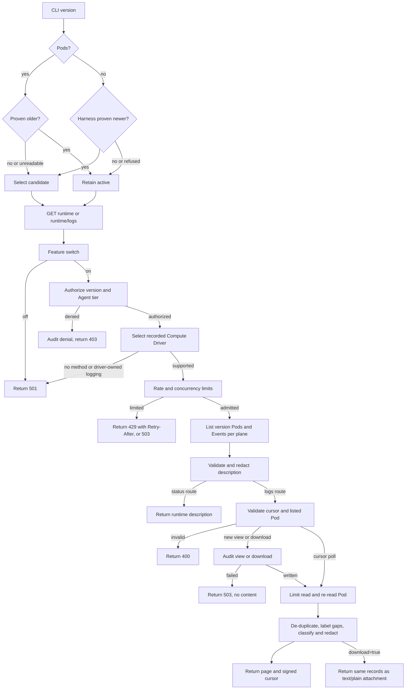

# Agent runtime logs flow

## Overview

Authorized reads return redacted, size-limited Compute records; downloads stay local.

## Entry Points

- `GET /namespaces/:namespaceId/agents/:agentId/deployments/:deploymentId/runtime`
  and `GET .../runtime/logs` (`download=true` for attachments) from Console,
  `occ agent runtime|logs` (`internal/occcli/agent_runtime.go`) or API. See
  [CLI reference](../reference/cli.md#runtime-status-and-logs).
- Source: `apps/controller/src/index.ts:createFastifyApp`,
  `packages/occ/src/agent-runtime-observations.ts:AgentRuntimeObservations.describeAgentRuntime` and
  `readAgentRuntimeLogs`, `packages/occ/src/runtime-logs/`, and
  `apps/controller/src/drivers/compute/kubernetes/index.ts:KubernetesComputeDriver.describeAgentRuntime`
  and `readAgentRuntimeLogs`.
- `deploymentId` identifies the Agent's saved version. Grants:
  [runtime log reads](../reference/security.md#console-and-api-runtime-log-reads);
  `authorizeRuntimeLogRead` checks `read_logs` first.

## Flow

## Execution Trace

### 1. Admit and authorize

`internal/occcli/cli.go:validateOptions` checks explicit `--output` before
requests; default: `text`.

`internal/occcli/agent_runtime.go:agentRevision` honors `--revision`; otherwise
`newerRevisionWithRuntime` reuses status, excludes Pods proven older by
`Client.GetAgentRevision`, and requires Harness-only candidates to be proven newer.

`packages/contracts/src/api/routes.ts:occApiRoutes` declares closed GET query schemas.
`apps/controller/src/index.ts:perform` returns `501` for disabled `agentRuntimeLogs`.
`AgentRuntimeObservations.describeAgentRuntime` checks revision `read` and Agent
`operate`. `readAgentRuntimeLogs` checks the caller's log grant on the Agent.
Both require Agent `read`, resolve the exact revision, and reject unavailable
Compute or Driver-owned logging.
`apps/controller/src/http/runtime-logs.ts:RuntimeLogLimiter` admits reads;
audited denials spend no token; buckets ignore clock changes.
Disconnects abort the handler signal, including before Driver I/O if identity lookup outlives the connection.

### 2. Describe the runtime

`KubernetesComputeDriver.describeAgentRuntime` lists owned-Namespace Pods by
Agent, Agent revision ID, and role labels. Single-cluster profiles read both roles in the tenant namespace;
two-cluster profiles read Gateways from control and Harnesses from execution. Termination and cluster `403` reporting:
[Compute reference](../reference/drivers/compute.md#optional-runtime-status-and-logs). Event reads keep the Pod's 100 newest eligible Events across pages,
drop settled `FailedScheduling` PVC retries, and derive `container` from
`involvedObject.fieldPath` (`null` for Pod Events). Log reads pass
`{ source, events: false }`. Kubernetes calls have five-second deadlines. `runtime-logs/description.ts:validRuntimeDescription`
checks names, UIDs, counts and RFC 3339 UTC timestamps. Malformed, impossible, or offset timestamps, including Pod and Event times,
make status unavailable; they are never normalized.
`runtime-logs/redact.ts:maskRuntimeEventText` masks node, image and Secret names;
reasons and Event messages are redacted.

### 3. Read one page

`runtime-logs/read.ts:readRuntimeLogPage` verifies the cursor HMAC against principal,
Agent, version and source (`runtime-logs/cursor.ts`). Select a listed Pod and main or
init `container`. Views identify source, Pod name, container, and current or previous logs.
A missing or expired cursor (one hour), changed selection, or selecting another Pod
after departure starts a new view. OCC audits it as `openclaw.agents.runtime_logs.view` before
the Driver read. Change sources without a cursor; another source's cursor is invalid.
UID or restart-count changes within a selection preserve its view ID without another audit.
The Driver rechecks
Pod ownership and container, then calls `readNamespacedPodLog`
with `tailLines`, `sinceSeconds`, `previous`, 1 MiB `limitBytes`, and timestamps. After this name-addressed read, Kubernetes Compute requires a fresh revision-owned
Pod, UID, declared container, and observed restart count. Missing identity fails
without content; changed UID or restart count discards fetched lines. OCC rejects
invalid stream metadata or a different Pod name or container. A valid changed
instance returns a `stream_replaced` gap without lines; unchanged lines continue. A never-started container's exact kubelet `400` waiting-to-start Status
(`PodInitializing`, `ContainerCreating`) yields an empty page. Reading logs first
prevents stale status from hiding output; other failures keep their mapping.
`kubernetesRuntimeLogLine` separates kubelet's RFC3339 timestamp from each raw
line and converts numeric offsets to UTC while retaining every fractional digit.
Unknown or malformed offset prefixes remain untimed raw text. After discarding a replacement
read, polls reuse the requested relative duration or omit it until the first identity-verified read.
A verified empty read resumes quiet polling from its start. Ordinary polls derive
`sinceSeconds` from the newest delivered timestamp or, if none exists, the previous read start (a full or byte-cut tail emits `window_exceeded`). If a line exceeding 1 MiB stalls every poll and is over about 3 seconds old,
the cursor resumes from the current read; `window_exceeded` dates the lost interval. A carried PEM block loses its time boundary and remains masked; earlier lines are dropped.
Cursors are signed, not encrypted; keyed line/window hashes prevent testing masked
values. Verified `v1` cursors expire into new audited views.
The frontier stores `frontierComplete`, `frontierCount`, and 16 recent hashes.
Positional de-duplication requires completeness, the group's first line (proved by
an earlier timestamp or short uncut page), ordered valid times, and matching suffix
hashes. Skipping `frontierCount` preserves groups over 16. Hash fallback consumes
matches and invalidates the count on delivery there. New hashes require complete
history; extra identical occurrences also require frontier completeness.

Completeness requires an ordered consumed prefix after the earliest fetched time
or a short uncut Driver page; it persists at unchanged time. Otherwise matching-time
text stays suppressed and the advancing page reports `window_exceeded` there. Larger
cut tails must not reveal old occurrences as new. Infer legacy counts only below 16
hashes; byte cuts preserve complete-frontier counts.
It emits `stream_replaced`, `window_exceeded`, `cursor_expired`, or `truncated` gaps and passes remaining lines to
`runtime-logs/sanitize.ts:sanitizeRuntimeLogChunk`, the only producer of
`SanitizedRuntimeLogRecord`. `page-budget.ts` measures serialized pages,
signed cursors and the HTTP envelope against 512 KiB. Oversized pages shrink to a fitting, not necessarily maximal, prefix without I/O
or audits. Fetched masking/withholding persist; state advances through delivered rows. Rows aging out before the first safe read may be missed.

Signed `pemOpen`/`pemAfterTime` describe delivered boundaries, never fetched overlap.
Order is validated through the last delivered line against the prior cursor's
reliable boundary, not earlier same-page lines. Only a strictly newer line can
close a carried block; ordered same-page BEGIN and END at the same newer time can close it. Times at or before the prior frontier and evicted hashes cannot prove progress;
replay cannot erase a carried later BEGIN. Non-PEM text remains visible while
ambiguous context stays open.

Missing, invalid, or reordered times make the frontier uncertain (`null`); later
timestamped pages alone cannot repair it. Empty polls preserve it; undelivered lines
beyond page or byte cuts cannot advance it. New views, expiry, instance/Pod changes,
or mid-read replacement discard context.
Both fields share the cursor MAC; malformed or inconsistent pairs fail as
`cursor_invalid` before Driver I/O. Legacy
cursors and initial tails without observed PEM boundaries remain unknown and
best-effort.

`source=sandbox` skips Compute description. `OpenClawController.readSandboxLogs`
requires the provisioning Sandbox Driver's `readSandboxLogs`, obtains Compute placement
through `resolveSandboxNamespace`, and runs `runtime-logs/sandbox.ts:readSandboxLogPage`.
`OpenShellSandboxDriver.readSandboxLogs` derives the Sandbox name from the version
and calls only `GetSandboxLogs` through `openShellSandboxLogReader`. Impossible
`since_time` dates fail before gRPC. OpenShell batches and filters timestamped
supervisor lines. Resume overlaps `SANDBOX_LOG_OVERLAP_MS` and consumes delivered
hashes on reread ([limits](../guides/topics/agent-logs.md#sandbox-source)).
First pages retain the requested window start.

Signed checkpoints retain prefix digest/count, query floor, and baseline; container
overlap is 2 seconds. Timed windows resume progress; changed tails or ambiguous
replacements reset with gaps. Sandbox pins short/unordered windows, untimed rows,
and overflowing groups. Full timed groups use counted overlap; cuts retain a rollover
witness. Uncertain context resets with a gap and replay. Container recovery gaps once,
unless a short uncut window precedes the delivered frontier. All-untimed byte cuts
retain progress; mixed cuts advance through time with a reset that may replay untimed
rows. Matching checkpoints retain positional proof; stable windows drain overflowing
groups. UID/restarts reset progress; PEM recovery keeps masking. Identical replacements
are unobservable; full checkpoints, missing anchors, or overflowing timestamp groups
report gaps. gRPC `NOT_FOUND` (absent Sandbox or concealed from a non-member) maps to
`RUNTIME_LOGS_SANDBOX_NOT_FOUND`, never an empty page. Lines naming two Sandbox IDs
are refused; a new ID emits `stream_replaced`. The OpenShell Driver adds decision
fields; OCC removes sensitive values. See [policy evidence](agent-sandbox-policy.md).

Downloads (`download=true`) force `tailLines=1000` and start a new view; `apps/controller/src/index.ts:auditAction`
names its audit event, and any denial, `openclaw.agents.runtime_logs.download`.

### 4. Return

`apps/controller/src/http/runtime-logs.ts:runtimeLogPageBody` and `runtimeLogDownloadBody`
reject reserved `content`. Container headers label `instance` without Pods. Console and `runtimeLogDownloadFileName`
take `-previous.log` from the request.
Console saves only HTTP 200 plain text; other successful formats show retry feedback
without saving, and JSON errors retain applicable guidance.
`runtimeLogPageAtLevel` filters after signing, preserving unknown levels, gaps and withheld counts.

`console/agents/logs.mts` clears output on source, Pod, or instance changes; only
readable replacements start fresh tails. Status denial preserves log access; cached
`403` prevents repeat denials. Unreadable versions and denied status reads stop status
polling. Polls and tab refocus reread only the Agent (3000, 3005, 3010).
Without a running Pod, `detail.mts:runningVersion` links another running version's
Logs. Running Agents without selected versions poll revision lists for newer deployment
failures at most once per minute while state is unchanged; unchanged lists preserve
the chooser. Newer Agent state, including Stop, invalidates outstanding rereads (2998).

`deployment-recovery.mts:show` repeats recovery failure without its code until
deployment succeeds. For unreadable versions, `detail.mts:servingChange` reports
requested stops or removal from service selection in place (3012). Follow preserves
rows and unchanged statuses; its first line replaces empty-tail status. Refresh
prepares and validates all rows before replacing output. Failed reads or preparation
retain rows and cursor, report the error, and append nothing. Selection changes or
lost log access clear output. Pod cards show state and exit; Gateway links Harness
output or Deployment activity.

`internal/occcli/agent_runtime_output.go:printRuntimeLogPage` compacts indented API
records into single NDJSON lines, preserving fields, string escapes, and number
representations. See the [CLI reference](../reference/cli.md#runtime-status-and-logs)
for flags, polling, and `Retry-After` (`internal/occclient/transport.go:apiError`).
Cursor polls retain initial `tailLines` and do not resend `sinceSeconds` or widen
the tail. Cancellation succeeds only for `runAgentLogs --follow`.

Without an active revision, a failed fallback notice stops `agentRevision` before
status or log reads. `runAgentLogs` and `printRuntimeLogPage` return text-mode stderr
errors for no-Pod, gap, or withheld notices; `cmd/occ/main.go:main` exits nonzero.
After cancellation, `main` restores default signal handling: another Ctrl-C or
`SIGTERM` can terminate blocked local I/O or cleanup without guaranteeing cleanup.

Driver failures use fixed `RUNTIME_LOGS_*` codes; requests have ten-second deadlines.

## Debugging and Verification

- `go test ./internal/occcli -run '^TestResourceRequestStopsWhenCommandContextIsCanceled$'`
  proves loopback CLI cancellation, not deployed OCC behavior.

- `503 RUNTIME_LOGS_CLUSTER_RBAC`: API ServiceAccount lacks namespace
  `pods/log`, `events` or execution-cluster `pods` reads.
- Verify content and cursors with `runtime-logs-content.test.ts`, HTTP pages and downloads with
  `runtime-logs-container-wire.test.ts`, and authorization with `occ-runtime-logs-security.test.ts`.
  `kubernetes-runtime-logs.test.ts` uses Kubernetes API fixtures. Sandbox tests use protocol fixtures.

## Related docs

- [Agent logs guide](../guides/topics/agent-logs.md)
- [Console and API runtime log reads](../reference/security.md#console-and-api-runtime-log-reads)
- [Compute Driver runtime status and logs](../reference/drivers/compute.md#optional-runtime-status-and-logs)

## Manual Notes

[keep this for the user to add notes. do not change between edits]

## Changelog

- 2026-11-22 11:17: Withhold container log bytes when post-read workload identity is missing or changed. (authoring-run/9d322b49-797c-4910-bda7-a75a0eaba70a - effdc1086231ba457bf519cb2bf45e07e840d17f)

- 2026-11-20 16:29: Update source pointers for runtime observation and fleet inventory. (authoring-run/c41017eb-dc85-4c43-90e8-3040fbace6ac - c6acc7271f7753f74d3657251f23a036c08e671c)

- 2026-11-15 10:15: Condense Console and CLI return descriptions. (authoring-run/bfa808f8-e7f0-4a19-ba6d-00a3972ac541 - 0c8d829040492a70031f4b4e3b1581945884c231)

- 2026-11-15 10:05: Keep CLI NDJSON records on one line in the accompanying serialization fix. (authoring-run/9146809c-6569-4bd2-9252-4aaed7391146 - c1ece768d5d104dfd26b66ed2afeae0b059adaf8)

- 2026-11-12 23:26: Honor disconnects. (authoring-run/424005d3-ef73-4fd2-82c5-0237e640ba5a - 0dc9387e2521098fa1648d47f6350f1fd52fb46f)

- 2026-11-10: CLI cursor polls keep the initial tailLines; timing stays cursor-owned.

- 2026-11-09 02:46: Propagate fallback notice errors. (authoring-run/f0458286-baf0-414b-845d-eb460e02a598 - 23136d13b45ab43688ea14e771971bfc66378edf)

- 2026-11-08 03:13: Document CLI exits on text notice write errors. (authoring-run/8719abbf-9776-4ebb-970d-9575222fe52b - 143419c5a957dfacc399e72fccceeb9f3ebfa403)

- 2026-11-04 22:52: Restore signal termination after initial CLI cancellation. (PR #4640 - f9c0fb4398a33099bdbeec7a83d18b99b0861933)

- 2026-11-04 18:33: Keep loaded Console output when a log page cannot be prepared. (authoring-run/dcd46e24-f282-428e-8b71-91a98d9290a6 - d59eff6dc3b51e87eac86bb47eb4df3fd55846bb)

- 2026-10-31 18:30: Mask values after literal escapes and percent-encoded separators. (3053, 3055)
- 2026-10-31 17:30: Mask values after spacing controls and quoted keys. (3051, 3052)
- 2026-10-31 16:00: Show a line break inside a message as one space, not joined words. (3048)
- 2026-10-30 21:30: Say a stop in Logs of an unreadable version; keep the view in place. (3012)
- 2026-10-30 20:30: Reread the Agent in Logs after a fresh status refusal. (3010)
- 2026-10-30 20:00: Reread the Agent in Logs whose status denial is remembered. (3005)
- 2026-10-30 18:15: Reread the Agent on refocus and in Logs of an unreadable version. (3000)
- 2026-10-30 17:20: Drop a Logs serving reread that a newer Agent state overtook (2998). (bughunt-1030h - 93acaf8ac6)
- 2026-10-30: Repeat a failed deployment's line in the Logs view. (2993)
- 2026-10-30: Bound the version list reread; show a redeploy after a failed one. (2988)
- 2026-10-30 16:00: Show a newer deployment's failure when the Agent runs with no selected version. (fix-dogfood-r60)
- 2026-10-29 18:00: Skip status reads of unreadable versions. (D794)
- 2026-10-29: Report frontier lines that de-duplication withheld once time advances.

- 2026-10-26: Follow polls no longer rewrite loaded rows or unchanged statuses (port of #2502).

- 2026-10-24 13:19: Validate output. (authoring-run/3954aa04-12f8-4a8e-bb62-a4d9a8603edd - 1b59554add06e9f7be0b0a730202f558c939a661)

- 2026-10-19 09:48: Preserve main and policy traces; condense prose. (authoring-run/545665b0-3aef-44dc-beb8-492b753b1a13 - bc3ba215dd9927692bc2882ffaf06a35c27fed4a)

- 2026-10-17 22:06: Align log output with status-driven selection changes. (authoring-run/77795960-6a71-4c2d-95a7-3c0c0558e489 - ee93918670368e1f34ae39b7a5f32744d8fae78e)

- 2026-10-17 18:04: Use monotonic request-bucket time. (authoring-run/5775742a-69b2-4b9b-947e-198df50d9f40 - 4c15e69650b440b8b4bbd995bb61669f69d1d049)

- 2026-10-16 19:09: Retain Pods unless proven older. (codex/01a10a81-070c-7aa3-97d0-fbce8f285d4d - 646709121b8ad092df151d16cd4ca6a6c523e34d)

- 2026-10-16 13:46: Require Pod candidate recency. (authoring-run/75d1c4b0-a13f-4188-9aec-3adb7fa43164 - 591feb34bdbaaf7f316607347a02f7335ee816c0)

- 2026-10-15 20:56: Label container exports. (authoring-run/5d925828-f306-4469-bedb-9c60bc9c6def - 7041b4c11a1bc9109fbb150beac2f8bc430474a6)

- 2026-10-15 22:11: Merge main; preserve both flows. (authoring-run/8e4e2c2d-907a-411c-96f0-f882c1118e6d - 20d9edc976cc)

- 2026-10-15 10:38: Verify Podless Harness recency; unknown ordering retains active. (authoring-run/7163351c-af75-410f-bd45-a2809e178c9e - c1a15e2e953c)

- 2026-10-15 09:08: Select newer provider Harness status before version Pods exist. (authoring-run/7163351c-af75-410f-bd45-a2809e178c9e - 422cb3fe407204d4add49ea8494f0fd0ce49be52)

- 2026-10-15 09:25: Honor HTTP-date Retry-After in CLI follow. (authoring-run/613fa018-dc4e-4c4d-b05b-f2f8f79e3244 - 422cb3fe407204d4add49ea8494f0fd0ce49be52)
- 2026-10-15 16:14: Move OpenShell decision parsing into its Driver; redact shared metadata. (authoring-run/43cb74b9-e1fe-4fc2-adde-9d932b061d7c - a28596ab8)

- 2026-10-13: Key cursor hashes; `v1` cursors expire. (#2274)

- 2026-10-12 11:55: Advertise and select actual main and init container streams with container-bound audit views. (authoring-run/adccd418-cf61-4fbb-b3ba-0fcad194d907 - 040e7498ecd89e0e565af71f234776ecfaad2186)

- 2026-10-11: Reject impossible OpenShell timestampMessage values before gRPC. (#2146)

- 2026-10-11 09:48: Refuse impossible or offset Kubernetes Pod and Event times. (fix-1096 - 839b0c90cb1c54d7ed70eb23229bd117f25278be)

- 2026-10-11 15:20: Reject malformed or impossible Compute Driver timestamps at the runtime-description boundary. (authoring-run/b5dc3ace-2767-4645-9b89-e30d18fa3184 - 2a1eae472d6a820a574cdbcb75dd7d31e3619a68)

- 2026-10-11 09:10: Reject sub-second runtime-log `--since` before any API request. (issue-2114 - 724b37bd1630f0b066bb2cbc23e3e965d172f9a7)

- 2026-10-11 08:15: Distinguish an omitted runtime-log `--since` from an explicit zero and refuse the latter before any API request. (issue-2109 - 731db98bbbc8e5296571e64130ac62482413520e)

- 2026-10-10 13:17: Resume partial groups; deduplicate gaps. (authoring-run/46f029c3-e915-4829-949b-638e0b2be118 - 59b9c9eec562e50df8e3cbe9669a2e6f697ba37d)

- 2026-10-10 09:27: Follow moving byte-cut windows. (authoring-run/8a9638ae-99ab-4dca-9759-92fe81e8d280 - 8741e9f5e2a915ac5c2dcb076479cc9e23d8c5cb)

- 2026-10-10 08:12: Retain overlap and Sandbox gaps. (authoring-run/e28bad2a-a77a-4033-aa7c-174ac006a870 - a2911f897dfdd9d748f8e65065da5196b7749eff)

- 2026-10-10 07:56: Preserve final-drain gaps. (authoring-run/9cfa5b3b-2ef8-4413-a9ec-458eb1ba7fdd - 5533e03c05db33fdec64574893190f8ec4096bb0)

- 2026-10-10 07:45: Advance mixed byte-cut windows. (authoring-run/8b207d82-4eff-4478-872a-80762052a959 - 42351dce1d1e1a4faf457edd87da96fa8d6169c4)

- 2026-10-10 07:44: Merge main; preserve histories. (authoring-run/19081d63-7696-4bb4-9fcd-1d6e0ffce0a0 - 3bfadece19cdbea1a23574549265953f9d0e54fc)

- 2026-10-10 07:32: Preserve untimed cut progress. (authoring-run/3dcf8b04-24bd-4739-ac19-fb70f6064952 - f9b208a0ac5e1e5118c2f8dcc9050c27ff23061c)

- 2026-10-10 07:17: Retain positional progress. (authoring-run/858ce292-681c-43ab-a4d3-0640d3380971 - a9176a61cf209915e2ccab3f862db9a2bc750754)

- 2026-10-10 05:09: Compact hashes and window tuples; retain legacy decoding. (authoring-run/377d6942-f5b9-4c5f-825c-cdfdfeea7501 - 95c76244bcc6f88989993a30730e63dc45b87f65)

- 2026-10-10 05:02: Unify Sandbox overlap baselines. (authoring-run/c8de19eb-fe81-4a26-b639-a0cb02360f23 - a0fd14ec40c2e5b8c66537e457ddd2d8202adc6e)

- 2026-10-10 04:37: Compose safety evidence with Events. (authoring-run/39d848cc-a298-48fd-9f82-c39b85089b94 - 8e5a06cec7f622185222a8a7dbafe3b0a7228d9f)

- 2026-10-10 04:19: Preserve masking evidence. (authoring-run/d983fb2c-0a98-43db-8690-ddb7f5b43f87 - 9222f0073c951203c5f959bc9382dbb13c605ee9)

- 2026-10-10 04:10: Preserve rounded and empty windows. (authoring-run/b4a36577-a96a-44f4-9600-41b94747c1c9 - d791a48aa0baacfef2dede241c6161ad9c82e89a)

- 2026-10-10 03:27: Keep recovery cursors valid and mark full Sandbox windows. (authoring-run/50fe6eec-f154-4d38-9cb5-8e755a82ded9 - dd55627538daa7b7ae43c431ab9db37ae878cc65)

- 2026-10-10 03:05: Drain Container cuts. (authoring-run/b68ecd62-c0d7-4fbf-82ee-0f440d8ae84c - 4e23a961fff52cb453a4114afc922278205d3fec)

- 2026-10-10 02:53: Fit termination status in response budgets. (authoring-run/2cbbcc37-919d-41ec-bdab-51aa836d92b7 - 880b645f5e5fb5c99c6046c1eac6ca81211be584)

- 2026-10-10 02:47: Keep untimed replacement progress. (authoring-run/fd5e728e-9e9f-42ea-8ab7-d389f82b973d - f4c9a1b36988d659f8f927825fda4cd838ae832a)

- 2026-10-10 02:43: Retain Sandbox cut progress; report changed snapshots. (authoring-run/2edda611-948b-44ae-a3d8-0a011073b719 - 5c7c56b49f16b80c4fcb91fedff0959a5fd733b0)

- 2026-10-10 01:14: Bound Container and Sandbox pages, cursors and API frame. (authoring-run/018d11d8-3699-4e97-945b-c2cfd3088412 - 243b38ba6d951240065e5061e1e4abccdb44410c)
- 2026-10-10 07:06: Merge main; preserve initial continuation, timestamps, Events, termination and histories. (authoring-run/b0c35eb4-2b87-4f3e-aec3-8c416cdef3bb - b744ee6f217d17942cdaacea80cbbd08126aa87f)

[Agent runtime logs documentation history](agent-runtime-logs/history.md) preserves the earlier dated entries.
