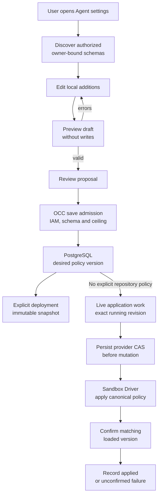

# Agent sandbox policy flow

## Overview

OCC saves Agent network additions, freezes them at deployment, and can apply
a later version through the Sandbox Driver. Denial logs and provider
recommendations inform review.

## Entry Points

- Trigger: the console Policy denials tab or `occ agent policy` commands.
- Source: `apps/controller/src/http/sandbox-policy.ts:sandboxPolicyHandlers` and
  `packages/occ/src/index.ts:updateAgentSandboxPolicy` / `applyAgentSandboxPolicy`.
- Assumptions: a ready Namespace, active Agent, exact grants, enabled editing for
  mutations, and an Installation ceiling shared by API and worker.

## Flow

The solid arrows trace source paths, not a claim that all providers are verified.

## Execution Trace

### 1. Admit and persist desired additions

The CLI policy commands print JSON or YAML through
`internal/occcli/output.go:printStructured`. `validateOptions` defaults to JSON
and rejects unsupported output formats before sending a request.

`OpenClawController.discoverConfigurations` filters contributions by Driver,
scope, and owner read permission. Discovery and GET return the same descriptor
with URLs for the available facet actions. See
[Installation inspection](driver-plugin-loading.md#4-load-current-policy-and-hand-off-lifecycle-ownership).

`loadInstallationConfiguration` validates the YAML
[repository ceiling](../reference/configuration.md). Agent and SandboxPolicy
read permission allow GET to return the saved grants, the Namespace's delegation
ceiling, and whether the state adapter can store explicit grants. The ceiling
includes only Installation grants the bound repository policy owner allows for
that Namespace. A write limit becomes read when the owner allows read alone.
An authorized PUT checks the same ceiling and stores valid grants with the next
policy version. An unsupported adapter refuses an explicit list with
`409 RESOURCE_CONFLICT`. An empty list saves deny-all. Omission keeps the saved
grants and leaves them out of the PUT response.

`validateAgentSandboxPolicy` checks authorization, editing, version, pending
application, the shared schema, ceiling and Driver admission without writing.
Empty or reversed port ranges fail admission. Mutations repeat these checks.
Refusals identify the field and cause, including a ceiling or Driver
capability limit. `internal/occclient/transport.go:APIError.Error` prints up to 32 safe
details as escaped JSON and excludes records with Unicode control characters.

`packages/occ/src/index.ts:updateAgentSandboxPolicy` independently authorizes
Agent `manage_policy` and SandboxPolicy `update`, locks the Namespace and Agent,
and checks editing, expected version, pending work, complete ceiling coverage,
and registry-resolved Driver admission. The saved additions come from the
admitted snapshot. While the active or next revision runs under protected
execution, PUT refuses additions and any explicit repository policy, including
deny-all, with `409 SANDBOX_POLICY_PROTECTED_EXECUTION`. To clear ordinary
additions, send an empty additions list and omit the repository field. Protected
execution also refuses live application and deployment with ordinary additions. Protected, dedicated Codex
repository admission can carry the Sandbox Driver's explicitly acknowledged
[artifact subset](../reference/drivers/openshell-sandbox.md#protected-codex-artifact-rules).
`checkedProtectedCodexArtifactPolicy` verifies its purpose, declared keys, Driver
identity, version and empty additions before runtime credential provisioning.
That immutable snapshot remains ineligible for live apply. The policy view reports
`protectedExecution`.

Protected Codex repository preparation compiles the revision's qualified artifact
snapshot through `openshell-codex-artifacts.ts`; it never merges ambient defaults.
Both paired compilers validate the complete map. The Sandbox separately compares
the final workspace enrollment rule with its validated Agent-owned setup binding,
then returns the full immutable policy in `SandboxResourceRef.proxyWiring`.
The proxy checks the complete artifact map and bounded auxiliary rule before
comparing the complete loaded policy.
For an Agent with repository bindings (or a Git-bound active revision), Driver
admission gets `repositoryCredentials`: the OpenShell Driver with its Git route
refuses a grant or default reaching `github.com` or a name under it, or naming an
IP address, with a `409` naming it. Adding a binding beside such a saved grant, deploy, and provisioning refuse it too.
With saved additions, deploy and an Agent update that leaves repository bindings
authorize SandboxPolicy `read` first, so only a caller who may read the grant
sees it named (findings 2151, 2881).
`apps/controller/src/http/sandbox-policy.ts` records the
nonsecret approved additions with their version in the same transaction.
The required facet argument currently admits `networking` only. Other facets
fail before network policy access. The temporary
`TEMPORARY_API_WILL_BREAK_IN_FUTURE_setAgentSandboxPolicyEditing` requires
Installation and Agent administration; Guardrails will replace this switch.

Both state adapters return `sandboxPolicyEditing: false` at Agent creation,
matching the PostgreSQL column default and subsequent reads. The separately
authorized editing operation changes this flag.

`packages/occ/src/state/postgres-state.ts` performs versioned updates. Agent
creation creates its one policy through a database trigger. Constraints enforce
ownership, document shape, immutable application identity, version transitions,
and application revision ownership. The in-memory adapter and the PostgreSQL
update trigger reject saves that remove a pending application, including saves
that keep the current policy version. The worker can record the expected provider
resource version and set the same application to `applied` or `failed`.
Agent deletion cascades policy removal and
cleans its exact IAM access.

### 2. Freeze deployment or enqueue live application

`packages/occ/src/index.ts:admitAgentDeployment` reads the desired policy under
the Namespace and Agent locks. Saved host additions or an explicit repository
list, including an empty list, require SandboxPolicy `read` before policy
admission. Protected execution refuses an explicit repository list.

For ordinary execution, OCC checks the list against the Installation ceiling.
A nonempty list also requires approval for each grant from the Installation's
repository policy owner for this Namespace.
`packages/contracts/src/sandbox-policy.ts:admitSandboxRepositoryNetworkPolicy`
requires the selected Driver to return an effective policy from the checked base
snapshot, including for an empty list. OCC stores that document and the canonical list identity in
`AgentRevision.sandboxPolicy` before the worker can act. A refusal leaves no
revision or queued deployment. Omission uses the ordinary Driver snapshot.

`applyAgentSandboxPolicy` authorizes Agent `manage_policy` and SandboxPolicy
`update` and `read` before inspecting the saved policy. Both live apply request
shapes return `409 RESOURCE_CONFLICT` before saving or queuing work if the
desired policy or the active revision has an explicit repository list, including
deny-all. For host additions, live application requires the exact active
revision and a supporting Driver. With reviewed additions, one transaction
saves the policy version, records its pending application and queues Agent-target
work. Omission retains the saved version. The worker confirms provider enforcement.

### 3. Reconcile provider effects

`apps/controller/src/worker/sandbox-policy.ts:reconcileSandboxPolicy` locks the
same lifecycle owners and rechecks current authority, ceiling, Driver identity,
and Compute placement. Shared definition and provider admission are rerun before
provider effects. One pass records the provider CAS version; a later pass
can mutate with that fixed version and operation ID. Provider reads and effects
are bounded by the claim lease. Database and audit failures roll back the pass.

`apps/controller/src/drivers/sandbox/openshell.ts` verifies exact provider
ownership, preserves the Sandbox's static policy and generated access, and uses
native status/UpdateConfig RPCs. A full candidate match plus loaded active version
is required for `applied`. If the current resource version already differs from the
pinned version and the policy does not match, the worker fails before it sends a write.
After a refused write, the worker reads the provider again and confirms its lease.
A matching policy still loading is deferred within the deadline, `applied` is recorded
only for a loaded active match, and a changed resource version with a nonmatch fails as
`SANDBOX_POLICY_PROVIDER_FAILED` (the pinned version cannot succeed). Worker shutdown during
that read rolls back so the next worker recovers the claim; other outcomes retry within limits;
exhausted abandoned claims become unconfirmed failures. The worker calls
`failAbandonedSandboxPolicies` inside the same `transactWithQueue` that recovers
exhausted work, so queue failure, application failure, and audit either all commit
or remain recoverable after interruption. A failed live request does
not deploy another revision. Last confirmed live evidence is retained separately.

### 4. Read contextual evidence

`openshell-log-decisions.ts:openShellLogDecision` decorates recognized provider
records. `packages/occ/src/runtime-logs/sandbox.ts` validates them;
`runtime-logs/sanitize.ts` redacts metadata and raw text through the existing
bounded log path. See [runtime logs](agent-runtime-logs.md).

`readAgentSandboxRecommendations` independently checks exact Agent/policy read
and revision ownership before its audited, limited provider read. The OpenShell
Driver projects representable native chunks into untrusted suggestions. The
console editor submits canonical additions through the same mutation path;
native draft approval cannot bypass OCC admission.

`console/driver-configurations.mts:renderAgentDriverConfigurations` discovers
resource-owner controls. `console/configuration-fields.mts` retains the full
draft and shows schema diagnostics. JSON Schema counts Unicode code points and
owns length validation, so HTML attributes cannot truncate a valid draft.

`console/agents/sandbox-policy.mts:renderLogs` pages the current denials.
Selection spans pages. Follow retains new records separately until the user
selects **Show newest**. `stageGrants` deduplicates exact executable, host, and
port proposals against saved and staged grants. Missing metadata prevents
prefilling, and an incomplete draft must be corrected before staging more grants.

`renderPolicy` shows the saved policy, suggestions, and an independent read-only
view of the ceiling. The editor keeps changes locally until review. It sends the
complete validated list and reviewed policy version. Obsolete preview or read
responses cannot replace newer state. A confirmed save closes the editor and
clears selection. A refusal or unreadable preview retains the draft.

A combined save and apply must return the reviewed rules, the next policy
version, and a pending application for the selected revision. The write pauses
polling and invalidates older reads. When the response is lost or mismatched,
the Console reads the policy again. A failed read leaves **Refresh policy**
available. Provider application remains pending until confirmed.
**Save for later** only saves. **Apply saved rules** requires a clean draft.
After explicit inspection of a failure, **Retry application** invokes the apply
operation under the current permissions, lifecycle, and draft guards.

`console/agents/sandbox-policy.mts:mutate` displays rejected saves as focused
alerts and scrolls the reason into view after rendering. Ceiling rejection
preserves the attempted additions for correction without changing saved state.
`console/navigation.mts:createNavigation` admits the `policy` tab in login
destinations, preserving an Agent's Policy denials link after sign-in.

The Console reads the policy even when discovery returns no descriptor. Logs
and suggestions check their own permissions. A negative `sandboxPolicyRead`
answer skips policy and suggestion reads and reports the refusal on the policy
card. The Console refreshes a settled permission answer when the tab opens.
A draft, a revision without a Sandbox, or `RUNTIME_LOGS_SOURCE_UNAVAILABLE`
hides denial counts and controls.

## Debugging and Verification

- Inspect the desired policy and application with `occ agent policy get`.
  `pending` or `failed` never establishes a successful retry.
- Compare the application revision with the active Agent revision and inspect
  attributable audit evidence before retrying a stale or unconfirmed request.
- [PostgreSQL admission integration](../../tests/integration/postgres-agent-sandbox-policy.test.mjs)
  exercises HTTP/IAM/storage, application-role refusal of pending application
  removal, and worker settlement; the [OpenShell runtime lane](../../tests/helpers/openshell-sandbox-workflows.mjs)
  owns real enforcement proof. Storybook proves simulated presentation only.
- [Console batch browser tests](../../tests/browser/console-policy-denials.test.ts)
  cover selection across pages, stable Follow, deduplication, preservation of saved
  rules, and ceiling rejection through real controller routes. They use in-memory
  storage and test Drivers with simulated log input. A simulated failed-application
  view covers explicit inspection and retry against the real API refusal; neither
  case proves provider enforcement.

## Related docs

- [Policy reference](../reference/sandbox-policies.md)
- [Operator workflow](../guides/topics/agent-sandbox-policy.md)
- [OpenShell provisioning](openshell-sandbox-provisioning.md)
- [Implementation plan](../../specs/plans/0045-python-sandbox-policy-denials.md)

## Manual Notes

## Changelog

- 2026-11-19 04:52: Join Namespace-scoped policy saves and reads to deployment and live-application admission. (authoring-run/0d379c0d-2a2a-474f-b271-f03647d508ca - 993169eb2861cf538f6bcd26f1ec2d5123503561)

- 2026-11-19 04:47: Limit repository grants to Namespace authority and refuse explicit repository policy saves under protected execution. (authoring-run/36174b4a-9481-45e4-b5e7-f332cc293107 - 6a8b92278837a776fe6479dbf0418790d44bb3ff)

- 2026-11-19 04:34: Describe deployment policy permissions and shorten the Console trace. (authoring-run/190c2a1d-2700-4872-bbce-76d9efd7ffff - cde278dc600afaeb932df55620fed149e2d47896)

- 2026-11-19 04:07: Trace repository grant readback, ceiling admission, and versioned saves through the Agent API. (authoring-run/16714b20-9501-44e3-8b3a-41b43ee3949f - ef779de40b885811dcc40e6eadaa8f185d4bb34d)

- 2026-11-19 03:49: Check saved repository policy at deployment and refuse live application. (authoring-run/db384c8e-1261-4598-92e7-3737756473eb - ef779de40b885811dcc40e6eadaa8f185d4bb34d)

- 2026-11-19 02:49: Refuse Driver-supplied repository access lists on ordinary deployment. (authoring-run/2cbf1f13-9f6c-407a-be4f-453fd3ed04f6 - 8b711ab7bef82b4db58547655aef785c8e74092b)

- 2026-11-13 22:21: Reject policy saves that remove a pending application. (authoring-run/9f288473-f3c0-4816-b8a7-d2bc81b82c2c - cf0370780b4e885e35ee463033b6926e5d3109ef)

- 2026-11-13: Trace the Console’s single save-and-apply request and its atomic admission for a running Agent.

- 2026-10-29 12:37: Link Installation inspection to its startup projection owner. (01a1891d-5b6b-7071-b482-793a9dd01044 - 32b59e204e)

- 2026-10-29 18:30: An Agent update with repository bindings authorizes SandboxPolicy `read` before the overlap refusal that names a saved grant (finding 2881).

- 2026-10-29 12:00: Live application authorizes SandboxPolicy `read` before admitting the saved additions (finding 2874).

- 2026-10-26 10:49: Combine the accompanying policy UX controls with upstream permission hints, unavailable Sandbox log handling, and application failure explanations. (authoring-run/0f3c367f-75d3-40f0-bcfa-3b649b78721f - e89a4e37a0b3dff75739cf6988028f81cd96f5ac)

- 2026-10-25: Hide the empty denial rows and state a refused policy read once. (finding 2522)
- 2026-10-25: Hide the denial window's controls on the draft. (finding 2509)
- 2026-10-25: Skip the policy and suggestion reads that the permission answer refuses. (finding 2454)

- 2026-10-24 18:15: Preserve complete Unicode string drafts for owner validation and add a simulated policy Review/Save walkthrough. (authoring-run/b7994562-b460-4667-9017-4c62c3f56eb0 - 6857956afcfee0b88563ea882c95034b5780cbec)

- 2026-10-24 13:19: Refuse explicit unsupported CLI formats before policy requests. (authoring-run/3954aa04-12f8-4a8e-bb62-a4d9a8603edd - 1b59554add06e9f7be0b0a730202f558c939a661)

- 2026-10-22 23:45: Preserve CLI output guidance alongside upstream grant admission rules after conflict resolution. (authoring-run/01a10a81-070c-7aa3-97d0-fbce8f285d4d - c574fc743b21599c51d3809365039010a7e077d2)

- 2026-10-23 16:20: Trace the accompanying compact policy controls, suggestion disclosure, independent ceiling dialog, contextual footer, and explicit retry after status inspection. (authoring-run/2d64e0f2-543e-4fee-bc9d-0ed8f2d48f5b - a8575405cf9fbd1779b2daa1fab96a88d584cc7c)

- 2026-10-23 14:55: Trace the accompanying move of the policy-editing control to the page, visible mutation feedback, and read recovery. (authoring-run/71e6c3c8-7b57-42ff-bc6c-37f2506f2da5 - a8575405cf9fbd1779b2daa1fab96a88d584cc7c)

- 2026-10-22 16:59: Trace the accompanying console changes for paged denials, batch proposals, rule management, and review before saving. (authoring-run/cd2ce6a3-4507-46cc-b936-68c9862c794b - 0c73a86a6cdd92f0129c8e52e0f230517490bd46)

- 2026-10-22 13:40: Run the shared grant rules before a Driver contribution, at every admission (preview, save, apply, deploy) and the worker recheck; empty or reversed ranges never satisfy the ceiling. (bughunt-1022c)

- 2026-10-21 04:25: Declare structured policy CLI output before requests. (authoring-run/a66234ce-95fd-4d64-9fe8-3ce3d143e572 - e8185dac805b737363c7178d3068b310a53a7c24)

- 2026-10-20 03:48: Complete policy capability reads without discovery metadata and omit terminal controls from CLI diagnostics. (authoring-run/ee617f7c-b2e1-4dbb-ace9-7908ebc5cfd6 - df244b6bd678acad513a02b5eb5d69e13f2d68dc)

- 2026-10-20 01:48: Trace rejection causes, CLI details, and refresh sequencing. (authoring-run/9d1ff825-b9f4-492a-9420-1e316d820e28 - e7e5f3321cb0a8471d74964eba56ddd069a4e4c5)

- 2026-10-19 20:34: Trace shared definitions, contextual discovery, and preview admission in the accompanying implementation. (authoring-run/9b1f7ddf-52fe-46c8-9fa9-fa7a1acfa64a - 7fa0a561df615296a612126d430a4bbfa1124d9c)

- 2026-10-19 14:18: Align Agent creation and reload defaults for policy editing in both state adapters. (authoring-run/a9906404-d12d-4f05-ba24-16be225b527c - 7e677523ba1ad953707b14f6b6c2f041e5ccd6b7)

- 2026-10-19 09:23: Require a policy facet, mark temporary editing admission, and commit exhausted application recovery atomically. (authoring-run/545665b0-3aef-44dc-beb8-492b753b1a13 - bc3ba215dd9927692bc2882ffaf06a35c27fed4a)

- 2026-10-15 17:42: Distinguish local proposals, saved policy, and explicit live application in the console. (authoring-run/11c6d771-178c-4ac7-ae8b-310ebe644daa - a28596ab8)

- 2026-10-15 17:12: Bring rejected policy saves into view and preserve the attempted edit. (authoring-run/b37638d5-3a21-4fe8-99ab-3b9600cfe107 - a28596ab8)

- 2026-10-15 16:14: Trace governed Agent network additions and separate decision evidence. (authoring-run/43cb74b9-e1fe-4fc2-adde-9d932b061d7c - a28596ab8)
