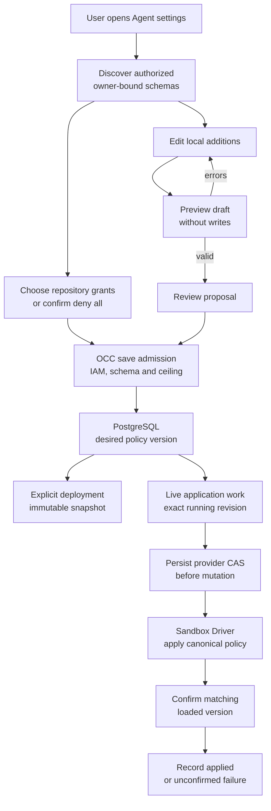

# Agent sandbox policy flow

## Overview

OCC saves and freezes Agent network additions at deployment. The Sandbox Driver
can apply later versions. Operators review denials and recommendations.

## Entry Points

- Trigger: the console Policy denials tab or `occ agent policy` commands.
- Source: `apps/controller/src/http/sandbox-policy.ts:sandboxPolicyHandlers` and
  `packages/occ/src/sandbox-policy.ts:updateAgentSandboxPolicy` / `applyAgentSandboxPolicy`.
- Assumptions: a ready Namespace, active Agent, exact grants, enabled editing for
  mutations, and an Installation ceiling shared by API and worker.

## Flow

Solid arrows trace source paths, not provider verification.

## Execution Trace

### 1. Admit and persist desired additions

Policy CLI commands accept JSON (default) or YAML and reject unsupported formats
before requesting. They print structured results
(`internal/occcli/agent_policy.go:agentPolicyCommand`).

`SetupDiscovery.discoverConfigurations` lists selected Driver contributions.
Installation `administer` permits [startup inspection](driver-plugin-loading.md#4-load-current-policy-and-hand-off-lifecycle-ownership).
Agent discovery requires Agent and policy `read` and shares the policy GET descriptor.
Submitted additions cannot select a Driver.

`validateAgentSandboxPolicy` checks Agent and policy authorization, editing, version,
pending work, grant schemas and Driver rules. `networkGrantAdmissionDetails` in
`packages/contracts/src/deployment-policy.ts` checks executables, hosts and ports against the
Installation ceiling and Sandbox wildcard and range support. Preview writes nothing; save and deploy repeat admission.

Validation names failed fields and checks. Stale or denied requests retain resource errors.
`internal/occclient/transport.go:APIError.Error` prints up to 32 escaped details without Unicode controls.

`packages/occ/src/agent-deployment-admission.ts:admitModelCredentialPolicy` matches
one grant against the approved inference host/port, checks the ceiling, and
records separate network and method/path injection policies in the revision ([status](../reference/credential-sources.md#implementation-status)).

`packages/occ/src/sandbox-policy.ts:updateAgentSandboxPolicy` requires Agent
`manage_policy` and SandboxPolicy `update` and locks Namespace and Agent.
Legacy protected execution rejects nonempty additions at save, deploy, and
live apply (`409 SANDBOX_POLICY_PROTECTED_EXECUTION`).
A repository-only Proxy permits a model exception with no repositories and one ready
Gateway static Harness Source. Managed revisions block nonempty
edits and live apply. Protected dedicated Codex admits the Sandbox-approved
[artifact subset](../reference/drivers/openshell-sandbox.md#protected-codex-artifact-rules).
`checkedProtectedCodexArtifactPolicy` verifies its purpose, keys, Driver,
version and empty additions before credential provisioning. That snapshot
cannot be applied live. Unreadable scoped revisions report `protectedExecution: null`.

Both protected Codex compilers validate the revision artifact map.
`openshell-codex-artifacts.ts` excludes ambient defaults. The Sandbox checks
workspace enrollment against the validated Agent-owned setup binding and returns
the immutable policy in `SandboxResourceRef.proxyWiring`. The proxy checks the
map, auxiliary rule and loaded policy. [GitHub API access](../reference/repository-credentials/access-levels.md#native-git-delivery)
requires permissions and Namespace opt-in. Admission passes saved or deployed
`repositoryCredentials`. Binding, deploy and provisioning refuse additions or
defaults targeting `github.com`, its subdomains or IP addresses. Deploy and
binding-preserving updates check SandboxPolicy `read` before naming saved additions.

[`compileOpenShellBoundGitRule`](../../apps/controller/src/drivers/sandbox/openshell-git-network-policy.ts)
binds repository rules to the credential-only Provider. OpenShell alone enforces
Git, issue and PR reads and [PR creation](../reference/repository-credentials/access-levels.md#pull-request-creation).
The Git middleware selects no admitted host, so no OCE service is in the request
path. Deny rules refuse the create fields in a query string. Request bodies are
not inspected ([known limits](../reference/repository-credentials/access-levels.md#known-limits)).

`apps/controller/src/http/sandbox-policy.ts` audits the approved additions
and version in the save transaction. The only facet is `networking`.
`TEMPORARY_API_WILL_BREAK_IN_FUTURE_setAgentSandboxPolicyEditing` requires
Installation and Agent administration. New Agents start with editing disabled.

`packages/occ/src/state/postgres-state.ts` versions saves. A trigger creates
one policy per Agent. Constraints check revision and Agent ownership, document
shape, immutable application identity and version transitions. Both adapters prevent removal
of pending applications. The Worker records the expected provider version
and settles the application as `applied` or `failed`. Deleting the Agent
removes its policy and exact IAM access.

The [editor](../reference/sandbox-policies.md#repository-network-policy) shows grants
and the Namespace ceiling. Save before deploy. Initial `[]` denies all. Omission
retains grants without returning them. For `[]`, OCC checks SandboxPolicy read
before lookup. A reader can withdraw after Driver loss with both lists empty.

PostgreSQL saves an explicit list at Read Committed. The PUT starts that
transaction before OCC waits for the IAM configuration lock, and the
authorization checks see revocations committed during the wait.

`apps/controller/src/console/agents/sandbox-policy.mts:renderAgentSandboxPolicy`
uses the GET hint and Namespace limits. Refresh updates version and limits.
Refresh and rejected saves preserve drafts while saved grants match. Otherwise, discard them. PUT validates the list and the editor checks
the returned Agent, Namespace, version and grants. Confirm deny-all and withdrawal.
After unscoped deployment, save policy on a new Agent before deploy. A compatible
controller and Worker must stop an unreadable revision.

Deployment rechecks the selected Repo scope, proxy and Driver identities across
asynchronous validation before accessing credentials and inserting a revision.
Migration 0087 binds the snapshot to the exact saved policy version, grants
and identity. Older Workers refuse its reader marker. The Worker rechecks
the policy before dispatch. An explicit list blocks live application.

### 2. Freeze deployment or enqueue live application

`packages/occ/src/sandbox-policy.ts:admitDeploymentSnapshot` freezes Driver
defaults and additions in `AgentRevision.sandboxPolicy`. The OpenShell Driver
provisions from that snapshot.

For a saved repository policy and a bound Channel Secret,
`packages/occ/src/deployment-channels.ts:startDeploymentValidation` checks
deployment admission before handing the Secret to the Channel provider.
The Channel handoff and final deployment admission start PostgreSQL transactions
at Read Committed. The policy preview reuses the Channel handoff transaction.
The IAM reads after the lock wait see permission changes committed by the
previous lock holder, even when the connection defaults to Repeatable Read.
A platform dependency failure returns a retryable `503 DEPENDENCY_UNAVAILABLE`
with bounded request diagnostics. An incompatible Compute topology or an
unscoped revision history returns `409 RESOURCE_CONFLICT` with recovery
instructions. Credential check failures use the Channel credential response.
Authorization denials still return `403 FORBIDDEN`.

`applyAgentSandboxPolicy` checks Agent `manage_policy` and SandboxPolicy
`update` and `read` before disclosing saved additions. It requires the exact
active revision and a supporting Driver. One transaction saves supplied
changes, records the pending application and queues work. Omitting additions
keeps the saved policy version. Provider readback confirms enforcement.

### 3. Reconcile provider effects

`apps/controller/src/worker/sandbox-policy.ts:reconcileSandboxPolicy` locks the
same lifecycle owners and rechecks current authority, ceiling, Driver identity,
and Compute placement. Shared definition and provider admission are rerun before
provider effects. One pass records the provider CAS version; a later pass
can mutate with that fixed version and operation ID. Provider reads and effects
are bounded by the claim lease. Database and audit failures roll back the pass.

`apps/controller/src/drivers/sandbox/openshell.ts` verifies exact provider
ownership, preserves the Sandbox's static policy and generated access, and uses
native status/UpdateConfig RPCs. A full candidate match plus loaded active version
is required for `applied`. If the current resource version already differs from the
pinned version and the policy does not match, the worker fails before it sends a write.
After a refused write, the worker reads the provider again and confirms its lease.
A matching policy still loading is deferred within the deadline, `applied` is recorded
only for a loaded active match, and a changed resource version with a nonmatch fails as
`SANDBOX_POLICY_PROVIDER_FAILED` (the pinned version cannot succeed). Worker shutdown during
that read rolls back so the next worker recovers the claim; other outcomes retry within limits;
exhausted abandoned claims become unconfirmed failures. The worker calls
`failAbandonedSandboxPolicies` inside the same `transactWithQueue` that recovers
exhausted work, so queue failure, application failure, and audit either all commit
or remain recoverable after interruption. A failed live request does
not deploy another revision. Last confirmed live evidence is retained separately.

### 4. Read contextual evidence

`openshell-log-decisions.ts:openShellLogDecision` decorates recognized provider
records. `packages/occ/src/runtime-logs/sandbox.ts` validates them;
`runtime-logs/sanitize.ts` redacts metadata and raw text through the existing
bounded log path. See [runtime logs](agent-runtime-logs.md).

`readAgentSandboxRecommendations` independently checks exact Agent/policy read
and revision ownership before its audited, limited provider read. The OpenShell
Driver projects representable native chunks into untrusted suggestions. The
console editor submits canonical additions through the same mutation path;
native draft approval cannot bypass OCC admission.

`console/driver-configurations.mts:renderAgentDriverConfigurations` finds owner
controls. `console/configuration-fields.mts` renders schema fields, JSON fallback
and safe diagnostics. It preserves complete string drafts because JSON Schema
counts code points and HTML counts UTF-16 units.
`console/agents/sandbox-policy.mts:renderLogs` snapshots the displayed log window,
filters it, and renders five denials per page initially. Selection spans pages;
Select page changes only eligible visible rows. Follow retains up to 1,000 new
log records without replacing inspected rows. Show newest accepts the retained
window and removes selections for records no longer retained.

`stageGrants` deduplicates exact executable/host/port candidates and excludes
requests covered by saved or proposed grants. It preserves all additions and
opens the schema editor or batch preview. Missing metadata prevents prefilling.
Incomplete drafts block further staging. `ruleList` searches and pages explicit rules five at
a time; row controls edit or remove local additions.

`console/agents/sandbox-policy.mts:renderPolicy` shows policy status and three
expandable suggestions above the log, independent of mutation authority.
`openNetworkLimits` displays the ceiling read-only. Defaults and versions remain
on the main page. The Network policy card authorizes editing separately and
retains feedback, read errors and recovery with the dialog closed.
`renderEditor` keeps edits local. Review compares the validated draft with
saved additions. Save submits the full validated array and reviewed version.
Confirmation closes the dialog and clears the completed selection. Stale
responses cannot overwrite drafts. Writes invalidate earlier reads and pause
polling. A fresh read resumes polling for pending applications. Unreadable
previews and refusals preserve edits. The combined response must contain the
reviewed rules, next policy version and fresh pending application for the
selected running revision. A lost or mismatched response triggers a GET.
If it fails, **Refresh policy** remains available. Provider confirmation
settles pending status. **Save for later** only saves. **Apply saved rules**
targets the saved version and requires a clean draft. `loadPolicy(true)`
records inspection before retry through the apply descriptor. Refresh only
reads. Retry checks current permissions, lifecycle and draft.

`console/agents/sandbox-policy.mts:mutate` displays rejected saves as focused
alerts and scrolls the reason into view after rendering. Ceiling rejection
preserves the attempted additions for correction without changing saved state.
`console/navigation.mts:createNavigation` admits the `policy` tab in login
destinations, preserving an Agent's Policy denials link after sign-in.

The console reads the policy owner even without a discovery descriptor.
This reports unsupported capability or refusal before independently
authorized log and suggestion reads. `sandboxPolicyRead: false` skips policy
and suggestion reads and hides the suggestions card. The network policy card
shows the refusal. An unknown answer keeps the reads. Reopening the tab
refreshes permissions. A revision without `sandboxDriverId` skips log and
suggestion reads and reports no denials, as does
`RUNTIME_LOGS_SOURCE_UNAVAILABLE`. These states and drafts hide denial
counters, controls and empty rows.

## Debugging and Verification

- Inspect the desired policy and application with `occ agent policy get`.
  `pending` or `failed` never establishes a successful retry.
- Compare the application revision with the active Agent revision and inspect
  attributable audit evidence before retrying a stale or unconfirmed request.
- [PostgreSQL admission integration](../../tests/integration/postgres-agent-sandbox-policy.test.mjs)
  exercises HTTP/IAM/storage, application-role refusal of pending application
  removal, and worker settlement; the [OpenShell runtime lane](../../tests/helpers/openshell-sandbox-workflows.mjs)
  owns real enforcement proof. Storybook proves simulated presentation only.
- [Console batch browser tests](../../tests/browser/console-policy-denials.test.ts)
  cover selection across pages, stable Follow, deduplication, preservation of saved
  rules, and ceiling rejection through real controller routes. They use in-memory
  storage and test Drivers with simulated log input. A simulated failed-application
  view covers explicit inspection and retry against the real API refusal; neither
  case proves provider enforcement.

## Related docs

- [Policy reference](../reference/sandbox-policies.md)
- [Operator workflow](../guides/topics/agent-sandbox-policy.md)
- [OpenShell provisioning](openshell-sandbox-provisioning.md)
- [Implementation plan](../../specs/plans/0045-python-sandbox-policy-denials.md)

## Manual Notes

## Changelog

- 2026-11-23 09:00: Explain that OpenShell alone enforces PR reads and creation, with no request-time OCE check. (authoring-run/19359633-e6f9-48aa-aedb-66a9b329a7fd - eab74449a971c0efd318d62304640dca4f54ba76)

- 2026-11-22 13:25: Explain draft retention and recovery after a concurrent repository grant change. (authoring-run/ef83c979-c682-4429-8d7f-63340166b9fa - 19ce90f1761a9da44d9a972c42d49686732a604a)

- 2026-11-22 12:08: Reconcile managed model admission with current IAM handoff and repository grants. (authoring-run/193bbeb9-3f9b-4d51-a11f-6f763c5a299f - a6b923bad)

- 2026-11-22 10:36: Reconcile repository grants and managed model admission. (authoring-run/5fd71b49-d9db-436b-8ae0-2157ae7ca64a - 5a30353ef9a8f0388b857612c3b31624c810209d)

- 2026-11-22 10:23: Trace managed model admission and legacy protected egress. (authoring-run/afd8fac9-f5bf-4366-9cd1-d3ff0c00ba14 - 6747afc21abe61933b5e5222cacb79141c2a692f)

- 2026-11-22 10:05: Document IAM currentness during Channel handoff and deployment admission. (authoring-run/c8a2f368-b5c6-464f-859b-7c81d28819ae - 00a5b1d2edc6de425e2e9d197bb0841a02f439e8)

- 2026-11-22 09:55: Document transaction isolation for explicit repository policy saves. (authoring-run/0eda0b23-705a-489b-833d-3cde8916b691 - 42f0df7230de059d4a96da27298c911e22993cab)

- 2026-11-22 09:28: Document the read check for explicit empty repository lists and omission from save responses. (authoring-run/df899b2b-1188-46fb-a341-5c7068e9208a - 8d738163780171c639367dbbccd9d9bb3a0ee63c)

- 2026-11-21 11:25: Issue reads. (authoring-run/0bcc1e9a-07b4-4e62-84f3-5c8d8204522e - 64c5b34ff03f7b17aaa69af21aa75af0a91b1d56)

- 2026-11-21 08:16: Document Console repository choices, first-deployment eligibility and active revision recovery. (authoring-run/6ef4f22d-ce36-4d4c-941f-cb7a21afbb49 - 9cd9c344f9c57cd158dd74b87029a8266ca7cac2)

- 2026-11-20 23:58: Document repository grant persistence and revision compatibility. (authoring-run/7cea7928-edfb-4fb5-ba4d-0d07ca245dca - 0f4a2d3d3)

- 2026-11-20 16:58: Point to deployment admission and its request module. (authoring-run/c0b1d670-9c9d-4163-a9e1-c480b2170bfc - 48e378422c0f6527682d305cac5ca3992a00c5ad)

- 2026-11-20 16:36: Point discovery to the setup catalog module. (authoring-run/81560d43-8d6a-40f6-8c1a-fa669ed36e0d - d7da2d9c7716128fb51147656fec44d22b896cc2)

- 2026-11-20 16:26: Point policy admission and live application to their Sandbox policy module. (authoring-run/f1915f3d-1425-495a-b3d9-3ed171e6cf74 - c153a2bbf59310a74974a455c11152460d486af4)

- 2026-11-19 07:54: Separate credential acquisition. (authoring-run/a7f97564-0c7b-4c61-b72f-0b866891ade8 - 1eb271262)

- 2026-11-19 09:03: Separate policy and validation context. (authoring-run/2ca60020-2ed8-48c5-943c-ba2890e5bb12 - 9dd2694f3cdbbed2c2e26222d503a2253af93ee9)

- 2026-11-18 21:48: Preserve source-approved HTTP methods. (01a1eb01-27e9-7d91-a1e5-c673380d2fc8 - 7ee6a09585aa160de6feab9c133bf5c090ff05f5)

- 2026-11-18 15:56: Trace HTTP unions and UTF-8 paths. (01a1eb01-27e9-7d91-a1e5-c673380d2fc8 - 2fcc0a88cc29bbdc5c3a744ebdd15c6d62ad8934)

- 2026-11-18 15:37: Clarify projection and request matching. (01a1eb01-27e9-7d91-a1e5-c673380d2fc8 - f099db22a50b4929601520d156b5b14d6bb63613)

- 2026-11-18 05:50: Trace per-binding static request admission. (01a1eb01-27e9-7d91-a1e5-c673380d2fc8 - 913c717d12f78645b5f8d47216aaddd2dfe90c0e)

- 2026-11-13 22:21: Reject policy saves that remove a pending application. (authoring-run/9f288473-f3c0-4816-b8a7-d2bc81b82c2c - cf0370780b4e885e35ee463033b6926e5d3109ef)

- 2026-11-13: Trace the Console’s single save-and-apply request and its atomic admission for a running Agent.

- 2026-10-29 12:37: Link Installation inspection to its startup projection owner. (01a1891d-5b6b-7071-b482-793a9dd01044 - 32b59e204e)

- 2026-10-29 18:30: An Agent update with repository bindings authorizes SandboxPolicy `read` before the overlap refusal that names a saved grant (finding 2881).

- 2026-10-29 12:00: Live application authorizes SandboxPolicy `read` before admitting the saved additions (finding 2874).

- 2026-10-26 10:49: Combine the accompanying policy UX controls with upstream permission hints, unavailable Sandbox log handling, and application failure explanations. (authoring-run/0f3c367f-75d3-40f0-bcfa-3b649b78721f - e89a4e37a0b3dff75739cf6988028f81cd96f5ac)

- 2026-10-25: Hide the empty denial rows and state a refused policy read once. (finding 2522)
- 2026-10-25: Hide the denial window's controls on the draft. (finding 2509)
- 2026-10-25: Skip the policy and suggestion reads that the permission answer refuses. (finding 2454)

- 2026-10-24 18:15: Preserve complete Unicode string drafts for owner validation and add a simulated policy Review/Save walkthrough. (authoring-run/b7994562-b460-4667-9017-4c62c3f56eb0 - 6857956afcfee0b88563ea882c95034b5780cbec)

- 2026-10-24 13:19: Refuse explicit unsupported CLI formats before policy requests. (authoring-run/3954aa04-12f8-4a8e-bb62-a4d9a8603edd - 1b59554add06e9f7be0b0a730202f558c939a661)

- 2026-10-22 23:45: Preserve CLI output guidance alongside upstream grant admission rules after conflict resolution. (authoring-run/01a10a81-070c-7aa3-97d0-fbce8f285d4d - c574fc743b21599c51d3809365039010a7e077d2)

- 2026-10-23 16:20: Trace the accompanying compact policy controls, suggestion disclosure, independent ceiling dialog, contextual footer, and explicit retry after status inspection. (authoring-run/2d64e0f2-543e-4fee-bc9d-0ed8f2d48f5b - a8575405cf9fbd1779b2daa1fab96a88d584cc7c)

- 2026-10-23 14:55: Trace the accompanying move of the policy-editing control to the page, visible mutation feedback, and read recovery. (authoring-run/71e6c3c8-7b57-42ff-bc6c-37f2506f2da5 - a8575405cf9fbd1779b2daa1fab96a88d584cc7c)

- 2026-10-22 16:59: Trace the accompanying console changes for paged denials, batch proposals, rule management, and review before saving. (authoring-run/cd2ce6a3-4507-46cc-b936-68c9862c794b - 0c73a86a6cdd92f0129c8e52e0f230517490bd46)

- 2026-10-22 13:40: Run the shared grant rules before a Driver contribution, at every admission (preview, save, apply, deploy) and the worker recheck; empty or reversed ranges never satisfy the ceiling. (bughunt-1022c)

- 2026-10-21 04:25: Declare structured policy CLI output before requests. (authoring-run/a66234ce-95fd-4d64-9fe8-3ce3d143e572 - e8185dac805b737363c7178d3068b310a53a7c24)

- 2026-10-20 03:48: Complete policy capability reads without discovery metadata and omit terminal controls from CLI diagnostics. (authoring-run/ee617f7c-b2e1-4dbb-ace9-7908ebc5cfd6 - df244b6bd678acad513a02b5eb5d69e13f2d68dc)

- 2026-10-20 01:48: Trace rejection causes, CLI details, and refresh sequencing. (authoring-run/9d1ff825-b9f4-492a-9420-1e316d820e28 - e7e5f3321cb0a8471d74964eba56ddd069a4e4c5)

- 2026-10-19 20:34: Trace shared definitions, contextual discovery, and preview admission in the accompanying implementation. (authoring-run/9b1f7ddf-52fe-46c8-9fa9-fa7a1acfa64a - 7fa0a561df615296a612126d430a4bbfa1124d9c)

- 2026-10-19 14:18: Align Agent creation and reload defaults for policy editing in both state adapters. (authoring-run/a9906404-d12d-4f05-ba24-16be225b527c - 7e677523ba1ad953707b14f6b6c2f041e5ccd6b7)

- 2026-10-19 09:23: Require a policy facet, mark temporary editing admission, and commit exhausted application recovery atomically. (authoring-run/545665b0-3aef-44dc-beb8-492b753b1a13 - bc3ba215dd9927692bc2882ffaf06a35c27fed4a)

- 2026-10-15 17:42: Distinguish local proposals, saved policy, and explicit live application in the console. (authoring-run/11c6d771-178c-4ac7-ae8b-310ebe644daa - a28596ab8)

- 2026-10-15 17:12: Bring rejected policy saves into view and preserve the attempted edit. (authoring-run/b37638d5-3a21-4fe8-99ab-3b9600cfe107 - a28596ab8)

- 2026-10-15 16:14: Trace governed Agent network additions and separate decision evidence. (authoring-run/43cb74b9-e1fe-4fc2-adde-9d932b061d7c - a28596ab8)
