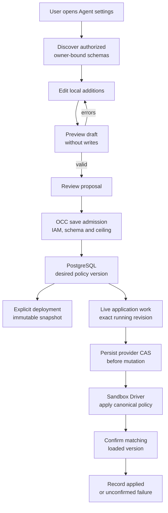

# Agent sandbox policy flow

## Overview

OCC persists governed network additions for one Agent, freezes them at deployment,
and optionally applies a later version through its Sandbox Driver. Denial logs
and provider recommendations supply independent context for a user review.
This trace describes the implemented source; runtime proof has separate limits.

## Entry Points

- Trigger: the console Policy denials tab or `occ agent policy` commands.
- Source: `apps/controller/src/http/sandbox-policy.ts:sandboxPolicyHandlers` and
  `packages/occ/src/index.ts:updateAgentSandboxPolicy` / `applyAgentSandboxPolicy`.
- Assumptions: a ready Namespace, active Agent, exact grants, enabled editing for
  mutations, and an Installation ceiling shared by API and worker.

## Flow

The solid arrows trace source paths, not a claim that all providers are verified.

## Execution Trace

### 1. Admit and persist desired additions

`internal/occcli/agent_policy.go:agentPolicyCommand` declares JSON and YAML
output for each policy subcommand. `internal/occcli/cli.go:validateOptions` selects JSON only when `--output` is
omitted and refuses unsupported explicit formats before any request. It then
prints the acknowledged result through
`internal/occcli/output.go:printStructured`. A successful mutation therefore
returns its result without a later table-format error.

`OpenClawController.discoverConfigurations` filters registry contributions by the
server-selected Driver, scope, and resource-owner read authority. Installation
inspection exposes startup schemas without values. Agent discovery and policy GET
use the same descriptor with owner-generated facet action URLs and current
availability. The registry never selects a Driver from submitted additions.

`validateAgentSandboxPolicy` authorizes the exact Agent and policy, checks the
current editing flag, expected version, and pending application, then runs shared
schema/semantic validation, the Driver contribution (which can only narrow it), and
current ceiling/provider admission. An empty or reversed port range is never inside
the ceiling. It returns a configuration result without entering a mutation
transaction. Schema and semantic refusals carry safe `error.details`; stale or
unauthorized requests retain their resource errors. Every later mutation repeats
these checks. Ceiling refusal keeps its Installation-delegation cause; unsupported
wildcard/range refusal names the Driver capability limit. Both retain field details.
`internal/occclient/transport.go:APIError.Error` prints up to 32 public detail
records as escaped JSON and omits records with Unicode control characters, so
CLI callers retain the same field and cause without terminal controls.

`packages/occ/src/index.ts:updateAgentSandboxPolicy` independently authorizes
Agent `manage_policy` and SandboxPolicy `update`, locks the Namespace and Agent,
and checks editing, expected version, pending work, complete ceiling coverage,
and registry-resolved Driver admission. The saved additions come from the
admitted snapshot. While the active or next revision runs under protected
execution (the Installation selects the Credential Proxy), additions are refused
with `409 SANDBOX_POLICY_PROTECTED_EXECUTION`, as are live application to a
protected revision and a protected deploy carrying them; protected
revisions admit no policy snapshot. The policy view reports `protectedExecution`.
For an Agent with repository bindings (or a Git-bound active revision), Driver
admission gets `repositoryCredentials`: the OpenShell Driver with its Git route
refuses a grant or default reaching `github.com` or a name under it, or naming an
IP address, with a `409` naming it. Adding a binding beside such a saved grant, deploy, and provisioning refuse it too.
`apps/controller/src/http/sandbox-policy.ts` records the
nonsecret approved additions with their version in the same transaction.
The required facet argument currently admits `networking` only. Other facets
fail before network policy access. The temporary
`TEMPORARY_API_WILL_BREAK_IN_FUTURE_setAgentSandboxPolicyEditing` requires
Installation and Agent administration; Guardrails will replace this switch.

Both state adapters return `sandboxPolicyEditing: false` at Agent creation,
matching the PostgreSQL column default and subsequent reads. The separately
authorized editing operation changes this flag.

`packages/occ/src/state/postgres-state.ts` performs versioned updates. Agent
creation creates its one policy through a database trigger. Constraints enforce
ownership, document shape, immutable application identity, version transitions,
and application revision ownership. Agent deletion cascades policy removal and
cleans its exact IAM access.

### 2. Freeze deployment or enqueue live application

`packages/occ/src/index.ts:deployAgent` freezes the Driver's defaults and additions
into `AgentRevision.sandboxPolicy`. The OpenShell Driver provisions from this
snapshot rather than re-reading changed defaults.

`applyAgentSandboxPolicy` requires the exact active revision and supporting
Driver. It persists a pending application and durable Agent-target work in one
transaction. Neither saving nor enqueueing establishes enforcement.

### 3. Reconcile provider effects

`apps/controller/src/worker/sandbox-policy.ts:reconcileSandboxPolicy` locks the
same lifecycle owners and rechecks current authority, ceiling, Driver identity,
and Compute placement. Shared definition and provider admission are rerun before
provider effects. One pass records the provider CAS version; a later pass
can mutate with that fixed version and operation ID. Provider reads and effects
are bounded by the claim lease. Database and audit failures roll back the pass.

`apps/controller/src/drivers/sandbox/openshell.ts` verifies exact provider
ownership, preserves the Sandbox's static policy and generated access, and uses
native status/UpdateConfig RPCs. A full candidate match plus loaded active version
is required for `applied`. Transient or unknown outcomes retry within limits;
terminal stale work becomes an unconfirmed failure. The worker calls
`failAbandonedSandboxPolicies` inside the same `transactWithQueue` that recovers
exhausted work, so queue failure, application failure, and audit either all commit
or remain recoverable after interruption. A failed live request does
not deploy another revision. Last confirmed live evidence is retained separately.

### 4. Read contextual evidence

`openshell-log-decisions.ts:openShellLogDecision` decorates recognized provider
records. `packages/occ/src/runtime-logs/sandbox.ts` validates them;
`runtime-logs/sanitize.ts` redacts metadata and raw text through the existing
bounded log path. See [runtime logs](agent-runtime-logs.md).

`readAgentSandboxRecommendations` independently checks exact Agent/policy read
and revision ownership before its audited, limited provider read. The OpenShell
Driver projects representable native chunks into untrusted suggestions. The
console editor submits canonical additions through the same mutation path;
native draft approval cannot bypass OCC admission.

`console/driver-configurations.mts:renderAgentDriverConfigurations` discovers
sections and selects resource-owner controls. `console/configuration-fields.mts`
renders schema fields and JSON fallback, with safe field/root diagnostics.
String controls retain the complete draft. Length validation stays with the
policy owner: JSON Schema counts Unicode code points, while HTML length
attributes count UTF-16 code units and can truncate a valid executable path.
`console/agents/sandbox-policy.mts:renderLogs` snapshots the displayed log window,
filters it, and renders five denials per page initially. Selection spans pages;
Select page changes only eligible visible rows. Follow retains up to 1,000 new
log records without replacing inspected rows. Show newest accepts the retained
window and removes selections for records no longer retained.

`stageGrants` builds exact executable/host/port candidates, deduplicates requests,
and skips requests already covered by saved or proposed grants. It retains the
complete additions array and opens the schema editor or batch preview. Missing
metadata disables prefilling. An incomplete existing draft must be corrected
before staging more grants. `ruleList` searches and pages explicit rules five at
a time; row controls edit or remove local additions.

`console/agents/sandbox-policy.mts:renderPolicy` places policy status and suggestions
above the log. It shows three suggestions initially and expands the remaining
candidates on request, independently of mutation authority. `openNetworkLimits`
uses the policy view's ceiling in a separate read-only dialog. Defaults and
version details stay in the main-page disclosure. The Network policy card also enables or disables Agent policy editing
through the separately authorized editing operation. Mutation feedback appears in
the card while the dialog is closed; a failed policy read retains its error and
read recovery action. `renderEditor` manages rules without an editing toggle and
keeps proposed rules local until preview. Its footer compares the draft with saved
additions, including removals and restored values, to offer review, application,
or Done. Saving a confirmed response closes the dialog and clears the completed
selection. Review shows additions, updates, and removals from the controller-validated rules,
with the previously saved policy available for comparison. Save sends the complete
validated array with the reviewed policy version. Superseded preview and read responses
cannot overwrite a newer draft. Policy reads use a separate sequence: an earlier response
cannot invalidate a newer request. A pending application re-arms polling after
the latest read, including a response discarded after a draft edit.
An unreadable preview retains the draft for another review. Save and apply checks
that the save response names this policy, Agent, Namespace, next version, and
the rules shown in review before requesting application to the selected revision.
Starting a write invalidates earlier policy reads and pauses polling. After an
unconfirmed save, only an explicit refresh started after the outcome can reopen editing.
Save alone leaves running enforcement unchanged. Applying a
previously saved policy is disabled while local edits are unsaved. If application
fails after saving, the alert identifies the saved version rather than implying
that the entire operation was rejected. `loadPolicy(true)` records explicit
inspection of a failed application. Refresh issues only the policy GET; a separate
Retry application action invokes the existing apply descriptor after inspection.
The action remains subject to current permissions, lifecycle, and draft guards.

`console/agents/sandbox-policy.mts:mutate` displays rejected saves as focused
alerts and scrolls the reason into view after rendering. Ceiling rejection
preserves the attempted additions for correction without changing saved state.
`console/navigation.mts:createNavigation` admits the `policy` tab in login
destinations, preserving an Agent's Policy denials link after sign-in.

The console reads the policy owner even when discovery returns no descriptor. This
read establishes an unsupported capability or a permission refusal before log and
suggestion reads continue under their own permissions. It cannot leave those reads
waiting for a policy request that never starts. When the caller's permission answer
reports `sandboxPolicyRead` as `false`, the console skips the policy and suggestion
reads and says so; an unknown answer keeps the reads. A tab opened after the answer
settled rereads it first, so a later grant applies. A version snapshot without
`sandboxDriverId` runs without a Sandbox, so the tab skips its log and suggestion reads
and says no denials are recorded. A `RUNTIME_LOGS_SOURCE_UNAVAILABLE` answer shows the same.
Then, and on the draft, which reads no log, the denial count, refresh, follow and filter
controls and the empty denial rows are hidden. When the permission answer refuses
the policy read, only the network policy card states it; the suggestions card is hidden.

## Debugging and Verification

- Inspect the desired policy and application with `occ agent policy get`.
  `pending` or `failed` never establishes a successful retry.
- Compare the application revision with the active Agent revision and inspect
  attributable audit evidence before retrying a stale or unconfirmed request.
- [PostgreSQL admission integration](../../tests/integration/postgres-agent-sandbox-policy.test.mjs)
  exercises HTTP/IAM/storage; the [OpenShell runtime lane](../../tests/integration/sandbox-driver-openshell-k3d-real.test.mjs)
  owns real enforcement proof. Storybook proves simulated presentation only.
- [Console batch browser tests](../../tests/browser/console-policy-denials.test.ts)
  cover selection across pages, stable Follow, deduplication, preservation of saved
  rules, and ceiling rejection through real controller routes. They use in-memory
  storage and test Drivers with simulated log input. A simulated failed-application
  view covers explicit inspection and retry against the real API refusal; neither
  case proves provider enforcement.

## Related docs

- [Policy reference](../reference/sandbox-policies.md)
- [Operator workflow](../guides/topics/agent-sandbox-policy.md)
- [OpenShell provisioning](openshell-sandbox-provisioning.md)
- [Implementation plan](../../specs/plans/0045-python-sandbox-policy-denials.md)

## Manual Notes

## Changelog

- 2026-10-26 10:49: Combine the accompanying policy UX controls with upstream permission hints, unavailable Sandbox log handling, and application failure explanations. (authoring-run/0f3c367f-75d3-40f0-bcfa-3b649b78721f - e89a4e37a0b3dff75739cf6988028f81cd96f5ac)

- 2026-10-25: Hide the empty denial rows and state a refused policy read once. (finding 2522)
- 2026-10-25: Hide the denial window's controls on the draft. (finding 2509)
- 2026-10-25: Skip the policy and suggestion reads that the permission answer refuses. (finding 2454)

- 2026-10-24 18:15: Preserve complete Unicode string drafts for owner validation and add a simulated policy Review/Save walkthrough. (authoring-run/b7994562-b460-4667-9017-4c62c3f56eb0 - 6857956afcfee0b88563ea882c95034b5780cbec)

- 2026-10-24 13:19: Refuse explicit unsupported CLI formats before policy requests. (authoring-run/3954aa04-12f8-4a8e-bb62-a4d9a8603edd - 1b59554add06e9f7be0b0a730202f558c939a661)

- 2026-10-22 23:45: Preserve CLI output guidance alongside upstream grant admission rules after conflict resolution. (authoring-run/01a10a81-070c-7aa3-97d0-fbce8f285d4d - c574fc743b21599c51d3809365039010a7e077d2)

- 2026-10-23 16:20: Trace the accompanying compact policy controls, suggestion disclosure, independent ceiling dialog, contextual footer, and explicit retry after status inspection. (authoring-run/2d64e0f2-543e-4fee-bc9d-0ed8f2d48f5b - a8575405cf9fbd1779b2daa1fab96a88d584cc7c)

- 2026-10-23 14:55: Trace the accompanying move of the policy-editing control to the page, visible mutation feedback, and read recovery. (authoring-run/71e6c3c8-7b57-42ff-bc6c-37f2506f2da5 - a8575405cf9fbd1779b2daa1fab96a88d584cc7c)

- 2026-10-22 16:59: Trace the accompanying console changes for paged denials, batch proposals, rule management, and review before saving. (authoring-run/cd2ce6a3-4507-46cc-b936-68c9862c794b - 0c73a86a6cdd92f0129c8e52e0f230517490bd46)

- 2026-10-22 13:40: Run the shared grant rules before a Driver contribution, at every admission (preview, save, apply, deploy) and the worker recheck; empty or reversed ranges never satisfy the ceiling. (bughunt-1022c)

- 2026-10-21 04:25: Declare structured policy CLI output before requests. (authoring-run/a66234ce-95fd-4d64-9fe8-3ce3d143e572 - e8185dac805b737363c7178d3068b310a53a7c24)

- 2026-10-20 03:48: Complete policy capability reads without discovery metadata and omit terminal controls from CLI diagnostics. (authoring-run/ee617f7c-b2e1-4dbb-ace9-7908ebc5cfd6 - df244b6bd678acad513a02b5eb5d69e13f2d68dc)

- 2026-10-20 01:48: Trace rejection causes, CLI details, and refresh sequencing. (authoring-run/9d1ff825-b9f4-492a-9420-1e316d820e28 - e7e5f3321cb0a8471d74964eba56ddd069a4e4c5)

- 2026-10-19 20:34: Trace shared definitions, contextual discovery, and preview admission in the accompanying implementation. (authoring-run/9b1f7ddf-52fe-46c8-9fa9-fa7a1acfa64a - 7fa0a561df615296a612126d430a4bbfa1124d9c)

- 2026-10-19 14:18: Align Agent creation and reload defaults for policy editing in both state adapters. (authoring-run/a9906404-d12d-4f05-ba24-16be225b527c - 7e677523ba1ad953707b14f6b6c2f041e5ccd6b7)

- 2026-10-19 09:23: Require a policy facet, mark temporary editing admission, and commit exhausted application recovery atomically. (authoring-run/545665b0-3aef-44dc-beb8-492b753b1a13 - bc3ba215dd9927692bc2882ffaf06a35c27fed4a)

- 2026-10-15 17:42: Distinguish local proposals, saved policy, and explicit live application in the console. (authoring-run/11c6d771-178c-4ac7-ae8b-310ebe644daa - a28596ab8)

- 2026-10-15 17:12: Bring rejected policy saves into view and preserve the attempted edit. (authoring-run/b37638d5-3a21-4fe8-99ab-3b9600cfe107 - a28596ab8)

- 2026-10-15 16:14: Trace governed Agent network additions and separate decision evidence. (authoring-run/43cb74b9-e1fe-4fc2-adde-9d932b061d7c - a28596ab8)
