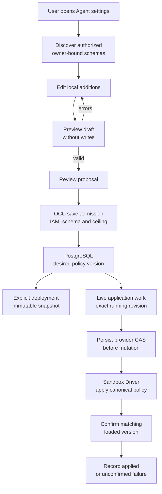

# Agent sandbox policy flow

## Overview

OCC saves governed network additions per Agent, freezes them at deployment,
and can apply a later version through its Sandbox Driver. Operators review denial
logs and provider recommendations.

## Entry Points

- Trigger: the console Policy denials tab or `occ agent policy` commands.
- Source: `apps/controller/src/http/sandbox-policy.ts:sandboxPolicyHandlers` and
  `packages/occ/src/index.ts:updateAgentSandboxPolicy` / `applyAgentSandboxPolicy`.
- Assumptions: a ready Namespace, active Agent, exact grants, enabled editing for
  mutations, and an Installation ceiling shared by API and worker.

## Flow

Solid arrows trace source paths, not provider verification.

## Execution Trace

### 1. Admit and persist desired additions

`internal/occcli/agent_policy.go:agentPolicyCommand` accepts JSON and YAML.
`internal/occcli/cli.go:validateOptions` defaults to JSON and rejects other formats
before sending a request. `internal/occcli/output.go:printStructured` prints the
acknowledged result.

`OpenClawController.discoverConfigurations` filters registry contributions by the
server-selected Driver, scope, and resource-owner read authority. Installation
inspection exposes [Driver-projected startup values](driver-plugin-loading.md#4-load-current-policy-and-hand-off-lifecycle-ownership).
Agent discovery and policy GET
use the same descriptor with owner-generated facet action URLs and current
availability. The registry never selects a Driver from submitted additions.

`validateAgentSandboxPolicy` checks Agent and policy authorization, editing, version,
pending work, grant schemas and Driver rules. `networkGrantAdmissionDetails` in
`packages/contracts/src/deployment-policy.ts` checks executables, hosts and ports against the
Installation ceiling and Sandbox wildcard and range support. Preview writes nothing; save and deploy repeat admission.

Validation errors identify failed fields and checks; stale or unauthorized requests retain resource errors.
`internal/occclient/transport.go:APIError.Error` prints up to 32 escaped details without Unicode controls.

Staged `validateDeploymentPolicy(policy, context)` checks source approval, reviewed requests and
projections using trusted binding, source and consumer authority. Only proposed proxy configuration
receives a source-bound resolver. The proxy qualifies bindings and requests. Static approvals match
method, host, port and path (`null` permits any method). The Sandbox qualifies HTTP rules and exact
MCP paths. Discovery can be credentialless; providers enforce OAuth scopes.

`packages/occ/src/index.ts:updateAgentSandboxPolicy` independently authorizes
Agent `manage_policy` and SandboxPolicy `update`, locks the Namespace and Agent,
and checks editing, expected version, pending work, complete ceiling coverage,
and registry-resolved Driver admission. Saved additions come from admission. While the active or next revision runs under protected
execution (the Installation selects the Credential Proxy), additions are refused
with `409 SANDBOX_POLICY_PROTECTED_EXECUTION`, as are live application to a
protected revision and a protected deploy carrying them; protected
revisions admit no ordinary Agent policy snapshot. Protected, dedicated Codex
repository admission can carry the Sandbox Driver's explicitly acknowledged
[artifact subset](../reference/drivers/openshell-sandbox.md#protected-codex-artifact-rules).
`checkedProtectedCodexArtifactPolicy` verifies its purpose, declared keys, Driver
identity, version and empty additions before runtime credential provisioning.
The policy view reports `protectedExecution`. Live apply remains unavailable.

`openshell.ts:admitProtectedCodexArtifactPolicy` freezes eligible opt-ins.
Both compilers replay them. Opted-in artifacts must have separate destinations
from enrollment and providers. Git checks attached profiles for strict parsing.
The proxy verifies exact artifact replay and strict effective model endpoints.
For an Agent with repository bindings (or a Git-bound active revision), Driver
admission gets `repositoryCredentials`: the OpenShell Driver with its Git route
refuses a grant or default reaching `github.com` or a name under it, or naming an
IP address, with a `409` naming it. Adding a binding beside such a saved grant, deploy, and provisioning refuse it too.
With saved additions, deploy and an Agent update that leaves repository bindings
authorize SandboxPolicy `read` first, so only a caller who may read the grant
sees it named (findings 2151, 2881).
`apps/controller/src/http/sandbox-policy.ts` records the
nonsecret approved additions with their version in the same transaction.
The required facet argument currently admits `networking` only. Other facets
fail before network policy access. The temporary
`TEMPORARY_API_WILL_BREAK_IN_FUTURE_setAgentSandboxPolicyEditing` requires
Installation and Agent administration; Guardrails will replace this switch.

Both state adapters return `sandboxPolicyEditing: false` at Agent creation,
matching the PostgreSQL column default and subsequent reads. The separately
authorized editing operation changes this flag.

`packages/occ/src/state/postgres-state.ts` performs versioned updates. Agent
creation creates its one policy through a database trigger. Constraints enforce
ownership, document shape, immutable application identity, version transitions,
and application revision ownership. The in-memory adapter and the PostgreSQL
update trigger reject saves that remove a pending application, including saves
that keep the current policy version. The worker can record the expected provider
resource version and set the same application to `applied` or `failed`.
Agent deletion cascades policy removal and
cleans its exact IAM access.

### 2. Freeze deployment or enqueue live application

`packages/occ/src/index.ts:deployAgent` freezes the Driver's defaults and additions
into `AgentRevision.sandboxPolicy`. The OpenShell Driver provisions from this
snapshot rather than re-reading changed defaults.

The deployment request may select `networkEgressMode: public` for this revision
when the Installation allows public mode and both selected Drivers support it.
The request defaults to restricted. The controller stores the mode with the
revision and the API returns it on revision detail reads. Retained revisions
without a stored mode use restricted policy.

`applyAgentSandboxPolicy` authorizes Agent `manage_policy` and SandboxPolicy
`update` and `read` before any refusal that names saved additions, then requires
the exact active revision and supporting Driver. When the caller supplies reviewed additions, the same transaction saves the new
policy version, records its pending application and enqueues Agent-target work.
Omitting additions retains the saved policy version. Neither saving nor enqueueing establishes enforcement.

### 3. Reconcile provider effects

`apps/controller/src/worker/sandbox-policy.ts:reconcileSandboxPolicy` locks the
same lifecycle owners and rechecks current authority, ceiling, Driver identity,
and Compute placement. Shared definition and provider admission are rerun before
provider effects. One pass records the provider CAS version; a later pass
can mutate with that fixed version and operation ID. Provider reads and effects
are bounded by the claim lease. Database and audit failures roll back the pass.

`apps/controller/src/drivers/sandbox/openshell.ts` verifies exact provider
ownership, preserves the Sandbox's static policy and generated access, and uses
native status/UpdateConfig RPCs. A full candidate match plus loaded active version
is required for `applied`. The Driver keeps the revision's network mode when it
builds the candidate. A revision with no saved mode uses restricted policy.
The Driver uses the same [supervisor readback](openshell-sandbox-provisioning.md#5-observe-readiness-or-clean-up)
for any revision marked `public`. If the current resource version already differs from the
pinned version and the policy does not match, the worker fails before it sends a write.
After a refused write, the worker reads the provider again and confirms its lease.
A matching policy still loading is deferred within the deadline, `applied` is recorded
only for a loaded active match, and a changed resource version with a nonmatch fails as
`SANDBOX_POLICY_PROVIDER_FAILED` (the pinned version cannot succeed). Worker shutdown during
that read rolls back so the next worker recovers the claim; other outcomes retry within limits;
exhausted abandoned claims become unconfirmed failures. The worker calls
`failAbandonedSandboxPolicies` inside the same `transactWithQueue` that recovers
exhausted work, so queue failure, application failure, and audit either all commit
or remain recoverable after interruption. A failed live request does
not deploy another revision. Last confirmed live evidence is retained separately.

### 4. Read contextual evidence

`openshell-log-decisions.ts:openShellLogDecision` decorates recognized provider
records. `packages/occ/src/runtime-logs/sandbox.ts` validates them;
`runtime-logs/sanitize.ts` redacts metadata and raw text through the existing
bounded log path. See [runtime logs](agent-runtime-logs.md).

`readAgentSandboxRecommendations` independently checks exact Agent/policy read
and revision ownership before its audited, limited provider read. The OpenShell
Driver projects representable native chunks into untrusted suggestions. The
console editor submits canonical additions through the same mutation path;
native draft approval cannot bypass OCC admission.

`console/driver-configurations.mts:renderAgentDriverConfigurations` discovers
owner controls. `console/configuration-fields.mts` renders fields, JSON fallback
and diagnostics. String controls retain the whole draft for server validation.
JSON Schema counts Unicode code points, while HTML length limits count UTF-16
units and can cut a valid executable path short.

`console/agents/sandbox-policy.mts:renderLogs` filters a fixed log window and
initially shows five denials per page. Selection spans pages. Select page affects
only eligible visible rows. Follow buffers at most 1,000 new records. Show newest
accepts the new window and clears selections outside it. `stageGrants` builds
executable/host/port rules, deduplicates them, and skips covered requests. It
keeps the complete additions array for editing or preview. Missing metadata
disables prefilling. Fix incomplete drafts before staging. `ruleList` searches,
pages five rules at a time, and lets users edit or remove local additions.

`renderPolicy` shows status and three suggestions above the log. Expand to see
more, including with read-only grants. `openNetworkLimits` shows the ceiling in a
read-only dialog. The main disclosure shows defaults and versions. The card
controls authorized editing and retains read errors and recovery actions.
`renderEditor` keeps rules local, comparing all additions and removals with the
saved version. It offers review, application or Done. Review shows validated
changes and the previously saved policy. Save sends the full validated array
and reviewed version. Success closes the dialog and clears the selection.

Policy reads and preview each discard stale responses. An unreadable preview
keeps the draft. While pending, the latest read re-arms polling even if a draft
edit discarded its response. Starting a write invalidates earlier reads and
pauses polling. A save-and-apply response must confirm the reviewed rules, next
policy version and fresh pending application for the running revision. A lost
or mismatched response prompts another policy read, with **Refresh policy**
available after failure. Refusal keeps edits local. Admitted work stays pending
until confirmed. **Save for later** only saves. **Apply saved rules** requires a
clean draft. `loadPolicy(true)` records inspection of a failed application.
Refresh only runs a GET. Retry uses the apply action and rechecks current
permissions, lifecycle and draft state.

`console/agents/sandbox-policy.mts:mutate` displays rejected saves as focused
alerts and scrolls the reason into view after rendering. Ceiling rejection
preserves the attempted additions for correction without changing saved state.
`console/navigation.mts:createNavigation` admits the `policy` tab in login
destinations, preserving an Agent's Policy denials link after sign-in.

The console reads policy even without a discovery descriptor, so logs and
suggestions proceed under their own permissions after unsupported-capability or
read-refusal results. A known `sandboxPolicyRead: false` skips policy and
suggestion reads. An unknown answer permits them. Opening the tab later refreshes
the permission answer. For a draft, a revision without `sandboxDriverId`, or
`RUNTIME_LOGS_SOURCE_UNAVAILABLE`, the console hides the denial count, controls
and empty rows. Drafts and revisions without a Sandbox skip log reads.
Revisions without a Sandbox also skip suggestions. Only the policy card
reports policy read refusal.

## Debugging and Verification

- Inspect the desired policy and application with `occ agent policy get`.
  `pending` or `failed` never establishes a successful retry.
- Compare the application revision with the active Agent revision and inspect
  attributable audit evidence before retrying a stale or unconfirmed request.
- [PostgreSQL admission integration](../../tests/integration/postgres-agent-sandbox-policy.test.mjs)
  exercises HTTP/IAM/storage, application-role refusal of pending application
  removal, and worker settlement; the [OpenShell runtime lane](../../tests/helpers/openshell-sandbox-workflows.mjs)
  owns real enforcement proof. Storybook proves simulated presentation only.
- [Console batch browser tests](../../tests/browser/console-policy-denials.test.ts)
  cover selection across pages, stable Follow, deduplication, preservation of saved
  rules, and ceiling rejection through real controller routes. They use in-memory
  storage and test Drivers with simulated log input. A simulated failed-application
  view covers explicit inspection and retry against the real API refusal; neither
  case proves provider enforcement.

## Related docs

- [Policy reference](../reference/sandbox-policies.md)
- [Operator workflow](../guides/topics/agent-sandbox-policy.md)
- [OpenShell provisioning](openshell-sandbox-provisioning.md)
- [Implementation plan](../../specs/plans/0045-python-sandbox-policy-denials.md)

## Manual Notes

## Changelog

- 2026-11-19 19:16: Trace strict provider endpoints for artifact opt-in. (authoring-run/71f8a011-0c4b-42b6-ada8-cc50ebe72267 - b6412e90e68687ce9af9b36f3fe9cb6660efaa85)

- 2026-11-19 19:02: Trace the protected endpoint opt-in. (authoring-run/a43734f7-8d75-46da-a753-921293ba235f - b6412e90e68687ce9af9b36f3fe9cb6660efaa85)

- 2026-11-19 18:11: Trace the frozen npm endpoint flag. (authoring-run/39a44c79-5023-4989-8f66-7ba3720310fd - b63dda0b529b4bf73f5591be89886f66133b3dc9)

- 2026-11-19 07:54: Separate credential acquisition. (authoring-run/a7f97564-0c7b-4c61-b72f-0b866891ade8 - 1eb271262)

- 2026-11-19 07:31: Reconcile saved public network mode with current policy admission. (authoring-run/8502e0d3-905b-43ff-9c00-e3b1a03856c6 - 01922f334313161236682955fa851628cf8a5ef1)

- 2026-11-19 09:03: Separate policy and validation context. (authoring-run/2ca60020-2ed8-48c5-943c-ba2890e5bb12 - 9dd2694f3cdbbed2c2e26222d503a2253af93ee9)

- 2026-11-18 21:48: Preserve source-approved HTTP methods. (01a1eb01-27e9-7d91-a1e5-c673380d2fc8 - 7ee6a09585aa160de6feab9c133bf5c090ff05f5)

- 2026-11-18 15:56: Trace HTTP unions and UTF-8 paths. (01a1eb01-27e9-7d91-a1e5-c673380d2fc8 - 2fcc0a88cc29bbdc5c3a744ebdd15c6d62ad8934)

- 2026-11-18 15:37: Clarify projection and request matching. (01a1eb01-27e9-7d91-a1e5-c673380d2fc8 - f099db22a50b4929601520d156b5b14d6bb63613)

- 2026-11-18 05:50: Trace per-binding static request admission. (01a1eb01-27e9-7d91-a1e5-c673380d2fc8 - 913c717d12f78645b5f8d47216aaddd2dfe90c0e)

- 2026-11-18 01:31: Trace how live policy reconciliation retains the saved network mode. (authoring-run/17a66632-6f14-45a9-9a3d-61939f4e57d7 - 86c25391636e35f3d4bbdc88e2acd52e03aaa7a7)

- 2026-11-13 22:21: Reject policy saves that remove a pending application. (authoring-run/9f288473-f3c0-4816-b8a7-d2bc81b82c2c - cf0370780b4e885e35ee463033b6926e5d3109ef)

- 2026-11-13: Trace the Console’s single save-and-apply request and its atomic admission for a running Agent.

- 2026-10-29 12:37: Link Installation inspection to its startup projection owner. (01a1891d-5b6b-7071-b482-793a9dd01044 - 32b59e204e)

- 2026-10-29 18:30: An Agent update with repository bindings authorizes SandboxPolicy `read` before the overlap refusal that names a saved grant (finding 2881).

- 2026-10-29 12:00: Live application authorizes SandboxPolicy `read` before admitting the saved additions (finding 2874).

- 2026-10-26 10:49: Combine the accompanying policy UX controls with upstream permission hints, unavailable Sandbox log handling, and application failure explanations. (authoring-run/0f3c367f-75d3-40f0-bcfa-3b649b78721f - e89a4e37a0b3dff75739cf6988028f81cd96f5ac)

- 2026-10-25: Hide the empty denial rows and state a refused policy read once. (finding 2522)
- 2026-10-25: Hide the denial window's controls on the draft. (finding 2509)
- 2026-10-25: Skip the policy and suggestion reads that the permission answer refuses. (finding 2454)

- 2026-10-24 18:15: Preserve complete Unicode string drafts for owner validation and add a simulated policy Review/Save walkthrough. (authoring-run/b7994562-b460-4667-9017-4c62c3f56eb0 - 6857956afcfee0b88563ea882c95034b5780cbec)

- 2026-10-24 13:19: Refuse explicit unsupported CLI formats before policy requests. (authoring-run/3954aa04-12f8-4a8e-bb62-a4d9a8603edd - 1b59554add06e9f7be0b0a730202f558c939a661)

- 2026-10-22 23:45: Preserve CLI output guidance alongside upstream grant admission rules after conflict resolution. (authoring-run/01a10a81-070c-7aa3-97d0-fbce8f285d4d - c574fc743b21599c51d3809365039010a7e077d2)

- 2026-10-23 16:20: Trace the accompanying compact policy controls, suggestion disclosure, independent ceiling dialog, contextual footer, and explicit retry after status inspection. (authoring-run/2d64e0f2-543e-4fee-bc9d-0ed8f2d48f5b - a8575405cf9fbd1779b2daa1fab96a88d584cc7c)

- 2026-10-23 14:55: Trace the accompanying move of the policy-editing control to the page, visible mutation feedback, and read recovery. (authoring-run/71e6c3c8-7b57-42ff-bc6c-37f2506f2da5 - a8575405cf9fbd1779b2daa1fab96a88d584cc7c)

- 2026-10-22 16:59: Trace the accompanying console changes for paged denials, batch proposals, rule management, and review before saving. (authoring-run/cd2ce6a3-4507-46cc-b936-68c9862c794b - 0c73a86a6cdd92f0129c8e52e0f230517490bd46)

- 2026-10-22 13:40: Run the shared grant rules before a Driver contribution, at every admission (preview, save, apply, deploy) and the worker recheck; empty or reversed ranges never satisfy the ceiling. (bughunt-1022c)

- 2026-10-21 04:25: Declare structured policy CLI output before requests. (authoring-run/a66234ce-95fd-4d64-9fe8-3ce3d143e572 - e8185dac805b737363c7178d3068b310a53a7c24)

- 2026-10-20 03:48: Complete policy capability reads without discovery metadata and omit terminal controls from CLI diagnostics. (authoring-run/ee617f7c-b2e1-4dbb-ace9-7908ebc5cfd6 - df244b6bd678acad513a02b5eb5d69e13f2d68dc)

- 2026-10-20 01:48: Trace rejection causes, CLI details, and refresh sequencing. (authoring-run/9d1ff825-b9f4-492a-9420-1e316d820e28 - e7e5f3321cb0a8471d74964eba56ddd069a4e4c5)

- 2026-10-19 20:34: Trace shared definitions, contextual discovery, and preview admission in the accompanying implementation. (authoring-run/9b1f7ddf-52fe-46c8-9fa9-fa7a1acfa64a - 7fa0a561df615296a612126d430a4bbfa1124d9c)

- 2026-10-19 14:18: Align Agent creation and reload defaults for policy editing in both state adapters. (authoring-run/a9906404-d12d-4f05-ba24-16be225b527c - 7e677523ba1ad953707b14f6b6c2f041e5ccd6b7)

- 2026-10-19 09:23: Require a policy facet, mark temporary editing admission, and commit exhausted application recovery atomically. (authoring-run/545665b0-3aef-44dc-beb8-492b753b1a13 - bc3ba215dd9927692bc2882ffaf06a35c27fed4a)

- 2026-10-15 17:42: Distinguish local proposals, saved policy, and explicit live application in the console. (authoring-run/11c6d771-178c-4ac7-ae8b-310ebe644daa - a28596ab8)

- 2026-10-15 17:12: Bring rejected policy saves into view and preserve the attempted edit. (authoring-run/b37638d5-3a21-4fe8-99ab-3b9600cfe107 - a28596ab8)

- 2026-10-15 16:14: Trace governed Agent network additions and separate decision evidence. (authoring-run/43cb74b9-e1fe-4fc2-adde-9d932b061d7c - a28596ab8)
