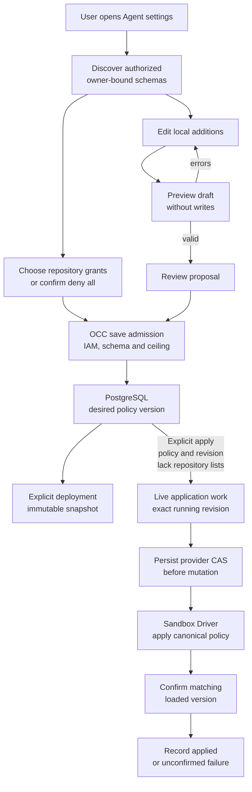

# Agent sandbox policy flow

## Overview

OCC saves desired network additions per Agent. Deployment freezes them. Operators review
denials and recommendations.

## Entry Points

- Trigger: [Repositories](../guides/topics/agent-sandbox-policy.md#repository-access), Policy denials or `occ agent policy`.
- Source: `apps/controller/src/http/sandbox-policy.ts:sandboxPolicyHandlers` and
  `packages/occ/src/sandbox-policy.ts:updateAgentSandboxPolicy` / `applyAgentSandboxPolicy`.
- Assumptions: ready Namespace, active Agent, exact grants, editing enabled for
  mutations, shared API/worker Installation ceiling.

## Flow

Arrows show implementation. Verify provider enforcement separately. OCC rejects apply for repository lists in
saved policy or active Agent revision, even `[]`.
Other admission checks apply.

## Execution Trace

### 1. Admit and persist desired additions

`apps/controller/src/index.ts` applies the [write budgets](../reference/api-explorer.md#write-request-limits)
and delegates pre-body authorization through `OpenClawController` to
`packages/occ/src/sandbox-policy.ts`. Save requires Agent `manage_policy` and
SandboxPolicy `update`; apply also requires policy `read`. Admission repeats checks.

`SandboxNetworkGrantsSchema` and the [SQL validator](../../migrations/0097_sandbox_policy_capacity.sql)
limit ceilings and additions to 16,384 grants. `createSandboxNetworkGrantChecker`
indexes transport coverage; restricted requests retain full matching. Cached union
intervals stay within the compiled ceiling count. See [limits](../reference/sandbox-policies.md).

`internal/occcli/agent_policy.go:agentPolicyCommand` reads JSON updates and outputs JSON
(default) or YAML, rejecting unsupported formats before requests.

`SetupDiscovery.discoverConfigurations` lists selected contributions. Installation
`administer` permits [startup inspection](driver-plugin-loading.md#4-load-current-policy-and-hand-off-lifecycle-ownership); Agent discovery requires Agent/policy
`read`. Submitted additions cannot select a Driver.

`validateAgentSandboxPolicy` checks Agent and policy authorization, editing, version,
pending work, grant schemas and Driver rules. `networkGrantAdmissionDetails` in
`packages/contracts/src/deployment-policy.ts` checks executables, hosts and ports against the
Installation ceiling and Sandbox wildcard and range support. Preview writes nothing; save and deploy repeat admission.

Validation names failed fields and checks. Stale or denied requests retain resource errors.
`internal/occclient/transport.go:APIError.Error` prints up to 32 escaped details without Unicode controls.

Model admission uses saved grants or derives exact first-deployment preset
requests when the Installation ceiling allows the stock executable. Revisions
store separate network and injection policies. [Source status](../reference/credential-sources.md#implementation-status)

`packages/occ/src/sandbox-policy.ts:updateAgentSandboxPolicy` requires Agent
`manage_policy` and SandboxPolicy `update` and locks Namespace and Agent.
Legacy protected execution rejects nonempty additions at save, deploy, and
live apply (`409 SANDBOX_POLICY_PROTECTED_EXECUTION`).
Managed credential revisions block live policy application. Protected dedicated Codex admits the Sandbox-approved
[artifact subset](../reference/drivers/openshell-sandbox.md#protected-codex-artifact-rules).
`checkedProtectedCodexArtifactPolicy` verifies its purpose, keys, Driver,
version and empty additions before credential provisioning. That snapshot
cannot be applied live. Unreadable scoped revisions report `protectedExecution: null`.

Both protected Codex compilers validate revision artifacts. `openshell-codex-artifacts.ts`
excludes ambient defaults. Sandbox checks Agent-owned workspace enrollment and returns
immutable `SandboxResourceRef.proxyWiring`. Proxy checks the map, auxiliary rule and loaded
policy. Binding, deploy and provisioning reject general network grants targeting
`github.com`, its subdomains or IP addresses when protected Git owns the route.

For Source-backed Git,
`packages/occ/src/agent-deployment-admission.ts:prepareGitHubRepository` refuses
a separately saved repository network policy before Source enrollment. OCC
derives the revision's grants from the saved GitHub App and repository access,
the registry and ceiling, and the Source's verified GitHub identities.
`openshell-repository-policy.ts` compiles those frozen grants into exact Git
service requests. These Git-only grants do not admit GitHub REST calls. A
credential-free metadata GET requires its own admitted network rule and returns
the upstream response without injection or filtering. [Native Git access levels](../reference/repository-credentials/access-levels.md#native-git-delivery)

`apps/controller/src/http/sandbox-policy.ts` audits the approved additions
and version in the save transaction. The only facet is `networking`.
`TEMPORARY_API_WILL_BREAK_IN_FUTURE_setAgentSandboxPolicyEditing` requires
Installation and Agent administration. New Agents start with editing disabled.

`packages/occ/src/state/postgres-state.ts` versions saves. A trigger creates
one policy per Agent. Constraints check revision and Agent ownership, document
shape, immutable application identity and version transitions. Both adapters prevent removal
of pending applications. The Worker records the expected provider version
and settles the application as `applied` or `failed`. Deleting the Agent
removes its policy and exact IAM access.

For the separate Sandbox policy list, omission preserves saved grants and an
explicit `[]` denies all. OCC checks SandboxPolicy `read` before looking up the
list for an empty PUT. PUT uses Read Committed to observe revocations during
IAM lock waits. Live application refuses explicit repository lists.

On the Source-backed path, an authorized operator edits Git access in the Agent
draft. Removing the selections requests withdrawal from the active revision
and leaves independently admitted model access in place. OCC and the Worker
reject earlier unscoped Git history through `supportsScopedRepositoryHistory`.
A supported standalone model-only history can add Git after Stop.
Deployment rechecks the scope and enforcing Driver identities before saving
the revision. Git uses a repository-scoped HTTPS credential helper with
OpenShell's placeholder.

### 2. Freeze deployment or enqueue live application

`packages/occ/src/sandbox-policy.ts:admitDeploymentSnapshot` freezes Driver
defaults and additions in `AgentRevision.sandboxPolicy`. The OpenShell Driver
provisions from that snapshot.

For a saved repository policy and a bound Channel Secret,
`packages/occ/src/deployment-channels.ts:startDeploymentValidation` checks
deployment admission before handing the Secret to the Channel provider.
The Channel handoff and final deployment admission start PostgreSQL transactions
at Read Committed. The policy preview reuses the Channel handoff transaction.
The IAM reads after the lock wait see permission changes committed by the
previous lock holder, even when the connection defaults to Repeatable Read.
A platform dependency failure returns a retryable `503 DEPENDENCY_UNAVAILABLE`
with bounded request diagnostics. An incompatible Compute topology or an
unscoped revision history returns `409 RESOURCE_CONFLICT` with recovery
instructions. Credential check failures use the Channel credential response.
Authorization denials still return `403 FORBIDDEN`.

`applyAgentSandboxPolicy` checks Agent `manage_policy` and SandboxPolicy
`update` and `read` before disclosing saved additions. It requires the exact
active revision and a supporting Driver. One transaction saves supplied
changes, records the pending application and queues work. Omitting additions
keeps the saved policy version. Provider readback confirms enforcement.
CLI `--file` sends checked JSON.

### 3. Reconcile provider effects

`apps/controller/src/worker/sandbox-policy.ts:reconcileSandboxPolicy` locks the
same lifecycle owners and rechecks current authority, ceiling, Driver identity,
and Compute placement. Shared definition and provider admission are rerun before
provider effects. One pass records the provider CAS version; a later pass
can mutate with that fixed version and operation ID. Provider reads and effects
are bounded by the claim lease. Database and audit failures roll back the pass.

`apps/controller/src/drivers/sandbox/openshell.ts` verifies exact provider
ownership, preserves the Sandbox's static policy and generated access, and uses
native status/UpdateConfig RPCs. A full candidate match plus loaded active version
is required for `applied`. If the current resource version already differs from the
pinned version and the policy does not match, the worker fails before it sends a write.
After a refused write, the worker reads the provider again and confirms its lease.
A matching policy still loading is deferred within the deadline, `applied` is recorded
only for a loaded active match, and a changed resource version with a nonmatch fails as
`SANDBOX_POLICY_PROVIDER_FAILED` (the pinned version cannot succeed). Worker shutdown during
that read rolls back so the next worker recovers the claim; other outcomes retry within limits;
exhausted abandoned claims become unconfirmed failures. The worker calls
`failAbandonedSandboxPolicies` inside the same `transactWithQueue` that recovers
exhausted work, so queue failure, application failure, and audit either all commit
or remain recoverable after interruption. A failed live request does
not deploy another revision. Last confirmed live evidence is retained separately.

### 4. Read contextual evidence

`openshell-log-decisions.ts:openShellLogDecision` decorates recognized provider
records. `packages/occ/src/runtime-logs/sandbox.ts` validates them;
`runtime-logs/sanitize.ts` redacts metadata and raw text through the existing
bounded log path. See [runtime logs](agent-runtime-logs.md).

`readAgentSandboxRecommendations` checks Agent/policy read authority and revision
ownership before audited, limited provider reads. Native suggestions are untrusted;
submission uses ordinary OCC admission.

`renderLogs` pages five denials with cross-page selection. Follow retains 1,000
records; Show newest accepts them and drops stale selections. Configuration fields
preserve Unicode drafts and safe diagnostics.

`stageGrants` deduplicates exact executable/host/port candidates and excludes
requests covered by saved or proposed grants. It preserves all additions and
opens the schema editor or batch preview. Missing metadata prevents prefilling.
Incomplete drafts block further staging. `ruleList` searches and pages explicit rules five at
a time; row controls edit or remove local additions.

`console/agents/sandbox-policy.mts:renderPolicy` shows policy status and three
expandable suggestions above the log, independent of mutation authority.
`openNetworkLimits` displays the ceiling read-only. Defaults and versions remain
on the main page. The Network policy card authorizes editing separately and
retains feedback, read errors and recovery with the dialog closed.
`renderEditor` keeps edits local. Review compares the validated draft with
saved additions. Save submits the full validated array and reviewed version.
Confirmation closes the dialog and clears the completed selection. Stale
responses cannot overwrite drafts. Writes invalidate earlier reads and pause
polling. A fresh read resumes polling for pending applications. Unreadable
previews and refusals preserve edits. The combined response must contain the
reviewed rules, next policy version and fresh pending application for the
selected running revision. A lost or mismatched response triggers a GET.
If it fails, **Refresh policy** remains available. Provider confirmation
settles pending status. **Save for later** only saves. **Apply saved rules**
targets the saved version and requires a clean draft. `loadPolicy(true)`
records inspection before retry through the apply descriptor. Refresh only
reads. Retry checks current permissions, lifecycle and draft.

`console/agents/sandbox-policy.mts:mutate` displays rejected saves as focused
alerts and scrolls the reason into view after rendering. Ceiling rejection
preserves the attempted additions for correction without changing saved state.
`console/navigation.mts:createNavigation` admits the `policy` tab in login
destinations, preserving an Agent's Policy denials link after sign-in.

The console reads the policy owner even without a discovery descriptor.
This reports unsupported capability or refusal before independently
authorized log and suggestion reads. `sandboxPolicyRead: false` skips policy
and suggestion reads and hides the suggestions card. The network policy card
shows the refusal. An unknown answer keeps the reads. Reopening the tab
refreshes permissions. A revision without `sandboxDriverId` skips log and
suggestion reads and reports no denials, as does
`RUNTIME_LOGS_SOURCE_UNAVAILABLE`. These states and drafts hide denial
counters, controls and empty rows.

## Debugging and Verification

- Inspect the desired policy and application with `occ agent policy get`.
  `pending` or `failed` never establishes a successful retry.
- Compare the application revision with the active Agent revision and inspect
  attributable audit evidence before retrying a stale or unconfirmed request.
- [PostgreSQL admission integration](../../tests/integration/postgres-agent-sandbox-policy.test.mjs)
  exercises HTTP/IAM/storage, application-role refusal of pending application
  removal, and worker settlement; the [OpenShell runtime lane](../../tests/helpers/openshell-sandbox-workflows.mjs)
  owns real enforcement proof. Storybook proves simulated presentation only.
- [Console batch browser tests](../../tests/browser/console-policy-denials.test.ts)
  cover selection across pages, stable Follow, deduplication, preservation of saved
  rules, and ceiling rejection through real controller routes. They use in-memory
  storage and test Drivers with simulated log input. A simulated failed-application
  view covers explicit inspection and retry against the real API refusal; neither
  case proves provider enforcement.

## Related docs

- [Policy reference](../reference/sandbox-policies.md)
- [Operator workflow](../guides/topics/agent-sandbox-policy.md)
- [OpenShell provisioning](openshell-sandbox-provisioning.md)
- [Implementation plan](../../specs/plans/0045-python-sandbox-policy-denials.md)

## Manual Notes

## Changelog

- 2026-11-23 22:32: Preserve capacity beside saved repository API limits. (01a1cb2b-f8fd-79b0-9789-7d0ca67c4ddd - c7519e99cacc4b50700808b15f5c4fa8a2619e09)

- 2026-11-23 22:01: Preserve capacity admission alongside Namespace-derived REST permissions. (01a1cb2b-f8fd-79b0-9789-7d0ca67c4ddd - 713ecb6effe69c9e254676e22aec6b00d1514794)

- 2026-11-23 18:37: Preserve capacity and pre-body authorization across policy extraction and repository constraints. (01a1cb2b-f8fd-79b0-9789-7d0ca67c4ddd - b3c6ef3d045f8812063ac0721b1d33afbd70a8c4)

Earlier entries are preserved in the [documentation history](agent-sandbox-policy/history.md).
