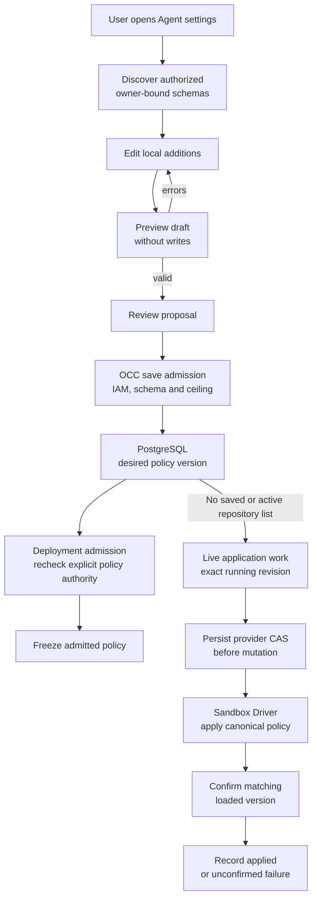

# Agent sandbox policy flow

## Overview

OCC saves Agent network additions and freezes them at deployment. A supporting
Sandbox Driver can apply later versions. Operators review denial logs and recommendations.

## Entry Points

- Trigger: the console Policy denials tab or `occ agent policy` commands.
- Source: `apps/controller/src/http/sandbox-policy.ts:sandboxPolicyHandlers` and
  `packages/occ/src/index.ts:updateAgentSandboxPolicy` / `applyAgentSandboxPolicy`.
- Assumptions: a ready Namespace, active Agent, exact grants, enabled editing for
  mutations, and an Installation ceiling shared by API and worker.

## Flow

Solid arrows trace source paths, not provider verification.

## Execution Trace

### 1. Admit and persist desired additions

The CLI accepts JSON and YAML. Policy GET and [Driver discovery](driver-plugin-loading.md#4-load-current-policy-and-hand-off-lifecycle-ownership)
share authorized facet URLs.

`validateAgentSandboxPolicy` previews edit authority, version, pending work,
schema and Driver admission. `networkGrantAdmissionDetails` checks the ceiling,
wildcards and ports. The CLI prints at most 32 escaped details without Unicode controls.

`validateDeploymentPolicy(policy, context)` checks source approval and proxy
requests. Static approvals match method, host, port and path. A null method
matches every method. The Sandbox checks HTTP and exact MCP paths. Providers
enforce OAuth scopes and discovery can be credentialless.

Startup validates the [repository ceiling](../reference/configuration.md).
GET requires Agent and SandboxPolicy read and returns saved grants and the
Namespace ceiling. `delegatedRepositoryCeiling` returns an empty ceiling if
Repo approval throws or changes ownership. The save hint checks exact grants.

PUT requires Agent `manage_policy` and SandboxPolicy `update`. OCC locks the
Namespace and Agent, checks editing, version and pending work, and rechecks
authority through commit. Omission preserves the list and excludes it from
the response.

A first list needs a grant. Nonempty lists require Configuration and Harness
credential source read. OCC checks the ceiling, Repo approval, Git access, and
Sandbox and Compute admission. Compute receives the authorized Configuration
and placement. OCC rechecks bound methods before saving. Send empty arrays with
SandboxPolicy read to withdraw a list. Protected execution refuses additions.

Protected dedicated Codex repository
admission can carry the Driver's acknowledged
[artifact subset](../reference/drivers/openshell-sandbox.md#protected-codex-artifact-rules).
`packages/occ/src/deployment-policy.ts:checkedProtectedCodexArtifactPolicy`
checks purpose, rule keys, Driver identity, version and empty additions at save
and deployment. Live application refuses that snapshot.

`openshell-codex-artifacts.ts` compiles the qualified artifact snapshot without
ambient defaults. The Sandbox checks workspace enrollment against the Agent's
setup binding before returning immutable `SandboxResourceRef.proxyWiring`. The
proxy verifies the loaded artifact map and bounded auxiliary rule.
Driver admission receives `repositoryCredentials` for repository bindings or a
Git-bound active revision. OpenShell's Git route refuses grants or defaults for
`github.com`, its subdomains or IP addresses with a `409` naming the conflict.
Adding bindings, deploying and provisioning enforce the same restriction.
Deploy and updates that retain bindings require SandboxPolicy read before naming
saved additions. HTTP audits approved additions and their version in the
transaction. The API supports the `networking` facet.
The temporary `TEMPORARY_API_WILL_BREAK_IN_FUTURE_setAgentSandboxPolicyEditing`
requires Installation and Agent administration until Guardrails takes ownership.
Agents start with editing disabled in both adapters.

`packages/occ/src/state/postgres-state.ts` updates policies by version. A trigger
creates one policy per Agent. Constraints enforce ownership, shape, immutable
application identity, version transitions and revision ownership. Both adapters
refuse to remove pending applications at any policy version. The worker records
the expected provider resource version and marks the application `applied` or
`failed`. Agent deletion removes the policy and its IAM access.

### 2. Freeze deployment or enqueue live application

`packages/occ/src/index.ts:prepareDeploymentChannels` requires SandboxPolicy
`read` and `update` and Agent `manage_policy` before Channel preparation for an
explicit list. After the backend read, OCC locks the Namespace to recheck
deployment authority, Secret `operate` and Secret metadata. It releases the
lock before delivering the value through the callback from the captured Channel
validator. OCC invokes that same validator with its Driver as the receiver.

`packages/occ/src/index.ts:admitAgentDeployment` rechecks before repair, grants
or runtime credentials. An existing first receipt returns before fresh
admission. Ordinary host additions still require SandboxPolicy `read`.
Protected execution refuses ordinary additions.

OCC checks the ceiling, Repo approval, and current protected Git access.
Compute checks placement and Sandbox validates the frozen revision.
OCC rechecks the selected methods before credentials or revision writes.

`KubernetesComputeDriver.snapshotRuntimeInputs` captures the image references,
Workspace node route, and Sandbox mode. The Worker independently revalidates
Compute and the selected Sandbox before protected reconciliation.
See [OpenShell workload placement](openshell-managed-workload.md).

PostgreSQL writes a reader version marker for all scoped revisions.
`packages/occ/src/state/postgres-state.ts:revisionFromRow` checks that marker
before handing off the revision. Before enabling scoped writes, drain Workers
that cannot enforce repository grants, reconcile their outstanding deployment
and maintenance claims, and verify enforcement in their replacements.

`apps/controller/src/worker.ts:ControllerWorker.authorizeRevision` rechecks the
deployment actor's policy grants. The successor's deployment claim owns
preparation, activation and predecessor retirement. `prepareRevision` checks
Compute support before the exclusive stop sweep. `stagedRevision` rechecks
support and renews the claim before activation.

`runtimeSuccessor` defers predecessor repair while a scoped replacement
is pending or a later scoped revision may still hold the Gateway.
A later queue entry or supersession record leaves that hold in place. The
Worker can complete an authorized Agent stop or activate a newer revision.
When an exclusive deployment fails before starting the predecessor stop, the
Worker can resume the serving revision's maintenance.
Git withdrawal and Agent stop use their own authority.

`applyAgentSandboxPolicy` checks Agent `manage_policy` and SandboxPolicy
`update` and `read`. Both request shapes refuse a saved or active repository
list. If only the active revision has a list, stop the Agent, confirm shutdown
and investigate the mismatch. For ordinary application, one transaction
checks the active revision and Driver, saves reviewed additions and queues work.
Omitted additions retain the saved version.

### 3. Reconcile provider effects

`apps/controller/src/worker/sandbox-policy.ts:reconcileSandboxPolicy` locks the same lifecycle
owners; rechecks current authority, ceiling, Driver identity and Compute placement;
reruns shared definition and provider admission. One pass pins provider CAS; later
mutation uses that version and operation ID. The claim lease bounds reads and
effects; database or audit failure rolls back.

`apps/controller/src/drivers/sandbox/openshell.ts` verifies exact provider ownership,
preserves static policy and generated access, and calls native status/UpdateConfig
RPCs. Changed resource version plus policy mismatch fails before writing. After
refusal the Worker rereads status and confirms its lease. A full active match
records `applied`. A loading match waits within the deadline. Mismatch at a
changed version fails with `SANDBOX_POLICY_PROVIDER_FAILED`. Shutdown during reread
rolls back for claim recovery; other outcomes retry within limits.

Recovering exhausted abandoned claims, the worker calls
`failAbandonedSandboxPolicies` inside `transactWithQueue`. Queue failure,
unconfirmed application failure and audit commit together or remain recoverable.
Failed live requests deploy no revision; OCC separately stores last confirmed live
evidence.

### 4. Read contextual evidence

`openshell-log-decisions.ts:openShellLogDecision` decorates recognized provider
records. `packages/occ/src/runtime-logs/sandbox.ts` validates them;
`runtime-logs/sanitize.ts` redacts metadata and raw text through the existing
bounded log path. See [runtime logs](agent-runtime-logs.md).

`readAgentSandboxRecommendations` independently checks exact Agent/policy read
and revision ownership before its audited, limited provider read. The OpenShell
Driver projects representable native chunks into untrusted suggestions. The
console editor submits canonical additions through the same mutation path;
native draft approval cannot bypass OCC admission.

`console/driver-configurations.mts:renderAgentDriverConfigurations` discovers
resource-owner controls. `console/configuration-fields.mts` retains the full
draft and shows schema diagnostics. JSON Schema counts Unicode code points and
owns length validation, so HTML attributes cannot truncate a valid draft.

`console/agents/sandbox-policy.mts:renderLogs` pages the current denials.
Selection spans pages. Follow retains new records separately until the user
selects **Show newest**. `stageGrants` deduplicates exact executable, host, and
port proposals against saved and staged grants. Missing metadata prevents
prefilling, and an incomplete draft must be corrected before staging more grants.

`renderPolicy` shows the saved policy, suggestions, and an independent read-only
view of the ceiling. The editor keeps changes locally until review. It sends the
complete validated list and reviewed policy version. Obsolete preview or read
responses cannot replace newer state. A confirmed save closes the editor and
clears selection. A refusal or unreadable preview retains the draft.

A combined save and apply must return the reviewed rules, the next policy
version, and a pending application for the selected revision. The write pauses
polling and invalidates older reads. When the response is lost or mismatched,
the Console reads the policy again. A failed read leaves **Refresh policy**
available. Provider application remains pending until confirmed.
**Save for later** only saves. **Apply saved rules** requires a clean draft.
After explicit inspection of a failure, **Retry application** invokes the apply
operation under the current permissions, lifecycle, and draft guards.

`console/agents/sandbox-policy.mts:mutate` displays rejected saves as focused
alerts and scrolls the reason into view after rendering. Ceiling rejection
preserves the attempted additions for correction without changing saved state.
`console/navigation.mts:createNavigation` admits the `policy` tab in login
destinations, preserving an Agent's Policy denials link after sign-in.

The Console reads the policy even when discovery returns no descriptor. Logs
and suggestions check their own permissions. A negative `sandboxPolicyRead`
answer skips policy and suggestion reads and reports the refusal on the policy
card. The Console refreshes a settled permission answer when the tab opens.
A draft, a revision without a Sandbox, or `RUNTIME_LOGS_SOURCE_UNAVAILABLE`
hides denial counts and controls.

## Debugging and Verification

- Inspect the desired policy and application with `occ agent policy get`.
  `pending` or `failed` never establishes a successful retry.
- Compare the application revision with the active Agent revision and inspect
  attributable audit evidence before retrying a stale or unconfirmed request.
- [PostgreSQL admission integration](../../tests/integration/postgres-agent-sandbox-policy.test.mjs)
  exercises HTTP/IAM/storage, application-role refusal of pending application
  removal, and worker settlement; the [OpenShell runtime lane](../../tests/helpers/openshell-sandbox-workflows.mjs)
  owns real enforcement proof. Storybook proves simulated presentation only.
- [Console batch browser tests](../../tests/browser/console-policy-denials.test.ts)
  cover selection across pages, stable Follow, deduplication, preservation of saved
  rules, and ceiling rejection through real controller routes. They use in-memory
  storage and test Drivers with simulated log input. A simulated failed-application
  view covers explicit inspection and retry against the real API refusal; neither
  case proves provider enforcement.

## Related docs

- [Policy reference](../reference/sandbox-policies.md)
- [Operator workflow](../guides/topics/agent-sandbox-policy.md)
- [OpenShell provisioning](openshell-sandbox-provisioning.md)
- [Implementation plan](../../specs/plans/0045-python-sandbox-policy-denials.md)

## Manual Notes

## Changelog

- 2026-11-20 10:24: Trace the authorized placement from policy save to protected revision deployment. (authoring-run/9f931987-3f00-44cc-b993-af4c9d4b4762 - 5913bf95871c38b4165d19dfd1034ae8b317c9b3)

- 2026-11-20 10:08: Trace explicit repository policy save and frozen revision admission. (authoring-run/4758cc5b-0069-4094-a947-c93410e5e46b - de6466ddf9605d648785288bed755038d99d24ed)

- 2026-11-20 08:14: Refuse deployment without returning private approval errors. (authoring-run/140d9cef-7de2-45f4-aa02-b53c18c4757e - 237d0fc8fe3e9b258e06fc84a68caeb3eb93ef33)

- 2026-11-20 08:04: Preserve repository grant withdrawal readback when checking Driver approval throws. (authoring-run/191b53ca-438b-4987-9206-b77590aa9c21 - 7933c6f2ebeb909bb949c45bceabe2ef0428fe5e)

- 2026-11-20 06:11: Trace scoped replacement ownership and held Gateway repair. (authoring-run/a2bef7a4-6af0-434c-9776-68935257de2b - df83476dc44e9deabdc3f34f7634a59621f4c90c)

- 2026-11-20 05:30: Trace the captured Channel validator and Worker repair and retirement holds. (authoring-run/f0454df4-01c9-49e5-babc-8bcc1156c2bd - df83476dc44e9deabdc3f34f7634a59621f4c90c)

- 2026-11-20 04:52: Trace synchronous ceiling approval, policy withdrawal and Worker drain. (authoring-run/4c8151f6-8b1e-4a9c-9cab-c76091f92ea4 - b8e2396539ed2e1f91b302371486ebf5938350a3)

- 2026-11-20 04:25: Trace repository approval, scoped revision storage and Worker supersession alongside provider fences. (authoring-run/23ddd614-d8ba-4db3-b0b5-dae0e6590095 - df83476dc44e9deabdc3f34f7634a59621f4c90c)

- 2026-11-20 04:23: Trace scoped revision refusal and Worker drain. (authoring-run/7263c830-6404-45c8-9dc5-a4c9304385df - f6f018182bc5b335701f7b2b5c1f6bfc3b31bf29)

- 2026-11-20 03:29: Preserve the stock provider fences alongside repository policy admission. (authoring-run/106fbccf-f304-4d4e-8013-a8ae076553ea - df83476dc44e9deabdc3f34f7634a59621f4c90c)

- 2026-11-20 03:25: Reconcile repository policy withdrawal and refusal with the stock policy flow. (authoring-run/8b055753-e2df-4179-960e-0154a3bc0f63 - b8e2396539ed2e1f91b302371486ebf5938350a3)

- 2026-11-20 03:05: Distinguish live-application refusals for saved and active-only repository lists. (authoring-run/c870c8bb-cf7e-4618-8f26-736ae6c6214d - d3f79c54ca30e3aff0aacacb36d93e347d5b1f11)

- 2026-11-20 02:32: Preserve withdrawal-only saves and the locked credential handoff for stored policies. (authoring-run/450206ea-89f0-44e6-b847-1532d4235f55 - d3f79c54ca30e3aff0aacacb36d93e347d5b1f11)

- 2026-11-20 02:20: Check repository policy authority before provisioning and at Channel credential handoff. (authoring-run/2639107f-8cb3-469d-bf37-22b4465676de - cfecf1c902552c2636f01e2669df168be5c2bcdb)

- 2026-11-20 01:35: Refuse unsupported repository policies at save and deploy, and allow authorized withdrawal of existing grants. (authoring-run/34ec168d-3a0c-43f9-bdd1-d0538ec03f14 - a0b789e53181ed65aa00c94f161301d80af0d711)

- 2026-11-19 23:00: Renew the work claim after validating repository policy and before Compute activation. (authoring-run/738fc0a1-e73c-4f82-98af-989a7c5273cc - 1cd1aae973ac4677d46ff8932436d50dc4dd3413)

- 2026-11-19 21:31: Recheck repository policy authority and Compute support at Worker dispatch. (authoring-run/d5be3dc4-113a-480c-8ea6-eabbac590e2e - 1cd1aae973ac4677d46ff8932436d50dc4dd3413)

- 2026-11-19 11:44: Check the approving Driver identities before deployment writes. (authoring-run/e9ff0fe7-18b6-41e2-a275-47d9cd003a54 - aa54b497c52d2c338e22142dfc06bed9f2870af4)

- 2026-11-19 10:41: Reconcile repository policy admission with source-bound credential acquisition. (authoring-run/a1d54016-87f5-4fbb-b7c2-43f2250e78a0 - 41bbfbee0cf3df3ed653389c70c86087e571f17b)

- 2026-11-19 09:03: Separate policy and validation context. (authoring-run/2ca60020-2ed8-48c5-943c-ba2890e5bb12 - 9dd2694f3cdbbed2c2e26222d503a2253af93ee9)

- 2026-11-19 07:54: Separate credential acquisition. (authoring-run/a7f97564-0c7b-4c61-b72f-0b866891ade8 - 1eb271262)

- 2026-11-19 05:16: Recheck edit authority and Compute compatibility before preparing runtime credentials for deployment. (authoring-run/38c216a8-92d9-43c3-8a5b-78b59abce9b4 - ca5be28e834019f067505fc23788560604633211)

- 2026-11-19 04:52: Join Namespace-scoped policy saves and reads to deployment and live-application admission. (authoring-run/0d379c0d-2a2a-474f-b271-f03647d508ca - 993169eb2861cf538f6bcd26f1ec2d5123503561)

- 2026-11-19 04:47: Limit repository grants to Namespace authority and refuse explicit repository policy saves under protected execution. (authoring-run/36174b4a-9481-45e4-b5e7-f332cc293107 - 6a8b92278837a776fe6479dbf0418790d44bb3ff)

- 2026-11-19 04:34: Describe deployment policy permissions and shorten the Console trace. (authoring-run/190c2a1d-2700-4872-bbce-76d9efd7ffff - cde278dc600afaeb932df55620fed149e2d47896)

- 2026-11-19 04:07: Trace repository grant readback, ceiling admission, and versioned saves through the Agent API. (authoring-run/16714b20-9501-44e3-8b3a-41b43ee3949f - ef779de40b885811dcc40e6eadaa8f185d4bb34d)

- 2026-11-19 03:54: Validate the repository policy document before copying it. (authoring-run/d7d4af8d-9bb4-4523-b8fe-bbd15bbc95c4 - 6abc9fbff60c1fc739b35a6fa55ca5774a547a53)

- 2026-11-19 03:49: Check saved repository policy at deployment and refuse live application. (authoring-run/db384c8e-1261-4598-92e7-3737756473eb - ef779de40b885811dcc40e6eadaa8f185d4bb34d)

- 2026-11-19 02:49: Refuse Driver-supplied repository access lists on ordinary deployment. (authoring-run/2cbf1f13-9f6c-407a-be4f-453fd3ed04f6 - 8b711ab7bef82b4db58547655aef785c8e74092b)

- 2026-11-18 21:48: Preserve source-approved HTTP methods. (01a1eb01-27e9-7d91-a1e5-c673380d2fc8 - 7ee6a09585aa160de6feab9c133bf5c090ff05f5)

- 2026-11-18 15:56: Trace HTTP unions and UTF-8 paths. (01a1eb01-27e9-7d91-a1e5-c673380d2fc8 - 2fcc0a88cc29bbdc5c3a744ebdd15c6d62ad8934)

- 2026-11-18 15:37: Clarify projection and request matching. (01a1eb01-27e9-7d91-a1e5-c673380d2fc8 - f099db22a50b4929601520d156b5b14d6bb63613)

- 2026-11-18 05:50: Trace per-binding static request admission. (01a1eb01-27e9-7d91-a1e5-c673380d2fc8 - 913c717d12f78645b5f8d47216aaddd2dfe90c0e)

- 2026-11-13: Trace the Console’s single save-and-apply request and its atomic admission for a running Agent.

- 2026-11-13 22:21: Reject policy saves that remove a pending application. (authoring-run/9f288473-f3c0-4816-b8a7-d2bc81b82c2c - cf0370780b4e885e35ee463033b6926e5d3109ef)

- 2026-10-29 18:30: An Agent update with repository bindings authorizes SandboxPolicy `read` before the overlap refusal that names a saved grant (finding 2881).

- 2026-10-29 12:37: Link Installation inspection to its startup projection owner. (01a1891d-5b6b-7071-b482-793a9dd01044 - 32b59e204e)

- 2026-10-29 12:00: Live application authorizes SandboxPolicy `read` before admitting the saved additions (finding 2874).

- 2026-10-26 10:49: Combine the accompanying policy UX controls with upstream permission hints, unavailable Sandbox log handling, and application failure explanations. (authoring-run/0f3c367f-75d3-40f0-bcfa-3b649b78721f - e89a4e37a0b3dff75739cf6988028f81cd96f5ac)

- 2026-10-25: Skip the policy and suggestion reads that the permission answer refuses. (finding 2454)

- 2026-10-25: Hide the empty denial rows and state a refused policy read once. (finding 2522)

- 2026-10-25: Hide the denial window's controls on the draft. (finding 2509)

- 2026-10-24 18:15: Preserve complete Unicode string drafts for owner validation and add a simulated policy Review/Save walkthrough. (authoring-run/b7994562-b460-4667-9017-4c62c3f56eb0 - 6857956afcfee0b88563ea882c95034b5780cbec)

- 2026-10-24 13:19: Refuse explicit unsupported CLI formats before policy requests. (authoring-run/3954aa04-12f8-4a8e-bb62-a4d9a8603edd - 1b59554add06e9f7be0b0a730202f558c939a661)

- 2026-10-23 16:20: Trace the accompanying compact policy controls, suggestion disclosure, independent ceiling dialog, contextual footer, and explicit retry after status inspection. (authoring-run/2d64e0f2-543e-4fee-bc9d-0ed8f2d48f5b - a8575405cf9fbd1779b2daa1fab96a88d584cc7c)

- 2026-10-23 14:55: Trace the accompanying move of the policy-editing control to the page, visible mutation feedback, and read recovery. (authoring-run/71e6c3c8-7b57-42ff-bc6c-37f2506f2da5 - a8575405cf9fbd1779b2daa1fab96a88d584cc7c)

- 2026-10-22 23:45: Preserve CLI output guidance alongside upstream grant admission rules after conflict resolution. (authoring-run/01a10a81-070c-7aa3-97d0-fbce8f285d4d - c574fc743b21599c51d3809365039010a7e077d2)

- 2026-10-22 16:59: Trace the accompanying console changes for paged denials, batch proposals, rule management, and review before saving. (authoring-run/cd2ce6a3-4507-46cc-b936-68c9862c794b - 0c73a86a6cdd92f0129c8e52e0f230517490bd46)

- 2026-10-22 13:40: Run the shared grant rules before a Driver contribution, at every admission (preview, save, apply, deploy) and the worker recheck; empty or reversed ranges never satisfy the ceiling. (bughunt-1022c)

- 2026-10-21 04:25: Declare structured policy CLI output before requests. (authoring-run/a66234ce-95fd-4d64-9fe8-3ce3d143e572 - e8185dac805b737363c7178d3068b310a53a7c24)

- 2026-10-20 03:48: Complete policy capability reads without discovery metadata and omit terminal controls from CLI diagnostics. (authoring-run/ee617f7c-b2e1-4dbb-ace9-7908ebc5cfd6 - df244b6bd678acad513a02b5eb5d69e13f2d68dc)

- 2026-10-20 01:48: Trace rejection causes, CLI details, and refresh sequencing. (authoring-run/9d1ff825-b9f4-492a-9420-1e316d820e28 - e7e5f3321cb0a8471d74964eba56ddd069a4e4c5)

- 2026-10-19 20:34: Trace shared definitions, contextual discovery, and preview admission in the accompanying implementation. (authoring-run/9b1f7ddf-52fe-46c8-9fa9-fa7a1acfa64a - 7fa0a561df615296a612126d430a4bbfa1124d9c)

- 2026-10-19 14:18: Align Agent creation and reload defaults for policy editing in both state adapters. (authoring-run/a9906404-d12d-4f05-ba24-16be225b527c - 7e677523ba1ad953707b14f6b6c2f041e5ccd6b7)

- 2026-10-19 09:23: Require a policy facet, mark temporary editing admission, and commit exhausted application recovery atomically. (authoring-run/545665b0-3aef-44dc-beb8-492b753b1a13 - bc3ba215dd9927692bc2882ffaf06a35c27fed4a)

- 2026-10-15 17:42: Distinguish local proposals, saved policy, and explicit live application in the console. (authoring-run/11c6d771-178c-4ac7-ae8b-310ebe644daa - a28596ab8)

- 2026-10-15 17:12: Bring rejected policy saves into view and preserve the attempted edit. (authoring-run/b37638d5-3a21-4fe8-99ab-3b9600cfe107 - a28596ab8)

- 2026-10-15 16:14: Trace governed Agent network additions and separate decision evidence. (authoring-run/43cb74b9-e1fe-4fc2-adde-9d932b061d7c - a28596ab8)
